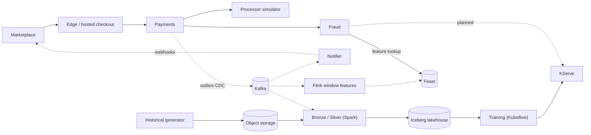

# Payment Gateway and Real-Time Fraud Detection

A payment gateway for a refurbished-electronics marketplace, with a real-time fraud decision on every payment attempt. Its events and a synthetic history feed a lakehouse, a feature store and a fraud model, and read-only analyst agents explain declines and risk decisions on top. Synthetic cards only. The [proposal](docs/overview/proposal.md) covers the domain, the data problems and the AI problem.

## Contents

- [System overview](#system-overview)
- [LLM and agent platform](#llm-and-agent-platform)
- [Documentation](#documentation)
  - [Overview](#overview)
  - [Payment gateway](#payment-gateway)
  - [Data](#data)
  - [ML](#ml)
  - [LLM](#llm)
  - [Deployment](#deployment)
- [Repository structure](#repository-structure)
- [Getting started](#getting-started)

## System overview



Two Talos Kubernetes clusters (Proxmox dev, AWS prod), deployed by Argo CD from release branches. Deployment view: [architecture](docs/overview/architecture.md).

## LLM and agent platform

A coordinator agent hands each analyst question to the evidence agent (knowledge base, cited passages) or the risk agent (online features, the fraud model's score, the knowledge base). Every model, tool and agent call passes agentgateway: client keys, rate and token limits, PII masking and a request screen by the d3-edge decision model. Models run on vLLM through KServe and llm-d on a shared GPU; Langfuse holds prompts, A/B tests and traces.


Diagram source: [`llm-architecture.excalidraw`](docs/llm/images/llm-architecture.excalidraw).

## Documentation

Pages live in [`docs/`](docs) and are published to the [project wiki](https://github.com/phuchoang2603/payment-gateway-fraud-detection/wiki).

### [Overview](docs/overview/proposal.md)

[Proposal](docs/overview/proposal.md) · [architecture](docs/overview/architecture.md) · [roadmap](docs/overview/roadmap.md)

### [Payment gateway](docs/payment-gateway/architecture.md)

[Architecture](docs/payment-gateway/architecture.md) · [flows](docs/payment-gateway/flows.md) · [conventions](docs/payment-gateway/conventions.md) · [Docker images](docs/payment-gateway/docker.md)

### [Data](docs/data/offline.md)

[Offline data](docs/data/offline.md) · [online data](docs/data/online.md) · [storage](docs/data/storage.md) · [orchestration and governance](docs/data/orchestration-governance.md)

### [ML](docs/ml/feature-store.md)

[Feature store](docs/ml/feature-store.md) · [training](docs/ml/training.md) · [serving](docs/ml/serving.md) · [background](docs/ml/background.md)

### [LLM](docs/llm/agents.md)

[Agents](docs/llm/agents.md) · [inference](docs/llm/inference.md) · [benchmark](docs/llm/benchmark.md) · [agent gateway](docs/llm/gateway.md) · [RAG](docs/llm/rag.md) · [observability](docs/llm/observability.md)

### [Deployment](docs/deployment/cd.md)

[CI](docs/deployment/ci.md) · [CD](docs/deployment/cd.md) · [infrastructure](docs/deployment/infra.md) · [security](docs/deployment/security.md) · [observability](docs/deployment/observability.md)

## Repository structure

```text
.
├── .github/                  # CI workflows, image build paths
├── contracts/
│   ├── payments/ fraud/ processor/ vault/   # Versioned protobuf service and event contracts
│   ├── features/             # Fraud feature definitions and conformance examples
│   ├── data-products/        # ODPS products and ODCS table contracts
│   └── synthetic/            # Shared synthetic identity vectors
├── docs/                     # Project documentation, published to the wiki
├── infra/
│   ├── argocd/               # App-of-apps, dev and prod roots
│   ├── charts/               # Application Helm charts
│   └── docker/               # Dockerfiles for every image
├── openspec/                 # Capability specifications and change plans
├── scripts/                  # CI checks, code generation, release planning
├── src/
│   ├── payment-gateway/      # Go services: edge, payments, fraud, notifier, vault and processor simulators, shared module
│   ├── llm/                  # RAG pipeline, knowledge API and MCP server, agent runtime
│   └── data-pipeline/
│       ├── simulator/        # Historical generator and live simulator
│       ├── streaming/        # Flink feature job
│       ├── feast/            # Feast writer and feature server
│       ├── features/         # Reference feature implementation
│       ├── batch/            # Bronze, Silver, maintenance and analytics Spark jobs
│       └── openmetadata/     # Metadata integrations, native checks and lineage publication
└── devenv.nix, devenv.yaml   # Development environment
```

## Getting started

Install Nix and devenv, then run `devenv shell`; details in [CONTRIBUTING.md](CONTRIBUTING.md).
