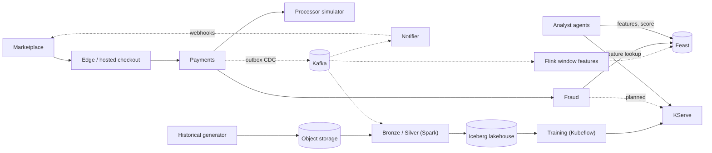

# Payment Gateway and Real-Time Fraud Detection

A payment gateway for a refurbished-electronics marketplace, with a real-time fraud decision on every payment attempt. Its events and a synthetic history feed a lakehouse, a feature store and a fraud model, and read-only analyst agents explain declines and risk decisions on top. Synthetic cards only. The [proposal](docs/overview/proposal.md) covers the domain, the data problems and the AI problem.

- [Overview](#overview)
- [Ecommerce payment gateway integration](#ecommerce-payment-gateway-integration)
- [Data pipeline and ML](#data-pipeline-and-ml)
- [LLM and agents](#llm-and-agents)
- [Deployment and security](#deployment-and-security)
- [Getting started](#getting-started)

## Overview

Docs: [architecture](docs/overview/architecture.md) · [proposal](docs/overview/proposal.md) · [roadmap](docs/overview/roadmap.md)

## Ecommerce payment gateway integration

The [refurbished marketplace](https://github.com/phuchoang2603/refurbished-marketplace) sends checkout snapshots; the gateway owns hosted checkout, payment attempts, fraud decisions, simulated processing and signed outcome webhooks.

_Diagram to come._

Docs: [architecture](docs/payment-gateway/architecture.md) · [flows](docs/payment-gateway/flows.md) · [conventions](docs/payment-gateway/conventions.md) · [Docker images](docs/payment-gateway/docker.md)

## Data pipeline and ML

Payment events and the synthetic history become Bronze and Silver Iceberg tables, streaming and daily features in Feast, and the training data for the fraud model served by KServe.

_Diagram to come._

Docs: [offline data](docs/data/offline.md) · [online data](docs/data/online.md) · [storage](docs/data/storage.md) · [orchestration and governance](docs/data/orchestration-governance.md) · [feature store](docs/ml/feature-store.md) · [training](docs/ml/training.md) · [serving](docs/ml/serving.md) · [background](docs/ml/background.md)

## LLM and agents

A coordinator agent hands each analyst question to the evidence agent (knowledge base, cited passages) or the risk agent (online features, the fraud model's score, the knowledge base). Every model, tool and agent call passes agentgateway: client keys, rate and token limits, PII masking and a request screen by the d3-edge decision model. Models run on vLLM through KServe and llm-d on a shared GPU; Langfuse holds prompts, A/B tests and traces.

Docs: [agents](docs/llm/agents.md) · [inference](docs/llm/inference.md) · [benchmark](docs/llm/benchmark.md) · [agent gateway](docs/llm/gateway.md) · [RAG](docs/llm/rag.md) · [observability](docs/llm/observability.md) · diagram source [`llm-architecture.excalidraw`](docs/llm/images/llm-architecture.excalidraw)

## Deployment and security

The platform (Talos clusters on Proxmox for dev and AWS for prod, Karpenter, object storage, Argo CD, Doppler secrets, the operators and the mesh) is owned by [talos-proxmox](https://github.com/phuchoang2603/talos-proxmox). This repository ships the application images, charts and Argo CD applications.

_Diagram to come._

Docs: [CI](docs/deployment/ci.md) · [CD](docs/deployment/cd.md) · [infrastructure](docs/deployment/infra.md) · [security](docs/deployment/security.md) · [observability](docs/deployment/observability.md)

## Getting started

Install Nix and devenv, then run `devenv shell`; details in [CONTRIBUTING.md](CONTRIBUTING.md). Documentation lives in [`docs/`](docs) and is published to the [project wiki](https://github.com/phuchoang2603/payment-gateway-fraud-detection/wiki).
