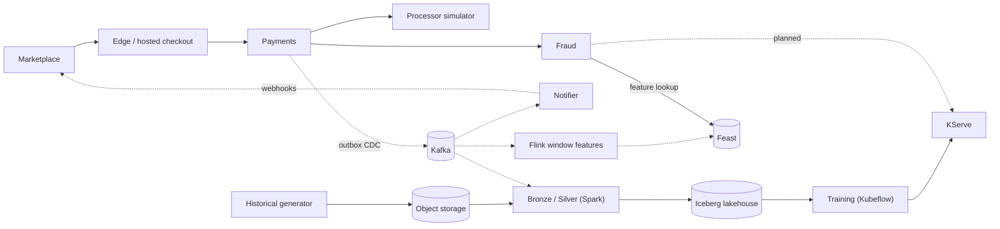

# Payment Gateway and Real-Time Fraud Detection

An ecommerce payment gateway with real-time fraud decisioning. A refurbished-electronics marketplace sends checkout snapshots; the gateway owns hosted checkout, payment attempts, risk decisions, simulated processing and signed outcome webhooks, using synthetic cards only. Its payment events, together with a reproducible synthetic history, feed a lakehouse, a feature store and a fraud model that predicts, at decision time, whether an attempt is fraudulent. The domain, data problems and AI problem are in the [proposal](docs/overview/proposal.md).

## Table of contents

- [System overview](#system-overview)
- [LLM and agent platform](#llm-and-agent-platform)
- [Repository structure](#repository-structure)
- [Documentation](#documentation)
- [Getting started](#getting-started)

## System overview



Everything runs on two Talos Kubernetes clusters (Proxmox dev, AWS prod), deployed by Argo CD from release branches. The full deployment view is in [architecture](docs/overview/architecture.md).

## LLM and agent platform

Read-only analyst agents explain declines, risk decisions and payment behaviour. A coordinator hands each question to the evidence agent (knowledge base, cited passages) or the risk agent (online features, the fraud model's score and the knowledge base). Every model, tool and agent call goes through agentgateway, which adds client keys, rate and token limits, PII masking and a request screen by the d3-edge decision model. The models run on vLLM through KServe and llm-d on one shared GPU, and Langfuse holds the agents' prompts, A/B tests and traces.


The diagram's source is [`llm-architecture.excalidraw`](docs/llm/images/llm-architecture.excalidraw); the pages under [docs/llm](docs/llm) cover each part.

## Repository structure

```text
.
├── .github/                  # CI workflows, image build paths
├── contracts/
│   ├── payments/ fraud/ processor/ vault/   # Versioned protobuf service and event contracts
│   ├── features/             # Fraud feature definitions and conformance examples
│   ├── data-products/        # ODPS products and ODCS table contracts
│   └── synthetic/            # Shared synthetic identity vectors
├── docs/                     # Project documentation, published to the wiki
├── infra/
│   ├── argocd/               # App-of-apps, dev and prod roots
│   ├── charts/               # Application Helm charts
│   └── docker/               # Dockerfiles for every image
├── openspec/                 # Capability specifications and change plans
├── scripts/                  # CI checks, code generation, release planning
├── src/
│   ├── payment-gateway/      # Go services: edge, payments, fraud, notifier, vault and processor simulators, shared module
│   ├── llm/                  # RAG pipeline, knowledge API and MCP server, agent runtime
│   └── data-pipeline/
│       ├── simulator/        # Historical generator and live simulator
│       ├── streaming/        # Flink feature job
│       ├── feast/            # Feast writer and feature server
│       ├── features/         # Reference feature implementation
│       ├── batch/            # Bronze, Silver, maintenance and analytics Spark jobs
│       └── openmetadata/ # Metadata integrations, native checks and lineage publication
└── devenv.nix, devenv.yaml   # Development environment
```

## Documentation

All documentation lives in [`docs/`](docs/Home.md) and is published to the [project wiki](https://github.com/phuchoang2603/payment-gateway-fraud-detection/wiki).

| Section | Pages |
|---|---|
| Overview | [Proposal](docs/overview/proposal.md), [architecture](docs/overview/architecture.md), [roadmap](docs/overview/roadmap.md) |
| Payment gateway | [Architecture](docs/payment-gateway/architecture.md), [flows](docs/payment-gateway/flows.md), [conventions](docs/payment-gateway/conventions.md), [Docker images](docs/payment-gateway/docker.md) |
| Data | [Offline data](docs/data/offline.md), [online data](docs/data/online.md), [storage](docs/data/storage.md), [orchestration and governance](docs/data/orchestration-governance.md) |
| ML | [Feature store](docs/ml/feature-store.md), [training](docs/ml/training.md), [serving](docs/ml/serving.md), [background](docs/ml/background.md) |
| LLM | [Agents](docs/llm/agents.md) |
| Deployment | [CI](docs/deployment/ci.md), [CD](docs/deployment/cd.md), [infrastructure](docs/deployment/infra.md), [security](docs/deployment/security.md), [observability](docs/deployment/observability.md) |

## Getting started

See [CONTRIBUTING.md](CONTRIBUTING.md): install Nix and devenv, then run `devenv shell`.
