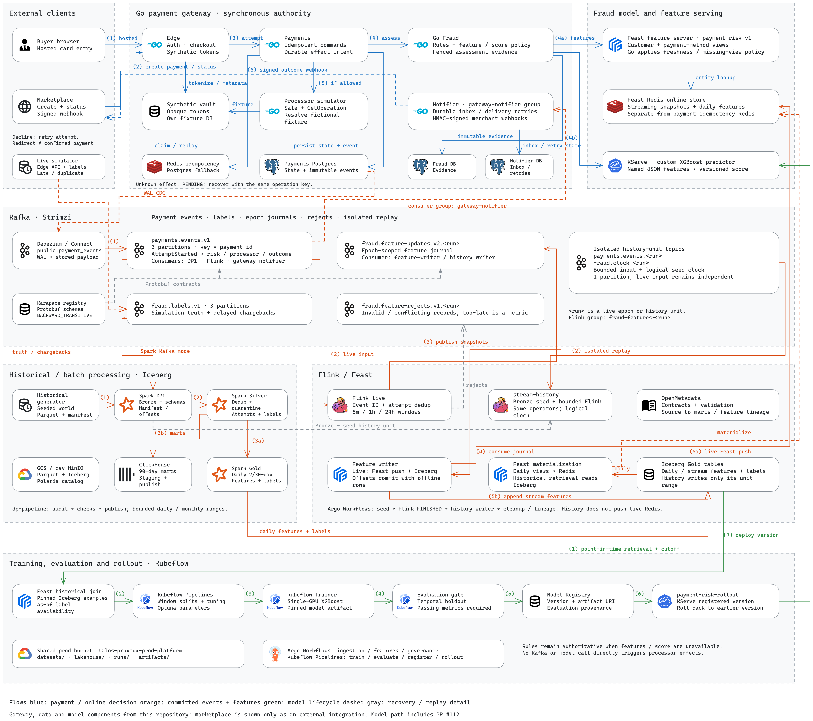
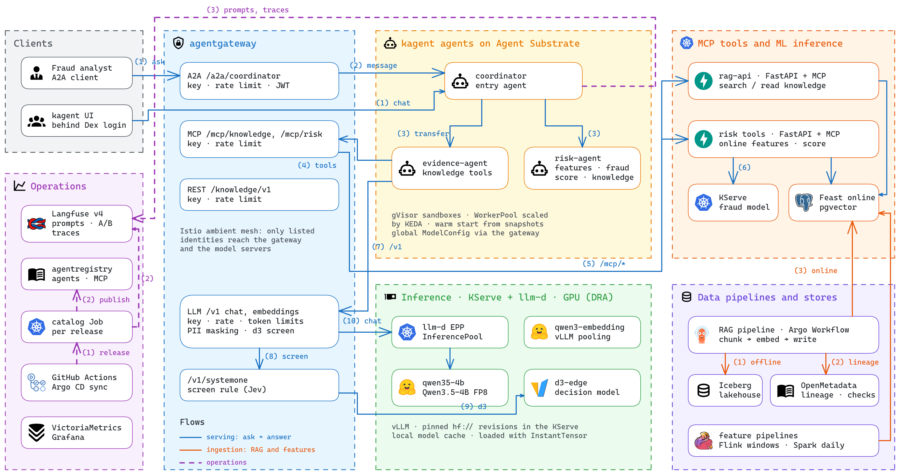
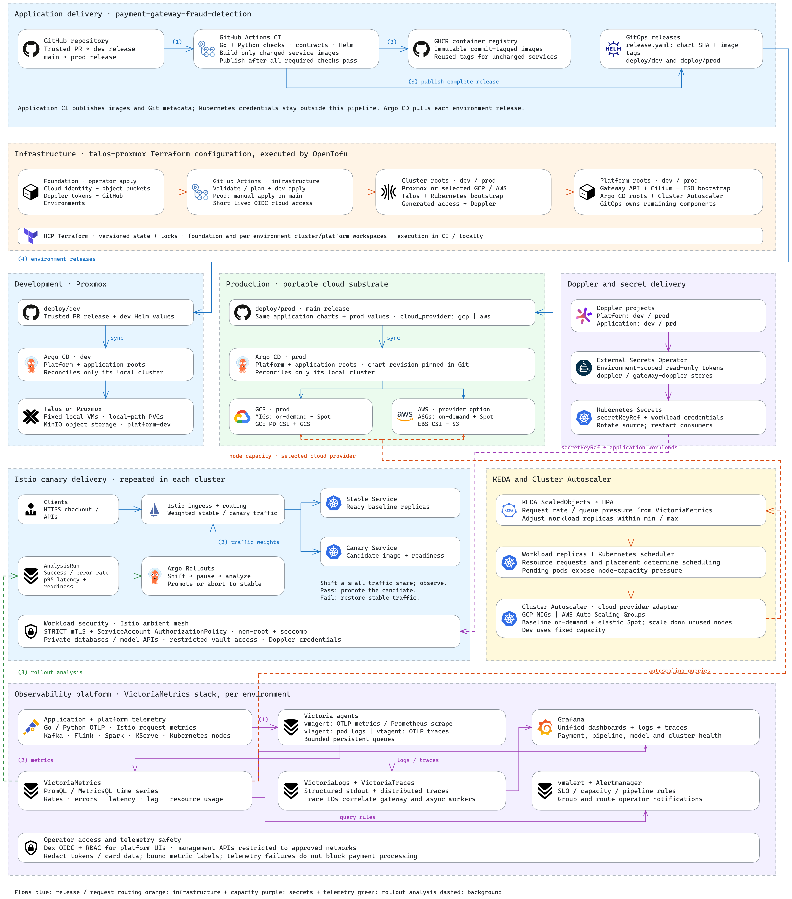

# Payment Gateway and Real-Time Fraud Detection

A payment gateway for a refurbished-electronics marketplace, built to connect reliable checkout with real-time fraud decisions and explainable investigations. Payment events feed streaming and historical data pipelines for model training, scoring and analyst agents, using synthetic cards and fraud labels. See the [project wiki](https://github.com/phuchoang2603/payment-gateway-fraud-detection/wiki) for the architecture and implementation.

## Payment gateway, data pipeline and ML

- **Gateway:** Go services, Postgres, Kafka CDC, idempotent payment attempts, timeout recovery and signed webhooks. Integrates with the [marketplace](https://github.com/phuchoang2603/refurbished-marketplace). [Architecture](https://github.com/phuchoang2603/payment-gateway-fraud-detection/wiki/architecture).
- **Lakehouse:** Spark Bronze → Silver → Gold, audited publication and OpenMetadata lineage. **133.5 GB** synthetic v19 source dataset (AWS run). [Offline data](https://github.com/phuchoang2603/payment-gateway-fraud-detection/wiki/offline).
- **Warehouse:** ClickHouse marts and skip indexes. Same-query GCP plan: **5,541 → 156 granules, 97.18% fewer**, with query-condition cache disabled. [Storage](https://github.com/phuchoang2603/payment-gateway-fraud-detection/wiki/storage).
- **Streaming:** shared Java Flink operators for live traffic and historical replay; Feast/Redis for online features. Parity tests compare **2,498 snapshots from 503 deliveries**. [Replay](https://github.com/phuchoang2603/payment-gateway-fraud-detection/wiki/online#historical-replay) · [Feature store](https://github.com/phuchoang2603/payment-gateway-fraud-detection/wiki/feature-store).
- **ML:** Kubeflow/Katib, GPU XGBoost, Triton and drift-triggered retraining. Dev synthetic test set: **PR-AUC 0.9370**, **91.1% recall at 1% FPR**. [Training](https://github.com/phuchoang2603/payment-gateway-fraud-detection/wiki/training) · [Pipeline](https://github.com/phuchoang2603/payment-gateway-fraud-detection/wiki/pipeline).

## LLM and agents

- **Agents:** coordinator, evidence and risk agents; read-only tools, cited knowledge retrieval and Langfuse prompts/traces. [Agents](https://github.com/phuchoang2603/payment-gateway-fraud-detection/wiki/agents).
- **Model access:** agentgateway API keys, rate limits, PII masking and request screening; vLLM/KServe inference. [Gateway](https://github.com/phuchoang2603/payment-gateway-fraud-detection/wiki/gateway) · [Inference](https://github.com/phuchoang2603/payment-gateway-fraud-detection/wiki/inference).
- **Knowledge API:** dev load test, 60 users over 5 minutes: **140.31 requests/s**, **p95 310 ms**, **0 failures across 41,945 requests**. [RAG](https://github.com/phuchoang2603/payment-gateway-fraud-detection/wiki/rag).

## Deployment and security

- **Platform:** Talos on Proxmox (dev) and GCP (prod), OpenTofu, Argo CD and shared operators, owned by [talos-proxmox](https://github.com/phuchoang2603/talos-proxmox).
- **Delivery:** GitHub Actions → GHCR → Argo CD; Istio checkout canary stages at **10%, 25%, 50%**. [CI](https://github.com/phuchoang2603/payment-gateway-fraud-detection/wiki/ci) · [Delivery](https://github.com/phuchoang2603/payment-gateway-fraud-detection/wiki/cd).
- **Access:** Cloudflare Tunnel/HTTPS, Istio ambient mTLS, service-account policies and Doppler/External Secrets. [Networking](https://github.com/phuchoang2603/payment-gateway-fraud-detection/wiki/networking) · [Security](https://github.com/phuchoang2603/payment-gateway-fraud-detection/wiki/security).

## Repository structure

| Path | Contents |
|---|---|
| `src/payment-gateway/` | Go payment services and synthetic vault/processor |
| `src/data-pipeline/` | Java Flink, Python simulators, Spark, Feast and catalog jobs |
| `src/ml/` | Training, evaluation, registry, serving and drift |
| `src/llm/` | Agents, RAG pipeline and knowledge API/MCP tools |
| `contracts/` | Protobuf, data-product contracts and feature definitions |
| `infra/` | Application Dockerfiles, Helm charts and Argo CD releases |
| `openspec/` | Specifications and changes |
| `docs/` | Project wiki sources |
| `scripts/` | CI, generation, releases and wiki publication |

## Getting started

- Install Nix and devenv; run `devenv shell`.
- See [CONTRIBUTING.md](CONTRIBUTING.md) for setup and local checks.
