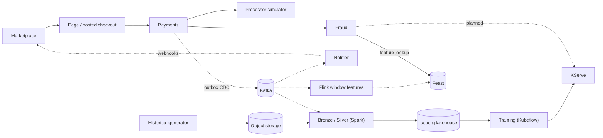

# Payment Gateway and Real-Time Fraud Detection

An ecommerce payment gateway with real-time fraud decisioning. A refurbished-electronics marketplace sends checkout snapshots; the gateway owns hosted checkout, payment attempts, risk decisions, simulated processing and signed outcome webhooks, using synthetic cards only. Its payment events, together with a reproducible synthetic history, feed a lakehouse, a feature store and a fraud model that predicts, at decision time, whether an attempt is fraudulent. The domain, data problems and AI problem are in the [proposal](docs/overview/proposal.md).

## Table of contents

- [System overview](#system-overview)
- [Repository structure](#repository-structure)
- [Documentation](#documentation)
- [Getting started](#getting-started)

## System overview



Everything runs on two Talos Kubernetes clusters (Proxmox dev, AWS prod), deployed by Argo CD from release branches. The full deployment view is in [architecture](docs/overview/architecture.md).

## Repository structure

```text
.
├── .github/                  # CI workflows, image build paths
├── contracts/
│   ├── payments/ fraud/ processor/ vault/   # Versioned protobuf service and event contracts
│   ├── features/             # Fraud feature definitions and conformance examples
│   ├── data-products/        # ODPS products and ODCS table contracts
│   └── synthetic/            # Shared synthetic identity vectors
├── docs/                     # Project documentation, published to the wiki
├── infra/
│   ├── argocd/               # App-of-apps, dev and prod roots
│   ├── charts/               # Application Helm charts
│   └── docker/               # Dockerfiles for every image
├── openspec/                 # Capability specifications and change plans
├── scripts/                  # CI checks, code generation, release planning
├── src/
│   ├── payment-gateway/      # Go services: edge, payments, fraud, notifier, vault and processor simulators, shared module
│   └── data-pipeline/
│       ├── simulator/        # Historical generator and live simulator
│       ├── streaming/        # Flink feature job
│       ├── feast/            # Feast writer and feature server
│       ├── features/         # Reference feature implementation
│       └── batch/            # Bronze and Silver Spark jobs, contract checks and metadata integrations
└── devenv.nix, devenv.yaml   # Development environment
```

## Documentation

All documentation lives in [`docs/`](docs/Home.md) and is published to the [project wiki](https://github.com/phuchoang2603/payment-gateway-fraud-detection/wiki).

| Section | Pages |
|---|---|
| Overview | [Proposal](docs/overview/proposal.md), [architecture](docs/overview/architecture.md), [roadmap](docs/overview/roadmap.md) |
| Payment gateway | [Architecture](docs/payment-gateway/architecture.md), [flows](docs/payment-gateway/flows.md), [conventions](docs/payment-gateway/conventions.md), [Docker images](docs/payment-gateway/docker.md) |
| Data | [Offline data](docs/data/offline.md), [online data](docs/data/online.md), [storage](docs/data/storage.md), [orchestration and governance](docs/data/orchestration-governance.md) |
| ML | [Feature store](docs/ml/feature-store.md), [training](docs/ml/training.md), [serving](docs/ml/serving.md), [background](docs/ml/background.md) |
| LLM | [Agents](docs/llm/agents.md) |
| Deployment | [CI](docs/deployment/ci.md), [CD](docs/deployment/cd.md), [infrastructure](docs/deployment/infra.md), [security](docs/deployment/security.md), [observability](docs/deployment/observability.md) |

## Getting started

See [CONTRIBUTING.md](CONTRIBUTING.md): install Nix and devenv, then run `devenv shell`.
