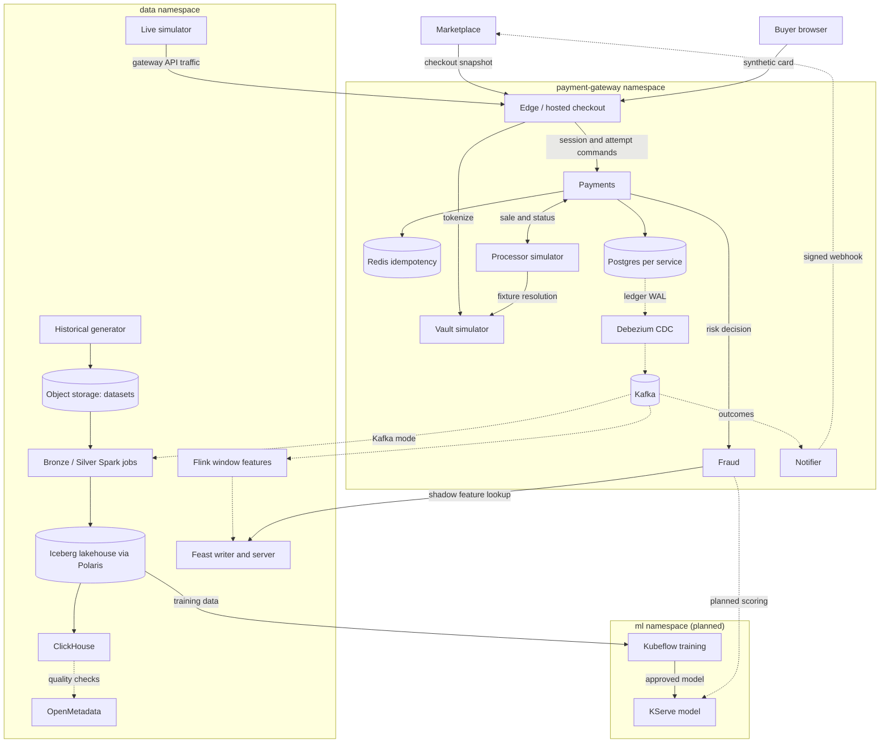

# Payment Gateway and Real-Time Fraud Detection

An ecommerce payment gateway with real-time fraud decisioning. A refurbished-electronics marketplace sends checkout snapshots to the gateway; the gateway owns hosted checkout, payment attempts, risk decisions, simulated processing and signed outcome webhooks, and the marketplace keeps buyers, sellers, orders and inventory. All card data is synthetic: an isolated vault simulator issues opaque tokens for allow-listed fictional cards.

The system has three layers on one shared Kubernetes platform: the payment gateway that produces authoritative payment events, a data platform that turns them and a reproducible synthetic history into curated tables and features, and an ML platform that trains and serves the fraud model. An LLM agent layer reads from both. The shared platform (Talos clusters, Argo CD, operators, the ClickHouse operator, OpenMetadata, Kubeflow, observability) is owned by [talos-proxmox](https://github.com/phuchoang2603/talos-proxmox/tree/main/docs/architecture); this repository owns the application workloads, their charts (including the Polaris catalog), contracts and pipelines. See [infrastructure](deployment/infra.md).

## Domain

### Data

- **Payment events:** one lifecycle event per payment change, from the Payments ledger through outbox CDC (online) or the historical generator (offline). Contract: [payment events](data/products/historical-payments/payment-events.md); wire format: [`contracts/payments/v1`](../contracts/payments/v1).
- **Fraud labels:** simulation truth and chargebacks per attempt, available later than the attempt. Contract: [fraud labels](data/products/historical-payments/fraud-labels.md).
- **Attempt context:** customer, merchant, order, device, network and payment-method fingerprints carried on each attempt, curated into Silver attempts ([offline data](data/offline.md)).

### Data problems

| Problem | In this domain | Where |
|---|---|---|
| Skew | A hot marketplace merchant receives half of all purchases (`hot_merchant_share: 0.5`), on top of Zipf merchant and category popularity | [Offline data](data/offline.md) |
| Schema evolution | The fraud service starts recording `assessment_id` and `evidence_sha256` on risk decisions: events move from `schema_version` 2 to 3 on a configured date, and version-2 Parquet files physically lack those columns | [Offline data](data/offline.md) |
| Offline duplicates | About 2% of events are republished by the export with the same `event_id` and content but a later `recorded_at` | [Offline data](data/offline.md) |
| High cardinality | About 3 million customers, 3.9 million payment methods and 4.2 million devices in the full-scale source | [Offline data](data/offline.md) |
| Late arrivals | Store-and-forward clients submit attempts minutes after the client `attempted_at` | [Online data](data/online.md) |
| Streaming duplicates | Kafka redelivery and at-least-once CDC deliver the same event more than once | [Online data](data/online.md) |
| Delayed labels | Chargebacks arrive 7–21 days after a successful fraudulent attempt; absent chargebacks are unknown, not negative | [Offline data](data/offline.md) |

### AI problem

**ML:** predict, at decision time, whether a payment attempt is fraudulent. One training row is one attempt with features computed strictly before its attempt time: request features (amount, account age, IP and shipping country mismatch) and history features per customer and per payment method (attempt counts over 5 minutes, 1 hour and 24 hours, distinct devices over 24 hours; 7- and 30-day windows from the offline store). The target is simulation truth, evaluated against chargebacks available before the training cutoff. See [feature store](ml/feature-store.md) and [training](ml/training.md).

**LLM/agent:** a read-only fraud investigation agent that answers analyst questions about a payment by retrieving recorded events, labels, features and model scores, and calling the fraud model as a tool. It never sits in the payment decision path. See [agents](llm/agents.md).

## Architecture

### Deployable units

| Unit | Role | Owned state | Status |
|---|---|---|---|
| Edge / hosted checkout | Go; integration authentication, merchant API, browser checkout | Bounded checkout access | Deployed |
| Vault simulator | Go; synthetic tokenization, processor-only fixture resolution | Token mappings, encrypted fixtures | Deployed |
| Payments | Go; sessions, attempts, versioned commands, recovery | Versioned rows, append-only ledger, idempotency, effect intents | Deployed |
| Processor simulator | Go; simulated sales with configurable latency and lost responses | Operation results | Deployed |
| Notifier | Go; signed, deduplicated webhooks with retries | Inbox, deliveries, retry state | Deployed |
| Fraud | Go; validates inputs, applies the rules policy, retrieves features in shadow mode | Policy and decision metadata, assessments | Deployed |
| Kafka, Debezium, Karapace | Outbox CDC, internal event transport, schema registry | Topics, registered schemas | Deployed |
| Historical generator | Python; per-day synthetic history to object storage | Immutable datasets v18 (dev), v19 (prod) | Deployed |
| Live simulator | Python; current-time gateway traffic and labels | None | Deployed, disabled |
| Data pipelines (DP1, `dp-pipeline`) | Spark on the Spark Operator: Bronze, then Silver, Gold features and ClickHouse marts; checks and lineage in OpenMetadata | Iceberg tables, ClickHouse marts, run reports | Running on prod (v19 backfill) |
| Flink streaming features, Feast writer and server | Python; window features to Redis and `gold.feat_stream_*`, stream history replay, materialization | Checkpoints, Feast Redis, stream tables | Deployed in dev (shadow); enabled in prod |
| Training, KServe, drift | Kubeflow, KServe | Models | Planned |
| LLM and agent platform | vLLM on KServe, agentgateway, kagent agents on Agent Substrate, RAG pipeline and knowledge API ([LLM agents](llm/agents.md)) | Feast pgvector and Iceberg knowledge chunks, Langfuse | Deployed in dev; further agents planned |

### Deployment view

Solid arrows are synchronous calls or storage writes; dotted arrows are asynchronous events.

Only Edge `/checkout/*` is publicly routed. Internal APIs are ClusterIP-only behind the Istio ambient mesh with service-account authorization; see [security](deployment/security.md). The marketplace context is in the [marketplace gateway note](https://github.com/phuchoang2603/refurbished-marketplace/blob/main/docs/ecommerce-fraud-gateway.md).

## Roadmap

Status of each capability, grouped like the course rubric. **Done** means implemented and exercised with recorded results on the linked page; **in progress** means implementation is under review; **planned** means designed but not built. Course tools are replaced by platform equivalents where noted (Argo Workflows for Airflow, OpenMetadata for DataHub, Kubeflow Model Registry for MLflow, GitHub Actions for Jenkins).

Open work is planned in [OpenSpec changes](../openspec/changes); finished changes are archived there.

### Data platform

| Area | Capability | Page | Status |
|---|---|---|---|
| Engineering fundamentals | Multi-stage Docker images and size comparison | [Docker images](payment-gateway/docker.md) | Images done; size comparison planned |
| Offline generator | Skew, schema evolution, duplicates; ≥ 100 GB stored for Bronze ingestion | [Offline data](data/offline.md) | Done (v19: 133.5 GB) |
| Online generator | Late arrivals and streaming duplicates | [Online data](data/online.md) | Done; see [evidence](data/online.md#evidence) |
| Spark jobs | Baseline, skew, schema evolution, duplicates, integrated into pipelines | [Offline data](data/offline.md) | Running on prod v19; optimizations recorded from the backfill |
| Flink jobs | Baseline, late arrivals, duplicates, windows, dead-letter topic; output ends at the feature journal topic | [Online data](data/online.md) | Done except a Flink UI metrics-panel capture; see [evidence](data/online.md#evidence) |
| Storage | Lakehouse compaction, partitioning, Z-order; ClickHouse warehouse indexing (`ORDER BY`, skip indexes) | [Storage](data/storage.md) | Partitioning, write order and mart codecs done on v19; compaction, Z-order and mart `EXPLAIN` evidence after the backfill |
| Orchestration | DP1 (raw → Bronze), then `dp-pipeline`: Silver, then Gold and the marts side by side, each layer with ingest, validate and publish stages; unchanged stages skipped | [Orchestration and governance](data/orchestration-governance.md) | DP1 done; backfill through 2026-08-31 done, September–October running |
| Incremental curation | Silver and Gold take a day range and overwrite only those days, so the daily run and a backfill are the same job; CI checks daily runs against one backfill for both | [Offline data](data/offline.md) | Done; prod backfill month by month |
| Governance | Lineage and validation for DP1–DP3 in the catalog | [Orchestration and governance](data/orchestration-governance.md) | Done: source-to-marts lineage, 58 passing tests |
| Schemas | SCD2 dimensions, `feat_` tables with `event_timestamp`/`created`, naming conventions, relationships | [Offline data](data/offline.md) | Done |

### ML platform

| Area | Capability | Page | Status |
|---|---|---|---|
| Feature store | Streaming features to online and offline stores, incremental materialization, TTL | [Feature store](ml/feature-store.md) | In progress: implemented, prod runs pending |
| Generator | Data drift and a label table joinable with features | [Offline data](data/offline.md) | Labels done; drift planned |
| Model | Notebook baseline from the offline store, training pipeline, distributed training | [Training](ml/training.md) | Planned |
| Versioning | Model registry and incremental data versions | [Training](ml/training.md) | Planned |
| Serving | Feature-retrieval API, KServe inference, rolling update, autoscaling, A/B traffic split | [Serving](ml/serving.md) | Planned |
| Drift | Periodic drift comparison and retraining trigger | [Training](ml/training.md) | Planned |

### LLM and agent platform

| Area | Capability | Page | Status |
|---|---|---|---|
| Inference | Qwen3.5-4B (FP8) chat, Qwen3-Embedding and the d3-edge decision model on vLLM through KServe, one shared GPU | [Inference](llm/inference.md) | Done on dev; [benchmark](llm/benchmark.md) with FP8 KV cache kept |
| Agent gateway | One gateway for models, MCP tools and REST APIs: per-client keys, rate and token limits, PII masking, mesh-only access | [Agent gateway](llm/gateway.md) | Done on dev |
| Agents | Global model config; the `coordinator` entry agent behind the A2A gateway with `evidence-agent` (knowledge tools) and `risk-agent` as sub-agents; sandboxed on Agent Substrate with warm start and KEDA-scaled workers; registry | [Agents](llm/agents.md) | Done on dev; the risk agent's scoring tool planned |
| Retrieval | RAG pipeline into Iceberg and a Feast pgvector store, governed in OpenMetadata; Web API by id and MCP tools, autoscaled by KEDA | [RAG](llm/rag.md) | Done on dev |
| Prompt management | Prompts managed and versioned in Langfuse (seeded from Git); agents read them at each model call | [Observability](llm/observability.md#prompts) | Done on dev |
| A/B tests | Prompt A/B tests per agent in Langfuse, compared per version; LLM-version tests on prod | [Observability](llm/observability.md#ab-tests) | Prompt tests done on dev; LLM versions planned for prod |
| Agent tracing | Agent traces from kagent to Langfuse, linked to prompt versions; LLM, gateway and API metrics in VictoriaMetrics with a Grafana dashboard | [Observability](llm/observability.md) | Done on dev |
| Decision model | Self-hosted d3-edge on vLLM on the shared GPU screening requests at the gateway | [Agent gateway](llm/gateway.md#security-and-policy) | Done on dev |
| GPU scheduling | Kueue queueing for GPU training and serving workloads | [Agents](llm/agents.md) | Planned |
| Model loading | Pinned revisions in the KServe local model cache, loaded with InstantTensor | [Inference](llm/inference.md) | Done on dev |

### Delivery and operations

| Area | Capability | Page | Status |
|---|---|---|---|
| Verification | Coverage, equivalence partitioning and boundary values, mutation testing (> 80% on changed code), property-based tests, load tests | [CI](deployment/ci.md) | Partial |
| CI/CD | Test, build and deploy for services and pipelines | [CI](deployment/ci.md), [CD](deployment/cd.md) | Done |
| Routing | Gateway in front of services, HTTPS | [Security](deployment/security.md) | Done for Edge |
| Infrastructure as code | Cluster and cloud provisioning, configuration | [Infrastructure](deployment/infra.md) | Done (platform repository) |
| Observability | Metrics, logs and traces for services | [Observability](deployment/observability.md) | Done for Go services |
| Security | Central secrets, service-to-service authorization | [Security](deployment/security.md) | Done |

## Limits and scope

- Synthetic data cannot establish real-world fraud-model quality. Unlabelled drift measures distribution change, not accuracy.
- Real card custody, live processor connectivity, live money movement, settlement and reconciliation files, payouts and FX are out of scope. The gateway demonstrates PCI-oriented boundaries with synthetic data, not compliance.
