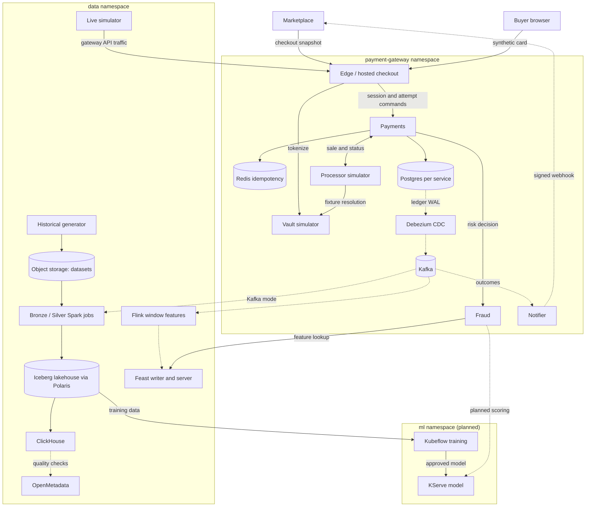

# Payment Gateway and Real-Time Fraud Detection

A payment gateway for a refurbished-electronics marketplace, connecting checkout, fraud decisions and the data used to train and investigate them.

## Domain

The marketplace owns buyers, sellers, orders and inventory. The gateway owns checkout sessions, payment attempts, fraud assessments, simulated processing and signed outcome webhooks. Each payment can have multiple attempts; their lifecycle events feed the lakehouse, streaming features and model training. Cards and fraud labels are synthetic.

[Gateway architecture](payment-gateway/architecture.md) · [Data pipelines](data/orchestration-governance.md) · [Feature store](ml/feature-store.md)

## Data problems

The source combines a hot merchant receiving roughly half of purchases with millions of customer, card and device identities. It includes about 2% duplicate exports and a v2→v3 schema change that adds fraud-assessment fields. Live traffic adds late arrivals and Kafka redelivery. Chargebacks arrive 7–21 days after successful fraudulent attempts, so features and labels must be joined using their availability times. [Offline processing](data/offline.md) and [streaming/replay](data/online.md) handle these cases.

## Schema

| Entity | Key / relationship | Contents |
|---|---|---|
| Payment | `(integration_id, payment_id)` | Checkout snapshot and lifecycle |
| Attempt | `(integration_id, payment_id, attempt_id)` | Customer, merchant, amount, device, network and payment-method context |
| Event | `event_id`; linked to a payment and, where applicable, an attempt | Versioned lifecycle observations |
| Fraud label | Linked attempt and label source | Fraud outcome with separate availability time |
| Feature snapshot | Integration, customer or payment-method key, timestamp | Daily and streaming history used for scoring |

Wire schemas: [payments](../contracts/payments/v1) · [fraud](../contracts/fraud/v1). Data contracts: [events](data/products/historical-payments/payment-events.md) · [labels](data/products/historical-payments/fraud-labels.md). Physical tables and relationships: [storage schemas](data/storage.md#schemas-and-naming).

## Architecture

### Deployable units

| Unit | Role | Owned state | Status |
|---|---|---|---|
| Edge / hosted checkout | Go; integration authentication, merchant API, browser checkout | Bounded checkout access | Deployed |
| Vault simulator | Go; synthetic tokenization, processor-only fixture resolution | Token mappings, encrypted fixtures | Deployed |
| Payments | Go; sessions, attempts, versioned commands, recovery | Versioned rows, append-only ledger, idempotency, effect intents | Deployed |
| Processor simulator | Go; simulated sales with configurable latency and lost responses | Operation results | Deployed |
| Notifier | Go; signed, deduplicated webhooks with retries | Inbox, deliveries, retry state | Deployed |
| Fraud | Go; validates inputs, applies the rules policy, retrieves features, scores with the model | Policy and decision metadata, assessments | Deployed |
| Kafka, Debezium, Karapace | Outbox CDC, internal event transport, schema registry | Topics, registered schemas | Deployed |
| Historical generator | Python; per-day synthetic history to object storage | Immutable datasets v18 (dev), v19 (prod) | Deployed |
| Live simulator | Python; current-time gateway traffic and labels | None | Deployed; runs as a bounded Job |
| Data pipelines (DP1, `dp-pipeline`) | Spark on the Spark Operator: Bronze, then Silver, Gold features and ClickHouse marts; checks and lineage in OpenMetadata | Iceberg tables, ClickHouse marts, run reports | Running on prod (v19 backfill) |
| Flink streaming features, Feast writer and server | Python; window features to Redis and `gold.feat_stream_*`, stream history replay, materialization | Checkpoints, Feast Redis, stream tables | Deployed in dev; enabled in prod |
| Training and model serving | Kubeflow Pipelines, Katib, Trainer, Model Registry, Triton on the GPU ([training](ml/training.md), [pipeline](ml/pipeline.md), [drift](ml/drift.md), [serving](ml/serving.md)) | Training-set versions, registered models | Done on dev, including drift and A/B |
| LLM and agent platform | vLLM on KServe, agentgateway, kagent agents on Agent Substrate, RAG pipeline and knowledge API ([LLM agents](llm/agents.md)) | Feast pgvector and Iceberg knowledge chunks, Langfuse | Deployed in dev; further agents planned |

### Deployment view

Solid arrows are synchronous calls or storage writes; dotted arrows are asynchronous events.

Only Edge `/checkout/*` is publicly routed. Internal APIs are ClusterIP-only behind the Istio ambient mesh with service-account authorization; see [domains, HTTPS and mesh routing](deployment/networking.md). The marketplace context is in the [marketplace gateway note](https://github.com/phuchoang2603/refurbished-marketplace/blob/main/docs/ecommerce-fraud-gateway.md).

## Roadmap

Status of each capability, grouped like the course rubric. **Done** means implemented and exercised with recorded results on the linked page; **in progress** means implementation is under review; **planned** means designed but not built. Course tools are replaced by platform equivalents where noted (Argo Workflows for Airflow, OpenMetadata for DataHub, Kubeflow Model Registry for MLflow, GitHub Actions for Jenkins).

Open work is planned in [OpenSpec changes](../openspec/changes); finished changes are archived there.

### Data platform

| Area | Capability | Page | Status |
|---|---|---|---|
| Engineering fundamentals | Multi-stage Docker images and size comparison | [Docker images](deployment/cd.md#docker-images) | Done; Spark image 5.07 → 3.06 GB, streaming −25% compressed |
| Offline generator | Skew, schema evolution, duplicates; ≥ 100 GB stored for Bronze ingestion | [Offline data](data/offline.md) | Done (v19: 133.5 GB) |
| Online generator | Late arrivals and streaming duplicates | [Online data](data/online.md) | Done; see [evidence](data/online.md#late-too-late-and-duplicate-trace) |
| Spark jobs | Baseline, skew, schema evolution, duplicates, integrated into pipelines | [Offline data](data/offline.md) | Done: AWS v19 run; skew timings, deduplication and schema-evolution comparisons on GCP, 2026-11-04 |
| Flink jobs | Baseline, late arrivals, duplicates, windows, dead-letter topic; output ends at the feature journal topic | [Online data](data/online.md) | Done: local correctness, dev recovery, and a runtime check with a too-late input, a duplicate and late attempts |
| Storage | Lakehouse compaction, partitioning, Z-order; ClickHouse warehouse indexing (`ORDER BY`, skip indexes) | [Storage](data/storage.md) | Done on v19: partitioning, write order, mart codecs and `EXPLAIN`; a Z-order run showed no file skipping at one file per day |
| Orchestration | DP1 (raw → Bronze), then `dp-pipeline`: Silver, then Gold and the marts side by side, each layer with ingest, validate and publish stages; unchanged stages skipped | [Orchestration and governance](data/orchestration-governance.md) | Recorded AWS backfill 2025-10-29 to 2026-10-28 completed |
| Data design notes | Audited multi-table lakehouse publication; shared live/historical feature engine and recoverable replay | [Write–audit–publish (novel)](data/write-audit-publish.md), [Historical replay](data/online.md#historical-replay) | Shared operators, isolated replay and catalog publication |
| Incremental curation | Silver and Gold take a day range and overwrite only those days, so the daily run and a backfill are the same job; CI checks daily runs against one backfill for both | [Offline data](data/offline.md) | Verified in recorded AWS monthly backfill |
| Governance | Lineage and validation for DP1–DP3 in the catalog | [Orchestration and governance](data/orchestration-governance.md) | Recorded AWS: source-to-marts lineage, 58 passing tests |
| Schemas | SCD2 dimensions, `feat_` tables with `event_timestamp`/`created`, naming conventions, relationships | [Storage](data/storage.md#schemas-and-naming) | Done |

### ML platform

| Area | Capability | Page | Status |
|---|---|---|---|
| Feature store | Streaming features to online and offline stores, incremental materialization, TTL | [Feature store](ml/feature-store.md) | Done: prod materialize pipeline, stream writers, TTL and live Flink job recorded |
| Generator | Data drift and a label table joinable with features | [Offline data](data/offline.md) | Labels done; the live simulator takes drift steps, shown on dev ([drift](ml/drift.md#signal)) |
| Model | Notebook baseline from the offline store, training pipeline, single-GPU training | [Training](ml/training.md#notebook), [pipeline](ml/pipeline.md#training-pipeline) | Done on dev |
| Versioning | Model registry and incremental data versions | [Training](ml/training.md#versions) | Done on dev; incremental rebuild pending |
| Serving | KServe inference from the registry, rollback | [Serving](ml/serving.md) | Done on dev |
| Scoring | Go Fraud calling the model under a missing-feature policy | [Serving](ml/serving.md) | Implemented |
| Autoscaling | KEDA on Triton queue time, scraped metrics and a Grafana dashboard | [Serving](ml/serving.md#autoscaling-and-dashboard) | Done on dev |
| A/B | Challenger model behind a waypoint route, stepwise weights gated by Argo Rollouts analysis, per-version panels | [Serving](ml/serving.md#ab-experiment) | Done on dev |
| Drift | Periodic drift comparison and retraining trigger | [Drift](ml/drift.md) | Done on dev; thresholds uncalibrated |

### LLM and agent platform

| Area | Capability | Page | Status |
|---|---|---|---|
| Inference | Qwen3.5-4B (FP8) chat, Qwen3-Embedding and the d3-edge decision model on vLLM through KServe, one shared GPU | [Inference](llm/inference.md) | Done on dev; [benchmark](llm/inference.md#benchmark) with FP8 KV cache kept |
| Agent gateway | One gateway for models, MCP tools and REST APIs: per-client keys, rate and token limits, PII masking, Jev request screening, mesh-only access | [Gateway and Jev policy (novel)](llm/gateway-and-jev-policy.md) | Done on dev |
| Agents | Global model config; the `coordinator` entry agent behind the A2A gateway with `evidence-agent` (knowledge tools) and `risk-agent` as sub-agents; sandboxed on Agent Substrate with warm start and KEDA-scaled workers; registry | [Agents](llm/agents.md) | Done on dev; risk prompt version 3 linked to the recorded trace |
| Retrieval | RAG pipeline into Iceberg and a Feast pgvector store, governed in OpenMetadata; Web API by id and MCP tools, autoscaled by KEDA | [RAG](llm/rag.md) | Done on dev |
| Prompt management | Prompts managed and versioned in Langfuse (seeded from Git); agents read them at each model call | [Langfuse](llm/langfuse.md#prompts) | Done on dev |
| A/B tests | Prompt A/B tests per agent in Langfuse, compared per version; LLM-version tests on prod | [Langfuse](llm/langfuse.md#ab-tests) | Prompt tests done on dev; LLM versions planned for prod |
| Agent tracing | Agent traces from kagent to Langfuse, linked to prompt versions; LLM, gateway and API metrics in VictoriaMetrics with a Grafana dashboard | [Langfuse](llm/langfuse.md), [metrics](deployment/observability.md#llm-metrics) | Done on dev |
| Custom agent runtime | Go ADK runtime with per-agent Langfuse prompts, conversation-stable variants and prompt-version trace linkage | [Custom Go ADK runtime (novel)](llm/custom-go-adk-runtime.md) | Implemented on dev; startup and prompt-linkage evidence recorded, evaluation limits stated |
| GPU scheduling | Kueue queueing for GPU training and serving workloads | [Agents](llm/agents.md) | Planned |
| Model loading | Pinned revisions in the KServe local model cache, loaded with InstantTensor | [Inference](llm/inference.md) | Done on dev |

### Delivery and operations

| Area | Capability | Page | Status |
|---|---|---|---|
| CI, validation and verification | Coverage, boundary tests, changed-code mutation tests, property tests and load tests | [CI](deployment/ci.md) | Coverage and mutation results listed |
| Infrastructure and IaC | Cloud/VM provisioning, Talos bootstrap and shared operators | [Infrastructure](deployment/infra.md) | Platform-owned; prod provisioning run captured |
| Docker, CD and canary deployment | Image optimization, test/build/deploy flow and guarded Edge promotion | [Delivery](deployment/cd.md) | Prod canary verified 2026-11-03 |
| Observability | Metrics, logs, traces and alert evaluation | [Observability](deployment/observability.md) | Prod captures recorded; external alert delivery disabled |
| Security and secrets | Doppler, External Secrets and service authorization | [Security](deployment/security.md) | Implemented; secret delivery and mesh authorization captured; feature-API rate limit pending |

## Limits and scope

- Synthetic data cannot establish real-world fraud-model quality. Unlabelled drift measures distribution change, not accuracy.
- Real card custody, live processor connectivity, live money movement, settlement and reconciliation files, payouts and FX are out of scope. The gateway demonstrates PCI-oriented boundaries with synthetic data, not compliance.
