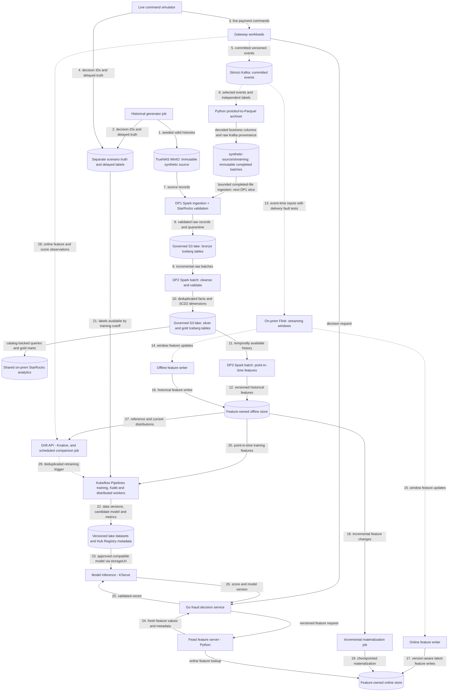

# Data pipeline architecture

Planned generators, DP1–DP3 pipelines and feature stores. Deployable units and the deployment view are in the [platform architecture](../overview/architecture.md); payment contracts are in [payment flows](../payment-gateway/payment-flows.md). The [ML pipeline architecture](ml-pipeline.md) covers training and drift monitoring. Capability coverage and required proof are tracked in the [roadmap](../overview/roadmap.md).

## Flow

This is a target flow, not a claim that its data engines, catalog or warehouse are deployed. Solid arrows show batch/storage transfers and synchronous reads; dotted arrows show streaming events or asynchronous triggers. Storage nodes are labelled by role. Feast feature serving is a separate runtime accessed by Go fraud; feature-access libraries remain embedded in the jobs/server that use them.



## Generation

Historical generation persists valid lifecycle histories outside bronze and outside production payment event storage. Live simulation calls gateway commands so Payments creates authoritative events. The maintained development source covers 90 purchase-start days using payload schema 3, including complete lifecycle and label tails. Attempt events carry merchant/customer/checkout context matching the gateway Fraud request. Both modes share versioned scenarios for customer, seller, device and synthetic method profiles: ordinary purchases, stolen-card/new-device behavior, unusual geography, reshipping, card testing and retry attacks. Burst, lateness and duplicate delivery are transport conditions; they never fabricate duplicate authoritative transitions.

## Live simulation and landing

`simulator live --config <path>` reuses a pinned historical manifest and verifies its profile digest, then drives gateway commands at current machine time. A historical gap is valid; there is no catch-up or maximum-gap requirement. New vault tokens resolve to the selected current profile's method fingerprints; mapping is bounded by the synthetic card encoding, not a legacy dataset cardinality. Merchant/customer assignments and familiar device/network pools are reused; account-created dates anchor profile ages to historical start. Shipping fingerprints follow the gateway's full-address canonicalization and are not guaranteed identical to the historical street-only fingerprints.

Traffic, independent protobuf labels and optional post-commit delay/duplicate/burst-hold delivery run in one Python process. Request retries preserve idempotency keys and content; the fault loop preserves original event bytes, keys and ordered headers on `payments.events.v1.faulty`. Held records commit only through acknowledged contiguous offsets, so restart may add deliveries. Label schedules are bounded in memory: interrupted or unsuccessful schedules are reported, not claimed durable. Synthetic truth is valid for training; scenario/oracle fields remain excluded from features and label joins respect availability time.

The independently enabled Python archiver uses the simulator package/image (`simulator archive`) and historical Arrow schemas to write historical-compatible event/label business columns plus reserved `_transport` metadata to `synthetic-source/streaming/`, alongside explicit `historical/<version>/` exports. Each fresh source epoch uses explicit frozen Kafka start offsets and its own landing group; manifests record the epoch and file paths include `epoch=<id>` so resets cannot mix sources. Live startup logs pin the reference manifest hash, generation/calibration identity and unique run ID; live payments retain distinct IDs and current UTC timestamps. The [completed-batch contract](../../contracts/landing/payments-parquet-v1.schema.json) defines manifests and provenance. It conditionally publishes content-addressed Parquet and then a batch manifest, confirms remote metadata/size, and only then commits Kafka offsets. Retries with different boundaries may overlap; bronze must preserve deliveries and silver owns deduplication. Raw protobuf remains available for exact replay. No Connect S3 plugin, registry or Flink landing workload is required.

The [live-traffic chart](../../infra/charts/live-traffic/values.yaml) shares Kafka, RustFS and the existing synthetic integration/source credentials. Exercise the simulator first with the archiver disabled, after its CI/image prerequisites pass: current-time gateway traffic, identities, labels, then delivery faults. Streaming-write policy access is needed for the later archiver session, not simulator-only traffic. Exercise landing/recovery next and review that evidence before starting DP1 multi-source ingestion. Select either clean or faulty events plus labels; avoid selecting both payment topics accidentally. Disable both workloads to roll back without deleting Kafka or landed data. The simulator is single-replica `Recreate`; bounded runs stop after configured duration and an enabled Deployment restarts them with a new run ID.

The v16 exercise completed 240 current-time payments with context equality and nullable signals verified. The fault epoch `v16-acceptance-20261026` preserves intentional delivery faults and recovery overlap; the current clean-topic archiver uses epoch `v16-20261026` and group `payments-parquet-landing-v16-20261026`, initialized from [explicit recorded offsets](../../openspec/changes/archive/2026-10-26-finalize-feature-contract-and-90-day-smoke/evidence/v16-landing-start.json). The clean archiver is enabled and caught up; [readback](../../openspec/changes/archive/2026-10-26-finalize-feature-contract-and-90-day-smoke/evidence/v16-clean-landing-report.json) verified all 1,440 selected positions in six files, including full business projection and original bytes/keys/ordered headers. The simulator stays disabled after its bounded exercise. One chargeback schedule remained pending at shutdown; do not treat the live scheduler as durable.

DP1 multi-source configuration, durable discovery of completed manifests (including late files), incremental Iceberg commits and contextual validation belong to the next slice. Existing DP1 cannot ingest these paths merely by changing `SOURCE_ROOT`. Preserve historical source contracts, published bands and previous evidence; the owning DP1 plan makes generator distribution/cardinality diagnostics informational while enforcing integrity, conservation, lifecycle context and label checks. Source publication does not establish DP1 acceptance. Accepted v11 evidence remains separate.

## Feature definitions and development order

The [shared baseline definitions](../../contracts/features/fraud-baseline-v1.yaml) and conformance examples establish request fields, prior assessed-attempt windows, integration-scoped keys, UTC/availability cutoffs and missingness. Flink consumes an unbounded Kafka stream; bounded windows and unmatched-attempt state limit retention without turning it into batch ingestion. Attempt context removes the creation-event join, while the committed risk decision gates historical contributions. Store the same versioned feature updates in online and offline sinks; do not mistake latest online values for historical point-in-time retrieval.

The schema-3 v16 source and current-time live/landing exercise passed; the [source/live evidence](../../openspec/changes/archive/2026-10-26-finalize-feature-contract-and-90-day-smoke/verification.md) records the manifest, epochs, offsets, replay and remaining limits. Use that small source for DP1 ingestion and downstream development; build Flink/Feast, Spark offline features, Kubeflow training and KServe before starting scale generation. The 100 GB coursework/scale target remains a later requirement. Storage and DP1 acceptance must follow the owning data-platform change; source publication alone does not accept bronze.

## Pipelines and schemas

The [data products guide](data-products.md) describes the source and bronze interfaces, agreements and validation commands. Curated dataset contracts are added with their pipelines.

DP1 ingests and validates raw records; DP2 cleanses and curates them; DP3 computes historical features. Each has observable ingest/validate stages, reusable centrally managed connections/configuration, quarantine or failed-validation evidence, and source/table/job lineage. Bronze uses `raw_`, silver `stg_`, and gold `dim_`, `fact_`, `obt_`, `feat_` conventions. SCD2 dimensions carry `valid_from_ts`, `valid_to_ts`, `is_current`; feature tables carry `event_timestamp` and `created`.

Argo Workflows coordinates finite on-prem Spark Operator ingestion and native OpenMetadata stages and their retries. The existing RustFS Iceberg REST catalog uses native SigV4 for multi-engine snapshots over governed lake storage; the synthetic source bucket remains immutable input, not an Iceberg table. Compaction, snapshot expiration, orphan cleanup and retention are explicit maintenance work. The owning DP1 plan selects shared StarRocks for snapshot-pinned SQL validation, analytical queries and gold marts, with native OpenMetadata discovery, profiling and quality. External Iceberg materialized views require scheduled/explicit refresh and store derived data. The ClickStack telemetry store remains observability infrastructure.

Streaming windows specify event time, watermarks, allowed lateness, deduplication and restart semantics. Offline and online writers are independently observable, each committing offsets only after its own sink write and tolerating replay without duplicating feature effects; one shared transformation and versioned feature contract feeds both, with each sink keeping its own checkpoint and deduplication/version policy. Incremental materialization has checkpoints, retries and version-aware idempotency; older late writes cannot replace newer online state. Per-feature TTL, stale/missing defaults and feature-version compatibility protect serving.

Long-running Flink jobs and their checkpoints stay on premises near Kafka and the lake. Local Spark is the batch baseline. AWS burst evaluation may stage an immutable versioned snapshot *one way* from MinIO to AWS S3 for a bounded Spark backfill; cloud outputs stay in separate S3 storage until validated and selectively imported. No live bidirectional Iceberg/catalog replication, cross-WAN Flink state or unmeasured large Spark deployment on today's stateless AWS workers.

## Shared storage and service boundaries

Shared storage infrastructure may host separate service-owned databases and credentials; services must not share mutable domain models or query one another's tables. The planned gateway includes Edge, Payments, Go fraud, a processor simulator, an isolated vault simulator, Redis, Kafka and the webhook notifier. Go fraud owns the rules decision runtime; Feast feature serving and KServe inference are introduced later as separate dependencies called directly by Go fraud. Integration configuration and derived IDs replace Accounts. Keep recovery and expiry workers inside Payments until independent scaling or isolation is needed; features, inference, drift and investigation follow their own acceptance steps.

The [Vietnam payment policy research](../research/vietnam-payment-policy.md) separates current regulatory sources, provider policies and fictional simulator assumptions, including authentication and dispute scope.

## Historical DP1

`src/data-platform` locks Python 3.12, Java 17, Spark 3.5.8, Iceberg 1.10.1, GX 1.24.0, PyIceberg 0.11.1 and DataHub client/GX plugin 1.7.0.16. Root Python 3.14 remains the service/generator toolchain. The Spark image contains verified, checksum-pinned Iceberg/S3A JARs; the smaller metadata image omits Spark/Java. `infra/charts/data-pipelines` and its prod Application are disabled by default.

Enable only after the platform watches `fraud-data-prod`, capacity is measured with DataHub running, external secrets are Ready, and `dp1 probe` verifies authenticated REST creation/write, snapshot reads, version-scoped overwrite and PyIceberg metadata access. The probe creates a uniquely named test table in `bronze` (or an explicitly authorized `ICEBERG_PROBE_NAMESPACE`) and retains it with its evidence; it never deletes existing datasets. The SDK catalog base URI is `https://minio.home.phuchoang.sbs/iceberg`; clients append `/v1` themselves. The REST warehouse identifier is `fraud-lakehouse-prod`; object storage remains `s3://fraud-lakehouse-prod/`. RustFS reflects the warehouse request value into its REST prefix, so an S3 URI is not a valid catalog identifier. Catalog SigV4 (`ICEBERG_REST_URI`, `ICEBERG_SIGV4_ENABLED`, signing name/region) and S3 endpoint/TLS/path-style settings are separate. Do not infer these settings from the console's Ready status.

The chart uses the existing `fraud-doppler` ClusterSecretStore and configurable external-key references defaulting to `DP1_LAKE_RUSTFS_ACCESS_KEY`, `DP1_LAKE_RUSTFS_SECRET_KEY`, `DP1_METADATA_RUSTFS_ACCESS_KEY`, `DP1_METADATA_RUSTFS_SECRET_KEY` and `DP1_DATAHUB_TOKEN`. The combined DP1 runtime identity has read-only access to the source historical prefix and writes only its allocated lake scope; it is separate from the generator writer. Native DataHub catalog ingestion uses the metadata identity for read-only REST catalog and warehouse metadata-file access; report persistence uses the lake identity. The combined identity must deny source writes; lake access must be restricted to the allocated warehouse/evidence prefix. Verify denied source writes and out-of-scope lake access before setting `prerequisitesVerified`. The preprovisioned `bronze` namespace is checked before any creation request. Source-bucket S3A probing is disabled (`fs.s3a.bucket.synthetic-source.bucket.probe=0`) to avoid requiring a root bucket listing; historical-prefix listing remains required. Do not put credential values in Helm arguments or reports.

Render an enabled candidate using full image digests, then enable the prod Application only after its prerequisites pass:

```bash
helm template data-pipelines infra/charts/data-pipelines \
  --set enabled=true --set prerequisitesVerified=true \
  --set-string images.spark="$DP1_SPARK_IMAGE" \
  --set-string images.metadata="$DP1_METADATA_IMAGE"
argo submit -n fraud-data-prod --from workflowtemplate/historical-dp1-bronze
```

The workflow serializes writers, persists logical ingestion identity before commits, and runs separate ingest/validate SparkApplications with one 1-core/2-GiB-memory driver and executor plus 512 MiB overhead each. Argo owns two ingest retries with fresh application names; operator restarts are disabled. Validation is not retried. Stage/workflow deadlines bound missing or unknown status. Exit handling cleans active applications and attempts failure publication. A namespace-scoped reaper handles `Terminate`, which can bypass Argo exit handlers, and retains application diagnostics before requesting deletion. Reaper/cancellation reconciliation still requires live acceptance.

DP1 requires passed native source declarations, or an embedded inventory and an explicit `result: skipped`, `gate: dp1-spark-gx` declaration with a reason. The latter permits ingestion and is preserved in run and validation evidence; it requires passing Spark/GX results for both persisted tables before bronze acceptance. Other skipped or missing source-validation declarations are rejected. DP1 reads only manifest inventory files, streams hashes on workers, checks byte/row/partition counts and source identities, and normalizes without narrowing integer types. When an accepted manifest has no embedded inventory, preflight requires an explicit companion URI and SHA-256 pin (`SOURCE_INVENTORY_URI` and `SOURCE_INVENTORY_SHA256`); `dp1 source-inventory` creates that evidence once outside the source scope and `dp1 verify-source` re-verifies every listed file against it. Ingestion never discovers or creates inventory evidence implicitly. It preserves all deliveries. Writes atomically replace only the selected source-version partition; two table commits remain a candidate until both snapshot IDs, validation and governance are complete. Recovery discovers a committed snapshot using its logical run ID and manifest digest. Run context and accepted records live under `EVIDENCE_ROOT`; validation selects the recorded pair even if latest table state advances. Readers must use `accepted/<dataset_version>.json` and its snapshot IDs, filtered by `_source_dataset_version`. Never expire referenced snapshots or remove their reports.

Replaying the same manifest reuses snapshots. A changed digest under the same source version fails. Changed bronze contracts produce a new validation-report key and require revalidation without rewriting data. Reports preserve coverage, every GX result, conservation, source/contract/image/workflow/snapshot identities, input file/byte counts and duration. GX query metrics bound driver samples to 200 rows. Failed unexpected-row SQL also produces an explicit sample limited to 20 rows for the persisted report; scalar/native expectation results keep their bounded SUMMARY format. Missing reports and execution errors fail acceptance.

Governance discovers the canonical URNs with DataHub's native Iceberg connector and reuses them for products, jobs, lineage and assertions. The pinned GX 1 plugin constructs identities and assertions. Fixture checks demonstrate two plugin limitations: execution errors become failures and event timestamps use publication time. The narrow assertion-SDK path preserves the original result type, logical execution ID and timestamp on metadata replay. Publication requires bounded readback of product membership, schemas, job/table lineage, assertion definitions and assertion outcomes; emitting successfully is insufficient.

Retry metadata without launching Spark, then accept only a previously passing validation with verified governance:

```bash
argo submit -n fraud-data-prod --from workflowtemplate/historical-dp1-governance-replay
dp1 accept
```

Rollback stops workflows and disables the application; retain source, warehouse, run evidence, accepted snapshots and the independently owned platform DataHub state. Select the previous accepted pair rather than deleting tables or buckets.

As of 2026-10-22, read-only inspection confirms v7's manifest lacks the file inventory, hashes and sizes required by the approved integrity gate. DP1 rejects it unless the approved companion is selected; this implementation does not amend v7 or invent integrity evidence. The create-only companion at `s3://fraud-lakehouse-prod/dp1-evidence/source-inventories/v7.json` (SHA-256 `408e44f10b20eaab9d875578d11fc5daa686b13e465fb04ae068a9d0d777ebf3`, bound to original manifest `020523c95eb960748cfc7953b740c204418479213c7e87f7a7e02d9a7c0a5dd7`) lists 202 Parquet files, 271,619,442 bytes, 2,215,309 event rows and 442,817 label rows; it was built from the unchanged source, recreation returns HTTP 412 and every listed file is re-verified on selection. It records current source integrity and does not retroactively prove publication-time checksums. The same explicit, create-only pin applies to any later tagged export such as v8 or v9; the companion binds its dataset version, so cross-version reuse fails. The parent verified the final two named IAM policies/users (`dp1-runtime` and `dp1-metadata-reader`): runtime source reads and lake I/O/catalog writes pass, source writes and unrelated buckets are denied, metadata catalog/table reads pass, metadata writes are denied, and both identities are denied table listing outside `bronze`. DataHub authentication remains a prerequisite. DataHub is absent, and no live DP1 run is accepted. The canonical inventory from a new generator export passed verification of all 31 files (3,957 events and 882 labels). A bounded live Spark probe failed with `Py4JJavaError`; its failed evidence and uniquely named test table are retained, and Spark interoperability remains unverified. Platform reconciliation, successful Spark probes and live failure/replay/readback tests are outstanding. Local fixtures and server dry runs establish no live acceptance or 100 GB performance claim. Duration/IO/memory/shuffle/spill measurements and immutable revision/image/snapshot identities must come from the eventual live acceptance run.
