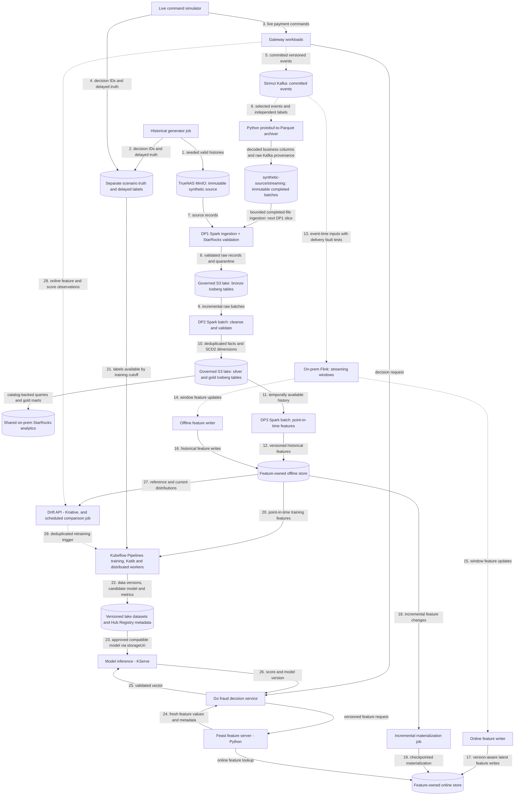

# Data pipeline architecture

Planned generators, DP1–DP3 pipelines and feature stores. Deployable units and the deployment view are in the [platform architecture](../overview/architecture.md); payment contracts are in [payment flows](../payment-gateway/payment-flows.md). The [ML pipeline architecture](ml-pipeline.md) covers training and drift monitoring. Capability coverage and required proof are tracked in the [roadmap](../overview/roadmap.md).

## Flow

This is a target flow, not a claim that its data engines, catalog or warehouse are deployed. Solid arrows show batch/storage transfers and synchronous reads; dotted arrows show streaming events or asynchronous triggers. Storage nodes are labelled by role. Feast feature serving is a separate runtime accessed by Go fraud; feature-access libraries remain embedded in the jobs/server that use them.



## Generation

Historical generation persists valid lifecycle histories outside bronze and outside production payment event storage. Live simulation calls gateway commands so Payments creates authoritative events. The maintained development source covers 90 purchase-start days using payload schema 3, including complete lifecycle and label tails. Attempt events carry merchant/customer/checkout context matching the gateway Fraud request. Both modes share versioned scenarios for customer, seller, device and synthetic method profiles: ordinary purchases, stolen-card/new-device behavior, unusual geography, reshipping, card testing and retry attacks. Burst, lateness and duplicate delivery are transport conditions; they never fabricate duplicate authoritative transitions.

## Live simulation and landing

`simulator live --config <path>` reuses a pinned historical manifest and verifies its profile digest, then drives gateway commands at current machine time. A historical gap is valid; there is no catch-up or maximum-gap requirement. New vault tokens resolve to the selected current profile's method fingerprints; mapping is bounded by the synthetic card encoding, not a legacy dataset cardinality. Merchant/customer assignments and familiar device/network pools are reused; account-created dates anchor profile ages to historical start. Shipping fingerprints follow the gateway's full-address canonicalization and are not guaranteed identical to the historical street-only fingerprints.

Traffic, independent protobuf labels and optional post-commit delay/duplicate/burst-hold delivery run in one Python process. Request retries preserve idempotency keys and content; the fault loop preserves original event bytes, keys and ordered headers on `payments.events.v1.faulty`. Held records commit only through acknowledged contiguous offsets, so restart may add deliveries. Label schedules are bounded in memory: interrupted or unsuccessful schedules are reported, not claimed durable. Synthetic truth is valid for training; scenario/oracle fields remain excluded from features and label joins respect availability time.

The independently enabled Python archiver uses the simulator package/image (`simulator archive`) and historical Arrow schemas to write historical-compatible event/label business columns plus reserved `_transport` metadata to `synthetic-source/streaming/`, alongside explicit `historical/<version>/` exports. Each fresh source epoch uses explicit frozen Kafka start offsets and its own landing group; manifests record the epoch and file paths include `epoch=<id>` so resets cannot mix sources. Live startup logs pin the reference manifest hash, generation/calibration identity and unique run ID; live payments retain distinct IDs and current UTC timestamps. The [completed-batch contract](../../contracts/landing/payments-parquet-v1.schema.json) defines manifests and provenance. It conditionally publishes content-addressed Parquet and then a batch manifest, confirms remote metadata/size, and only then commits Kafka offsets. Retries with different boundaries may overlap; bronze must preserve deliveries and silver owns deduplication. Raw protobuf remains available for exact replay. No Connect S3 plugin, registry or Flink landing workload is required.

The [live-traffic chart](../../infra/charts/live-traffic/values.yaml) shares Kafka, RustFS and the existing synthetic integration/source credentials. Exercise the simulator first with the archiver disabled, after its CI/image prerequisites pass: current-time gateway traffic, identities, labels, then delivery faults. Streaming-write policy access is needed for the later archiver session, not simulator-only traffic. Exercise landing/recovery next and review that evidence before starting DP1 multi-source ingestion. Select either clean or faulty events plus labels; avoid selecting both payment topics accidentally. Disable both workloads to roll back without deleting Kafka or landed data. The simulator is single-replica `Recreate`; bounded runs stop after configured duration and an enabled Deployment restarts them with a new run ID.

The v16 exercise completed 240 current-time payments with context equality and nullable signals verified. The fault epoch `v16-acceptance-20261026` preserves intentional delivery faults and recovery overlap; the current clean-topic archiver uses epoch `v16-20261026` and group `payments-parquet-landing-v16-20261026`, initialized from [explicit recorded offsets](../../openspec/changes/archive/2026-10-26-finalize-feature-contract-and-90-day-smoke/evidence/v16-landing-start.json). The clean archiver is enabled and caught up; [readback](../../openspec/changes/archive/2026-10-26-finalize-feature-contract-and-90-day-smoke/evidence/v16-clean-landing-report.json) verified all 1,440 selected positions in six files, including full business projection and original bytes/keys/ordered headers. The simulator stays disabled after its bounded exercise. One chargeback schedule remained pending at shutdown; do not treat the live scheduler as durable.

DP1 multi-source configuration, durable discovery of completed manifests (including late files), incremental Iceberg commits and contextual validation belong to the next slice. Existing DP1 cannot ingest these paths merely by changing `SOURCE_ROOT`. Preserve historical source contracts, published bands and previous evidence; the owning DP1 plan makes generator distribution/cardinality diagnostics informational while enforcing integrity, conservation, lifecycle context and label checks. Source publication does not establish DP1 acceptance. Accepted v11 evidence remains separate.

## Feature definitions and development order

The [shared baseline definitions](../../contracts/features/fraud-baseline-v1.yaml) and conformance examples establish request fields, prior assessed-attempt windows, integration-scoped keys, UTC/availability cutoffs and missingness. Flink consumes an unbounded Kafka stream; bounded windows and unmatched-attempt state limit retention without turning it into batch ingestion. Attempt context removes the creation-event join, while the committed risk decision gates historical contributions. Store the same versioned feature updates in online and offline sinks; do not mistake latest online values for historical point-in-time retrieval.

The schema-3 v16 source and current-time live/landing exercise passed; the [source/live evidence](../../openspec/changes/archive/2026-10-26-finalize-feature-contract-and-90-day-smoke/verification.md) records the manifest, epochs, offsets, replay and remaining limits. Use that small source for DP1 ingestion and downstream development; build Flink/Feast, Spark offline features, Kubeflow training and KServe before starting scale generation. The 100 GB coursework/scale target remains a later requirement. Storage and DP1 acceptance must follow the owning data-platform change; source publication alone does not accept bronze.

## Pipelines and schemas

The [data products guide](data-products.md) describes the source and bronze interfaces, agreements and validation commands. Curated dataset contracts are added with their pipelines.

DP1 ingests and validates raw records; DP2 cleanses and curates them; DP3 computes historical features. Each has observable ingest/validate stages, reusable centrally managed connections/configuration, quarantine or failed-validation evidence, and source/table/job lineage. Bronze uses `raw_`, silver `stg_`, and gold `dim_`, `fact_`, `obt_`, `feat_` conventions. SCD2 dimensions carry `valid_from_ts`, `valid_to_ts`, `is_current`; feature tables carry `event_timestamp` and `created`.

Argo Workflows coordinates finite on-prem Spark Operator ingestion and native OpenMetadata stages and their retries. The existing RustFS Iceberg REST catalog uses native SigV4 for multi-engine snapshots over governed lake storage; the synthetic source bucket remains immutable input, not an Iceberg table. Compaction, snapshot expiration, orphan cleanup and retention are explicit maintenance work. The owning DP1 plan selects shared StarRocks for snapshot-pinned SQL validation, analytical queries and gold marts, with native OpenMetadata discovery, profiling and quality. External Iceberg materialized views require scheduled/explicit refresh and store derived data. The ClickStack telemetry store remains observability infrastructure.

Streaming windows specify event time, watermarks, allowed lateness, deduplication and restart semantics. Offline and online writers are independently observable, each committing offsets only after its own sink write and tolerating replay without duplicating feature effects; one shared transformation and versioned feature contract feeds both, with each sink keeping its own checkpoint and deduplication/version policy. Incremental materialization has checkpoints, retries and version-aware idempotency; older late writes cannot replace newer online state. Per-feature TTL, stale/missing defaults and feature-version compatibility protect serving.

Long-running Flink jobs and their checkpoints stay on premises near Kafka and the lake. Local Spark is the batch baseline. AWS burst evaluation may stage an immutable versioned snapshot *one way* from MinIO to AWS S3 for a bounded Spark backfill; cloud outputs stay in separate S3 storage until validated and selectively imported. No live bidirectional Iceberg/catalog replication, cross-WAN Flink state or unmeasured large Spark deployment on today's stateless AWS workers.

## Shared storage and service boundaries

Shared storage infrastructure may host separate service-owned databases and credentials; services must not share mutable domain models or query one another's tables. The planned gateway includes Edge, Payments, Go fraud, a processor simulator, an isolated vault simulator, Redis, Kafka and the webhook notifier. Go fraud owns the rules decision runtime; Feast feature serving and KServe inference are introduced later as separate dependencies called directly by Go fraud. Integration configuration and derived IDs replace Accounts. Keep recovery and expiry workers inside Payments until independent scaling or isolation is needed; features, inference, drift and investigation follow their own acceptance steps.

The [Vietnam payment policy research](../research/vietnam-payment-policy.md) separates current regulatory sources, provider policies and fictional simulator assumptions, including authentication and dispute scope.

## Historical DP1

`src/data-pipeline/bronze-ingestion` locks Python 3.12, Java 17, Spark 4.1.3, Iceberg 1.12.0 (Scala 2.13) and the official OpenMetadata 2.0.6 ingestion image for native discovery and SQL tests. Root Python 3.14 remains the service/generator toolchain. The Spark image contains verified, checksum-pinned Iceberg/S3A JARs. `infra/charts/data-pipelines` and its prod Application are disabled by default.

Data workloads live under `src/data-pipeline/`: `simulator` and `bronze-ingestion`. Each workload retains its own Python version and lockfile. The Spark Dockerfile builds a self-contained image with dependencies installed in a separate build stage and runtime caches and unused test directories pruned.

Service-image CI builds and publishes both images; deployments use the published image digests.

The chart owns `fraud-data-prod` and retains it when disabled. The platform owns Apache Spark Operator 1.0.0 (chart 1.8.0), scoped to this namespace; the application chart owns Spark workload configuration and credentials.

The SDK catalog base URI is `https://minio.home.phuchoang.sbs/iceberg`; clients append `/v1` themselves. The REST warehouse identifier is `fraud-lakehouse-prod`; object storage remains `s3://fraud-lakehouse-prod/`. RustFS reflects the warehouse request value into its REST prefix, so an S3 URI is not a valid catalog identifier. Catalog SigV4 (`ICEBERG_REST_URI`, `ICEBERG_SIGV4_ENABLED`, signing name/region) and S3 endpoint/TLS/path-style settings are separate. Do not infer these settings from the console's Ready status.

The chart uses the `fraud-doppler` ClusterSecretStore for `LAKEHOUSE_RUSTFS_ACCESS_KEY`, `LAKEHOUSE_RUSTFS_SECRET_KEY` and `OPENMETADATA_TOKEN` (the OpenMetadata `ingestion-bot` token), and the platform `doppler` store for `STARROCKS_OPENMETADATA_PASSWORD`. The shared lakehouse runtime identity is exposed once as `AWS_ACCESS_KEY_ID` and `AWS_SECRET_ACCESS_KEY` in the `lakehouse-rustfs` Secret for source reads, Iceberg REST/S3 access and evidence writes. It has read-only access to the source historical prefix and writes only its allocated lake scope; it is separate from the generator writer. StarRocks reads the lake with its own read-only identity owned by the platform. The combined identity must deny source writes; lake access must be restricted to the allocated warehouse/evidence prefix. The preprovisioned `bronze` namespace is checked before any creation request. Source-bucket S3A probing is disabled (`fs.s3a.bucket.probe=0`) to avoid requiring a root bucket listing; historical-prefix listing remains required. Do not put credential values in Helm arguments or reports.

Render the chart using full image digests:

```bash
helm template data-pipelines infra/charts/data-pipelines \
  --set enabled=true \
  --set-string images.spark="$DP1_SPARK_IMAGE" \
  --set-string images.openmetadata="$DP1_OPENMETADATA_INGESTION_IMAGE"
argo submit -n fraud-data-prod --from workflowtemplate/historical-dp1-bronze \
  -p source-root=s3://synthetic-source/historical/v16 -p dataset-version=v16
```

Each submission is a batch over one completed source export. `source-root` and `dataset-version` are workflow parameters with chart-configured defaults. Submit a new source version for the next batch; retries of an accepted version reuse its recorded snapshots. Recurring landing ingestion uses the separate `recurring` entrypoint described below.

The workflow serializes writers and persists logical ingestion identity before commits. Under the writer mutex, each run first deletes and waits for previous bronze-payment workflow pods, then their SparkApplications and Spark pods; failed recovery prevents ingestion. Each Spark attempt also clears its previous stage resources before starting, so a failed cleanup cannot overlap a retry. Each ingest attempt creates a SparkApplication using the image's installed `data_platform/cli.py` (the same entry point as `dp1 ingest`). The remaining stages are finite containers: `dp1 preflight` and `dp1 prepare` on the Spark image, official OpenMetadata `metadata ingest`, `metadata test` and `metadata profile` steps, Argo HTTP templates for governance writes, and `dp1 accept`. Drivers request 500m CPU and 2.5 GiB; each of the two executors has one core and 2 GiB plus 1 GiB overhead, requesting 500m CPU. Chart values `spark.executors` and `spark.shufflePartitions` default to two and 1,024 for development ingestion. AQE coalesces shuffle partitions toward 64 MiB with `parallelismFirst=false`; this is a scale starting point pending development measurements. Driver/executor JVM and Python logging retain WARN and ERROR messages. Parquet/Iceberg formats and the 128 MiB output-file target are unchanged. Operator restarts are disabled; Argo owns two ingest retries; native steps retry once and deterministic quality failures are never retried. Argo waits for the operator's terminal state, deletes the application with foreground cascading cleanup, then explicitly deletes and waits for its labelled driver/executor pods before proceeding, and removes any remaining execution resources on exit. Workflow owner references cascade deletion, but active background Workflow deletion was observed to release the writer mutex while Spark containers were still running. Chart values `workflow.activeDeadlineSeconds` and `spark.activeDeadlineSeconds` bound the workflow and Spark resource/driver stages, defaulting to 7,200 and 2,400 seconds. Later scale deadlines require measured sizing. The platform admission guard requires a terminal Workflow phase before deletion in `fraud-data-prod` and rejects hard termination unless the existing phase is Pending or terminal. Cancel through graceful `argo stop -n fraud-data-prod <workflow>`, wait for completion and verify the cleanup steps succeeded before deleting the Workflow. A terminal phase alone does not prove cleanup; the next run must finish recovery before writing. SparkApplication attempt names remain in durable run and validation evidence; deleting execution resources does not remove source, lake or evidence objects.

DP1 supports only current-contract manifests with an embedded inventory and rejects any other manifest before writes. It requires passed native source declarations, or an explicit `result: skipped`, `gate: dp1-starrocks-openmetadata` declaration with a reason. The latter permits ingestion and is preserved in run and validation evidence; it is executed by the StarRocks validation policy (`bronze-raw-v3` for new runs), which is recorded in the run, and bronze acceptance requires every native result to pass; there is no legacy fallback. Other skipped or missing source-validation declarations are rejected. DP1 reads only manifest inventory files, streams hashes on workers, checks byte/row/partition counts and source identities, and normalizes without narrowing integer types. `dp1 verify-source` re-verifies every listed file against the embedded inventory. Ingestion never discovers or creates inventory evidence implicitly. It preserves all deliveries. Writes atomically replace only the selected source-version partition; two table commits remain a candidate until both snapshot IDs, native results and governance are complete. Recovery discovers a committed snapshot using its logical run ID and manifest digest. Run context and accepted records live under `EVIDENCE_ROOT` (`dp1-evidence/raw-v3` for new runs); validation selects the recorded pair even if latest table state advances. Readers must use `accepted/<dataset_version>.json` and its snapshot IDs, filtered by `_source_dataset_version`. Never expire referenced snapshots or remove their reports.

Raw source product `6.0.1` uses manifest format 3 and `task-fragments-v1`: each listed task file can span multiple dates and declares its schema version and per-date row counts. Bronze partitions by source version and timestamp day. Generator ratio bands are informational; integrity, conservation and contract failures still block acceptance. Validation evidence keys include the policy and contract hashes, so a change produces separate evidence. Spark reconciles persisted snapshots bidirectionally against source frames with duplicate-preserving `exceptAll`; matching manifest/snapshot receipts are required for acceptance. Native SQL independently compares per-day counts with the complete manifest.

Replaying the same manifest reuses snapshots. A changed digest under the same source version fails. Changed bronze contracts produce a new evidence key and require rerunning the native steps without rewriting data. `dp1 prepare` renders every rule from the Git contracts as StarRocks `COUNT(*)` SQL (expected zero) pinned to the recorded event and label snapshot IDs and stores the expected rule set before execution. OpenMetadata runs the SQL; a failed assertion still exits zero, so `dp1 accept` reads back all expected results and refuses missing, stale, `Failed`, `Aborted` or non-zero ones.

Native `metadata ingest` discovers `starrocks.lakehouse.bronze.raw_*` through the `openmetadata` StarRocks user, whose connection sets `init_command: SET CATALOG lakehouse`. OpenMetadata 2.0.6 does not extract nested struct children for StarRocks, so nested fidelity is checked by the generated bundled `schema_types` and `schema_required` rules; hidden `_file` and `_pos` columns also appear. Argo HTTP templates then write the domain, data products, native contracts carrying the original ODCS YAML, identity, version, SHA-256 and artifact reference, and the events-to-labels lineage with the Argo pipeline. `dp1 accept` reads back results, product membership, contract provenance and lineage before recording acceptance. OpenMetadata preserves existing descriptions on bot PUT requests, so Argo follows contract creation with JSON Patch to refresh Git-authoritative provenance. The bot token is `OPENMETADATA_TOKEN`.

Retry governance and acceptance without launching Spark or rerunning the native steps:

```bash
argo submit -n fraud-data-prod --from workflowtemplate/historical-dp1-bronze --entrypoint govern-and-accept
```

Rollback stops workflows and disables the application; retain source, warehouse, run evidence, accepted snapshots and the independently owned platform OpenMetadata state. Select the previous accepted pair rather than deleting tables or buckets.

V16 development acceptance passed for all 1,954 source files, 795,718 events and 161,967 labels, including complete event and label-availability tails. Exact duplicate-aware source/output reconciliation, all 146 native quality results, profiling and governance readback passed. Snapshot reuse and governance-only recovery preserved the original snapshot pair. The accepted record is `s3://fraud-lakehouse-prod/dp1-evidence/starrocks-v2/accepted/v16.json`; bounded receipts are under `openspec/changes/historical-dp1-bronze/evidence/`.

The initial missing-alias SQL abort and stale contract-provenance rejection remain recorded separately. Spark recovered one executor OOM during reconciliation; the provisional resource profile needs review before scale. This 139,597,476-byte development source establishes neither 100 GB acceptance nor feature/as-of, model-quality, training or serving acceptance.

Recurring DP1 reads only completed clean manifests under `streaming/_batches/epoch=<epoch>/`, without an event-date cutoff. It freezes at most `recurring.maxBatches` manifests per run, balances event/label selection, rejects changed completion identities and overlapping offset ranges, and advances its durable epoch ledger only after acceptance. Backlogs are drained across subsequent runs; daily capacity must be sized to arrival rate. `_source_epoch`, `_source_batch` and `_transport` preserve the original epoch/completion key and Kafka topic, partition, offset, timestamp, key, raw bytes and ordered headers. Optional provenance fields are added to the Iceberg schema without rewriting historical source data. Unchanged ports keep their snapshot; missing same-batch labels or terminal events are valid raw input.

Enable `recurring.enabled` to install `recurring-dp1-bronze`, scheduled daily at 00:00 UTC by default. It shares the writer mutex and cleanup guard with historical runs. No-input executions skip Spark/native tests. Submit an immediate batch with `argo submit -n fraud-data-prod --from cronwf/recurring-dp1-bronze`. This does not start the simulator or change Kafka offsets. Recurring profiling is disabled; native discovery, bundled schema checks, exact duplicate-aware batch reconciliation and governance readback remain required.

New `bronze-raw-v3` acceptance proves raw preservation, schema, integrity and provenance. Lifecycle reconstruction, conflicting business duplicates, amount/risk/context checks, cross-table linkage and label maturity/as-of joins belong to DP2 silver. Their retained SQL is `contracts/quality/silver-payments.yaml`; it is planned work, not executed silver acceptance. The earlier v16 146-check result remains unchanged under its original policy. Deliberate isolated failure/outage exercises are not required; full-scale benchmarking/coursework acceptance follows completion of the whole pipeline.
