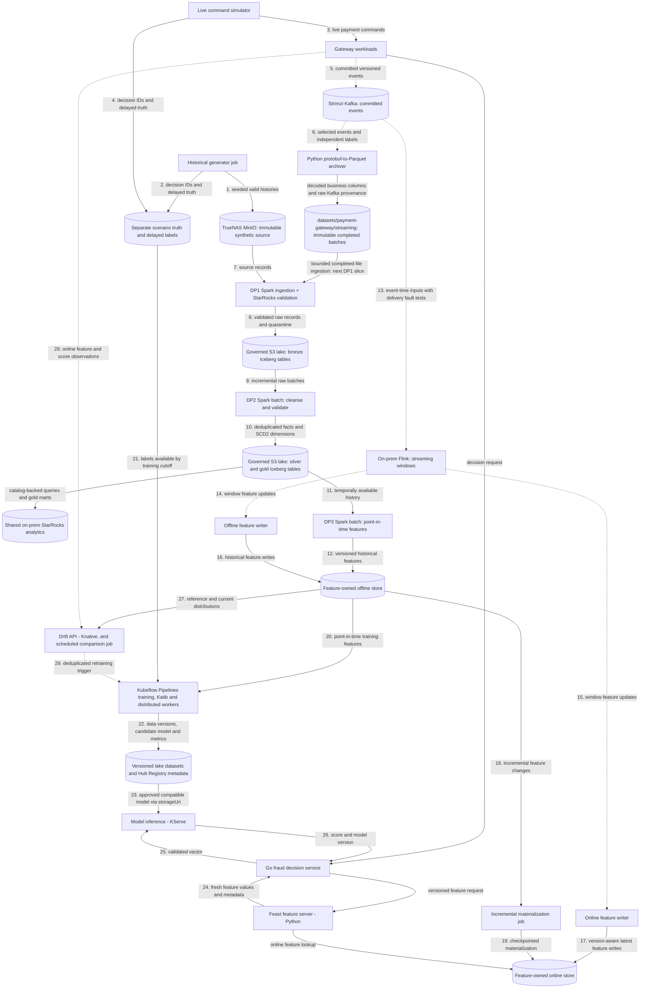

# Data pipeline architecture

Planned generators, DP1–DP3 pipelines and feature stores. Deployable units and the deployment view are in the [platform architecture](../overview/architecture.md); payment contracts are in [payment flows](../payment-gateway/payment-flows.md). The [ML pipeline architecture](ml-pipeline.md) covers training and drift monitoring. Capability coverage and required proof are tracked in the [roadmap](../overview/roadmap.md).

## Flow

This is a target flow, not a claim that its data engines, catalog or warehouse are deployed. Solid arrows show batch/storage transfers and synchronous reads; dotted arrows show streaming events or asynchronous triggers. Storage nodes are labelled by role. Feast feature serving is a separate runtime accessed by Go fraud; feature-access libraries remain embedded in the jobs/server that use them.



## Generation

Historical generation persists valid lifecycle histories outside bronze and outside production payment event storage. Live simulation calls gateway commands so Payments creates authoritative events. The maintained development configuration covers 90 purchase-start days with a physical schema 3-to-4 schedule and complete lifecycle and label tails; v17 is published and downstream acceptance remains pending. Attempt events carry merchant/customer/checkout context matching the gateway Fraud request. Both modes share versioned scenarios for customer, seller, device and synthetic method profiles: ordinary purchases, stolen-card/new-device behavior, unusual geography, reshipping, card testing and retry attacks. Burst, lateness and duplicate delivery are transport conditions; they never fabricate duplicate authoritative transitions. See the [data generator guide](data-generator.md) for configuration and publication.

## Live simulation and landing

`SIMULATOR_CONFIG=<path> python -m simulator.live.runtime` reuses a pinned historical manifest and verifies its profile digest, then drives gateway commands at current machine time. A historical gap is valid; there is no catch-up or maximum-gap requirement. New vault tokens resolve to the selected current profile's method fingerprints; mapping is bounded by the synthetic card encoding, not a legacy dataset cardinality. Merchant/customer assignments and familiar device/network pools are reused; account-created dates anchor profile ages to historical start. Shipping fingerprints follow the gateway's full-address canonicalization and are not guaranteed identical to the historical street-only fingerprints.

Traffic, independent protobuf labels and optional post-commit delay/duplicate/burst-hold delivery run in one Python process. Request retries preserve idempotency keys and content; the fault loop preserves original event bytes, keys and ordered headers on `payments.events.v1.faulty`. Held records commit only through acknowledged contiguous offsets, so restart may add deliveries. Label schedules are bounded in memory: interrupted or unsuccessful schedules are reported, not claimed durable. Synthetic truth is valid for training; scenario/oracle fields remain excluded from features and label joins respect availability time.

The independently enabled Python archiver uses the simulator package/image (`python -m simulator.landing.runtime`) and historical Arrow schemas to write historical-compatible event/label business columns plus reserved `_transport` metadata to `datasets/payment-gateway/streaming/`, alongside explicit `historical/<version>/` exports. Each fresh source epoch uses explicit frozen Kafka start offsets and its own landing group; manifests record the epoch and file paths include `epoch=<id>` so resets cannot mix sources. Live startup logs pin the reference manifest hash, generation/calibration identity and unique run ID; live payments retain distinct IDs and current UTC timestamps. The [completed-batch contract](../../contracts/landing/payments-parquet-v1.schema.json) defines manifests and provenance. It conditionally publishes content-addressed Parquet and then a batch manifest, confirms remote metadata/size, and only then commits Kafka offsets. Retries with different boundaries may overlap; bronze must preserve deliveries and silver owns deduplication. Raw protobuf remains available for exact replay. No Connect S3 plugin, registry or Flink landing workload is required.

The [live-traffic chart](../../infra/charts/live-traffic/values.yaml) shares Kafka, environment-selected object storage and the existing synthetic integration/source credentials. Exercise the simulator first with the archiver disabled, after its CI/image prerequisites pass: current-time gateway traffic, identities, labels, then delivery faults. Streaming-write policy access is needed for the later archiver session, not simulator-only traffic. Exercise landing/recovery next and review that evidence before starting DP1 multi-source ingestion. Select either clean or faulty events plus labels; avoid selecting both payment topics accidentally. Disable both workloads to roll back without deleting Kafka or landed data. The simulator is single-replica `Recreate`; bounded runs stop after configured duration and an enabled Deployment restarts them with a new run ID. A duration of zero runs until shutdown. The live delayed-label scheduler is in memory; shutdown can lose pending labels, so it does not establish durable label delivery.

DP1 consumes completed clean landing manifests through its `recurring` entrypoint, with durable progress, incremental Iceberg commits and retained transport provenance. Changing historical `SOURCE_ROOT` alone does not select landing mode. Raw acceptance enforces schema, integrity and exact conservation; contextual business and label checks belong to DP2 silver. Published source contracts and previous evidence remain unchanged; source publication alone does not establish DP1 acceptance.

## Feature definitions and development order

The [shared baseline definitions](../../contracts/features/fraud-snapshot-v1.yaml) and conformance examples establish request fields, prior assessed-attempt windows, integration-scoped keys, UTC/availability cutoffs and missingness. Flink consumes an unbounded Kafka stream; bounded windows and unmatched-attempt state limit retention without turning it into batch ingestion. Attempt context removes the creation-event join, while the committed risk decision gates historical contributions. Store the same versioned feature updates in online and offline sinks; do not mistake latest online values for historical point-in-time retrieval.

## Pipelines and schemas

The [data products guide](data-products.md) describes the source, Bronze and Silver interfaces, agreements and validation commands.

DP1 ingests and validates raw records; DP2 cleanses and curates them; DP3 computes historical features. Each has observable ingest/validate stages, reusable centrally managed connections/configuration, quarantine or failed-validation evidence, and source/table/job lineage. Bronze uses `raw_` table names; Silver ports use the names declared by their contracts. Later gold dimensions and feature tables follow their own contracts.

Argo Workflows coordinates finite on-prem Spark Operator ingestion and native OpenMetadata stages and their retries. The existing RustFS Iceberg REST catalog uses native SigV4 for multi-engine snapshots over governed lake storage; the synthetic source bucket remains immutable input, not an Iceberg table. Compaction, snapshot expiration, orphan cleanup and retention are explicit maintenance work. The owning DP1 plan selects shared StarRocks for snapshot-pinned SQL validation, analytical queries and gold marts, with native OpenMetadata discovery, profiling and quality. External Iceberg materialized views require scheduled/explicit refresh and store derived data. The ClickStack telemetry store remains observability infrastructure.

Streaming windows specify event time, watermarks, allowed lateness, deduplication and restart semantics. Offline and online writers are independently observable, each committing offsets only after its own sink write and tolerating replay without duplicating feature effects; one shared transformation and versioned feature contract feeds both, with each sink keeping its own checkpoint and deduplication/version policy. Incremental materialization has checkpoints, retries and version-aware idempotency; older late writes cannot replace newer online state. Per-feature TTL, stale/missing defaults and feature-version compatibility protect serving.

The streaming implementation updates rolling counts, the 24h amount sum and seven-day device reference counts incrementally. Ordered expiry queues replace full-history scans and retain exact microsecond window boundaries; each entity registers only its next Flink timer. Typed digest state avoids pickling event-dedup metadata, and each source payload is decoded once. State layout changes require a fresh explicitly isolated epoch rather than allowing unrestored state into existing online keys. Per-entity serialization and the single source-progress observer remain potential bottlenecks; these changes do not establish throughput, checkpoint-size or memory improvements without comparable CI/deployed measurements.

Long-running Flink jobs and their checkpoints stay on premises near Kafka and the lake. Local Spark is the batch baseline. AWS burst evaluation may stage an immutable versioned snapshot _one way_ from MinIO to AWS S3 for a bounded Spark backfill; cloud outputs stay in separate S3 storage until validated and selectively imported. No live bidirectional Iceberg/catalog replication, cross-WAN Flink state or unmeasured large Spark deployment on today's stateless AWS workers.

## Shared storage and service boundaries

Shared storage infrastructure may host separate service-owned databases and credentials; services must not share mutable domain models or query one another's tables. The planned gateway includes Edge, Payments, Go fraud, a processor simulator, an isolated vault simulator, Redis, Kafka and the webhook notifier. Go fraud owns the rules decision runtime; Feast feature serving and KServe inference are introduced later as separate dependencies called directly by Go fraud. Integration configuration and derived IDs replace Accounts. Keep recovery and expiry workers inside Payments until independent scaling or isolation is needed; features, inference, drift and investigation follow their own acceptance steps.

## Historical DP1

`src/data-pipeline/batch` locks Python 3.12, Java 17, Spark 4.1.3, Iceberg 1.12.0 (Scala 2.13) and the official OpenMetadata 2.0.7 ingestion image for native discovery and SQL tests. Root Python 3.14 remains the service/generator toolchain. The Spark image contains verified, checksum-pinned Iceberg/S3A JARs. Fresh dev generator → Bronze → Silver acceptance is pending; schedules remain disabled until source/catalog verification. Prod pipeline acceptance follows the whole pipeline and full-scale generation.

Data workloads live under `src/data-pipeline/`: `batch`, `simulator`, `streaming`, `feast` and `features`. Bronze and Silver share the `batch` Python project, one `pyproject.toml`, one `uv.lock` and one runtime environment. Its `fraud_batch` package contains `bronze`, `silver` and internal `common` modules; DP1 and DP2 retain separate Argo workflows and acceptance. The other workloads retain their own toolchains. The Spark Dockerfile builds a self-contained image with dependencies installed in a separate build stage and runtime caches and unused test directories pruned.

Service-image CI builds and publishes images. Release branches select per-service immutable commit tags through `global.imageTags`; Spark and metadata revisions may differ. Batch runtimes validate the actual digest or commit-tag reference supplied as `IMAGE_REFERENCE`; governance artifact URLs use the metadata image’s own revision.

The platform owns `data`; disabling the chart does not delete the namespace. The platform owns Apache Spark Operator 1.0.0 (chart 1.8.0), scoped to this namespace; the application chart owns Spark workload configuration and credentials.

The SDK catalog base URI is `http://iceberg-catalog.data.svc.cluster.local:8181/api/catalog`; clients append `/v1`. The warehouse identifier is `lakehouse`, backed by the environment platform bucket's `lakehouse/` prefix. OAuth2 uses client `platform`, platform secret `ICEBERG_CLIENT_SECRET`, scope `PRINCIPAL_ROLE:ALL` and token endpoint `/api/catalog/v1/oauth/tokens`. Configure S3 endpoint, region and path style independently; dev uses MinIO and prod uses AWS S3.

`data-pipelines` owns the `gateway-storage` Secret, reading `OBJECT_GATEWAY_ACCESS_KEY_ID` / `OBJECT_GATEWAY_SECRET_ACCESS_KEY` from the gateway `gateway-doppler` store. Flink, lakehouse workflows, metadata storage connections and the synthetic writer share this environment identity, scoped to `datasets/payment-gateway/`, `runs/payment-gateway/` and `lakehouse/`. The same gateway project owns these credentials; no platform storage identity or legacy key aliases are required. `metadata-integrations` owns the OpenMetadata token reference, endpoint and StarRocks connection. Native DP1 stages mount `metadata-connectors` and use `metadata-client`, `openmetadata` and `metadata-starrocks`. Completed-source immutability is enforced by publication logic; the shared storage identity has write access. The preprovisioned `bronze` namespace is checked before creation; source S3A bucket probing is disabled while historical-prefix listing remains required. Never put credential values in Helm arguments or reports.

Trusted PR releases deploy through `deploy/dev`; merged main releases use `deploy/prod`. Image selection is maintained by the release workflow, not manual digest overrides. After CI and deployment integration succeed, publish fresh dev v17, configure its actual digest, then submit:

```bash
argo submit -n data --from workflowtemplate/historical-dp1-bronze \
  -p source-root=s3://platform-dev/datasets/payment-gateway/historical/v17 -p dataset-version=v17
```

Each submission is a batch over one completed source export. `source-root` and `dataset-version` are workflow parameters with chart-configured defaults. Submit a new source version for the next batch; retries of an accepted version reuse its recorded snapshots. Recurring landing ingestion uses the separate `recurring` entrypoint described below.

The workflow serializes writers and persists logical ingestion identity before commits. Under the writer mutex, each run first deletes and waits for previous bronze-payment workflow pods, then their SparkApplications and Spark pods; failed recovery prevents ingestion. Each Spark attempt also clears its previous stage resources before starting, so a failed cleanup cannot overlap a retry. Each ingest attempt creates a SparkApplication using the image's installed `fraud_batch/bronze/runtime.py` with `PIPELINE_STAGE=ingest`. The remaining stages are finite containers: input selection on the metadata image, a reusable thin OpenMetadata image for native discovery/tests/profiling, and SDK publication/readback. Shared SDK configuration and the native runner are separated from DP1 product/contract/acceptance mapping; DP1 lives in `fraud_batch.bronze.bronze_metadata`, while later DP2/DP3 publication modules can run from the same image under Argo. Historical validation and bounded profiling run in parallel; daily ingestion skips profiling. Drivers request 500m CPU and 2.5 GiB; each of the two executors has one core and 2 GiB plus 1 GiB overhead, requesting 500m CPU. Chart values `spark.executors` and `spark.shufflePartitions` default to two and 1,024 for development ingestion. AQE coalesces shuffle partitions toward 64 MiB with `parallelismFirst=false`; this is a scale starting point pending development measurements. Driver/executor JVM and Python logging retain WARN and ERROR messages. Parquet/Iceberg formats and the 128 MiB output-file target are unchanged. Operator restarts are disabled; Argo owns two ingest retries; native steps retry once and deterministic quality failures are never retried. Argo waits for the operator's terminal state, deletes the application with foreground cascading cleanup, then explicitly deletes and waits for its labelled driver/executor pods before proceeding, and removes any remaining execution resources on exit. Workflow owner references cascade deletion, but active background Workflow deletion was observed to release the writer mutex while Spark containers were still running. Chart values `workflow.activeDeadlineSeconds` and `spark.activeDeadlineSeconds` bound the workflow and Spark resource/driver stages, defaulting to 7,200 and 2,400 seconds. Later scale deadlines require measured sizing. The platform admission guard requires a terminal Workflow phase before deletion in `data` and rejects hard termination unless the existing phase is Pending or terminal. Cancel through graceful `argo stop -n data <workflow>`, wait for completion and verify the cleanup steps succeeded before deleting the Workflow. A terminal phase alone does not prove cleanup; the next run must finish recovery before writing. SparkApplication attempt names remain in durable run and validation evidence; deleting execution resources does not remove source, lake or evidence objects.

DP1 supports only current-contract manifests with an embedded inventory and rejects any other manifest before writes. It requires passed native source declarations, or an explicit `result: skipped`, `gate: dp1-starrocks-openmetadata` declaration with a reason. The latter permits ingestion and is preserved in run and validation evidence; it is executed by the StarRocks validation policy (`bronze-catalog-v4` for new runs), which is recorded in the run, and bronze acceptance requires every native result to pass; there is no legacy fallback. Other skipped or missing source-validation declarations are rejected. DP1 reads only manifest inventory files, streams hashes on workers, checks byte/row/partition counts and source identities, and normalizes without narrowing integer types. `PIPELINE_STAGE=verify-source dp1` re-verifies every listed file against the embedded inventory. Ingestion never discovers or creates inventory evidence implicitly. It preserves all deliveries. Writes atomically replace only the selected source-version partition; two table commits remain a candidate until both snapshot IDs, native results and governance are complete. Recovery discovers a committed snapshot using its logical run ID and manifest digest. Run context and accepted records live under `EVIDENCE_ROOT` (`dp1-evidence/catalog-v4` for new runs); validation selects the recorded pair even if latest table state advances. Readers must use `accepted/<dataset_version>.json` and its snapshot IDs, filtered by `_source_dataset_version`. Never expire referenced snapshots or remove their reports.

The source product uses manifest format 3 and `task-fragments-v1`: each listed task file can span multiple dates and declares its schema version and per-date row counts. Bronze partitions by source version and timestamp day. Generator ratio bands are informational; integrity, conservation and contract failures still block acceptance. Validation evidence keys include the policy and contract hashes, so a change produces separate evidence. Spark reconciles persisted snapshots bidirectionally against source frames with duplicate-preserving `exceptAll`; matching manifest/snapshot receipts are required for acceptance. Native SQL independently compares per-day counts with the complete manifest.

Replaying the same manifest reuses snapshots. A changed digest under the same source version fails. Changed bronze contracts produce a new evidence key and require rerunning the native steps without rewriting data. The metadata discovery stage renders every rule from the Git contracts as StarRocks `COUNT(*)` SQL (expected zero) pinned to the recorded event and label snapshot IDs and stores the expected rule set before execution. OpenMetadata runs the SQL; a failed assertion still exits zero, so the publication stage reads back all expected results and refuses missing, stale, `Failed`, `Aborted` or non-zero ones.

Native `metadata ingest` discovers `starrocks.lakehouse.bronze.raw_*` through the `openmetadata` StarRocks user, whose connection sets `init_command: SET CATALOG lakehouse`. The generated bundled `schema_types` and `schema_required` rules check nested fidelity independently of connector extraction; hidden `_file` and `_pos` columns also appear. The Python SDK synchronizes nested native contracts, active quality references, declared owners, source/bronze product assets and input/output ports. Actual source storage containers link to their independent table outputs through the Argo pipeline; labels do not use the events table as an ingestion source. Pipeline tasks, execution I/O/counts/snapshots and Argo links are read back with contract fields and forward/reverse membership before acceptance. Native contract links use stable canonical `blob/main` paths. Set `config.GIT_REVISION` to the full source commit used by the metadata image; contract descriptions retain its immutable artifact URL alongside ODCS YAML/identity/version/hash, and execution parameters retain the publication revision. Metadata-only replay uses `--entrypoint metadata-replay`, preserving the run and native result timestamps. The bot token is `OPENMETADATA_TOKEN`.

Retry governance and acceptance without launching Spark or rerunning the native steps:

```bash
argo submit -n data --from workflowtemplate/historical-dp1-bronze --entrypoint metadata-replay
```

Rollback stops workflows and disables the application; retain source, warehouse, run evidence, accepted snapshots and the independently owned platform OpenMetadata state. Select the previous accepted pair rather than deleting tables or buckets.

Recurring DP1 reads only completed clean manifests under `streaming/_batches/epoch=<epoch>/`, without an event-date cutoff. It freezes at most `recurring.maxBatches` manifests per run, balances event/label selection, rejects changed completion identities and overlapping offset ranges, and advances its durable epoch ledger only after acceptance. Backlogs are drained across subsequent runs; daily capacity must be sized to arrival rate. `_source_epoch`, `_source_batch` and `_transport` preserve the original epoch/completion key and Kafka topic, partition, offset, timestamp, key, raw bytes and ordered headers. Optional provenance fields are added to the Iceberg schema without rewriting historical source data. Unchanged ports keep their snapshot; missing same-batch labels or terminal events are valid raw input.

Enable `recurring.enabled` to install `recurring-dp1-bronze`, scheduled daily at 00:00 UTC by default. It shares the writer mutex and cleanup guard with historical runs. No-input executions skip Spark/native tests. Submit an immediate batch with `argo submit -n data --from cronwf/recurring-dp1-bronze`. This does not start the simulator or change Kafka offsets. Recurring profiling is disabled. Request a bounded latest-state scalar-column profile explicitly with `argo submit -n data --from workflowtemplate/historical-dp1-bronze --entrypoint profile-only -p dataset-version=<recorded-version>`. This does not rerun ingestion or SQL quality tests; native discovery, bundled schema checks, exact duplicate-aware batch reconciliation and governance readback remain required.

Fresh Bronze acceptance must establish raw preservation, schema, integrity and provenance. Lifecycle reconstruction, conflicting business duplicates, amount/risk/context checks, cross-table linkage and label maturity/as-of joins belong to DP2 silver. Their retained SQL is `contracts/quality/silver-payments.yaml`; it is planned work, not executed silver acceptance. Fresh historical and recurring receipts remain pending in the migrated environment. Deliberate isolated failure/outage exercises are not required; full-scale benchmarking/coursework acceptance follows completion of the whole pipeline.

For DP2, resolve `accepted/<dataset_version>.json` under the configured `EVIDENCE_ROOT` (`s3://<platform-bucket>/runs/payment-gateway/dp1`), pin both recorded snapshots and retain the source-version filter. Use the recurring epoch ledger to identify accepted batches; do not infer completeness from event dates or the latest table state. Preserve referenced snapshots and evidence. Silver owns business deduplication, lifecycle/linkage checks and label availability/maturity; `contracts/quality/silver-payments.yaml` is the retained SQL handoff, not executed silver acceptance.

## Silver DP2

The `historical-dp1-bronze` and `historical-dp2-silver` Argo templates run independently. DP2 consumes explicitly accepted Bronze versions. It pins both Bronze snapshots per receipt, validates physical schema provenance, replaces each Silver table with the selected batch result and runs native discovery, validation and governance before advancing an accepted pointer. Iceberg snapshots retain prior accepted results; commits are tagged with the candidate ID so retries can recover completed writes. This MVP writes complete table snapshots, not incremental row merges. Every run recomputes the complete explicitly selected input set. Include prior Bronze receipts when retaining earlier history; newly selected older events and late labels are incorporated without date-watermark filtering. Automatic accepted-base merging, affected-payment recomputation and bounded-backfill modes are deferred. Complete and recurring histories use distinct completeness checks; incomplete recurring context remains pending.

The separate `benchmark` entrypoint compares direct versus salted merchant/category counts and `countDistinct` versus distinct-then-count customer/payment-method aggregation against the same pinned inputs and declared resources, retaining plans, runtime, job/stage IDs and a bidirectional content comparison. Task-duration and shuffle/spill evidence is captured manually in Spark UI. It does not infer an improvement or full-scale acceptance. The normal Silver acceptance graph does not run it. Both entrypoints retain compressed Spark event logs under the Silver evidence root. Capture real Spark UI and code screenshots separately; a compatible Spark history server can inspect retained event logs after the driver exits. Candidate writes and benchmark results are not Silver acceptance. Submit the benchmark separately with `argo submit -n data --from workflowtemplate/historical-dp2-silver --entrypoint benchmark -p candidate-id=<candidate-id> -p completeness=<complete-or-recurring>` using the candidate’s original Spark image release. `SILVER_BENCHMARK_SALT_BUCKETS` configures the hash buckets (default 8); retain baseline task evidence before selecting or interpreting this experiment.

Coursework screenshots are manual report artifacts, separate from pipeline acceptance. Keep the selected manifest hash, code revision, workflow/application IDs and snapshot IDs in the report captions or the existing [evidence index](../../openspec/changes/rework-simulator-spark-coursework/evidence/index.md). No screenshot validator, upload format or screenshot tests are required.

### Capturing coursework screenshots

Capture actual results after the relevant CI-built job has run; the new dataset and Silver runtime evidence are still pending. Hide credentials and tokens before taking screenshots.

1. **Generator configuration and volume:** open the configuration used for generation and its completed `manifest.json`. Capture the seed, entity pools, skew/duplicate settings, schema schedule, and the manifest's rows/files/bytes, format/compression and separate event/label time ranges. Include the dataset version and manifest hash in the caption.
2. **Data characteristics:** open the diagnostic JSON referenced by the candidate's `diagnostics.key` under `SILVER_EVIDENCE_ROOT`. Capture `merchant_shares`, `category_shares` or `region_shares`, `identity_cardinality` with `relative_error`, `assessment_references` grouped by source version/date, and `event_delivery_accounting` with `post_dedup_duplicates`. Show denominators and any `truncated` flags. Old-schema nulls must be shown alongside populated new-schema references.
3. **Transformation code:** capture the relevant functions in `simulator/storage.py` (duplicate exports), `fraud_batch/common/bronze_schema.py` (normalization), `fraud_batch/silver/silver.py` (canonical events and linkage), and `fraud_batch/silver/diagnostics.py` (measurements). Use the code revision that produced the displayed results; include only the functions needed to explain them.
4. **Spark baseline and optimization:** when running the optional benchmark, open its application in Spark UI or the history server. Capture the SQL plan and the slow stage's task-duration spread, shuffle and spill for each variant, with application/stage IDs visible. Pair these with the retained runtime and equal-content comparison. Explain the actual changed code/configuration and report slower results honestly; repartitioning alone is not proof of an improvement.
5. **Pipeline ordering:** open each DP1 and DP2 run in Argo, expand its graph, and capture the workflow name, stage order and outcomes. DP1 and DP2 are separate runs; include the accepted Bronze receipt used by DP2 in the caption.
6. **Governance:** open the discovered Silver tables in OpenMetadata. Capture the lineage view, the executed quality results and the contract details. Include the candidate's accepted snapshot IDs and execution identity in the report so the screens can be traced to the data. Describe the tools as Argo and OpenMetadata.

Use the workflow's `publish-only` entrypoint with `candidate-id` to repeat native governance readback and conditional acceptance. Failed candidates do not replace the prior accepted pointer. Publication uses a conditional lock; only after the previous publisher is confirmed stopped may an operator set `SILVER_TAKEOVER_STOPPED_PUBLISHER=true` in its runtime configuration. The [evidence index](../../openspec/changes/rework-simulator-spark-coursework/evidence/index.md) tracks what is still missing.

## Shared metadata integrations

The Argo CD `metadata-integrations` application owns shared connections and daily 03:00 UTC discovery independently of `data-pipelines`. Its chart values configure canonical services, filters and external credential references. Each connector declares its ExternalSecret alongside its connection; the catalog token is grouped with the OpenMetadata endpoint. A configuration/image-addressed Job idempotently registers services; scheduled native discovery refreshes StarRocks tables and Kafka topics. Object storage and Argo use scheduled registration only; pipelines retain their logical source containers and execution lineage. Per-connector pods receive only their connection Secret and the catalog token. Configuration changes do not rewrite accepted DP1 evidence or run ingestion. Removing a connector schedule does not delete its catalog assets.

Deploy the shared metadata application and registrations before switching DP1 to the new image/configuration. Initial registration may fail until shared ExternalSecrets are ready; reconcile/retry it after readiness. Operational database connectors and reader provisioning are outside this deployment.

Operational discovery enables neither row sampling nor profiling, query usage or stored-procedure body ingestion. Kafka uses the existing internal PLAINTEXT listener, an explicit topic allowlist and no offset commits or message samples; the Kafka chart owns Karapace schema registration, while registry-aware producer/consumer serialization remains separate work. The native Kafka connector uses `http://schema-registry.payment-gateway.svc.cluster.local:8081` to retrieve registered schemas using the default `<topic>-value` subjects. Empty registry subjects do not establish schema discovery, and catalog discovery does not establish producer/consumer/Connect lineage. Kafka assets need no data product merely to be discoverable. Define an ODPS/ODCS product only when exposing a governed consumer interface. Definitions stay under `contracts/`, owned by their product; pipeline publication stages reuse the metadata image SDK code. Feast/Flink/Kubeflow semantic assets and execution lineage require their own supported integration and acceptance. Kubeflow is outside the current connector scope. No new live connector or DP1 acceptance is claimed by configuration and CI alone.
