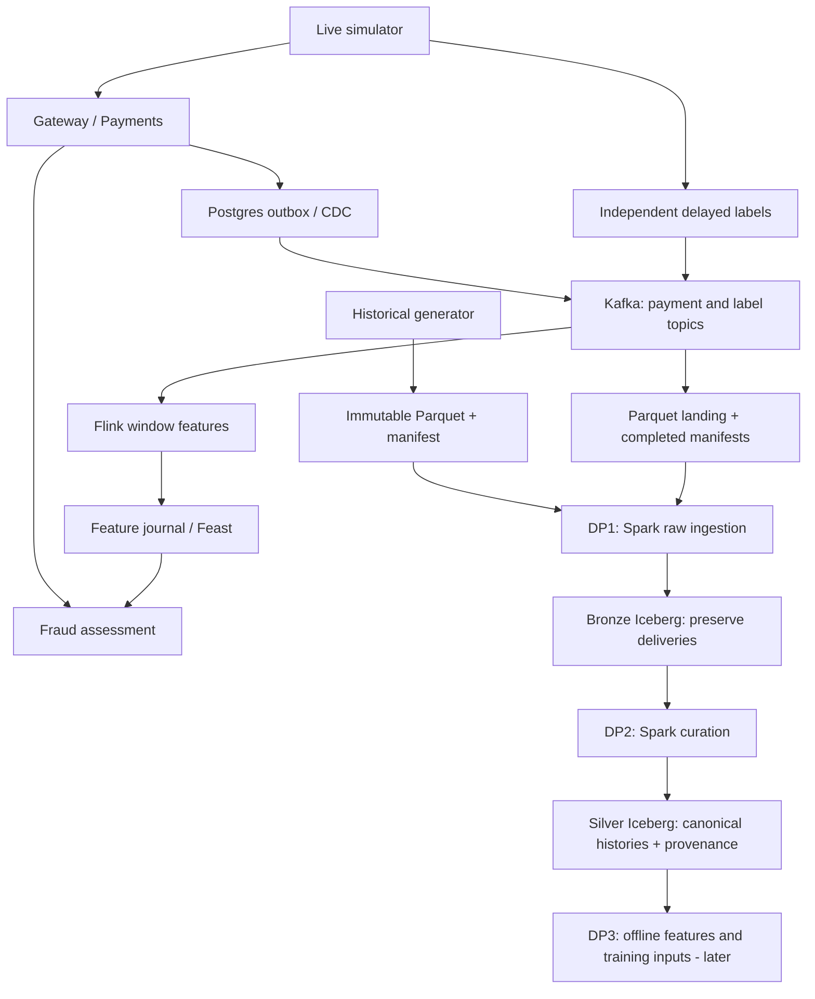

# Data pipeline architecture

The batch path uses Spark and Iceberg, orchestrated by Argo, with StarRocks SQL quality checks and OpenMetadata contracts/lineage. See [data products](data-products.md) for interfaces, [platform architecture](../overview/architecture.md) for infrastructure and [ML pipeline](ml-pipeline.md) for training and drift. Accepted dev results and screenshots are in [verification](verification.md).

## Flow



Historical exports and streaming landing use compatible business columns, with extra transport provenance for Kafka deliveries. They feed the same DP1 implementation through separate historical and recurring entrypoints. This slice accepted historical dev v17; it does not establish recurring, drift or training acceptance.

## Live simulation and landing

`python -m simulator.live.runtime` reads YAML selected by `SIMULATOR_CONFIG`, pins a historical entity world and issues current-time gateway commands. Payments owns authoritative events; retries preserve request idempotency. Independent delayed labels and optional post-commit burst/late/duplicate delivery run in the simulator. The faulty topic preserves original event bytes, keys and ordered headers. Select either clean or faulty payment events for a consumer, avoiding double subscription.

`python -m simulator.landing.runtime` writes decoded business fields plus raw Kafka provenance, then publishes a completed manifest before committing offsets. The [landing contract](../../contracts/landing/payments-parquet-v1.schema.json) defines that boundary. Source epochs pin starting offsets and isolate landing paths/groups; they do not require separate Bronze implementations. Silver handles business deduplication. The live label scheduler remains in memory and can lose pending labels at shutdown.

Flink consumes committed decisions and attempt context for the [versioned feature definitions](../../contracts/features/fraud-snapshot-v1.yaml). Online and offline feature history must share temporal/availability semantics. Current serving status belongs to the [roadmap](../overview/roadmap.md); this batch change does not alter Flink or Feast.

## Historical DP1

Bronze and Silver share the Python project, lockfile and Spark image under [`src/data-pipeline/batch`](../../src/data-pipeline/batch), but run as independent workflows. Spark Operator runs finite jobs; Argo owns orchestration and retries. Shared `metadata-integrations` owns catalog connections and scheduled discovery; each pipeline owns run-specific quality and product publication.

After the CI-built image is deployed, submit a completed export:

```bash
argo submit -n data --from workflowtemplate/historical-dp1-bronze \
  -p source-root=s3://platform-dev/datasets/payment-gateway/historical/v17 -p dataset-version=v17
```

DP1 reads only manifest-listed files, verifies integrity and normalizes supported physical schemas without losing fields or duplicate deliveries. It reconciles persisted events and labels against source content using bidirectional duplicate-aware comparisons. Native quality and governance must pass before acceptance. Read `accepted/<dataset_version>.json` under the configured DP1 run root and pin its independent event/label snapshots; latest table state is not an accepted input.

Replaying an unchanged source reuses snapshots; a changed digest under the same version is rejected. Metadata-only recovery uses `--entrypoint metadata-replay`. Retain referenced snapshots and remote receipts. Stop runs gracefully with `argo stop`, wait for cleanup, then delete execution resources if needed.

Recurring DP1 reads completed manifests under `streaming/_batches/epoch=<epoch>/`, preserves transport metadata and advances its durable batch ledger after acceptance. Enable `recurring.enabled` only after verifying the source/catalog; an immediate run uses `argo submit -n data --from cronwf/recurring-dp1-bronze`. Source delivery completeness does not imply business lifecycle completeness.

## Silver DP2

`historical-dp2-silver` consumes explicitly selected accepted Bronze receipts. It pins both input snapshots, detects conflicting duplicates, canonicalizes identical events, preserves exact delivery provenance, reconstructs attempts and validates lifecycle/linkage and label availability. [Silver contracts](../../contracts/data-products/silver-payments) declare the five outputs; [quality SQL](../../contracts/quality/silver-payments.yaml) supplies native rules.

The MVP recomputes the complete selected input set and replaces each output table. Include prior receipts to retain earlier history. Older newly accepted events and late labels are included without event-date watermark filtering. Incomplete recurring context remains pending. Automatic incremental merging is deferred.

Discovery, native validation and governance/readback precede the accepted pointer. A failed candidate cannot replace the accepted result. `--entrypoint publish-only -p candidate-id=<candidate-id>` retries publication of an existing validated candidate without rerunning Spark.

The optional benchmark is separate from normal acceptance:

```bash
argo submit -n data --from workflowtemplate/historical-dp2-silver \
  --entrypoint benchmark -p candidate-id=<candidate-id> -p completeness=complete
```

Use the candidate's original Spark image. It compares direct/salted aggregation and alternative distinct counting on identical inputs/resources, checking equal content. Plans and event logs remain in remote run storage. Actual results, resource adjustments and UI limitations are documented in [verification](verification.md).

## Temporal and storage rules

Labels are independent observations: missing reports remain unknown and training joins respect availability/maturity. Scenario/oracle fields and future outcomes cannot become features. Gold marts, SCD2/as-of joins and offline feature tables follow their own contracts and later acceptance.

Iceberg snapshots provide reproducible reads; compaction and retention are explicit maintenance. StarRocks queries external Iceberg tables; external-catalog materialized views store derived data and need scheduled or explicit refresh. Do not expire snapshots referenced by accepted receipts.
