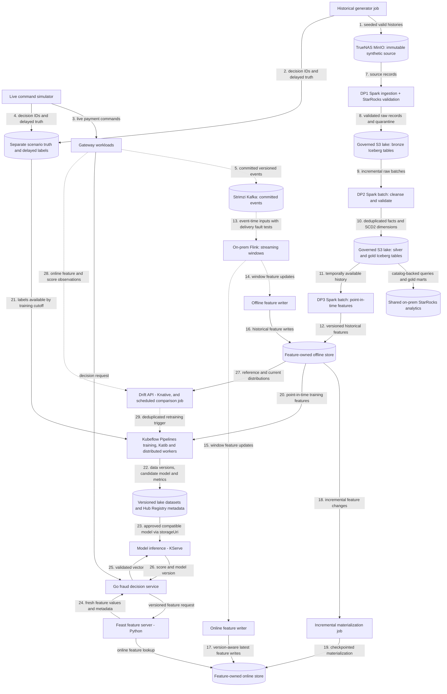

# Data pipeline architecture

Planned generators, DP1–DP3 pipelines and feature stores. Deployable units and the deployment view are in the [platform architecture](../overview/architecture.md); payment contracts are in [payment flows](../payment-gateway/payment-flows.md). The [ML pipeline architecture](ml-pipeline.md) covers training and drift monitoring. Capability coverage and required proof are tracked in the [roadmap](../overview/roadmap.md).

## Flow

This is a target flow, not a claim that its data engines, catalog or warehouse are deployed. Solid arrows show batch/storage transfers and synchronous reads; dotted arrows show streaming events or asynchronous triggers. Storage nodes are labelled by role. Feast feature serving is a separate runtime accessed by Go fraud; feature-access libraries remain embedded in the jobs/server that use them.

## Generation

Historical generation persists valid lifecycle histories outside bronze and outside production payment event storage. Live simulation calls gateway commands so Payments creates authoritative events. The maintained development source covers 90 purchase-start days using payload schema 3, including complete lifecycle and label tails. Attempt events carry merchant/customer/checkout context matching the gateway Fraud request. Both modes share versioned scenarios for customer, seller, device and synthetic method profiles: ordinary purchases, stolen-card/new-device behavior, unusual geography, reshipping, card testing and retry attacks. Burst, lateness and duplicate delivery are transport conditions; they never fabricate duplicate authoritative transitions.

## Live simulation

`SIMULATOR_CONFIG=<path> python -m simulator.live.runtime` reuses a pinned historical manifest and verifies its profile digest, then drives gateway commands at current machine time. A historical gap is valid; there is no catch-up or maximum-gap requirement. New vault tokens resolve to the selected current profile's method fingerprints; mapping is bounded by the synthetic card encoding, not a legacy dataset cardinality. Merchant/customer assignments and familiar device/network pools are reused; account-created dates anchor profile ages to historical start. Shipping fingerprints follow the gateway's full-address canonicalization and are not guaranteed identical to the historical street-only fingerprints.

Traffic, independent protobuf labels and optional post-commit delay/duplicate/burst-hold delivery run in one Python process. Request retries preserve idempotency keys and content; the fault loop preserves original event bytes, keys and ordered headers on `payments.events.v1.faulty`. Held records commit only through acknowledged contiguous offsets, so restart may add deliveries. Label schedules are bounded in memory: interrupted or unsuccessful schedules are reported, not claimed durable. Synthetic truth is valid for training; scenario/oracle fields remain excluded from features and label joins respect availability time.

## Feature definitions and development order

The [shared baseline definitions](../../contracts/features/fraud-snapshot-v1.yaml) and conformance examples establish request fields, prior assessed-attempt windows, integration-scoped keys, UTC/availability cutoffs and missingness. Flink consumes an unbounded Kafka stream; bounded windows and unmatched-attempt state limit retention without turning it into batch ingestion. Attempt context removes the creation-event join, while the committed risk decision gates historical contributions. Store the same versioned feature updates in online and offline sinks; do not mistake latest online values for historical point-in-time retrieval.

The schema-3 v16 source and current-time live/landing exercise passed; the [source/live evidence](../../openspec/changes/archive/2026-10-26-finalize-feature-contract-and-90-day-smoke/verification.md) records the manifest, epochs, offsets, replay and remaining limits. Those observations describe the previous deployment. The fresh migration selects v17, which must be generated and validated before use; build Flink/Feast, Spark offline features, Kubeflow training and KServe before starting scale generation. The 100 GB coursework/scale target remains a later requirement. Storage and DP1 acceptance must follow the owning data-platform change; source publication alone does not accept bronze.

## Pipelines and schemas

The [data products guide](data-products.md) describes the source and bronze interfaces, agreements and validation commands. Curated dataset contracts are added with their pipelines.

DP1 ingests and validates raw records; DP2 cleanses and curates them; DP3 computes historical features. Each has observable ingest/validate stages, reusable centrally managed connections/configuration, quarantine or failed-validation evidence, and source/table/job lineage. Bronze uses `raw_`, silver `stg_`, and gold `dim_`, `fact_`, `obt_`, `feat_` conventions. SCD2 dimensions carry `valid_from_ts`, `valid_to_ts`, `is_current`; feature tables carry `event_timestamp` and `created`.

Argo Workflows coordinates finite on-prem Spark Operator ingestion and native OpenMetadata stages and their retries. The existing RustFS Iceberg REST catalog uses native SigV4 for multi-engine snapshots over governed lake storage; the synthetic source bucket remains immutable input, not an Iceberg table. Compaction, snapshot expiration, orphan cleanup and retention are explicit maintenance work. The owning DP1 plan selects shared StarRocks for snapshot-pinned SQL validation, analytical queries and gold marts, with native OpenMetadata discovery, profiling and quality. External Iceberg materialized views require scheduled/explicit refresh and store derived data. The ClickStack telemetry store remains observability infrastructure.

Streaming windows specify event time, watermarks, allowed lateness, deduplication and restart semantics. Offline and online writers are independently observable, each committing offsets only after its own sink write and tolerating replay without duplicating feature effects; one shared transformation and versioned feature contract feeds both, with each sink keeping its own checkpoint and deduplication/version policy. Incremental materialization has checkpoints, retries and version-aware idempotency; older late writes cannot replace newer online state. Per-feature TTL, stale/missing defaults and feature-version compatibility protect serving.

The streaming implementation updates rolling counts, the 24h amount sum and seven-day device reference counts incrementally. Ordered expiry queues replace full-history scans and retain exact microsecond window boundaries; each entity registers only its next Flink timer. Typed digest state avoids pickling event-dedup metadata, and each source payload is decoded once. State layout changes require a fresh explicitly isolated epoch rather than allowing unrestored state into existing online keys. Per-entity serialization and the single source-progress observer remain potential bottlenecks; these changes do not establish throughput, checkpoint-size or memory improvements without comparable CI/deployed measurements.

Long-running Flink jobs and their checkpoints stay on premises near Kafka and the lake. Local Spark is the batch baseline. AWS burst evaluation may stage an immutable versioned snapshot _one way_ from MinIO to AWS S3 for a bounded Spark backfill; cloud outputs stay in separate S3 storage until validated and selectively imported. No live bidirectional Iceberg/catalog replication, cross-WAN Flink state or unmeasured large Spark deployment on today's stateless AWS workers.

## Shared storage and service boundaries

Shared storage infrastructure may host separate service-owned databases and credentials; services must not share mutable domain models or query one another's tables. The planned gateway includes Edge, Payments, Go fraud, a processor simulator, an isolated vault simulator, Redis, Kafka and the webhook notifier. Go fraud owns the rules decision runtime; Feast feature serving and KServe inference are introduced later as separate dependencies called directly by Go fraud. Integration configuration and derived IDs replace Accounts. Keep recovery and expiry workers inside Payments until independent scaling or isolation is needed; features, inference, drift and investigation follow their own acceptance steps.

Bronze and Silver are being rebuilt; the DP1 pipeline and its Bronze contracts are not part of `main`. The historical source is described in the [data generator](data-generator.md).

## Shared metadata integrations

The Argo CD `metadata-integrations` application owns shared connections and daily 03:00 UTC discovery independently of `data-pipelines`. Its chart values configure canonical services, filters and external credential references. Each connector declares its ExternalSecret alongside its connection; the catalog token is grouped with the OpenMetadata endpoint. A configuration/image-addressed Job idempotently registers services; scheduled native discovery refreshes StarRocks tables and Kafka topics. RustFS and Argo use scheduled registration only; pipelines retain their logical source containers and execution lineage. Per-connector pods receive only their connection Secret and the catalog token. Configuration changes do not rewrite accepted DP1 evidence or run ingestion. Removing a connector schedule does not delete its catalog assets.

Deploy the shared metadata application and registrations before switching DP1 to the new image/configuration. Initial registration may fail until shared ExternalSecrets are ready; reconcile/retry it after readiness. Operational database connectors and reader provisioning are outside this deployment.

Operational discovery enables neither row sampling nor profiling, query usage or stored-procedure body ingestion. Kafka uses the existing internal PLAINTEXT listener, an explicit topic allowlist and no offset commits or message samples; the Kafka chart owns Karapace schema registration, while registry-aware producer/consumer serialization remains separate work. The native Kafka connector uses `http://schema-registry.payment-gateway.svc.cluster.local:8081` to retrieve registered schemas using the default `<topic>-value` subjects. Empty registry subjects do not establish schema discovery, and catalog discovery does not establish producer/consumer/Connect lineage. Kafka assets need no data product merely to be discoverable. Define an ODPS/ODCS product only when exposing a governed consumer interface. Definitions stay under `contracts/`, owned by their product; pipeline publication stages reuse the metadata image SDK code. Feast/Flink/Kubeflow semantic assets and execution lineage require their own supported integration and acceptance. Kubeflow is outside the current connector scope. No new live connector or DP1 acceptance is claimed by configuration and CI alone.
