# Development data verification

Fresh dev v17 generation, independent Bronze/Silver acceptance and an equivalent-output Spark benchmark completed on 2026-10-28. This page retains the useful screenshots and their interpretation; the executed [generator notebook](../../src/data-pipeline/simulator/notebooks/historical-sanity.ipynb) contains source measurements and plots. Full-scale/prod, model quality, streaming faults and drift are outside these results.

## Source and generator

Source: `s3://platform-dev/datasets/payment-gateway/historical/v17/manifest.json`, SHA256 `12f32c115ae82226eec97c5ceed54549c871f2735210697ddeec17d3761fa5f9`.

The verified inventory contains 1,959 Parquet files, Zstandard level 3, totalling 146,690,621 physical bytes. There are 811,960 event deliveries and 161,967 label observations. Purchase starts span 90 days; events extend to September 29, 2025 and label availability to October 19. The notebook verifies every inventory file and shows skew distributions and observed cardinalities rather than treating configured pools as measurements.

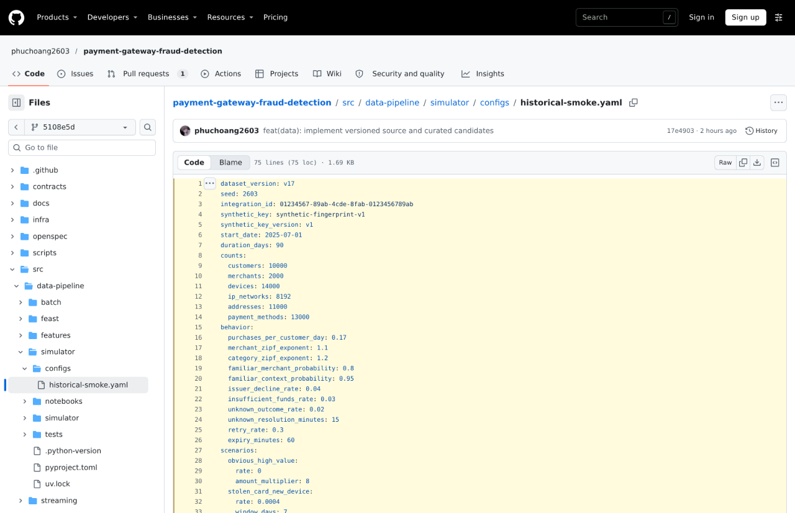

The configured extra-delivery rate is 2% of all exported event deliveries. Actual accounting is 795,718 canonical events + 16,242 identical duplicates = 811,960 deliveries (2.000345% duplicates). Silver reports zero conflicting/pending deliveries and zero post-dedup duplicates.

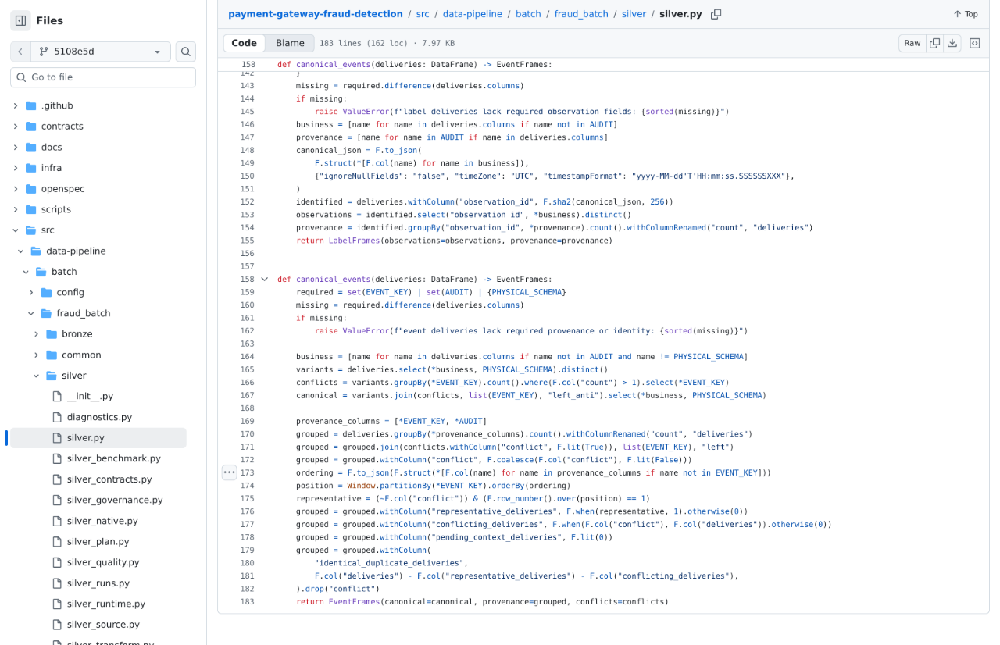

Spark cardinalities use `approx_count_distinct`, relative error 0.05, over 157,202 attempts. Estimates can exceed configured pools. Merchant diagnostics show only the top 20, using full-population denominators; notebook plots provide the source distribution context.

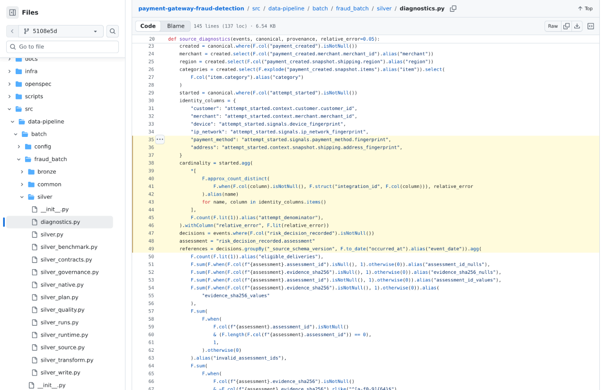

### Schema evolution

Physical schema 3 accounts for 400,601 event deliveries; schema 4 for 411,359. All 79,107 eligible schema-3 decision deliveries lack the two assessment references; all 81,326 schema-4 decision deliveries retain both values, with zero malformed values. Absence in the old physical shape normalizes to null. Synthetic references identify synthetic assessment evidence, not online served vectors.

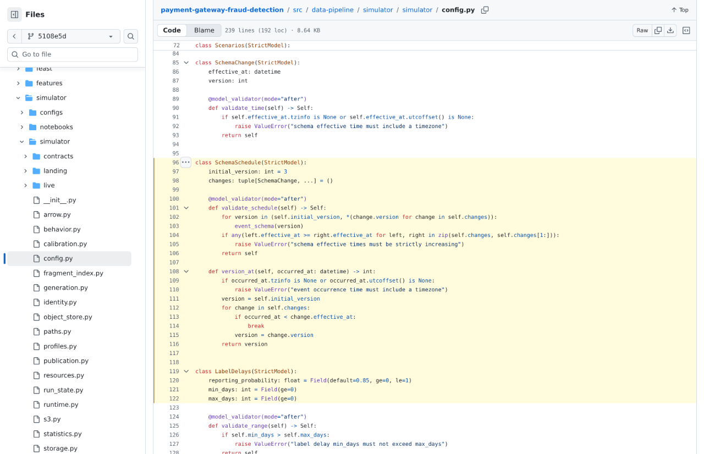

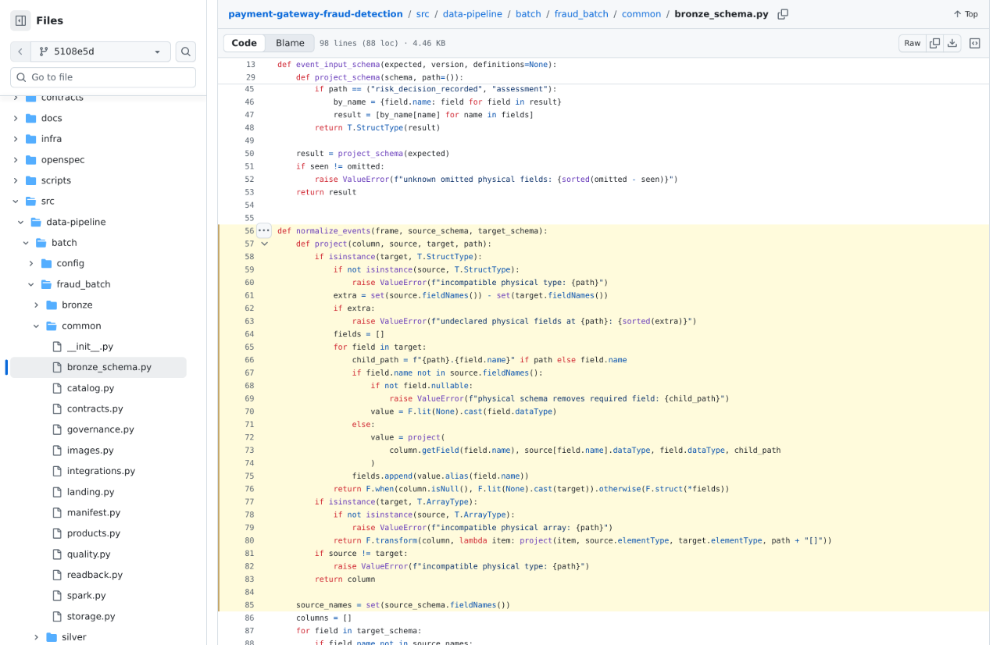

These code captures use revision `5108e5db029137c975e8fe4bcc6fa485b68c50f0`: [generator config](https://github.com/phuchoang2603/payment-gateway-fraud-detection/blob/5108e5db029137c975e8fe4bcc6fa485b68c50f0/src/data-pipeline/simulator/configs/historical-smoke.yaml), [schedule](https://github.com/phuchoang2603/payment-gateway-fraud-detection/blob/5108e5db029137c975e8fe4bcc6fa485b68c50f0/src/data-pipeline/simulator/simulator/config.py), [normalization](https://github.com/phuchoang2603/payment-gateway-fraud-detection/blob/5108e5db029137c975e8fe4bcc6fa485b68c50f0/src/data-pipeline/batch/fraud_batch/common/bronze_schema.py), [deduplication](https://github.com/phuchoang2603/payment-gateway-fraud-detection/blob/5108e5db029137c975e8fe4bcc6fa485b68c50f0/src/data-pipeline/batch/fraud_batch/silver/silver.py) and [diagnostics](https://github.com/phuchoang2603/payment-gateway-fraud-detection/blob/5108e5db029137c975e8fe4bcc6fa485b68c50f0/src/data-pipeline/batch/fraud_batch/silver/diagnostics.py).

## Bronze acceptance

Workflow `data/dev-v17-dp1-5q4vz` succeeded. It reused the already persisted raw snapshots and reran discovery, quality, profiling and publication. Six native cases passed across the two ports, with zero problems/governance gaps. Spark bidirectional `exceptAll` reconciliation establishes duplicate-aware source/output equality.

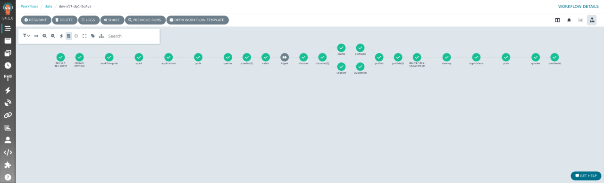

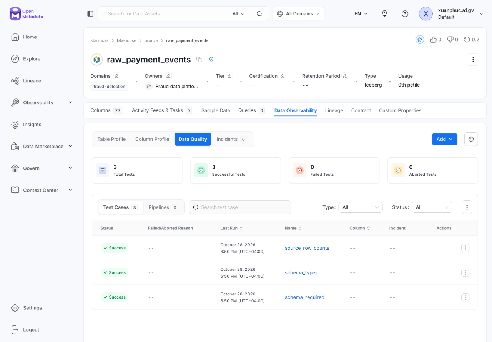

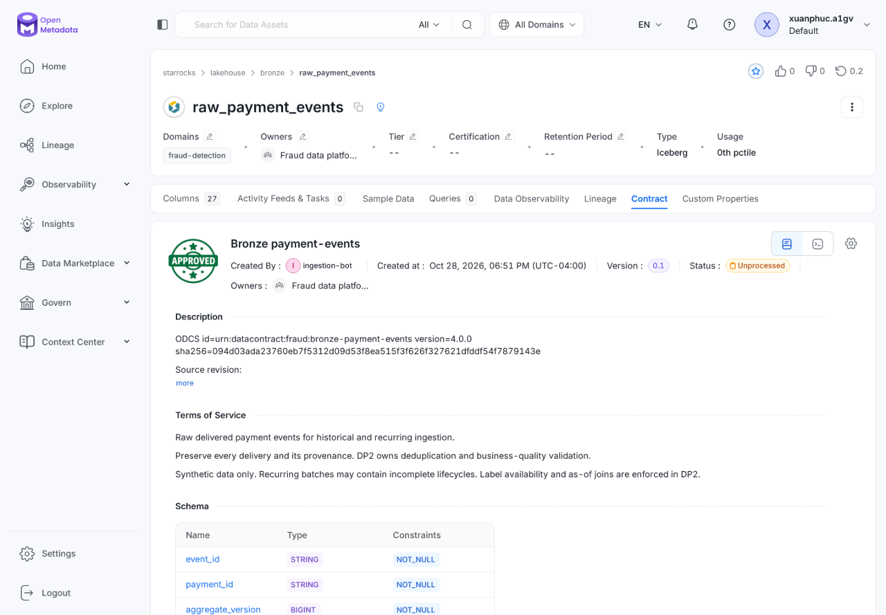

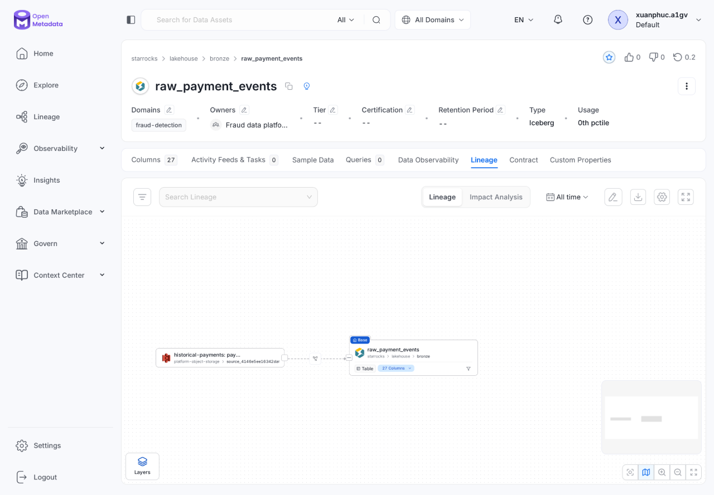

The accepted receipt remains at `s3://platform-dev/runs/payment-gateway/dp1/accepted/v17.json`, run `b7372f90-5077-4fe6-92e4-770aeeee2399`. Events snapshot: `6133974290511536717`; labels: `4796204550377179330`. Native profiling is capped at 100,000 rows, so the profile row count is not the total delivery count.

## Silver acceptance

The independent workflow `data/dev-v17-dp2-hrbxk` completed Spark transformation/readback and native quality, then failed at SDK publication. Publication-only workflow `data/dev-v17-dp2-publish-rpdhh` succeeded after the SDK wrapper fix, reusing the same inputs, five snapshots and passed native results. No source generation or transformation rerun was needed for that recovery.

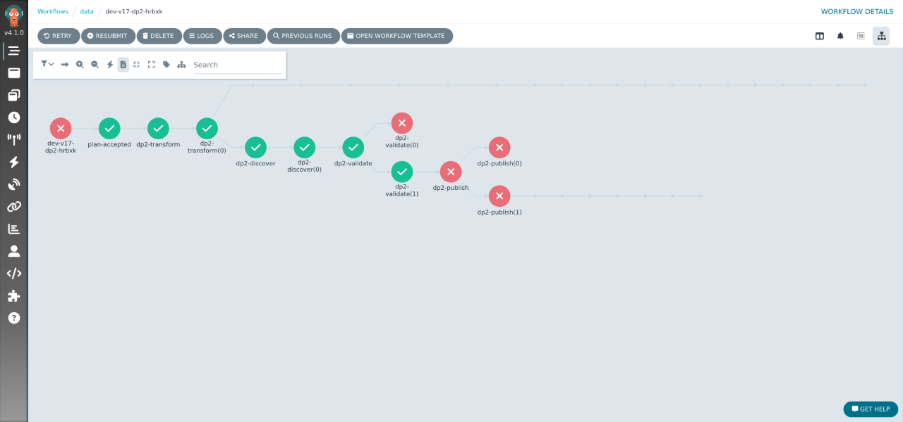

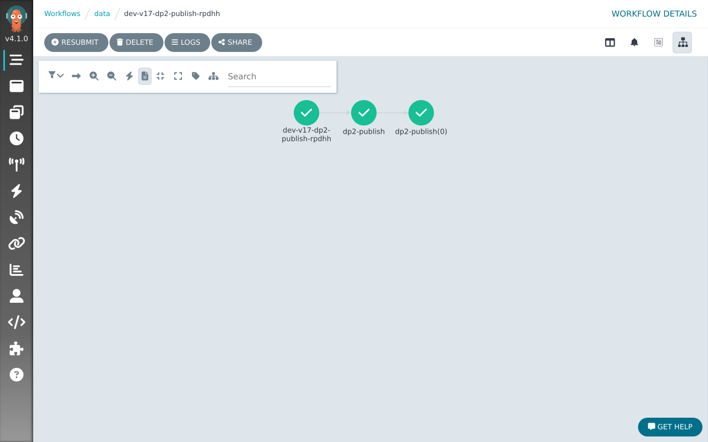

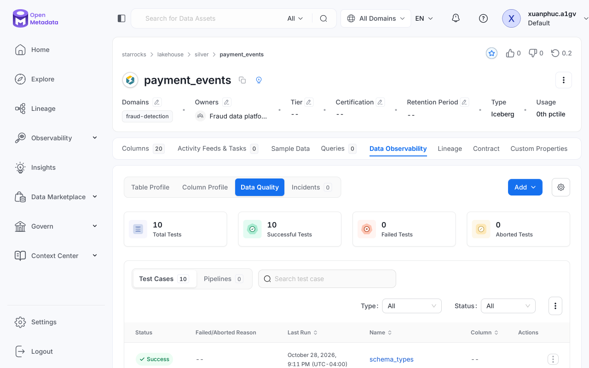

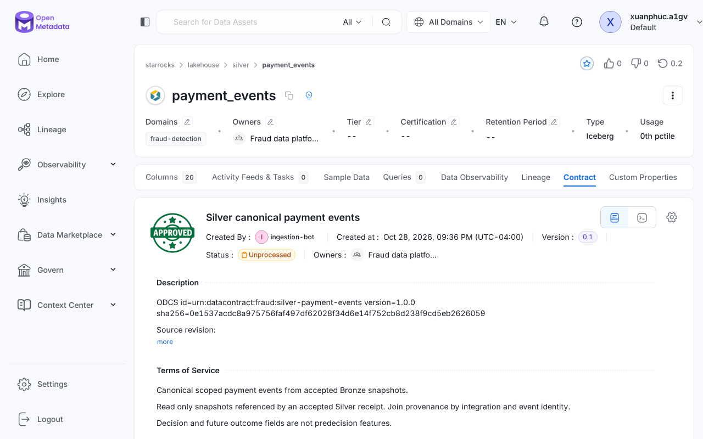

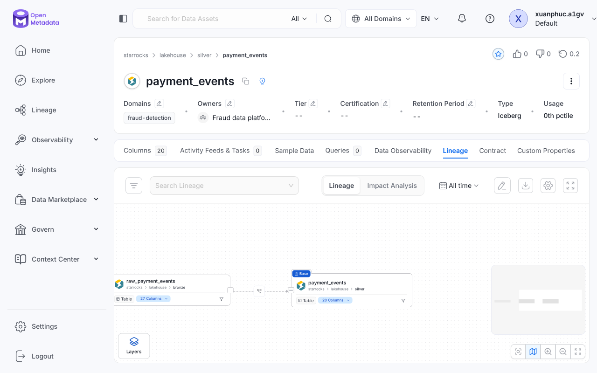

All 28 native cases across five ports passed, with complete contract, ownership, domain, product, lineage and execution readback. The owner team `Fraud data platform` resolves declared user `xuanphuc.a1gv`. OpenMetadata's native contract UI shows **Unprocessed**; that status is distinct from the pipeline's passed product acceptance.

Candidate: `1aacc2bd7643d860664fe507cf212d4a1587b6c1818f9492f0a197561097601a`. Transformation application: `dp2-9c5a5-40uiy6aeep0t2cwox2du9y3vrxsb3bk6w6uu`. Publisher image: `pr-97-8d7971bb556202b36237dfaaedbc20e3a5dfbfe8` (head `a22ebd7`).

| Output | Accepted snapshot |
|---|---|
| Canonical events | `134749491064778806` |
| Event delivery provenance | `1744261378093110830` |
| Attempts | `7330039527206951134` |
| Label observations | `9093244332554283895` |
| Label delivery provenance | `5333814728712134820` |

Remote acceptance pointer: `s3://platform-dev/runs/payment-gateway/dp2/dp2/accepted.json`. Its immutable receipt is under the same root at `receipts/37d17b37ecaf0fa472052ee613543cf586211ab2a163f8ec9e6739a957cbb097.json`. These operational receipts remain in object storage; redundant repository JSON copies are unnecessary.

## Spark baseline and candidate optimizations

Workflow `data/dev-v17-benchmark-v4hzl` succeeded, application `dp2-18327-40bbj5h4m9y1ff0nqj3a2e20sjsiielrye73`. Both variants produced equal content in both directions: 2,028 merchant/category rows and 9,715 customer rows.

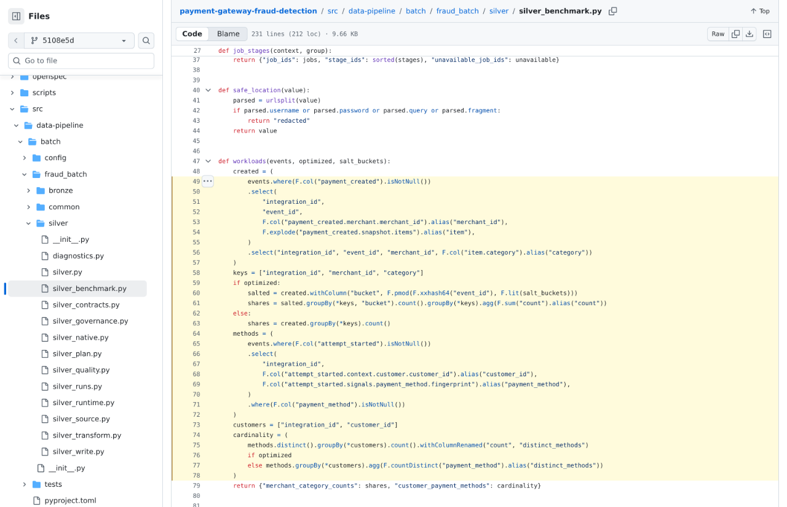

[Captured benchmark code](https://github.com/phuchoang2603/payment-gateway-fraud-detection/blob/5108e5db029137c975e8fe4bcc6fa485b68c50f0/src/data-pipeline/batch/fraud_batch/silver/silver_benchmark.py) changes the aggregation strategy while holding inputs/resources fixed.

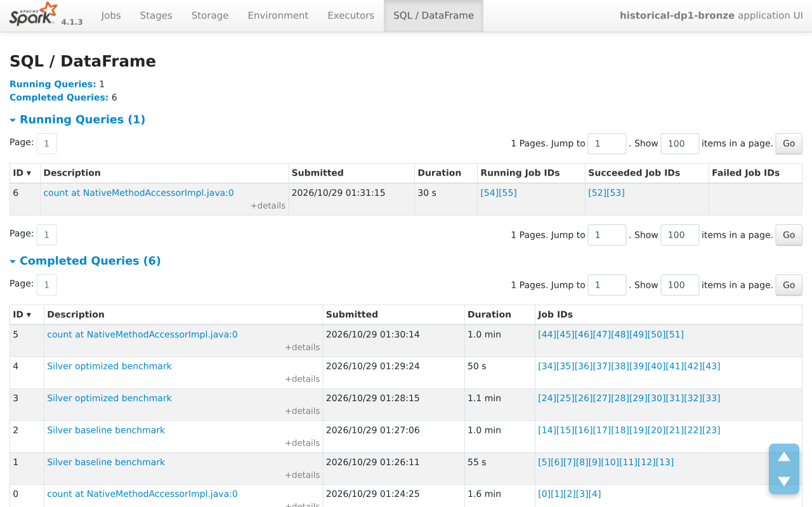

| Workload | Baseline | Candidate | Finding |
|---|---:|---:|---|
| Merchant/category counts | 55.225 s | 68.100 s | Eight-way salting was slower; no improvement demonstrated |
| Customer distinct methods | 62.603 s | 49.725 s | Distinct keys then count was faster in this trial |
| Whole variant, including planning | 128.152 s | 123.861 s | One trial does not establish a general speedup |

Both used two single-core executors, 2 GiB heap + 1 GiB overhead, 32 shuffle partitions, AQE and disk-only caches. Baseline ran first, without warmup/repetitions; filesystem caches were uncontrolled. The variants completed 240/241 tasks, zero failures/spill and approximately 761.45/762.08 MB shuffle written. Maximum task peak execution memory was 306,511,808 bytes for both; this is not process RSS.

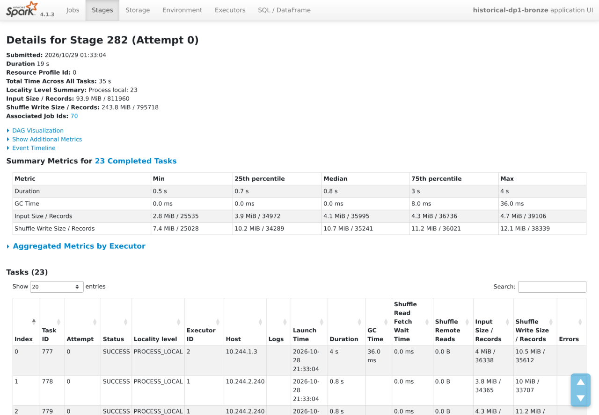

The shared session displays `historical-dp1-bronze`; the application ID above identifies the actual benchmark. Earlier timed-stage UI details had expired; complete metrics/plans remain in the remote benchmark report and compressed Spark event log. A displayed 70.96 h codegen accumulator is spurious; use the measured wall times above.

The report is under the Silver run root at `dp2/benchmarks/<candidate>/e6627a086f187b41b1113c07a8f2a1499f0acdfdb46022c79189eef3c541bfb6.json`; the event log is `s3://platform-dev/runs/payment-gateway/dp2/spark-events/eventlog_v2_<application>/events_1_<application>.zstd`.

### Resource adjustment and integration findings

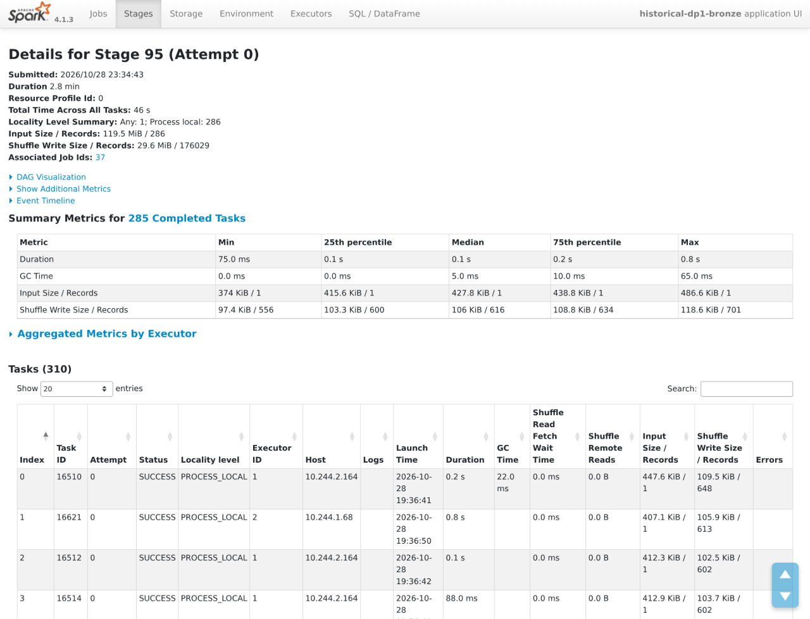

An earlier Silver attempt used 1,024 partitions and wide memory caches on the same small executors, leading to OOMKilled exit 137. Dev now uses 32 partitions and disk-only persistence without increasing resources. This operational correction is separate from the controlled benchmark; it does not establish a measured speedup.

Other resolved integration issues were StarRocks requiring aliases on derived tables, OpenMetadata 2.0.7 retaining stale quality cases during forced updates, and SDK entity-reference wrappers requiring typed `.root` handling. Native execution now uses supplied pinned cases, and the publication recovery above verifies the SDK fix. These failures are described here instead of retaining superseded JSON exports and in-progress screenshots.
