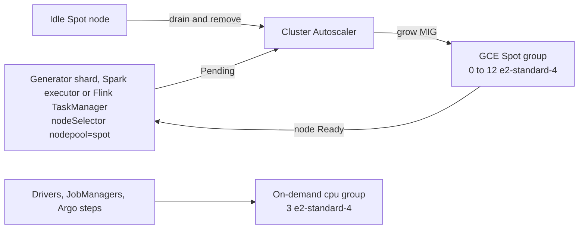
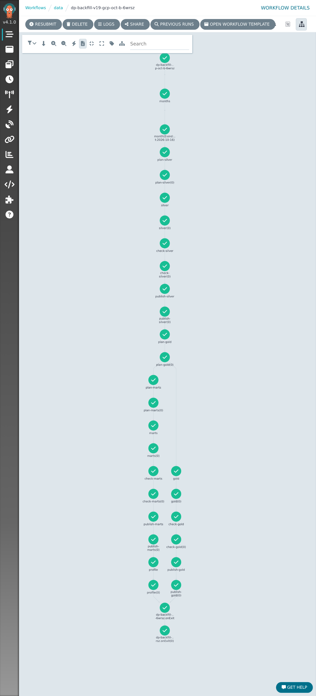
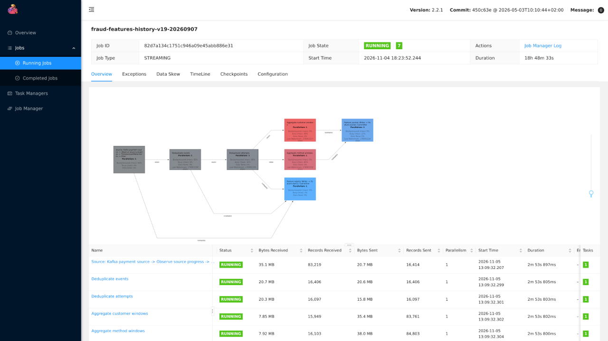

# Cluster Autoscaler for batch and streaming (novel)

The heavy data jobs are bursts: the 100 GB generator, a monthly Spark backfill and the stream history replay each need tens of vCPU for hours, then nothing. On GCP prod they ran on a Spot node group that Cluster Autoscaler grows from zero when their pods are Pending and drains back to zero when the nodes sit idle, so the cluster pays only for a fixed baseline of three on-demand workers plus Spot nodes while a job runs.

## How it works

- **Node groups.** The platform ([talos-proxmox](https://github.com/phuchoang2603/talos-proxmox/blob/main/docs/architecture/gcp-workers.md)) provisions a fixed `cpu` group of three on-demand `e2-standard-4` workers and a `spot` group of `e2-standard-4` Spot workers bounded at 0 to 12 nodes (48 vCPU, 192 GiB). Cluster Autoscaler v1.37.0 grows the Spot group for Pending pods; `kube-env` metadata describes the Talos reservations so it can simulate a node it has not started yet, which is what makes scale from zero work.
- **What goes on Spot.** Work that can be retried runs there: generator shards, Spark executors and Flink TaskManagers, selected by `talos.dev/nodepool: spot` in the [prod values](../../infra/charts/data-pipelines/values-prod.yaml). Work whose loss would restart a whole run stays on the on-demand group: Spark drivers, Flink JobManagers and Argo Workflows step pods, because a reclaimed resource-step pod makes Argo submit a second SparkApplication.
- **Sizing to the node.** A Spot node leaves about 3,270m CPU and 13,217 MiB for pods, so every Spot workload is sized to one node: a generator shard requests 3 CPU and 8 GiB, a Spark executor 3 cores with 9 GiB heap and 3 GiB overhead, and two history TaskManagers (1,400m, 5 GiB each) share a node.
- **Scale-down safety.** Pods of running jobs carry `cluster-autoscaler.kubernetes.io/safe-to-evict: "false"`, so the autoscaler never drains a node mid-job to consolidate; it removes a node only when nothing that annotation protects is left. A Spot reclaim is still possible, so every Spot job retries: Spark with graceful decommission and 10 retries, generator shards up to 10 times with complete days skipped, history units from their seeded topics.
- **One job family at a time.** The 12-node cap cannot hold a full generator run and a full Spark run together, so they run one after the other.

### Spark sizing and placement

| Workload | Placement and sizing |
|---|---|
| Silver and Bronze (`large`) | Spot pool (`talos.dev/nodepool: spot`): 11 executors × 3 cores = 33 executor cores; each 9 GiB heap + 3 GiB overhead, 24 GiB ephemeral storage |
| Gold (`gold`) | Same executors at 7 GiB heap + 5 GiB overhead: Gold runs no Python, but its native memory outgrew 3 GiB in May 2026 |
| Drivers | On-demand `cpu` pool (three `e2-standard-4` workers); 500m request, 4 GiB + 1.5 GiB for `large`, 2 GiB + 1.5 GiB for `gold` |
| Every executor | `MALLOC_ARENA_MAX=2`, graceful decommission, failure exclusion, 10 Argo retries |
| Shuffle | 1,024 partitions, AQE coalescing with 128 MB advisory size; large v19 shuffles require more than 3–4× core count |
| Kafka mode | One 3-core executor, three shuffle partitions matching the topics |
| Argo steps / SQL checks | Steps on on-demand workers; SQL executes on shared ClickHouse |

The spot pool is capped at 12 nodes / 48 vCPU / 192 GiB. Its only machine type is `e2-standard-4`, which has about 3,270m pod CPU after reservations, so one 3-core executor fits, and 16 GiB fits the executor memory.

## Runs on the Spot pool

The full v19 generator, `generate-historical-v19-gcp-mstrk`, ran 12 shards of 3 workers, one shard per Spot node, and published 983,727,083 events and 192,204,996 labels in 2,924 files (133.5 GB) to GCS ([offline data](offline.md#publication)).

The GCP backfill `dp-backfill-v19-gcp-oct-b-6wrsz` ran Bronze, Silver, Gold and the marts for October 16–28, 2026, with the `large` executors on Spot nodes; all 15 tasks passed:

The stream history replay ran six 4-day units at a time, each TaskManager on a Spot node and its JobManager on the on-demand group. Unit `20260907` on 2026-11-05 at 18:12 UTC (UI time UTC−05:00):

All 23 units of 2026-07-29 to 2026-10-29 finished and published in about 2 days 8 hours, about 236 million rows per stream table ([historical replay](online.md#full-replay)).

## Limits

- Prod was retired on 2026-11-09, so the runs above are its record; dev runs on fixed Proxmox VMs with no autoscaler.
- Spot reclaims are retried, not prevented, and a reclaim during a Spark stage repeats that stage's work.
