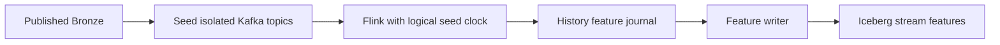
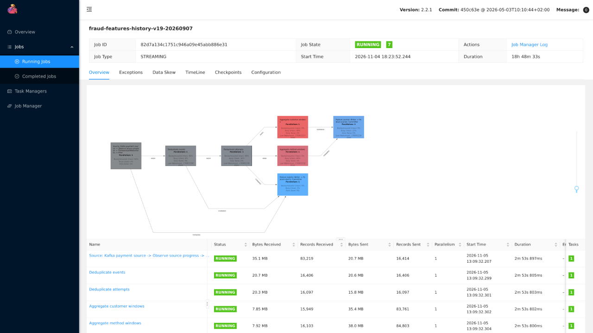
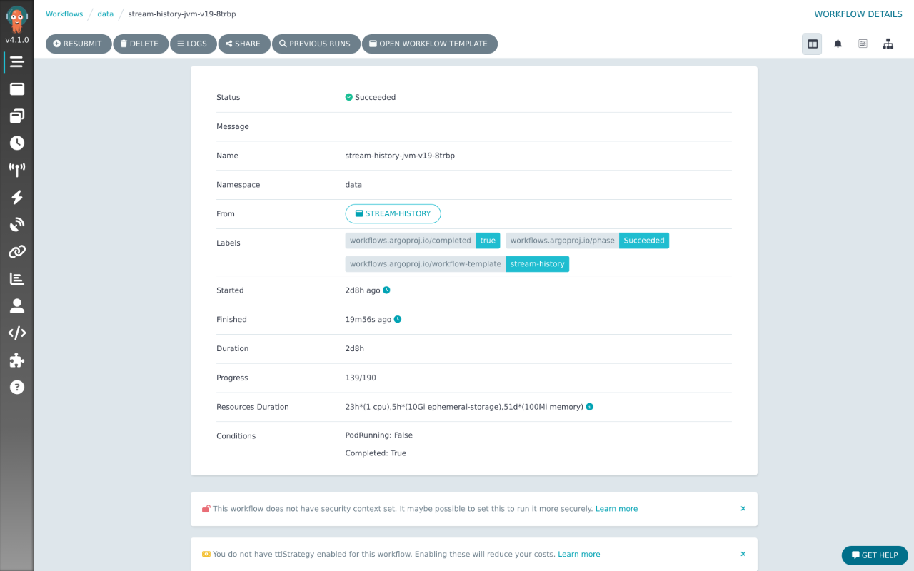
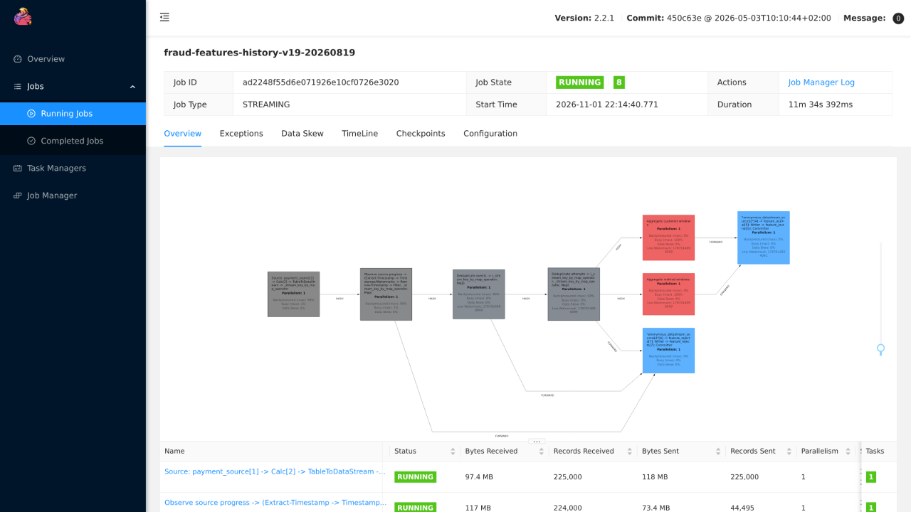
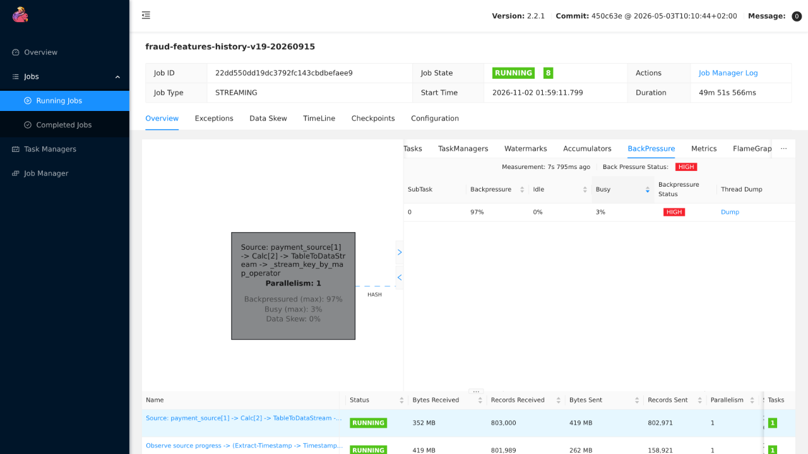
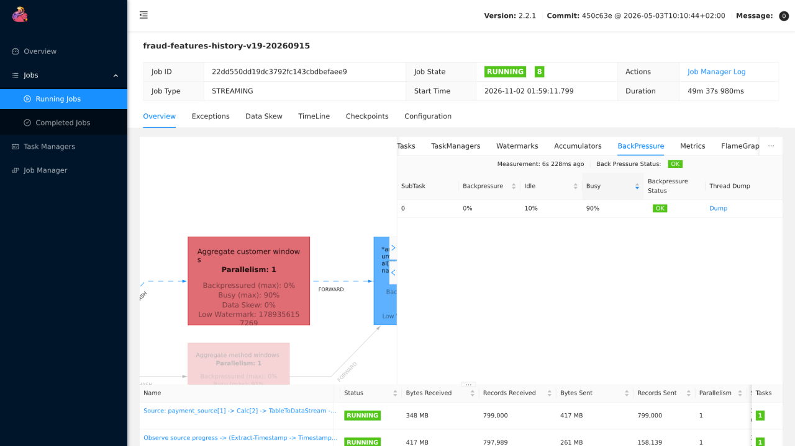
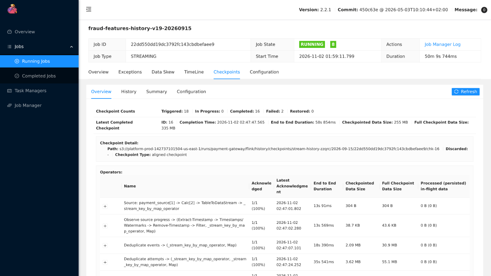

# Historical replay (novel)

Training needs months of streaming features, and serving reads the same features live. Instead of a second, batch implementation of the windows, history is replayed through the live Flink job's own operators: published Bronze is seeded into isolated Kafka topics, the job runs on a logical clock, and the output lands in the same Iceberg stream tables the feature store reads. Live and historical features therefore come from one engine, and the equivalence is tested rather than assumed.

Proof it worked:

- **Same results as an independent reference.** The JVM tests compare 2,498 snapshots from 503 deliveries with the reference implementation, and a seeded replay with late, too-late, duplicate and conflicting inputs has 0 incorrect feature cells out of 3,234 ([correctness comparison](online.md#local-correctness-comparison)).
- **Full replay.** 2026-07-29 to 2026-10-29 in 23 units, all finished and published, about 236 million rows per stream table ([below](#full-replay)).
- **Stability at volume.** Backpressure and checkpoint tuning took a unit from stalling near 1 million events to 227–466 events/s ([below](#backpressure-and-optimization)).

## How it runs

[`stream-history`](../../infra/charts/data-pipelines/templates/stream-history.yaml) plans bounded date units, seeds isolated Kafka topics from Bronze, runs Flink to `FINISHED`, writes history features, then deletes successful units’ topics and publishes lineage. Failed or stopped units retain their seeds for reuse; their Flink deployments are still cleaned up. [`history.py`](../../src/data-pipeline/streaming/fraud_streaming/history.py) owns planning/seeding; [`StreamJob`](../../src/data-pipeline/streaming/jvm/src/main/java/dev/fraud/stream/StreamJob.java) runs the shared operators with a logical seed clock. Historical topics and the configured history epoch are isolated from live `payments.events.v1` and the live epoch; replay never overwrites live features.

Run `stream-history` with `start`/`end` only after Bronze is published. Unit size and concurrency come from `features.historyUnitDays`, `features.historyParallelism` and `features.historyWriterParallelism` in the environment's values. Redis stream recovery is a separate `feast-materialize stream-recovery` run over the last 24 hours 5 minutes.

## Flink processing and publication

- Each unit adds a one-day lead-in for the 24-hour windows.
- [`ObserveSource`](../../src/data-pipeline/streaming/jvm/src/main/java/dev/fraud/stream/ObserveSource.java) releases clock controls only after their input-offset boundary; progress and buffered records are checkpointed together.
- Seed reuse requires matching date range, epoch, Bronze snapshot and Kafka topic end offsets.

Replay uses the same [windows](online.md#windows), [deduplication and rejects](online.md#late-too-late-and-duplicate-trace) as live traffic. Instead of wall-clock processing-time timers, it advances event-time timers with the logical seed clock, so old attempts contribute at their historical availability time. Each unit runs at parallelism 1 to preserve ordering; separate units run concurrently. History writers stage day-partitioned Parquet files in parallel, then atomically replace each unit's range per Iceberg table. Commit conflicts reuse the staged files; retries replace the range without duplicates. History does not push to Redis.

Prod Flink, 2026-11-05 at 18:12 UTC: unit `20260907` running all seven vertices, with backpressure upstream of the window aggregates. UI time: UTC−05:00.

## Full replay

The full Kappa replay ran as `stream-history-jvm-v19-8trbp` over `start=2026-07-29`, `end=2026-10-29`: 23 units, all FINISHED and published, Succeeded in about 2 d 8 h (2026-11-04 to 2026-11-07). `gold.feat_stream_customer` then held 236,441,166 rows and `gold.feat_stream_payment_method` 236,453,680, under the `live-v19` epoch.

## Backpressure and optimization

Recorded AWS-era replay measurements; current settings come from the environment values.

History replay drains seeded Kafka as fast as downstream operators accept it. Credit-based backpressure pauses source polling; Kafka retains the queued records.

**Baseline** (7-day unit, 3 GiB TaskManager, JVM heap state): the aggregate operators are red at about 100% busy, and everything upstream is backpressured.

*Unit `20260819`, 03:26 UTC (the UI shows UTC−5): source 96% backpressured and 4% busy; aggregates 0% backpressured and 88–89% busy.*

The aggregate stage spent about 12 ms/record (75 records/s); source throughput fell from 1,150 to 350 events/s. Near 1M events, heap reached 981/1,183 MB and repeated heartbeat/checkpoint failures prevented progress.

| Change | Purpose / observed result |
|---|---|
| Omit replay coverage-flip timers; allow interruptible timers | Avoid millions of simultaneous `bootstrap + 24h` timers blocking checkpoint barriers; live coverage timers remain |
| RocksDB, incremental checkpoints, 5 GiB TaskManager | Pass the former 1M-event heap failure point |
| Unaligned checkpoints, 2-minute minimum pause, 10-minute timeout, 10 tolerated failures | Avoid restart loops; tuned heap run: 4 checkpoints/11 min instead of 25/12 min, no restores |
| 4-day units, 24 concurrent; state cache 20,000 | Spread independent units across the capped pool; cache change not isolated in measurements |
| Bounded seed buffer, per-unit report/offset check | Keep memory bounded and reuse seeded topics after restart |
| `safe-to-evict: false` | Prevent autoscaler scale-down eviction during replay; Spot interruption remains possible |

**After** (4-day unit `20260915` on RocksDB, 50 minutes in)

*Source: 97% backpressured, 3% busy.*

*Customer aggregate: 0% backpressured, 90% busy; it paces the job.*

*18 checkpoints triggered, 16 completed, none restored. The latest uploaded 255 MB of a 335 MB state in 59 s.*

| | Baseline (heap) | RocksDB, 4-day units |
|---|---|---|
| Progress | stalls near 1M events | 227–466 events/s per unit with 14 running |
| Checkpoints | 22 of 25 completed, latest 1 min 59 s | 16 of 18 completed, average 46 s, longest 157 s |
| Upload per checkpoint | full 148 MB | 85 MB average, against 221 MB of full state |
| TaskManager | 1.4–1.5 of 2 CPU, heap 83% full | 1.3 of 1.4 CPU, 3.6 of 5 GiB |

RocksDB fixed stability; aggregation remains the bottleneck at about 350 events/s. Its checkpoints are slower than tuned heap (46 s versus 29 s). More independent units can increase total throughput within the 48-vCPU pool cap.

**Not adopted:** a 20,000-record Python bundle caused 40-second stalls and ~350-second checkpoints. Window counts are already incremental (0.16–0.67 ms/attempt outside Flink versus ~12 ms inside); merging dedup stages needs separate state/recovery validation.

**Reproduce.** Port-forward `svc/fraud-streaming-history-v19-<YYYYMMDD>-rest`, open the job and pick an operator's **BackPressure** tab (`HIGH` above 90%), and use **Checkpoints** for durations and sizes. The same figures are at `/jobs/<id>/vertices/<id>/subtasks/metrics` (`busyTimeMsPerSecond`, `backPressuredTimeMsPerSecond`).
