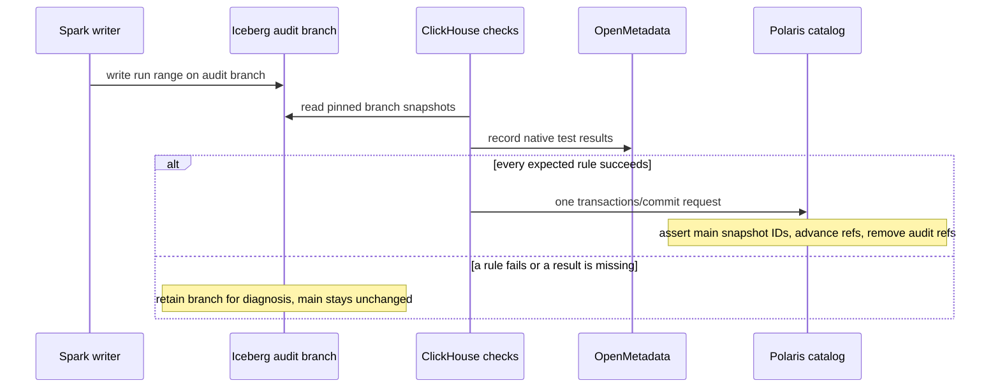
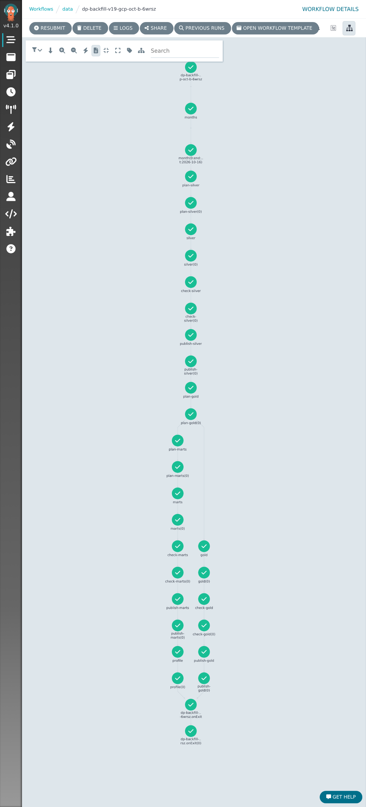

# Novel 1: write–audit–publish across the lakehouse

This pipeline writes candidate Iceberg snapshots, validates those exact snapshots through ClickHouse, and publishes the affected table references together through the catalog. It combines established techniques into a reproducible release gate.

## Release protocol

1. [`lakehouse.stage/restage`](../../src/data-pipeline/batch/batch/lakehouse.py) creates the run's `WAP_BRANCH` from published `main`. A retry of a multi-commit writer resets its branch to main, avoiding partial output from the previous attempt.
2. The writer overwrites only its day range and records input snapshots, range and code version in snapshot properties. Other pipelines read published data.
3. [`openmetadata.checks`](../../src/data-pipeline/openmetadata/openmetadata/checks.py) pins audited table snapshots and runs contract-derived SQL rules. Every expected result must be `Success`; missing results also fail the gate. Range scoping bounds the audit work without changing the rules.
4. [`wap.publish_changes`](../../src/data-pipeline/openmetadata/openmetadata/wap.py) verifies that main is an ancestor of each candidate head. Its `assert-ref-snapshot-id` requirements reject a concurrent main change. One REST catalog `transactions/commit` request advances the affected table references and removes their audit refs.
5. Failed audit branches remain available for inspection. Maintenance drops branches older than seven days; pipeline writer mutexes serialize competing writers and maintenance.

## Evidence and limits

The recorded GCP backfill `dp-backfill-v19-gcp-oct-b-6wrsz` passed all 15 tasks for October 16–28, 2026, with checks before each publication.

[`test_checks.py`](../../src/data-pipeline/openmetadata/tests/test_checks.py) exercises missing/failed results, successful fast-forward preparation and refusal when main has diverged.

The atomic boundary is the set of Iceberg table changes in that catalog transaction. It requires the catalog's optional multi-table commit support; it is not a sequence of independent Spark `fast_forward` calls. ClickHouse marts use separate staging tables, checks and partition replacement in [`gold/marts.py`](../../src/data-pipeline/batch/batch/gold/marts.py). Their publication and OpenMetadata reporting are not part of the Iceberg transaction, so this does not establish one atomic release across the entire lakehouse, warehouse and catalog UI. The stream-history writer also has its own replay gates and does not use this branch protocol.

A live failure-injection run has not yet verified that rejected candidates and concurrent-reference conflicts leave all main references unchanged.

Workflow inventory, contracts and lineage remain in [Orchestration and governance](orchestration-governance.md). Iceberg's [branching guide](https://iceberg.apache.org/docs/latest/branching/) and [REST specification](https://iceberg.apache.org/rest-catalog-spec/) describe the underlying capabilities.
