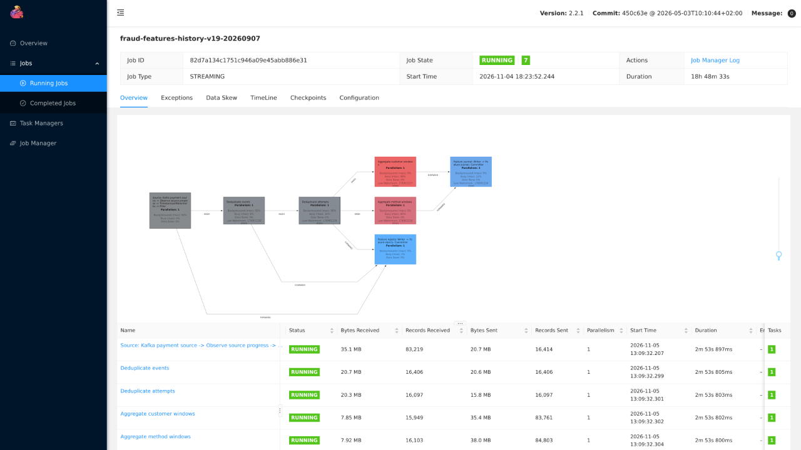

# Novel 2: historical replay through the live feature engine

Historical training features use the same JVM Flink operators as live features, with a logical replay clock and isolated outputs.

## Shared operators, historical clock

[`StreamJob`](../../src/data-pipeline/streaming/jvm/src/main/java/dev/fraud/stream/StreamJob.java) connects the same validation, event/attempt deduplication, customer/method windows and journal sinks in both modes. Live processing uses wall-clock timers. Replay uses bounded Kafka input and logical time derived from historical availability, so it can process old events without waiting for their original wall-clock intervals.

Prod Flink, 2026-11-05 at 18:12 UTC: unit `20260907` is running all seven vertices, with backpressure upstream of the window aggregates. The UI displays UTC−05:00.

The seed writes ordered Bronze deliveries and clock controls to separate topics. Each control includes an input-offset boundary. [`ObserveSource`](../../src/data-pipeline/streaming/jvm/src/main/java/dev/fraud/stream/ObserveSource.java) buffers interleaved records and releases a clock control only after its preceding input boundary has been processed. Source progress, buffered records and pending controls are checkpointed together; a control read early from Kafka cannot advance time past unread deliveries.

[`Aggregate`](../../src/data-pipeline/streaming/jvm/src/main/java/dev/fraud/stream/Aggregate.java) applies attempt-time membership to the same 5-minute, 1-hour and 24-hour windows in both modes. The replay clock determines when historical information becomes available, while the window excludes the scored attempt itself. Each unit includes a one-day lead-in to establish its retained history.

## Isolation and recovery

| Mechanism | Purpose |
|---|---|
| Separate input, clock and feature-journal topics; history epoch | Keep replay separate from live traffic and live feature revisions |
| Seed report matched to date range, epoch, Bronze snapshot and topic end offsets | Reuse completed Kafka seeds after a failed or stopped attempt |
| Independent bounded date units | Run units concurrently while preserving one ordered input partition within each unit |
| Flink checkpoints and transactional Kafka journal | Recover operator progress and journal writes together |
| Wait for Flink `FINISHED`, then replace the unit's Iceberg rows | Publish history after processing, without pushing replay rows into Redis |
| Retain failed units' seeds; delete successful units' topics after writing | Preserve retry inputs and reclaim completed temporary data |

[`history.py`](../../src/data-pipeline/streaming/fraud_streaming/history.py) implements planning and seed reuse; [`stream-history`](../../infra/charts/data-pipelines/templates/stream-history.yaml) orders processing, writing and cleanup. Point-in-time retrieval and label cutoffs remain in the [feature-store note](../ml/feature-store.md#online-and-offline-paths), and customer-version joins in [Storage](storage.md#schemas-and-naming).

The [shared-operator tests](online.md#local-correctness-comparison) cover snapshot correctness, timers, checkpoint recovery and Kafka output.
