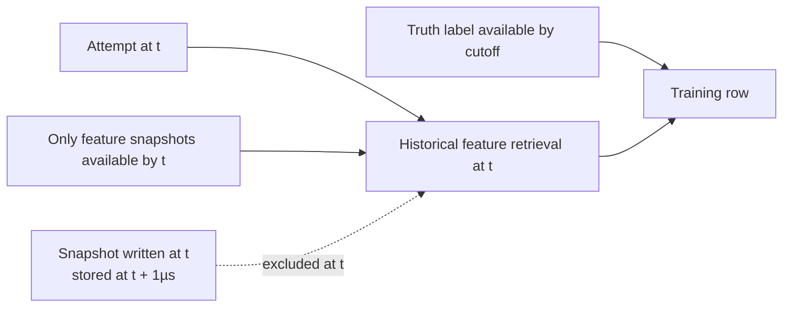
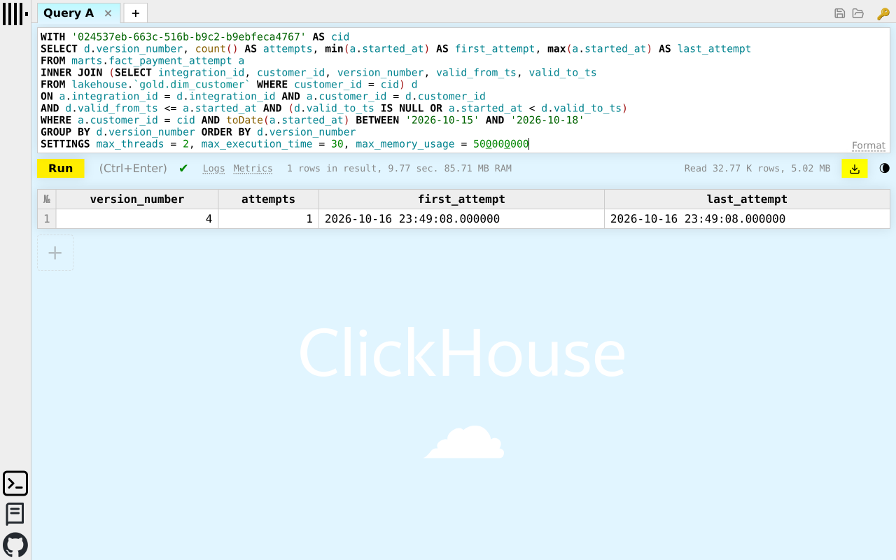

# Novel 2: point-in-time data that excludes future knowledge

A fraud dataset can have valid schemas and still leak the answer. This project combines customer version history, feature availability timestamps and label availability cutoffs so a training row represents what was knowable when the attempt was scored. These are established data techniques; the project-specific contribution is enforcing them together across batch features, stream snapshots and labels.

## Three time boundaries

| Boundary | Rule | Failure prevented |
|---|---|---|
| Customer business validity | `valid_from_ts <= t` and `valid_to_ts IS NULL OR t < valid_to_ts` | Joining an old attempt to today's customer profile |
| Feature availability at scoring | Training uses the attempt's `started_at`; stream rows have `event_timestamp = online_write_at + 1µs` | Including a snapshot produced by the very attempt being scored, or using event time as if late information had already arrived |
| Target availability at dataset cutoff | `label_available_at <= cutoff`, with explicit label-source selection | Using labels that were not yet known when the training dataset was assembled |

These boundaries are different. A target may become known after the attempt but before the dataset cutoff; that is allowed. Its later information must not enter the attempt's features. `created` is also distinct from feature event time; it records the journal record timestamp for stored stream rows.

[`training.entity_rows`](../../src/data-pipeline/feast/fraud_feast/training.py) selects lifecycle-valid attempts in `[start, end)`, joins their original `attempt_started` request context and accepts only `LABEL_SOURCE_SIMULATION_TRUTH` labels available by the explicit, timezone-aware cutoff. [`stream_writer.decode`](../../src/data-pipeline/feast/fraud_feast/stream_writer.py) applies the stream timestamp rule and rejects inconsistent availability or window-coverage metadata. Daily windows close at their daily anchor; their actual materialization delay remains an online/offline skew limitation.

[`gold/features.py`](../../src/data-pipeline/batch/batch/gold/features.py) preserves SCD2 customer versions rather than overwriting a single current profile. The customer history supports temporal joins; it is not itself an additional model input in the shared Feast feature service.

## Evidence and evaluation

This recorded GCP temporal join selects version 4 at `2026-10-16 23:49:08`, exactly where version 3 closes and version 4 opens. The capture demonstrates the half-open validity boundary, not model accuracy.

[`test_training.py`](../../src/data-pipeline/feast/tests/test_training.py) covers valid truth labels, unavailable labels, excluded label sources, invalid lifecycle rows and range/cutoff boundaries. [`test_stream_writer.py`](../../src/data-pipeline/feast/tests/test_stream_writer.py) exercises stream timestamp and coverage validation. These tests support correctness claims; they do not establish a model-quality gain.

A useful controlled evaluation would compare a deliberately naïve latest-row join with the point-in-time join on the same attempts, then count profile-version mismatches, features unavailable at scoring time and labels unavailable at cutoff. That experiment is proposed, not executed here; no fabricated leakage percentage or accuracy uplift is reported.

The [feature-store note](../ml/feature-store.md) owns feature lists, TTLs, retrieval and materialization. [Storage](storage.md#schemas-and-naming) owns the SCD2 schema and logical join reference.
