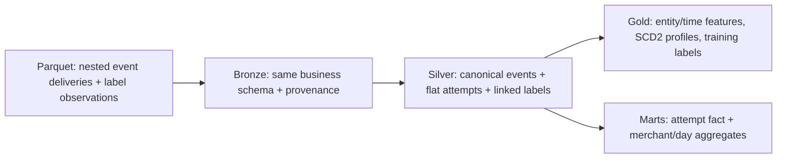
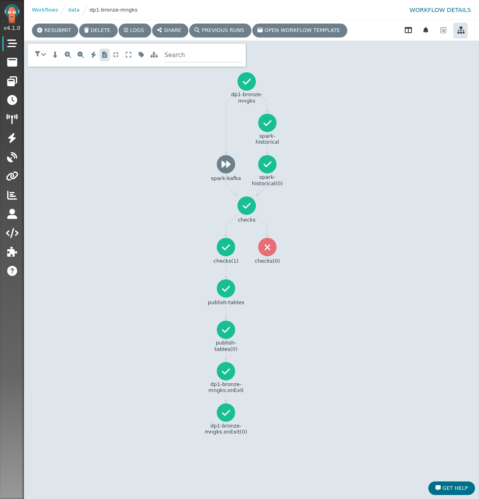
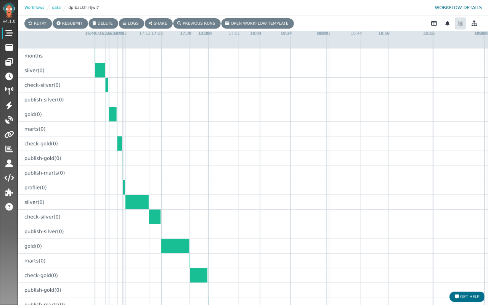
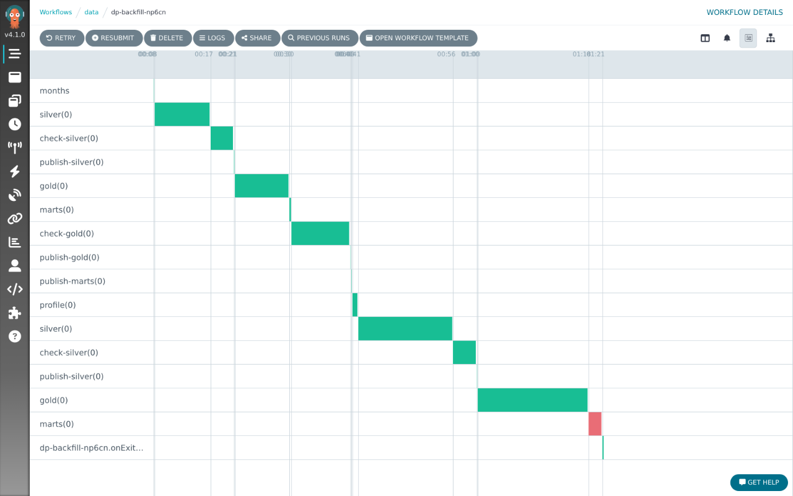
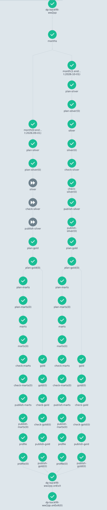

# Offline data

Historical generation produces reproducible payment lifecycles and labels in Parquet. Spark preserves deliveries in Bronze, canonicalizes events and attempts in Silver, then builds Gold history features. ClickHouse builds analytics marts from Silver separately. Each stage changes the row's meaning as well as its schema.

## Historical generation

[`historical-full.yaml`](../../src/data-pipeline/simulator/configs/historical-full.yaml) defines v19: 365 purchase-start days from 2025-10-29, seed 2603, 3M customers, 20K merchants, 3.9M payment methods and 4.2M devices. [`historical-dev.yaml`](../../src/data-pipeline/simulator/configs/historical-dev.yaml) uses a smaller population with the same generator.

### Model and sampling techniques

The generator builds a synthetic world first, then purchases, then valid payment lifecycles. It does not sample every event column independently.

| Technique | Implementation and purpose |
|---|---|
| Deterministic random streams | [`world.py`](../../src/data-pipeline/simulator/simulator/world.py) derives NumPy `SeedSequence` streams from the seed, generation stage and stable day/customer/purchase keys. UUIDv5 identities and normalized HMAC fingerprints keep entities consistent. Worker count, shard assignment and reruns do not change the generated records. |
| Unequal customer activity | A mean-normalized lognormal activity factor varies each customer's Poisson purchase count around `purchases_per_customer_day: 0.17`. This creates occasional and frequent buyers rather than one uniform rate. |
| Calendar-aware arrival times | Region/timezone, local-hour weights, weekday multipliers and month multipliers shape purchase volume and timestamps. The [calibration file](../../src/data-pipeline/simulator/simulator/us-calibration.json) records assumptions; this is an illustrative synthetic population, not a fitted production traffic model. |
| Popularity and hot-key skew | Merchant/category selection uses truncated Zipf distributions (exponents 1.1/1.2). Half of purchases explicitly select the hot merchant; familiar/Zipf selection can select it too, giving about 56% observed share. This stresses downstream merchant aggregations. |
| Correlated context and spend | Purchases usually reuse familiar merchants (80%) and context (95%). Category/condition prices, customer spend and lognormal amount variation determine integer minor-unit amounts; device/network rotation and foreign-IP draws introduce changes. |
| Fraud scenarios | High-value purchases, stolen cards, account takeover and card-testing bursts alter related amount/context/attempt behavior together. Friendly fraud adds a later chargeback case. Simulation truth remains separate from the rules policy's decision. |
| Lifecycle expansion | [`lifecycle.py`](../../src/data-pipeline/simulator/simulator/lifecycle.py) expands each purchase into creation, attempt, risk decision and processor/result events. It models declines, retries, unknown processor outcomes and expiry; aggregate versions preserve payment order. |
| Deliberate data problems | Each event has a 2% chance of one republished copy with the same `event_id` and business content but `recorded_at` 1–300 seconds later. Chargebacks are reported 7–21 days after successful eligible attempts; absent chargebacks are unknown, not negative. |

Configured entity-domain sizes are not observed distinct counts. Cardinality ratio means `count(DISTINCT key) / count(*)` for a named table/range, with nulls reported separately. For example:

```sql
SELECT count(*) AS attempts,
       uniqExact(customer_id) / nullIf(count(*), 0) AS customer_cardinality_ratio,
       uniqExact(merchant_id) / nullIf(count(*), 0) AS merchant_cardinality_ratio,
       countIf(customer_id IS NULL) AS customer_nulls,
       countIf(merchant_id IS NULL) AS merchant_nulls
FROM lakehouse.`silver.attempts`
WHERE payment_day BETWEEN '2026-09-01' AND '2026-09-30';
```

### Source schema and version change

[`arrow.py`](../../src/data-pipeline/simulator/simulator/arrow.py) defines typed Arrow schemas; [`historical.py`](../../src/data-pipeline/simulator/simulator/historical.py) writes Zstd-compressed Parquet in customer chunks with buffered row groups. Files are organized by purchase-start day, not by label availability.

| Source output | Row grain | Schema |
|---|---|---|
| `payment_events/date=…/part-….v2.parquet` or `.v3.parquet` | One lifecycle event delivery; duplicates intentionally remain | Envelope: `event_id`, `payment_id`, `integration_id`, `aggregate_version`, `schema_version`, `occurred_at`, `recorded_at`. One nested payload, such as `attempt_started` or `risk_decision_recorded`, supplies the business fields. |
| `fraud_labels/date=…/part-….parquet` | One label observation per attempt/source | `integration_id`, `payment_id`, `attempt_id`, `is_fraud`, `occurred_at`, `label_available_at`, `source` and optional `scenario`. Truth and chargeback observations remain separate. |

The event's `occurred_at` selects the schema version: v2 before 2026-04-30, v3 from that instant. A single purchase-day partition can contain both versions when its lifecycle crosses the cutover.

| Nested field added in v3 | Physical v2 Parquet | v3 meaning |
|---|---|---|
| `attempt_started.signals.user_agent_family` | Field absent | Client user-agent family |
| `risk_decision_recorded.assessment.assessment_id` | Field absent | Durable assessment identity |
| `risk_decision_recorded.assessment.evidence_sha256` | Field absent | Assessment evidence digest |

The generator removes these fields from both records and Arrow schemas for v2; it does not merely fill a v3-shaped file with nulls. [Generation tests](../../src/data-pipeline/simulator/tests/test_generation.py) verify physical schemas, occurrence-time cutover and equal records across worker counts, shards and interrupted runs.

### Publication and recorded generation

Submit `generate-historical` in `data`. Shards write per-day Parquet, separate `.v2`/`.v3` event files and `_day.json` markers; `config.json` pins inputs and the generator digest, and `manifest.json` publishes the inventory. Complete days are skipped, incomplete days regenerated, and changed inputs or an already published version are refused. Full-scale v19 publication also enforces the configured 100 GB minimum source size. Credentials come from Secrets; roots and shard settings come from chart values.

| Dataset / run | Events | Labels | Files / size |
|---|---:|---:|---|
| Dev v18, `generate-historical-v18-77fzr` | 823,963 | 161,007 | 181 / 112.4 MB; 11m50s |
| Recorded AWS v19, `generate-historical-v19-nvp7l` | 983,727,083 | 192,204,996 | 2,924 / 133.5 GB; 49 min |
| GCP v19, `generate-historical-v19-gcp-mstrk` | 983,727,083 | 192,204,996 | 2,924 / 133,498,693,796 bytes; succeeded |

Dev uses `s3://platform-dev/datasets/payment-gateway/historical/v18`; GCP uses `s3://talos-proxmox-prod-platform/datasets/payment-gateway/historical/v19`. GCP's manifest SHA-256 is `78ee54fe2a607ae0c128bc6765d89238f28d00270fca5ad48a8fed44fd0f8608`, matching the existing live-traffic pin. Its per-file rows/bytes, unique paths and 365 dates reconcile; this check did not reread every Parquet object or run downstream jobs. The recorded dev/AWS readbacks found no empty parts and verified physical v2/v3 schemas.

## Spark transformations

<a id="pipeline"></a>

`dp1-bronze` ingests the published source. `dp-pipeline(start, end)` builds Silver, then Gold features and the marts in parallel because both consume Silver. Each output goes to an audit branch or staging table, passes contract checks, then publishes. Daily runs and monthly backfills share these range-bounded jobs; plan steps skip matching range/input-snapshot/image outputs.



### DP1: source deliveries → Bronze

[`bronze/ingest.py`](../../src/data-pipeline/batch/batch/bronze/ingest.py) validates manifest paths/sizes, reads all event parts with `mergeSchema=true` and conforms them by field name to the target [Bronze schema](../../src/data-pipeline/batch/batch/bronze/schema.py). Historical ingestion replaces only that dataset version and verifies written row counts per source file.

| Change at this boundary | Bronze result |
|---|---|
| Mixed physical v2/v3 schemas | One typed event schema; missing nested v2 fields become null. Existing payloads, IDs, event versions and delivery timestamps are retained; `payload_case` identifies the populated payload. Schema version still determines which fields a contract requires. |
| Source file → queryable Iceberg row | Add `_source`, `_dataset_version`, `_source_file`, `_ingested_at` and `_run_id`. Kafka provenance fields are null for historical input. |
| Delivery and label grain | `bronze.payment_events` keeps every delivery, including duplicates; `bronze.fraud_labels` keeps label observations. No attempt-level flattening or feature calculation happens here. |

For the Kafka input mode, the same tables also hold decoded records with topic/partition/offset/timestamp provenance. Invalid records go to `bronze.rejected_records`; committed row offsets determine restart progress even after compaction.

**Technique and tradeoff.** Historical files already touch few day partitions, so Bronze uses local fanout writes instead of a redundant hash redistribution. Recorded AWS DP1 hash distribution wrote about 202 GB of shuffle; this is write-layout evidence, not proof of a skew-join speedup.



### DP2: Bronze → canonical Silver

[`silver/curate.py`](../../src/data-pipeline/batch/batch/silver/curate.py) reads Bronze from `start − 1` through `end + 1`, assigns each payment to its first event's UTC day and overwrites only the requested payment days. This keeps a lifecycle crossing midnight together. Labels are rebuilt by availability day and linked against 45 days of attempts.

| Silver output | Schema and grain change | Transformation |
|---|---|---|
| `silver.payment_events` | One canonical row per `event_id`; keeps the nested envelope/payload and adds `event_hash` and `payment_day`, retaining `_source` rather than file/offset provenance | Hash business fields excluding `recorded_at`; group by event ID, retain the earliest identical delivery. |
| `silver.rejected_events` | Rejection metadata plus serialized offending rows | Different hashes for one event ID quarantine every event of the affected payment, preventing a partly accepted lifecycle. |
| `silver.attempts` | One flat row per `(integration_id, payment_id, attempt_id)` | Group start/decision/result events by attempt and aggregate version, join payment status, derive outcome and `lifecycle_valid`. |
| `silver.labels` | One deduplicated observation with `observation_id`, attempt/outcome references and `linkage` | Distinguish linked, pending, orphan and violation; orphan/violation observations fail publication checks. |

For example, nested `attempt_started.context.snapshot.total.minor_units` becomes `silver.attempts.amount_minor` (`bigint`), customer context becomes `customer_id`, and assessment outcome/ID become `risk_outcome`/`assessment_id`. `started_at` is server event time; `attempted_at` preserves client time. Terminal events produce `outcome`/`outcome_at`; pending/unknown attempts remain unresolved rather than becoming invented declines. v2 rows retain null assessment IDs after flattening. Raw evidence digests remain in canonical events rather than becoming attempt features.

**Deduplication and schema checks.** Two identical `evt-1` copies become one; two `evt-2` copies with amounts 100/999 quarantine all three deliveries of their payment ([executable fixture](../../src/data-pipeline/batch/tests/silver/test_silver.py)). Recorded Bronze counts were 514,342,841 v2 and 469,384,242 v3 events: the new decision fields were absent in all 101,943,941 v2 decisions and present in all 93,028,261 v3 decisions. These establish correctness; side-by-side schema/dedup Spark UI captures remain missing.

**Scale techniques.** A narrow event-ID/hash aggregation replaces a broadcast of about 20M duplicate IDs; attempt construction uses one grouped aggregation instead of separate payload windows and joins. Range overwrites avoid full-history recomputation. `persist(MEMORY_AND_DISK)` allows lost Spot blocks to be recomputed from lineage instead of relying on local checkpoints.

**Controlled skew comparison.** [`silver/benchmark.py`](../../src/data-pipeline/batch/batch/silver/benchmark.py) compares a cached, pinned range with skew handling off, AQE skew handling on and 16-bucket salting. Broadcast is disabled; counts/checksums must agree and the AQE plan must show a real skew split. Run `dp2-benchmark start=2026-09-01 end=2026-09-30` after Silver publishes that range. Production timings remain unrecorded; AQE being enabled alone does not demonstrate an optimization.

### DP3: Silver → Gold history features

[`gold/features.py`](../../src/data-pipeline/batch/batch/gold/features.py) and [`gold/windows.py`](../../src/data-pipeline/batch/batch/gold/windows.py) implement [`fraud-history-batch-v1`](../../contracts/features/fraud-history-batch-v1.yaml). The grain changes from an attempt to an entity at a UTC-midnight anchor.

| Gold output | Key / time fields | Derived schema |
|---|---|---|
| `feat_customer_daily` | `integration_id`, `customer_id`, `event_timestamp`; `created` identifies the source snapshot's commit time | Nullable counts such as `attempt_count_7d` (`bigint`), `amount_sum_minor_30d` (`bigint`), `decline_rate_7d` (`double`), and exact distinct merchants/devices/payment methods |
| `feat_payment_method_daily` | `integration_id`, `payment_method_fingerprint`, `event_timestamp`, `created` | Equivalent card-history measures, including distinct customers |
| `dim_customer` | `customer_sk`, customer keys, `valid_from_ts`/`valid_to_ts`, `version_number`, `is_current` | SCD2 profile fields, `profile_hash` and familiar-device state; a new version represents a change, not another payment |
| `label_attempt` | Attempt keys, entity keys and scoring-time `event_timestamp` | Earliest linked label per attempt/source, with `is_fraud` and separate `label_available_at` |

For an anchor `s`, features read `[s − window, s)` using `coalesce(attempted_at, started_at)` and require that the attempt was observed before `s`. Outcome measures additionally require `outcome_at < s`. Incomplete windows are null; a complete empty window can be zero. Training takes the latest feature row at/before scoring time and only labels available by the cutoff.

**Scale techniques.** Emit rows only when a value changes or coverage completes, rather than every entity every day: recorded output was 348M customer/363M card rows instead of about 1.1B rows per daily table. Familiar devices (used at least twice in 90 days) use an ordered XOR sweep rather than an interval join. Retries reset the audit branch before the dimension's delete/append rewrite. Gold's 12 GiB executor budget shifted from 9 GiB heap + 3 GiB overhead to 7 + 5, with `MALLOC_ARENA_MAX=2`, after native-memory OOMs.

The 5-minute/1-hour/24-hour stream-feature tables are produced by Flink and its writer, including replay; this Spark stage owns the 7/30-day history.

### Silver → ClickHouse marts

[`gold/marts.py`](../../src/data-pipeline/batch/batch/gold/marts.py) builds a rolling 90-day analytics window independently of Gold feature computation.

| Mart | Schema change from Silver |
|---|---|
| `fact_payment_attempt` | Keep one flat attempt row, join label summaries, and add nullable `truth_is_fraud`, `truth_scenario` and `chargeback_available_at`. Convert Spark timestamps to UTC `DateTime64` and categorical fields to `LowCardinality` strings. |
| `fact_merchant_day` | Aggregate attempts by `(integration_id, merchant_id, day)` into counts, minor-unit sums, exact distinct customers and rates; `chargeback_window_complete` marks delayed-label coverage. |
| `build_info` | One build record with code version, rebuilt days, retention window, Silver snapshot IDs and build time for reproducibility. |

**Bounded construction.** Stage only rebuilt days, build label summaries in eight hash passes and insert the attempt fact in bounded hash buckets. Validate staging before `REPLACE PARTITION`. This keeps the mart build within ClickHouse's 2 GiB query budget and prevents a failed build from publishing partial outputs.

## Recorded backfill and execution improvements


The following results predate GCP. Source regeneration there does not establish a completed GCP backfill.
<a id="prod-v19-run"></a>

Bronze v19, then `dp-backfill` from 2025-10-29 on the prod cluster (11 spot executors × 3 cores, drivers on on-demand nodes). Minutes per stage, from the Argo node times. Until June the stages ran in one line and `check-gold` audited Gold and the marts together; from July Gold and the marts run side by side, so the month total no longer includes the mart build:

| Month | Run | silver | check-silver | gold | check-gold | marts | check-marts | Month total |
|---|---|---|---|---|---|---|---|---|
| 2025-10 (3 days) | `dp-backfill-ljwl7` | 4 | 1 | 3 | 2 | 0 | | 13 |
| 2025-11 | `dp-backfill-ljwl7` | 10 | 5 | 12 | 7 | 0 | | 37 |
| 2025-12 | `dp-backfill-ljwl7` | 12 | 9 | 13 | 15 | 0 | | 51 |
| 2026-01 | `dp-backfill-ljwl7` | 13 | 11 | 19 | 21 | 0 | | 68 |
| 2026-02 | `dp-backfill-6pqtr` | 11 | 12 | 12 | 23 | 0 | | 62 |
| 2026-03 | `dp-backfill-7xxsm` | 13 | 18 | 17 | 28 | 0 | | 103 |
| 2026-04 | `dp-backfill-np6cn` | 9 | 3 | 8 | 9 | 0 | | 33 |
| 2026-05 | `dp-backfill-drbzt` | 15 | 4 | 15 | 10.5 | 5.3 | | 52 |
| 2026-06 | `dp-backfill-wjc8k` | 9 | 3.6 | 9 | 14.5 | 20.5 | | 61 |
| 2026-07 | `dp-backfill-8h7gq` | 15 | 4 | 14 | 10 | 0.5 | 1.1 | 44 |
| 2026-08 | `dp-backfill-8h7gq` | 14.5 | 3.8 | 13.7 | 11.1 | 7.7 | 1.1 | 44 |
| 2026-09 | `dp-backfill-ww2pp` | skipped | skipped | 13.8 | 10.8 | 12.7 | 1.2 | 28 |
| 2026-10 (28 days) | `dp-backfill-ww2pp` | 12.5 | 3.5 | 11.9 | 10.9 | 16.2 | 1.3 | 50 |







Published row counts (Iceberg `main`, 2025-10-29 to 2026-10-28):

| Table | Rows |
|---|---|
| `silver.payment_events` | 964,433,589 |
| `silver.attempts` | 191,148,630 |
| `silver.labels` | 192,163,964 |
| `silver.rejected_events` | 0 |
| `gold.dim_customer` | 34,004,866 |
| `gold.feat_customer_daily` | 348,030,903 |
| `gold.feat_payment_method_daily` | 362,959,360 |
| `gold.label_attempt` | 192,163,964 |
| `marts.fact_payment_attempt` | 44,209,535 (2026-08-04 to 2026-10-28, the 90-day window; 6.05 GiB, 147 bytes a row) |
| `marts.fact_merchant_day` | 1,327,898 |

Every Silver, Gold and mart rule passed in OpenMetadata: 58 tests on 15 tables. Lineage runs from the v19 dataset through Bronze and Silver to the Gold tables and marts.


### Execution techniques behind these runs

| Technique | Problem and recorded result |
|---|---|
| Range-scoped checks with `additional_table_filters` | Whole-table checks grew every month; a wrapping `SELECT *` subquery also exhausted ClickHouse memory. Native range filters reduced check-silver + check-gold from 18 + 28 minutes (March) to 3 + 9 (April). |
| Gold and marts in parallel | Marts read Silver, so waiting for Gold added no dependency protection. July/August completed in 44 minutes per month with both branches running together. |
| Skip matching published stages | June's retry rebuilt 22 minutes of already published work. September's retry skipped Silver and finished in 28 minutes. |
| On-demand drivers, Spot executors | Losing a driver restarts an application; executor loss costs retries. Drivers stay on on-demand nodes and executors recompute lost work. |

These month-to-month results describe operational changes, not controlled same-input benchmarks.

Spark event logs live under `runs/payment-gateway/spark-events/`. A temporary History Server from the deployed Spark image, with the environment's storage credentials and S3A settings, exposes stages/plans through a port-forward on 18080; remove it after capture.
