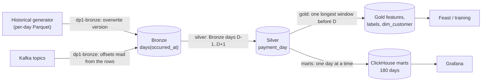
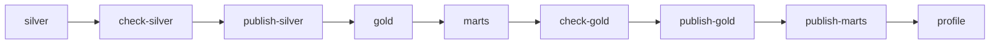
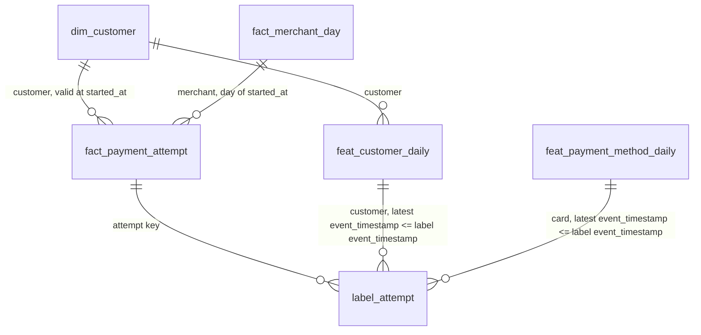

# Offline data

The offline path turns a reproducible synthetic history into curated tables and analytics. The historical generator writes immutable per-day Parquet datasets to object storage, standing in for an export from another department. DP1 ingests them into Bronze. One pipeline, `dp-pipeline`, then builds Silver, the Gold feature tables and the ClickHouse marts for a range of UTC days, auditing and publishing each layer before the next reads it. Each data problem the generator introduces is solved by a pipeline stage.

- Generator code: [`src/data-pipeline/simulator/simulator`](../../src/data-pipeline/simulator/simulator) (`world.py`, `lifecycle.py`, `historical.py`, `store.py`).
- Pipeline code: [`src/data-pipeline/batch/batch`](../../src/data-pipeline/batch/batch) (Spark and ClickHouse jobs) and [`src/data-pipeline/openmetadata/openmetadata`](../../src/data-pipeline/openmetadata/openmetadata) (checks, publish, lineage).
- Design: the [`payment-data-pipeline`](../../openspec/changes/payment-data-pipeline/design.md) change. Workflows, contracts and the catalog are on [orchestration and governance](orchestration-governance.md); table layout and the warehouse are on [storage](storage.md).

## Data problems and how they are solved

| Problem | Handling | Evidence |
|---|---|---|
| Skew | One merchant takes about 56% of purchases. Spark AQE splits skewed partitions; the marts keep a time-first key so the hot merchant does not decide the layout, and the overview dashboard shows the hot merchant's share | 56.3% top-merchant share in v18, about 56% in v19 samples |
| Schema evolution | Event schema 3 adds `assessment_id`, `evidence_sha256` and `user_agent_family` on 2026-04-30. DP1 reads `.v2` and `.v3` files together with `mergeSchema`, so absent version-2 fields become null; a Bronze rule requires them present exactly from version 3 | Every `.v2` file lacks the fields and every `.v3` file has them; the Bronze rule passes on v19 |
| Duplicates | About 2% of events are republished with a later `recorded_at`. Silver collapses equal business content per `event_id` and quarantines whole payments whose copies differ | `silver.rejected_events`: 0 rows through 2026-05-31 |
| High cardinality | 3M customers, their payment methods and devices are kept as integration-scoped keys; features use exact distinct counts over merged intervals, and the marts use bloom-filter indexes for per-customer and per-card lookups | Gold feature tables: 177M customer and 185M card rows through April |
| Delayed labels | Chargebacks arrive 7–21 days after the attempt. Silver links labels to the attempts of the 45 days before their availability day; Gold keeps `label_available_at` for the training cutoff | `silver.labels`: 116.5M rows through May, linkage checks pass |

The published interface is the contracts: [payment events](products/historical-payments/payment-events.md) and [fraud labels](products/historical-payments/fraud-labels.md).

## Generator

### Published datasets

| Dataset | Location | Run | Result |
|---|---|---|---|
| v18 (dev) | `s3://platform-dev/datasets/payment-gateway/historical/v18` | `generate-historical-v18-77fzr`, 1 shard, 11m50s | 823,963 events, 161,007 labels, 181 files, 112.4 MB; 1.996% duplicates; top merchant 56.3% of purchases, top 10 merchants 71.1%; 414,059 v2 and 409,904 v3 rows |
| v19 (prod, full scale) | `s3://platform-prod-142737101504-us-east-1/datasets/payment-gateway/historical/v19` | `generate-historical-v19-nvp7l`, 12 spot shards, 49 minutes | 983,727,083 events, 192,204,996 labels, 2,924 files over 365 days, 133.5 GB; sampled parts show about 2.0% duplicates and a 56% top-merchant share |

Both were checked by reading the manifest and Parquet files back from storage: no empty parts, and every `.v2` file lacks `assessment_id` while `.v3` files have it.

### Generation and reruns

[`historical-dev.yaml`](../../src/data-pipeline/simulator/configs/historical-dev.yaml) and [`historical-full.yaml`](../../src/data-pipeline/simulator/configs/historical-full.yaml) define dates, entity counts, skew, duplicates, schema changes and the output root. The chart supplies `SIMULATOR_CONFIG`, `GENERATOR_MODE`, `SHARD_INDEX`, `SHARD_COUNT`, `GENERATOR_WORKERS` and `GENERATOR_CONTRACTS`; credentials come from Secrets.

Submit `argo submit -n data --from workflowtemplate/generate-historical`. Shards write per-day Parquet parts, split into `.v2` and `.v3` event files, followed by `_day.json` completion markers. `config.json` pins the configuration and generator digest; `manifest.json` publishes the final inventory and totals. Reruns skip complete days, regenerate incomplete days and refuse changed inputs or an already published version.

Purchase dates end on the last full day before generation. Delayed chargebacks keep their real availability timestamps; training consumers must apply an as-of cutoff to both `occurred_at` and `label_available_at`.

## Pipeline

Every layer after Bronze runs one model: `job(start, end)` reads a bounded window before its range of UTC days, overwrites only its own days on a write-audit-publish branch, and is a pure function of its pinned inputs. The daily run and a backfill are the same code: `dp-daily` (suspended) runs Bronze from Kafka and then yesterday plus two lookback days, and `dp-backfill` runs the same pipeline month by month, in order, stopping at the first failed month.

Silver is audited and published before Gold reads it. Gold and the marts are audited together and published only if every Gold and mart rule passes; a Gold failure leaves the range's new Silver published with its previous Gold, and re-running the range rebuilds Gold.

### DP1: raw → Bronze

Bronze keeps every delivery, including duplicates, in two tables shared by both sources: `bronze.payment_events` and `bronze.fraud_labels`.

- **Historical mode** lists the dataset root once (metadata only) and fails before reading if its Parquet objects differ from the manifest's paths or sizes. It then reads the `.v2` and `.v3` files once, together, with `mergeSchema` (absent version-2 fields become null), casts losslessly to the Bronze contract and replaces only that dataset version's rows. After writing it groups the rows by source file and fails, naming the file, when a count differs from the manifest. The generator's SHA-256 values are not recomputed.
- **Kafka mode** reads `payments.events.v1` and `fraud.labels.v1` directly, decodes protobuf with the payments descriptor set, and appends. Each run starts from `max(_kafka_offset) + 1` per partition, read from Bronze itself, so progress and rows commit together and survive compaction. Records that fail protobuf decoding or a required-field check go to `bronze.rejected_records` instead of blocking later runs. A record that decodes but cannot be cast to the Bronze schema fails the run.
- **Provenance columns:** `_source`, `_dataset_version`, `_source_file`, `_kafka_topic`, `_kafka_partition`, `_kafka_offset`, `_kafka_timestamp`, `_ingested_at`, `_run_id`.

Prod v19 Bronze holds 983,727,083 events (2,904 files, 113.7 GB) and 192,204,996 labels (386 files, 9.8 GB).

### Silver

Silver is payment-scoped. Every event of a payment occurs within its 60-minute expiry, so a payment belongs to the UTC day of its first event, its `payment_day`. A run over `[start, end]` reads Bronze `occurred_at` days `start − 1` to `end + 1`, keeps the payments whose `payment_day` is in the range, and overwrites only those days. Labels are overwritten by availability day and link to the attempts of the 45 days before. Code: [`batch/silver/curate.py`](../../src/data-pipeline/batch/batch/silver/curate.py).

- **`silver.payment_events`:** one row per `event_id`, partitioned by `payment_day` and written in `occurred_at` order. Republished copies (same content, later `recorded_at`) collapse to the earliest. Copies that differ in any other business field are conflicts: the whole payment goes to `silver.rejected_events`.
- **`silver.rejected_events`:** all rows of a conflicting payment, excluded from the accepted tables, partitioned by `partition_day` (the payment's day, or a rejected label's availability day).
- **`silver.attempts`:** one row per attempt with `customer_id`, `merchant_id`, `payment_method_fingerprint`, `amount_minor`, server start time, client `attempted_at`, risk decision, outcome and payment status, partitioned by `payment_day` and written in `started_at` order. Lifecycle violations fail the checks.
- **`silver.labels`:** one row per distinct label observation, classified `linked`, `pending`, `orphan` or `violation` against the attempt, its start and success, and its payment's status. Violations and orphans fail the checks.

Deduplication is one shuffle on `event_id` within the run's payments, so its cost follows the range, not the history. The run report records the Bronze snapshot IDs, deliveries, distinct events, conflicting payments, label linkage counts, the Silver snapshot IDs and each phase's tasks and wall time.

### Gold: offline features

The `gold` stage is the Spark batch layer of a Lambda design; Flink is the speed layer and owns the 5-minute, 1-hour and 24-hour windows for both history and live. Gold reads the Silver snapshots the run just published and writes four Iceberg tables. Code: [`batch/gold/features.py`](../../src/data-pipeline/batch/batch/gold/features.py), [`batch/gold/windows.py`](../../src/data-pipeline/batch/batch/gold/windows.py); definition: [`fraud-history-batch-v1`](../../contracts/features/fraud-history-batch-v1.yaml).

- **Features at daily anchors.** `feat_customer_daily` and `feat_payment_method_daily` hold 7- and 30-day counts, amounts, decided and declined counts, decline rates and distinct counts at each UTC midnight `s`, over attempts with `s − window <= coalesce(attempted_at, started_at) < s` and `started_at < s` (outcome counts also need `outcome_at < s`). A row is written only where a value changes, so the value at time `t` is the entity's latest row with `event_timestamp <= t`; an entity with no such row is unknown. A window's columns are null until Silver covers the whole window. `created` is the pinned `silver.attempts` commit time.
- **Exact from one window of history.** `window_states` computes values from attempt intervals at `DailyAnchors`, starting from a baseline at the range's first midnight. A run therefore needs only one longest window of history before its range, and daily runs build exactly what one backfill builds (checked in CI).
- **Customer dimension.** `dim_customer` is an SCD2 over the observed profile: buyer ID, account creation time, shipping address and the sorted devices used at least twice in the 90 days up to each attempt. A version opens at the first attempt that changes the profile; `valid_to_ts` is the next version's `valid_from_ts`, null for the current one. A run continues each customer from its stored version before the range, finds familiar devices in one ordered pass (a running XOR of device hashes), and resets its audit branch to `main` first, so a retried run never builds on a failed attempt's delete.
- **Labels.** `label_attempt` keeps the earliest linked label per attempt and source, with `event_timestamp` equal to the attempt's `started_at`, when it was scored, and `label_available_at` for the training cutoff.
- **Kept, not written:** `gold.feat_attempt_rt` holds October 2025 to January 2026 from an earlier version, for an interim training dry run, until the Flink history replaces it.

### Marts

ClickHouse builds `marts.fact_payment_attempt` and `marts.fact_merchant_day` from the published Silver over a rolling 180-day window. A run rebuilds its days, the start days of attempts that gained a label in its range, and the days whose 21-day chargeback window completes in it, one day at a time into staging tables. The checks audit staging, and publish replaces those days' partitions. See [storage](storage.md#warehouse-indexing).

## Prod v19 run

Bronze v19, then `dp-backfill` from 2025-10-29 on the prod cluster (11 spot executors × 3 cores, drivers on on-demand nodes). Minutes per stage, from the Argo node times:

| Month | Run | silver | check-silver | gold | marts | check-gold | Month total |
|---|---|---|---|---|---|---|---|
| 2025-10 (3 days) | `dp-backfill-ljwl7` | 4 | 1 | 3 | 0 | 2 | 13 |
| 2025-11 | `dp-backfill-ljwl7` | 10 | 5 | 12 | 0 | 7 | 37 |
| 2025-12 | `dp-backfill-ljwl7` | 12 | 9 | 13 | 0 | 15 | 51 |
| 2026-01 | `dp-backfill-ljwl7` | 13 | 11 | 19 | 0 | 21 | 68 |
| 2026-02 | `dp-backfill-6pqtr` | 11 | 12 | 12 | 0 | 23 | 62 |
| 2026-03 | `dp-backfill-7xxsm` | 13 | 18 | 17 | 0 | 28 | 103 |
| 2026-04 | `dp-backfill-np6cn` | 9 | 3 | 8 | 0 | 9 | 33 |
| 2026-05 | `dp-backfill-drbzt` | 15 | 4 | running | | | |

The marts take no time before May because those days are older than the 180-day window. From November to March the Spark stages stay flat, because each run reads only its range, but the checks grow with every published month, because they audited whole tables. April is the first month with range-scoped checks: 3 and 9 minutes instead of 18 and 28.

Published row counts (Iceberg `main`):

| Table | Rows | Covers |
|---|---|---|
| `silver.payment_events` | 584,836,022 | 2025-10-29 to 2026-05-31 |
| `silver.attempts` | 115,915,077 | 2025-10-29 to 2026-05-31 |
| `silver.labels` | 116,513,105 | 2025-10-29 to 2026-05-31 |
| `silver.rejected_events` | 0 | 2025-10-29 to 2026-05-31 |
| `gold.dim_customer` | 17,738,110 | 2025-10-29 to 2026-04-30 |
| `gold.feat_customer_daily` | 176,997,829 | 2025-10-29 to 2026-04-30 |
| `gold.feat_payment_method_daily` | 184,503,875 | 2025-10-29 to 2026-04-30 |
| `gold.label_attempt` | 100,943,225 | 2025-10-29 to 2026-04-30 |

Every Silver and Gold rule passed in OpenMetadata: 58 tests on 15 tables. Lineage runs from the v19 dataset through Bronze and Silver to the Gold tables and marts; see [orchestration and governance](orchestration-governance.md#catalog).

## Optimization techniques

Each technique was adopted after a measured failure or cost on the v19 backfill; the run history above and the commits are the evidence, not a separate benchmark.

| Technique | Problem | Result |
|---|---|---|
| Range model: overwrite only the run's days | Full-history recomputes grew with history; rebuilding every customer's `dim_customer` history was OOMKilled in January | Silver 9–15 minutes a month from November to May |
| Payment-day partitions, rows written in time order | Time filters scanned whole tables | Gold, checks and marts prune to the run's days through partitions and file statistics |
| Local fanout writes for day-laid input | The hash distribution shuffle wrote 202 GB on the DP1 historical write (below) | Historical Bronze and Silver write without that shuffle |
| Narrow deduplication within the range | A broadcast of v19's 20M duplicated event IDs exceeded the driver's result size | One shuffle on `event_id` per month |
| Change-point feature rows | One row per entity per day would be about 1.1B rows a year per table | 177M customer and 185M card rows for six months |
| XOR sweep for familiar devices | Joining every attempt to its customer's device intervals was OOMKilled even per month | One ordered window pass per customer |
| `persist(MEMORY_AND_DISK)` instead of `localCheckpoint` | Spot reclaims lost locally checkpointed blocks and failed the stage | Lost blocks are recomputed from lineage |
| Range-scoped checks (`additional_table_filters`) | Whole-table checks grew every month; scoping through a `SELECT *` subquery ran ClickHouse out of memory | check-silver + check-gold: 18 + 28 minutes (March) → 3 + 9 (April) |
| Per-day mart insert, day's attempts as the hash build side | The monthly sort-merge join exceeded the marts user's 2 GiB in May | One day: 515,302 rows, 1.10 GiB peak, 66 s |
| Gold executor 9g + 3g → 7g + 5g, `MALLOC_ARENA_MAX=2` | Gold executors were OOMKilled in native memory while tasks peaked at 331 MB | Same 12 GiB pod, more room outside the heap |
| Drivers on on-demand nodes, executors on spot | A reclaimed driver restarts the whole application | Spot loss costs only executor retries |

### Viewing Spark event logs

Event logs live under `runs/payment-gateway/spark-events/` in each environment's bucket. Start a throwaway History Server using the deployed `data-platform-spark` image, `gateway-storage` credentials and `sparkEventLogDir` from the environment's chart values. Invoke `/opt/spark/bin/spark-class org.apache.spark.deploy.history.HistoryServer` with the S3A settings in `SPARK_HISTORY_OPTS`, port-forward port 18080, capture the required jobs, stages and plans, then delete the pod. Save PNGs under `docs/data/images/`.

## Schemas and naming

Table schemas are the data-product contracts, with generated references under [`products/`](products). The namespace or database names the layer and engine; a prefix names the role. Timestamps end in `_at` (business time) or `_ts` (SCD validity), surrogate keys in `_sk`, booleans start with `is_`; Feast's `event_timestamp` and `created` keep their names.

| Layer | Location | Tables |
|---|---|---|
| Bronze | Iceberg `bronze` | `payment_events`, `fraud_labels`, `rejected_records` |
| Silver | Iceberg `silver` | `payment_events`, `attempts`, `labels`, `rejected_events` |
| Gold, ML | Iceberg `gold` | `dim_customer`, `feat_customer_daily`, `feat_payment_method_daily`, `label_attempt` |
| Gold, analytics | ClickHouse `marts` | `fact_payment_attempt`, `fact_merchant_day`, `build_info` |

Point-in-time rules: join `dim_customer` on the customer key with `valid_from_ts <= t` and `valid_to_ts` null or after `t`. Join a feature table to a label row on the entity key, taking the latest feature row with `event_timestamp` at or before the label's `event_timestamp`; filter labels by `label_available_at` at or before the training cutoff.
