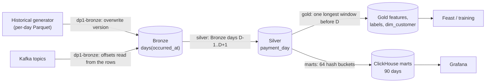
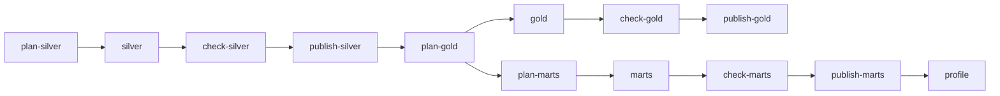
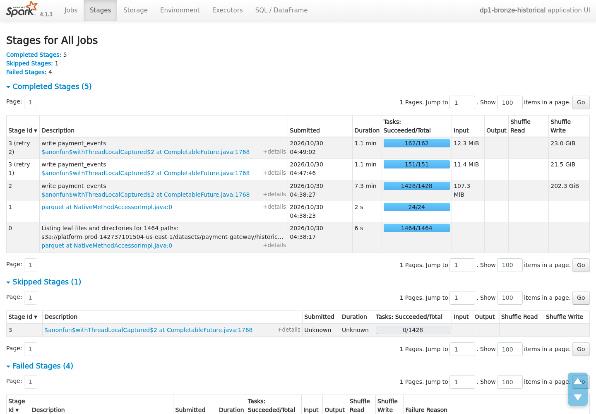
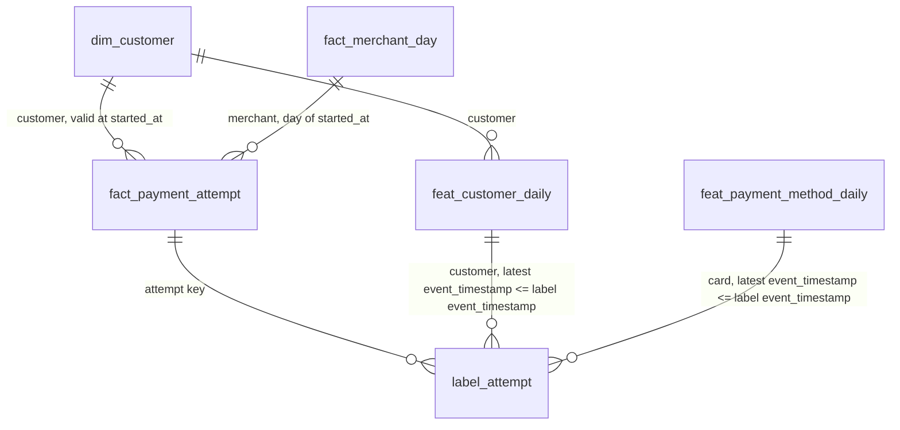

# Offline data

The offline path turns a reproducible synthetic history into curated tables and analytics. The historical generator writes immutable per-day Parquet datasets to object storage, standing in for an export from another department. DP1 ingests them into Bronze. One pipeline, `dp-pipeline`, then builds Silver, the Gold feature tables and the ClickHouse marts for a range of UTC days, auditing and publishing each layer before the next reads it. Each data problem the generator introduces is solved by a pipeline stage.

- Generator code: [`src/data-pipeline/simulator/simulator`](../../src/data-pipeline/simulator/simulator) (`world.py`, `lifecycle.py`, `historical.py`, `store.py`).
- Pipeline code: [`src/data-pipeline/batch/batch`](../../src/data-pipeline/batch/batch) (Spark and ClickHouse jobs) and [`src/data-pipeline/openmetadata/openmetadata`](../../src/data-pipeline/openmetadata/openmetadata) (checks, publish, lineage).
- Design: the archived [`payment-data-pipeline`](../../openspec/changes/archive/2026-11-01-payment-data-pipeline/design.md) change; current requirements are in [`openspec/specs`](../../openspec/specs). Workflows, contracts and the catalog are on [orchestration and governance](orchestration-governance.md); table layout and the warehouse are on [storage](storage.md).

## Data problems and how they are solved

| Problem | Handling | Evidence |
|---|---|---|
| Skew | One merchant takes about 56% of purchases. Spark enables AQE; the on-demand benchmark checks whether a skew split actually occurs; the marts keep a time-first key so the hot merchant does not decide the layout, and the overview dashboard shows the hot merchant's share | 56.3% top-merchant share in v18, about 56% in v19 samples |
| Schema evolution | Event schema 3 adds `assessment_id`, `evidence_sha256` and `user_agent_family` on 2026-04-30. DP1 reads `.v2` and `.v3` files together with `mergeSchema`, so absent version-2 fields become null; a Bronze rule requires them present exactly from version 3 | Bronze v19: version 2 is 514,342,841 events (2025-10-29 to 2026-04-29) and none of its 101,943,941 risk decisions has either field; version 3 is 469,384,242 events from 2026-04-30 and all 93,028,261 of its risk decisions have both |
| Duplicates | About 2% of events are republished with a later `recorded_at`. Silver collapses equal business content per `event_id` and quarantines whole payments whose copies differ | `silver.rejected_events`: 0 rows for the year |
| High cardinality | 3M customers, their payment methods and devices are kept as integration-scoped keys; features use exact distinct counts over merged intervals, and the marts use bloom-filter indexes for per-customer and per-card lookups | Gold feature tables: 348M customer and 363M card rows for the year |
| Delayed labels | Chargebacks arrive 7–21 days after the attempt. Silver links labels to the attempts of the 45 days before their availability day; Gold keeps `label_available_at` for the training cutoff | `silver.labels`: 192.2M rows for the year, linkage checks pass |

The published interface is the contracts: [payment events](products/historical-payments/payment-events.md) and [fraud labels](products/historical-payments/fraud-labels.md).

## Generator

### Published datasets

| Dataset | Location | Run | Result |
|---|---|---|---|
| v18 (dev) | `s3://platform-dev/datasets/payment-gateway/historical/v18` | `generate-historical-v18-77fzr`, 1 shard, 11m50s | 823,963 events, 161,007 labels, 181 files, 112.4 MB; 1.996% duplicates; top merchant 56.3% of purchases, top 10 merchants 71.1%; 414,059 v2 and 409,904 v3 rows |
| v19 (recorded AWS run, full scale) | `s3://platform-prod-142737101504-us-east-1/datasets/payment-gateway/historical/v19` | `generate-historical-v19-nvp7l`, 12 spot shards, 49 minutes | 983,727,083 events, 192,204,996 labels, 2,924 files over 365 days, 133.5 GB; sampled parts show about 2.0% duplicates and a 56% top-merchant share |
| v19 (GCP publication) | `s3://talos-proxmox-prod-platform/datasets/payment-gateway/historical/v19` | `generate-historical-v19-gcp-mstrk`, succeeded | Manifest: 983,727,083 events, 192,204,996 labels, 2,924 files over 365 days, 133,498,693,796 bytes |

The dev and recorded AWS datasets were checked by reading the manifest and Parquet files back from storage: no empty parts, and every `.v2` file lacks `assessment_id` while `.v3` files have it.

The [GCP publication check](evidence/gcs-v19-publication.json) downloaded the manifest and reconciled its per-file rows, bytes, dates and unique paths. Its SHA-256 is `78ee54fe2a607ae0c128bc6765d89238f28d00270fca5ad48a8fed44fd0f8608`, identical to the existing live-traffic pin. This check did not reread every Parquet object or execute the downstream backfill.

### Cardinality and skew are different measurements

The full configuration reserves 3M customers, 20K merchants, 3.9M payment methods and 4.2M devices. These are entity-domain sizes, not observed distinct counts in a sample. For a column `k`, report cardinality ratio as `count(DISTINCT k) / count(*)` over a named table and date range, and report nulls separately. A merchant can have low cardinality while one value dominates the rows; cardinality alone does not describe skew.

For example, run this against published Silver, keeping the same range when comparing layouts:

```sql
SELECT count(*) AS attempts,
       uniqExact(customer_id) / nullIf(count(*), 0) AS customer_cardinality_ratio,
       uniqExact(merchant_id) / nullIf(count(*), 0) AS merchant_cardinality_ratio,
       uniqExact(payment_method_fingerprint) / nullIf(count(*), 0) AS method_cardinality_ratio
FROM lakehouse.`silver.attempts`
WHERE payment_day BETWEEN '2026-09-01' AND '2026-09-30';
```

This query is a measurement recipe; its results have not been captured for the new GCP dataset. The configured `hot_merchant_share: 0.5` is one selection branch in [`World.purchase`](../../src/data-pipeline/simulator/simulator/world.py); familiar-merchant and Zipf selection can choose the same merchant too, explaining the observed share above 50%. Compare row shares with the generator configuration, not with a uniform-distribution assumption.

### Schema evolution and duplicate examples

| Input | Handling | Expected output |
|---|---|---|
| `.v2` Parquet without the new nested fields, followed by `.v3` with them | [`read_parts`](../../src/data-pipeline/batch/batch/bronze/ingest.py) reads all paths with `mergeSchema=true`; the contract checks presence by schema version | Both versions remain readable; old fields are null rather than invented values |
| Two copies of `evt-1`, differing only in `recorded_at` | Bronze retains both; Silver hashes business fields and keeps the earliest copy | One accepted event with the earlier `recorded_at` |
| Two `evt-2` copies with amounts 100 and 999, plus another event in that payment | Silver identifies a content conflict and quarantines the whole payment | No accepted events for that payment; all three deliveries remain inspectable in rejects |

The duplicate example is executable in [`test_silver.py`](../../src/data-pipeline/batch/tests/silver/test_silver.py), `test_identical_copies_collapse_to_earliest_and_conflicts_leave_the_accepted_tables`. Generator schema boundaries and physical Parquet fields are checked in [`test_generation.py`](../../src/data-pipeline/simulator/tests/test_generation.py). These fixtures prove behavior; they are not a timed Spark optimization comparison or UI capture. The recorded year decreased from 983,727,083 Bronze deliveries to 964,433,589 accepted Silver events, but the smaller table alone does not prove the conflict path, which needs the fixture above.

### Generation and reruns

[`historical-dev.yaml`](../../src/data-pipeline/simulator/configs/historical-dev.yaml) and [`historical-full.yaml`](../../src/data-pipeline/simulator/configs/historical-full.yaml) define dates, entity counts, skew, duplicates, schema changes and the output root. The chart supplies `SIMULATOR_CONFIG`, `GENERATOR_MODE`, `SHARD_INDEX`, `SHARD_COUNT`, `GENERATOR_WORKERS` and `GENERATOR_CONTRACTS`; credentials come from Secrets.

Submit `argo submit -n data --from workflowtemplate/generate-historical`. Shards write per-day Parquet parts, split into `.v2` and `.v3` event files, followed by `_day.json` completion markers. `config.json` pins the configuration and generator digest; `manifest.json` publishes the final inventory and totals. Reruns skip complete days, regenerate incomplete days and refuse changed inputs or an already published version.

Purchase dates end on the last full day before generation. Delayed chargebacks keep their real availability timestamps; training consumers must apply an as-of cutoff to both `occurred_at` and `label_available_at`.

## Pipeline

Every layer after Bronze runs one model: `job(start, end)` reads a bounded window before its range of UTC days, overwrites only its own days on a write-audit-publish branch, and is a pure function of its pinned inputs. The daily run and a backfill are the same code: `dp-daily` (suspended) runs Bronze from Kafka and then yesterday plus two lookback days, and `dp-backfill` runs the same pipeline month by month, in order, stopping at the first failed month.





Silver is audited and published before anything downstream reads it. Gold and the marts both read published Silver and nothing of each other, so they run side by side: the Gold Spark job overlaps the ClickHouse mart build, and the mart build, the two checks and the mart profile take turns on ClickHouse through one mutex. Each branch publishes when its own checks pass.

Each plan step skips its stage when the head of `main` (or the live `build_info`, for the marts) already holds this range's output from the same input snapshots by the same batch image. Re-running a range after a later stage failed therefore resumes at that stage instead of rebuilding Silver and Gold.

### DP1: raw → Bronze

Bronze keeps every delivery, including duplicates, in two tables shared by both sources: `bronze.payment_events` and `bronze.fraud_labels`.

- **Historical mode** lists the dataset root once (metadata only) and fails before reading if its Parquet objects differ from the manifest's paths or sizes. It then reads the `.v2` and `.v3` files once, together, with `mergeSchema` (absent version-2 fields become null), casts losslessly to the Bronze contract and replaces only that dataset version's rows. After writing it groups the rows by source file and fails, naming the file, when a count differs from the manifest. The generator's SHA-256 values are not recomputed.
- **Kafka mode** reads `payments.events.v1` and `fraud.labels.v1` directly, decodes protobuf with the payments descriptor set, and appends. Each run starts from `max(_kafka_offset) + 1` per partition, read from Bronze itself, so progress and rows commit together and survive compaction. Records that fail protobuf decoding or a required-field check go to `bronze.rejected_records` instead of blocking later runs. A record that decodes but cannot be cast to the Bronze schema fails the run.
- **Provenance columns:** `_source`, `_dataset_version`, `_source_file`, `_kafka_topic`, `_kafka_partition`, `_kafka_offset`, `_kafka_timestamp`, `_ingested_at`, `_run_id`.

Recorded AWS v19 Bronze held 983,727,083 events (2,904 files, 113.7 GB) and 192,204,996 labels (386 files, 9.8 GB).


### Silver

Silver is payment-scoped. Every event of a payment occurs within its 60-minute expiry, so a payment belongs to the UTC day of its first event, its `payment_day`. A run over `[start, end]` reads Bronze `occurred_at` days `start − 1` to `end + 1`, keeps the payments whose `payment_day` is in the range, and overwrites only those days. Labels are overwritten by availability day and link to the attempts of the 45 days before. Code: [`batch/silver/curate.py`](../../src/data-pipeline/batch/batch/silver/curate.py).

- **`silver.payment_events`:** one row per `event_id`, partitioned by `payment_day` and written in `occurred_at` order. Republished copies (same content, later `recorded_at`) collapse to the earliest. Copies that differ in any other business field are conflicts: the whole payment goes to `silver.rejected_events`.
- **`silver.rejected_events`:** all rows of a conflicting payment, excluded from the accepted tables, partitioned by `partition_day` (the payment's day, or a rejected label's availability day).
- **`silver.attempts`:** one row per attempt with `customer_id`, `merchant_id`, `payment_method_fingerprint`, `amount_minor`, server start time, client `attempted_at`, risk decision, outcome and payment status, partitioned by `payment_day` and written in `started_at` order. Lifecycle violations fail the checks.
- **`silver.labels`:** one row per distinct label observation, classified `linked`, `pending`, `orphan` or `violation` against the attempt, its start and success, and its payment's status. Violations and orphans fail the checks.

Deduplication is one shuffle on `event_id` within the run's payments, so its cost follows the range, not the history. The run report records the Bronze snapshot IDs, deliveries, distinct events, conflicting payments, label linkage counts, the Silver snapshot IDs and each phase's tasks and wall time.

### Gold: offline features

The `gold` stage is the Spark batch layer of a Lambda design; Flink is the speed layer and owns the 5-minute, 1-hour and 24-hour windows for both history and live. Gold reads the Silver snapshots the run just published and writes four Iceberg tables. Code: [`batch/gold/features.py`](../../src/data-pipeline/batch/batch/gold/features.py), [`batch/gold/windows.py`](../../src/data-pipeline/batch/batch/gold/windows.py); definition: [`fraud-history-batch-v1`](../../contracts/features/fraud-history-batch-v1.yaml).

- **Features at daily anchors.** `feat_customer_daily` and `feat_payment_method_daily` hold 7- and 30-day counts, amounts, decided and declined counts, decline rates and distinct counts at each UTC midnight `s`, over attempts with `s − window <= coalesce(attempted_at, started_at) < s` and `started_at < s` (outcome counts also need `outcome_at < s`). A row is written only where a value changes, so the value at time `t` is the entity's latest row with `event_timestamp <= t`; an entity with no such row is unknown. A window's columns are null until Silver covers the whole window. `created` is the pinned `silver.attempts` commit time.
- **Exact from one window of history.** `window_states` computes values from attempt intervals at `DailyAnchors`, starting from a baseline at the range's first midnight. A run therefore needs only one longest window of history before its range, and daily runs build exactly what one backfill builds (checked in CI).
- **Customer dimension.** `dim_customer` is an SCD2 over the observed profile: buyer ID, account creation time, shipping address and the sorted devices used at least twice in the 90 days up to each attempt. A version opens at the first attempt that changes the profile; `valid_to_ts` is the next version's `valid_from_ts`, null for the current one. A run continues each customer from its stored version before the range, finds familiar devices in one ordered pass (a running XOR of device hashes), and resets its audit branch to `main` first, so a retried run never builds on a failed attempt's delete.
- **Labels.** `label_attempt` keeps the earliest linked label per attempt and source, with `event_timestamp` equal to the attempt's `started_at`, when it was scored, and `label_available_at` for the training cutoff.
- **Stream tables.** `gold.feat_stream_customer` and `gold.feat_stream_payment_method` hold Flink's short-window snapshots, written by the feature writer, not by DP3. Each row carries its `epoch`: `live-v19` for live traffic and `history-v19` for the Kappa replay, so a replay never overwrites live rows and Feast reads only the configured epochs. `event_timestamp` is the online write time plus one microsecond. See [the feature store](../ml/feature-store.md).
- **Kept, not written:** `gold.feat_attempt_rt` holds October 2025 to January 2026 from an earlier version, for an interim training dry run, until the Flink history replaces it.

### Marts

ClickHouse builds `marts.fact_payment_attempt` and `marts.fact_merchant_day` from the published Silver over a rolling 90-day window. A run rebuilds its days and the 45-day label lookback before them, which covers the attempts its labels can belong to and the days whose 21-day chargeback window completes in it. It stages those days' attempts and their label summary once, joins them in 64 payment-hash buckets into staging tables, the checks audit staging, and publish replaces those days' partitions. See [storage](storage.md#warehouse-indexing).

## Recorded v19 backfill (AWS)

The timings, row totals and captures below describe the completed AWS-era run. Production now uses GCP; regeneration there does not establish that its downstream backfill has completed. Keep these recorded results separate from a new GCP run.

<a id="prod-v19-run"></a>

Bronze v19, then `dp-backfill` from 2025-10-29 on the prod cluster (11 spot executors × 3 cores, drivers on on-demand nodes). Minutes per stage, from the Argo node times. Until June the stages ran in one line and `check-gold` audited Gold and the marts together; from July Gold and the marts run side by side, so the month total no longer includes the mart build:

| Month | Run | silver | check-silver | gold | check-gold | marts | check-marts | Month total |
|---|---|---|---|---|---|---|---|---|
| 2025-10 (3 days) | `dp-backfill-ljwl7` | 4 | 1 | 3 | 2 | 0 | | 13 |
| 2025-11 | `dp-backfill-ljwl7` | 10 | 5 | 12 | 7 | 0 | | 37 |
| 2025-12 | `dp-backfill-ljwl7` | 12 | 9 | 13 | 15 | 0 | | 51 |
| 2026-01 | `dp-backfill-ljwl7` | 13 | 11 | 19 | 21 | 0 | | 68 |
| 2026-02 | `dp-backfill-6pqtr` | 11 | 12 | 12 | 23 | 0 | | 62 |
| 2026-03 | `dp-backfill-7xxsm` | 13 | 18 | 17 | 28 | 0 | | 103 |
| 2026-04 | `dp-backfill-np6cn` | 9 | 3 | 8 | 9 | 0 | | 33 |
| 2026-05 | `dp-backfill-drbzt` | 15 | 4 | 15 | 10.5 | 5.3 | | 52 |
| 2026-06 | `dp-backfill-wjc8k` | 9 | 3.6 | 9 | 14.5 | 20.5 | | 61 |
| 2026-07 | `dp-backfill-8h7gq` | 15 | 4 | 14 | 10 | 0.5 | 1.1 | 44 |
| 2026-08 | `dp-backfill-8h7gq` | 14.5 | 3.8 | 13.7 | 11.1 | 7.7 | 1.1 | 44 |
| 2026-09 | `dp-backfill-ww2pp` | skipped | skipped | 13.8 | 10.8 | 12.7 | 1.2 | 28 |
| 2026-10 (28 days) | `dp-backfill-ww2pp` | 12.5 | 3.5 | 11.9 | 10.9 | 16.2 | 1.3 | 50 |

What the table shows:

- **Spark stays flat.** Silver and Gold read only their range, so they take 9–19 minutes a month whatever the history before them.
- **Whole-table checks grew; [range-scoped](orchestration-governance.md#range-scoped-validation) ones do not.** November to March audited whole tables and grew with every published month; from April each rule reads only the audited commit's range.
- **The mart window.** Until May the backfilled days were older than the mart window and built nothing. June rebuilt 56 days one day at a time; from July the window is 90 days (from 2026-08-04 on 2026-11-01), so July builds nothing and August builds 28 days in buckets while Gold runs. September and October rebuild 58 and 73 days, their label lookback included, at about 13 s a day; October's longer build held the ClickHouse mutex, so its check-gold waited 6 minutes.
- **Failures cost one month, and a re-run skips what is published.** A month's failure stops the backfill and the next run resumes at that month. September's first run published Silver before check-gold failed on a full ClickHouse disk; the re-run found that Silver unchanged on `main` and skipped it and its checks. Silver over three months at once overflowed the executors' 24 GiB of local disk, so the backfill stays monthly.

What changed between the rows, and why, is in [optimization techniques](#optimization-techniques).


Published row counts (Iceberg `main`, 2025-10-29 to 2026-10-28):

| Table | Rows |
|---|---|
| `silver.payment_events` | 964,433,589 |
| `silver.attempts` | 191,148,630 |
| `silver.labels` | 192,163,964 |
| `silver.rejected_events` | 0 |
| `gold.dim_customer` | 34,004,866 |
| `gold.feat_customer_daily` | 348,030,903 |
| `gold.feat_payment_method_daily` | 362,959,360 |
| `gold.label_attempt` | 192,163,964 |
| `marts.fact_payment_attempt` | 44,209,535 (2026-08-04 to 2026-10-28, the 90-day window; 6.05 GiB, 147 bytes a row) |
| `marts.fact_merchant_day` | 1,327,898 |

Every Silver, Gold and mart rule passed in OpenMetadata: 58 tests on 15 tables. Lineage runs from the v19 dataset through Bronze and Silver to the Gold tables and marts; see [orchestration and governance](orchestration-governance.md#catalog).

### Controlled skew comparison

[`batch/silver/benchmark.py`](../../src/data-pipeline/batch/batch/silver/benchmark.py) compares the same cached, pinned attempt range using `baseline_no_skew_join`, `aqe_skew_join` and a 16-bucket `salted` join. It disables broadcast for this experiment, checks output row counts and checksums, and rejects an AQE result whose executed plan contains no actual skew split. Submit `argo submit -n data --from workflowtemplate/dp2-benchmark -p start=2026-09-01 -p end=2026-09-30` only after that Silver range is published.

Capture the report's snapshot ID, hot-key share, per-variant wall/task times and final adaptive plans alongside the Spark stage screenshots. There is no recorded production timing comparison for these three variants yet. The DP1 hash-write screenshots below measure write distribution, not a skewed merchant join, and cannot substantiate a skew-join speedup. Salting is an experiment, not the production default: it replicates the small side and adds another key, so adopt it only when the same-output comparison beats AQE on the target range.

## Optimization techniques

Each technique was adopted after a measured failure or cost on the v19 backfill; the run history above and the commits are the evidence, not a separate benchmark.

| Technique | Problem | Result |
|---|---|---|
| Range model: overwrite only the run's days | Full-history recomputes grew with history; rebuilding every customer's `dim_customer` history was OOMKilled in January | Silver 9–15 minutes a month from November to October |
| Payment-day partitions, rows written in time order | Time filters scanned whole tables | Gold, checks and marts prune to the run's days through partitions and file statistics |
| Local fanout writes for day-laid input | The hash distribution shuffle wrote 202 GB on the DP1 historical write (below) | Historical Bronze and Silver write without that shuffle |
| Narrow deduplication within the range | A broadcast of v19's 20M duplicated event IDs exceeded the driver's result size | One shuffle on `event_id` per month |
| Change-point feature rows | One row per entity per day would be about 1.1B rows a year per table | 348M customer and 363M card rows for the year |
| XOR sweep for familiar devices | Joining every attempt to its customer's device intervals was OOMKilled even per month | One ordered window pass per customer |
| `persist(MEMORY_AND_DISK)` instead of `localCheckpoint` | Spot reclaims lost locally checkpointed blocks and failed the stage | Lost blocks are recomputed from lineage |
| Range-scoped checks (`additional_table_filters`) | Whole-table checks grew every month; scoping through a `SELECT *` subquery ran ClickHouse out of memory | check-silver + check-gold: 18 + 28 minutes (March) → 3 + 9 (April) |
| Branch reset before the `dim_customer` rewrite | Its delete and append are two commits; a retry after a failure between them read the delete and would have dropped history | Every attempt starts from `main` |
| Gold executor 9g + 3g → 7g + 5g, `MALLOC_ARENA_MAX=2` | Gold executors were OOMKilled in native memory while tasks peaked at 331 MB | Same 12 GiB pod, more room outside the heap |
| Label summary in 8 hash passes of its own columns | June's summary read every label column in one group-by and exceeded the marts user's 2 GiB | One pass: 822 MiB, 18 s |
| Mart fact joined in 64 hash buckets of staged attempts and labels | The monthly sort-merge join exceeded 2 GiB in May; the per-day joins that replaced it rescanned all labels for every day | August: 28 days in 7.7 minutes, October: 73 days in 16.2 (13–16.5 s a day; June's per-day build took 22 s a day) |
| ZSTD on the ID and fingerprint columns, 90-day window | Random UUIDs and hashes took about 240 bytes a row under LZ4; a 180-day window and its staging copies would not fit the 30 GiB volume | 147 bytes a row; the 90-day fact is about 6 GiB |
| Gold and the marts side by side | The mart build waited for Gold although it reads only Silver | July and August: 44 minutes a month, the mart build behind Gold |
| Skip a stage whose output is already on `main` | A re-run after a later failure rebuilt every layer (June's re-run redid 22 minutes of published Silver and Gold) | Plan steps compare range, input snapshots and batch image; September's re-run skipped its published Silver and took 28 minutes |
| Drivers on on-demand nodes, executors on spot | A reclaimed driver restarts the whole application | Spot loss costs only executor retries |



### Viewing Spark event logs

Event logs live under `runs/payment-gateway/spark-events/` in each environment's bucket. Start a throwaway History Server using the deployed `data-platform-spark` image, `gateway-storage` credentials and `sparkEventLogDir` from the environment's chart values. Invoke `/opt/spark/bin/spark-class org.apache.spark.deploy.history.HistoryServer` with the S3A settings in `SPARK_HISTORY_OPTS`, port-forward port 18080, capture the required jobs, stages and plans, then delete the pod. Save PNGs under `docs/data/images/`.

## Novel ideas

- **Write-audit-publish on Iceberg branches, audited only where the run wrote.** Every layer writes to an `audit-<workflow>` branch, the contract's SQL rules run as native OpenMetadata tests against that branch's snapshot, and only a clean audit fast-forwards `main`. A consumer therefore never reads an unaudited row. The rules see only the range the audited commit records, through ClickHouse `additional_table_filters` and without rewriting the rule's SQL, so a check costs one month whatever the history behind it. See [range-scoped validation](orchestration-governance.md#range-scoped-validation).
- **Resumable re-runs from snapshot lineage, with no state store.** Each Silver and Gold commit records its day range, the input snapshot IDs it read and the batch image in its Iceberg summary, and the marts record the same in `build_info`. Before a stage, a plan step compares these with what the run would write and skips the stage when they match. Re-running a failed month therefore resumes at the failed stage, and the record of what was built travels with the data. See [pipeline](#pipeline).

## Schemas and naming

Table schemas are the data-product contracts, with generated references under [`products/`](products). The namespace or database names the layer and engine; a prefix names the role. Timestamps end in `_at` (business time) or `_ts` (SCD validity), surrogate keys in `_sk`, booleans start with `is_`; Feast's `event_timestamp` and `created` keep their names.

| Layer | Location | Tables |
|---|---|---|
| Bronze | Iceberg `bronze` | `payment_events`, `fraud_labels`, `rejected_records` |
| Silver | Iceberg `silver` | `payment_events`, `attempts`, `labels`, `rejected_events` |
| Gold, ML | Iceberg `gold` | `dim_customer`, `feat_customer_daily`, `feat_payment_method_daily`, `label_attempt` |
| Gold, analytics | ClickHouse `marts` | `fact_payment_attempt`, `fact_merchant_day`, `build_info` |



Point-in-time rules: join `dim_customer` on the customer key with `valid_from_ts <= t` and `valid_to_ts` null or after `t`. Join a feature table to a label row on the entity key, taking the latest feature row with `event_timestamp` at or before the label's `event_timestamp`; filter labels by `label_available_at` at or before the training cutoff.
