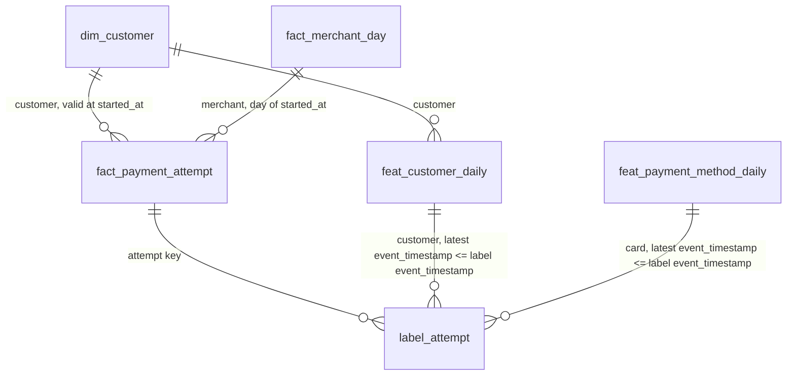

# Offline data

The offline path turns a reproducible synthetic history into curated tables. The historical generator writes immutable per-day Parquet datasets to object storage, standing in for an export from another department; DP1 ingests them into Bronze, DP2 curates Silver, and DP3 computes gold features, a customer dimension, labels and ClickHouse marts. Each data problem the generator introduces is solved by a pipeline stage.

- Generator code: [`src/data-pipeline/simulator/simulator`](../../src/data-pipeline/simulator/simulator) (`world.py`, `lifecycle.py`, `historical.py`, `store.py`).
- Pipeline code merged in [PR #102](https://github.com/phuchoang2603/payment-gateway-fraud-detection/pull/102); prod Bronze and Silver are published; complete Silver validation remains open under the [`rebuild-generation-to-silver`](../../openspec/changes/rebuild-generation-to-silver/design.md) change. Each pipeline is an Argo workflow that writes, audits and publishes: the Spark stage writes to an audit branch of each Iceberg table, the checks stage runs the ClickHouse SQL checks against that branch, and normally only when every check passes does `publish-tables` fast-forward the tables' main branch. An exit handler publishes the run to OpenMetadata; see [orchestration and governance](orchestration-governance.md).

## Data problems and how they are solved

| Problem | Handling | Evidence |
|---|---|---|
| Skew | Compare baseline sort-merge, AQE skew join and 16-bucket salting | About 56% hot-merchant share in v19 samples; timings/plans deferred |
| Schema evolution | DP1 `mergeSchema` fills physically absent v2 fields with null | Source v2/v3 layouts verified; Bronze null-count proof pending |
| Duplicates | Collapse equal business content by `event_id`; quarantine conflicting payments | v19 Spark: 19,293,494 copies collapsed; zero conflicts or rejected rows |
| High cardinality | Retain customer, payment-method and device identifiers | No separate benchmark in this change |
| Delayed labels | Link to attempt lifecycle and enforce availability cutoffs | v19 Spark: 192,204,996 linked observations; full SQL validation pending |

The published interface is the contracts: [payment events](products/historical-payments/payment-events.md) and [fraud labels](products/historical-payments/fraud-labels.md).

## Generator

### Published datasets

| Dataset | Location | Run | Result |
|---|---|---|---|
| v18 (dev) | `s3://platform-dev/datasets/payment-gateway/historical/v18` | `generate-historical-v18-77fzr`, 1 shard, 11m50s | 823,963 events, 161,007 labels, 181 files, 112.4 MB; 1.996% duplicates; top merchant 56.3% of purchases, top 10 merchants 71.1%; 414,059 v2 and 409,904 v3 rows |
| v19 (prod, full scale) | `s3://platform-prod-142737101504-us-east-1/datasets/payment-gateway/historical/v19` | `generate-historical-v19-nvp7l`, 12 spot shards, 49 minutes | 983,727,083 events, 192,204,996 labels, 2,924 files over 365 days, 133.5 GB; sampled parts show about 2.0% duplicates and a 56% top-merchant share |

Both were checked by reading the manifest and Parquet files back from storage: no empty parts, and every `.v2` file lacks `assessment_id` while `.v3` files have it.

### Generation and reruns

[`historical-dev.yaml`](../../src/data-pipeline/simulator/configs/historical-dev.yaml) and [`historical-full.yaml`](../../src/data-pipeline/simulator/configs/historical-full.yaml) define dates, entity counts, skew, duplicates, schema changes and the output root. The chart supplies `SIMULATOR_CONFIG`, `GENERATOR_MODE`, `SHARD_INDEX`, `SHARD_COUNT`, `GENERATOR_WORKERS` and `GENERATOR_CONTRACTS`; credentials come from Secrets.

Submit `argo submit -n data --from workflowtemplate/generate-historical`. Shards write per-day Parquet parts, split into `.v2` and `.v3` event files, followed by `_day.json` completion markers. `config.json` pins the configuration and generator digest; `manifest.json` publishes the final inventory and totals. Reruns skip complete days, regenerate incomplete days and refuse changed inputs or an already published version.

Purchase dates end on the last full day before generation. Delayed chargebacks retain their real availability timestamps; training consumers must apply an as-of cutoff to both `occurred_at` and `label_available_at`.

## Pipeline

### DP1: raw → Bronze

Bronze keeps every delivery, including duplicates, in two tables shared by both sources: `bronze.payment_events` and `bronze.fraud_labels`.

- **Historical mode** lists the dataset root once (metadata only) and fails before reading if its parquet objects differ from the manifest's paths or sizes. It then reads the `.v2` and `.v3` files once, together, with `mergeSchema` (absent version-2 fields become null), casts losslessly to the Bronze contract and replaces only that dataset version's rows. After writing it groups the rows by source file and fails, naming the file, when a count differs from the manifest. The generator's SHA-256 values are not recomputed.
- **Kafka mode** reads `payments.events.v1` and `fraud.labels.v1` directly, decodes protobuf with the payments descriptor set, and appends. Each run starts from `max(_kafka_offset) + 1` per partition, read from Bronze itself, so progress and rows commit together and survive compaction. Records that fail protobuf decoding or a required-field check go to `bronze.rejected_records` instead of blocking later runs. The error names the first failing check, and an empty string counts as missing. A record that decodes but cannot be cast to the Bronze schema fails the run.
- **Provenance columns:** `_source`, `_dataset_version`, `_source_file`, `_kafka_topic`, `_kafka_partition`, `_kafka_offset`, `_kafka_timestamp`, `_ingested_at`, `_run_id`.

### DP2: Bronze → Silver

`historical` recomputes from pinned Bronze snapshots. `incremental` reads new append snapshots, recomputes affected payments within a 35-day lookback and replaces their rows. It refuses missing state, historical reloads, changed logic or history beyond the lookback. Consumers use Iceberg changelogs; both modes manage four tables:

- **`silver.payment_events`:** one row per `event_id`. Republished copies (same content, later `recorded_at`) collapse to the earliest. Copies that differ in any other business field are conflicts: the whole payment goes to `silver.rejected_events`.
- **`silver.rejected_events`:** all event rows of a conflicting payment, excluded from the accepted tables.
- **`silver.attempts`:** one row per attempt with `customer_id`, `merchant_id`, `payment_method_fingerprint`, `amount_minor`, server start time, client `attempted_at`, risk decision, outcome and payment status. Lifecycle violations fail the checks.
- **`silver.labels`:** one row per distinct label observation, classified `linked`, `pending`, `orphan` or `violation` against the payment, the attempt's start and success. A historical label whose payment has no events is an `orphan`; a live label whose payment has not arrived is `pending`. Violations and orphans fail the checks.

A run report records the Bronze snapshot IDs, input rows, duplicates, conflicts, rejected rows, label linkage counts, the Silver snapshot IDs with their added records, and the tasks, stages and wall time of each phase. The report is written last, after every table write.

### Prod v19 evidence

| Run | Result |
|---|---|
| `dp1-bronze-mngks` | Succeeded, 62m02s; 983,727,083 events and 192,204,996 labels published |
| `dp2-silver-cxjgf` | Spark completed; checks failed. Report: 19,293,494 duplicate deliveries collapsed, 964,433,589 events, 191,148,630 attempts, 192,204,996 linked labels, zero conflicting payments or rejected rows |
| `dp2-silver-cnr27` | Historical Spark completed in about 32m; checks failed. Its four Silver snapshots are now on `main`; complete validation is still outstanding |
| `dp2-silver-q6xgs` | Incremental Spark completed in 2m02s with zero affected payments. Checks reached `silver_unique_event`, which aborted at ClickHouse's 3.4 GiB server memory limit; subsequent checks continued |

Incremental curation succeeded, but this rerun does not demonstrate new-data processing: Bronze had no new deliveries. SQL checks still cover the full relevant tables. Published Silver is available to DP3; its full validation must be resolved before treating derived training data as validated.

### Remaining optimization evidence

Benchmarks are deferred. Track execution and screenshots in the [open checklist](../../openspec/changes/rebuild-generation-to-silver/tasks.md); keep the change open until verification and evidence are complete.

| Coursework requirement | Evidence still needed |
|---|---|
| Spark baseline and skew | Same pinned snapshot: baseline, AQE skew join and 16-bucket salting; equal output checksums, timings, straggler tasks and final AQE plan |
| Duplicate handling | `full_width_group` versus `narrow_detect`: equal output, shuffle, spill and elapsed time |
| Schema evolution | Bronze v2/v3 null counts or read plan showing missing fields become null |
| Storage | Maintenance before/after files and bytes, partition and Z-order planning probes |
| Pipeline and governance | Successful Argo graphs, table lineage and complete native OpenMetadata results |

Each benchmark variant runs once; report observed gains only for equivalent completed outputs. If AQE does not split skew, inspect partition sizes before changing thresholds. Kafka new-data evidence waits for live traffic; capture the suspended CronWorkflow definition meanwhile. Gold indexing and feature/training evidence belong to DP3.

### Viewing Spark event logs

Event logs live under `runs/payment-gateway/spark-events/` in each environment's bucket. Start a throwaway History Server using the deployed `data-platform-spark` image, `gateway-storage` credentials and `sparkEventLogDir` from the environment's chart values. Invoke `/opt/spark/bin/spark-class org.apache.spark.deploy.history.HistoryServer` with the S3A settings in `SPARK_HISTORY_OPTS`, port-forward port 18080, capture the required jobs/stages/plans, then delete the pod. Save PNGs under `docs/data/images/`.

### DP3: offline features

The `dp3-gold` workflow reads Silver at its published snapshots and writes, through write-audit-publish, four gold Iceberg tables and two ClickHouse marts. Code: [`batch/gold/features.py`](../../src/data-pipeline/batch/batch/gold/features.py), [`batch/gold/windows.py`](../../src/data-pipeline/batch/batch/gold/windows.py), [`batch/gold/marts.py`](../../src/data-pipeline/batch/batch/gold/marts.py); definition: [`fraud-history-batch-v1`](../../contracts/features/fraud-history-batch-v1.yaml); design: [`dp3-features-and-marts`](../../openspec/changes/dp3-features-and-marts/design.md).

- **Features at daily anchors.** `feat_customer_daily` and `feat_payment_method_daily` hold 7- and 30-day counts, amounts, decided and declined counts, decline rates and distinct counts at each UTC midnight `s`, over attempts with `s − window <= coalesce(attempted_at, started_at) < s` and `started_at < s` (outcome counts also need `outcome_at < s`). A row is written only where a value changes, so the value at time `t` is the entity's latest row with `event_timestamp <= t`, and an entity with no such row is unknown. A window's columns are null until Silver covers the whole window. Anchors stop at the day of the pinned `silver.attempts` commit, and `created` is that commit's time.
- **Shared window engine.** `batch.gold.windows.change_points` computes these rows from attempt intervals and takes the anchor rule as a parameter: `DailyAnchors` here, `ExactAnchors` for exact change instants.
- **Customer dimension.** `dim_customer` is an SCD2 over the observed profile: buyer ID, account creation time, shipping address and the sorted devices used at least twice in the 90 days up to each attempt. A version opens at the first attempt that changes the profile; `valid_to_ts` is the next version's `valid_from_ts`, null for the current version.
- **Labels.** `label_attempt` keeps the earliest linked label per attempt and source, with `event_timestamp` equal to the attempt time and `label_available_at` for the training cutoff.
- **Marts.** ClickHouse builds `marts.fact_payment_attempt` and `marts.fact_merchant_day` from the lakehouse over a rolling 180-day window into staging tables; the checks audit staging, then publish swaps it in. See [storage](storage.md#warehouse-indexing).
- **Modes.** `mode=historical` recomputes everything. `mode=incremental`, used by the suspended daily schedule, reads the net Iceberg changelog of `silver.attempts` and `silver.labels` since the snapshots the last DP3 run recorded, recomputes only the affected and expiring customers and cards, the affected customers' versions and the changed attempts' labels, and replaces only the affected mart days. It refuses, asking for a historical run, when there is no earlier run, a historical DP2 run or expired snapshot lies in between, the earliest Silver day moved, or a logic version changed. CI checks that incremental output equals a historical run except for `created`.

Pending: dev and prod v19 run IDs, row counts, phase times and check results.

### Schemas and naming

Table schemas are the data-product contracts, with generated references under [`products/`](products). The namespace or database names the layer and engine; a prefix names the role. Timestamps end in `_at` (business time) or `_ts` (SCD validity), surrogate keys in `_sk`, booleans start with `is_`; Feast's `event_timestamp` and `created` keep their names.

| Layer | Location | Tables |
|---|---|---|
| Bronze | Iceberg `bronze` | `payment_events`, `fraud_labels`, `rejected_records` |
| Silver | Iceberg `silver` | `payment_events`, `attempts`, `labels`, `rejected_events` |
| Gold, ML | Iceberg `gold` | `dim_customer`, `feat_customer_daily`, `feat_payment_method_daily`, `label_attempt` |
| Gold, analytics | ClickHouse `marts` | `fact_payment_attempt`, `fact_merchant_day`, `build_info` |

Point-in-time rules: join `dim_customer` on the customer key with `valid_from_ts <= t` and `valid_to_ts` null or after `t`. Join a feature table to a label row on the entity key, taking the latest feature row with `event_timestamp` at or before the label's `event_timestamp`; filter labels by `label_available_at` at or before the training cutoff.
