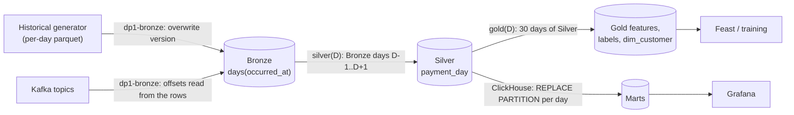
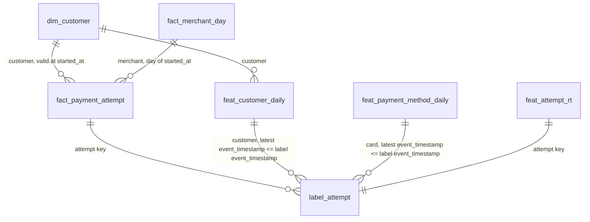

# Offline data

The offline path turns a reproducible synthetic history into curated tables. The historical generator writes immutable per-day Parquet datasets to object storage, standing in for an export from another department; DP1 ingests them into Bronze, DP2 curates Silver, and DP3 computes gold features, a customer dimension, labels and ClickHouse marts. Each data problem the generator introduces is solved by a pipeline stage.

- Generator code: [`src/data-pipeline/simulator/simulator`](../../src/data-pipeline/simulator/simulator) (`world.py`, `lifecycle.py`, `historical.py`, `store.py`).
- Pipeline code merged in [PR #102](https://github.com/phuchoang2603/payment-gateway-fraud-detection/pull/102); prod Bronze and Silver are published; complete Silver validation remains open under the [`rebuild-generation-to-silver`](../../openspec/changes/rebuild-generation-to-silver/design.md) change. Each pipeline is an Argo workflow that writes, audits and publishes: the Spark stage writes to an audit branch of each Iceberg table, the checks stage runs the ClickHouse SQL checks against that branch, and normally only when every check passes does `publish-tables` fast-forward the tables' main branch. An exit handler publishes the run to OpenMetadata; see [orchestration and governance](orchestration-governance.md).

## Data problems and how they are solved

| Problem | Handling | Evidence |
|---|---|---|
| Skew | Compare baseline sort-merge, AQE skew join and 16-bucket salting | About 56% hot-merchant share in v19 samples; timings/plans deferred |
| Schema evolution | DP1 `mergeSchema` fills physically absent v2 fields with null | Source v2/v3 layouts verified; Bronze null-count proof pending |
| Duplicates | Collapse equal business content by `event_id`; quarantine conflicting payments | v19 Spark: 19,293,494 copies collapsed; zero conflicts or rejected rows |
| High cardinality | Retain customer, payment-method and device identifiers | No separate benchmark in this change |
| Delayed labels | Link to attempt lifecycle and enforce availability cutoffs | v19 Spark: 192,204,996 linked observations; full SQL validation pending |

The published interface is the contracts: [payment events](products/historical-payments/payment-events.md) and [fraud labels](products/historical-payments/fraud-labels.md).

## Generator

### Published datasets

| Dataset | Location | Run | Result |
|---|---|---|---|
| v18 (dev) | `s3://platform-dev/datasets/payment-gateway/historical/v18` | `generate-historical-v18-77fzr`, 1 shard, 11m50s | 823,963 events, 161,007 labels, 181 files, 112.4 MB; 1.996% duplicates; top merchant 56.3% of purchases, top 10 merchants 71.1%; 414,059 v2 and 409,904 v3 rows |
| v19 (prod, full scale) | `s3://platform-prod-142737101504-us-east-1/datasets/payment-gateway/historical/v19` | `generate-historical-v19-nvp7l`, 12 spot shards, 49 minutes | 983,727,083 events, 192,204,996 labels, 2,924 files over 365 days, 133.5 GB; sampled parts show about 2.0% duplicates and a 56% top-merchant share |

Both were checked by reading the manifest and Parquet files back from storage: no empty parts, and every `.v2` file lacks `assessment_id` while `.v3` files have it.

### Generation and reruns

[`historical-dev.yaml`](../../src/data-pipeline/simulator/configs/historical-dev.yaml) and [`historical-full.yaml`](../../src/data-pipeline/simulator/configs/historical-full.yaml) define dates, entity counts, skew, duplicates, schema changes and the output root. The chart supplies `SIMULATOR_CONFIG`, `GENERATOR_MODE`, `SHARD_INDEX`, `SHARD_COUNT`, `GENERATOR_WORKERS` and `GENERATOR_CONTRACTS`; credentials come from Secrets.

Submit `argo submit -n data --from workflowtemplate/generate-historical`. Shards write per-day Parquet parts, split into `.v2` and `.v3` event files, followed by `_day.json` completion markers. `config.json` pins the configuration and generator digest; `manifest.json` publishes the final inventory and totals. Reruns skip complete days, regenerate incomplete days and refuse changed inputs or an already published version.

Purchase dates end on the last full day before generation. Delayed chargebacks retain their real availability timestamps; training consumers must apply an as-of cutoff to both `occurred_at` and `label_available_at`.

## Pipeline

Every layer after Bronze runs one model: `job(start, end)` reads a bounded window before its range of UTC days, overwrites only its own day partitions on a write-audit-publish branch, and is a pure function of its pinned inputs. The daily run and a backfill are the same code: `dp-daily` covers yesterday plus two lookback days, and `dp-backfill` runs the same `dp-pipeline` month by month, in order.

### DP1: raw → Bronze

Bronze keeps every delivery, including duplicates, in two tables shared by both sources: `bronze.payment_events` and `bronze.fraud_labels`.

- **Historical mode** lists the dataset root once (metadata only) and fails before reading if its parquet objects differ from the manifest's paths or sizes. It then reads the `.v2` and `.v3` files once, together, with `mergeSchema` (absent version-2 fields become null), casts losslessly to the Bronze contract and replaces only that dataset version's rows. After writing it groups the rows by source file and fails, naming the file, when a count differs from the manifest. The generator's SHA-256 values are not recomputed.
- **Kafka mode** reads `payments.events.v1` and `fraud.labels.v1` directly, decodes protobuf with the payments descriptor set, and appends. Each run starts from `max(_kafka_offset) + 1` per partition, read from Bronze itself, so progress and rows commit together and survive compaction. Records that fail protobuf decoding or a required-field check go to `bronze.rejected_records` instead of blocking later runs. The error names the first failing check, and an empty string counts as missing. A record that decodes but cannot be cast to the Bronze schema fails the run.
- **Provenance columns:** `_source`, `_dataset_version`, `_source_file`, `_kafka_topic`, `_kafka_partition`, `_kafka_offset`, `_kafka_timestamp`, `_ingested_at`, `_run_id`.

### DP2: Bronze → Silver

Silver is payment-scoped. Every event of a payment occurs within its 60-minute expiry, so a payment belongs to the UTC day of its first event, its `payment_day`. A run over `[start, end]` reads Bronze `occurred_at` days `start − 1` to `end + 1`, keeps the payments whose `payment_day` is in the range, and overwrites only those days. Labels are overwritten by availability day and link to the attempts of the 45 days before, which covers the 7–21 day chargeback delay. Code: [`batch/silver/curate.py`](../../src/data-pipeline/batch/batch/silver/curate.py).

- **`silver.payment_events`:** one row per `event_id`, partitioned by `payment_day` and written in `occurred_at` order. Republished copies (same content, later `recorded_at`) collapse to the earliest. Copies that differ in any other business field are conflicts: the whole payment goes to `silver.rejected_events`.
- **`silver.rejected_events`:** all rows of a conflicting payment, excluded from the accepted tables, partitioned by `partition_day` (the payment's day, or a rejected label's availability day).
- **`silver.attempts`:** one row per attempt with `customer_id`, `merchant_id`, `payment_method_fingerprint`, `amount_minor`, server start time, client `attempted_at`, risk decision, outcome and payment status, partitioned by `payment_day` and written in `started_at` order. Lifecycle violations fail the checks.
- **`silver.labels`:** one row per distinct label observation, classified `linked`, `pending`, `orphan` or `violation` against the attempt, its start and success, and its payment's status. A historical label whose payment has no attempts is an `orphan`; a live label whose payment has not arrived is `pending`. Violations and orphans fail the checks.

Deduplication is one shuffle on `event_id` within the run's payments, so its cost follows the range, not the history. The run report records the Bronze snapshot IDs, deliveries, distinct events, conflicting payments, label linkage counts, the Silver snapshot IDs and each phase's tasks and wall time.

### Prod v19 evidence

Pending the v2 backfill on a clean prod cluster: `dp1-bronze` for v19, then `dp-backfill` from 2025-10-29 to the last generated day.

### Viewing Spark event logs

Event logs live under `runs/payment-gateway/spark-events/` in each environment's bucket. Start a throwaway History Server using the deployed `data-platform-spark` image, `gateway-storage` credentials and `sparkEventLogDir` from the environment's chart values. Invoke `/opt/spark/bin/spark-class org.apache.spark.deploy.history.HistoryServer` with the S3A settings in `SPARK_HISTORY_OPTS`, port-forward port 18080, capture the required jobs/stages/plans, then delete the pod. Save PNGs under `docs/data/images/`.

### DP3: offline features

DP3, the `gold` stage of `dp-pipeline`, is the Spark batch layer of a Lambda design; Flink is the speed layer. It reads Silver at its published snapshots and writes, through write-audit-publish, five gold Iceberg tables and two ClickHouse marts for a range of UTC days. Code: [`batch/gold/features.py`](../../src/data-pipeline/batch/batch/gold/features.py), [`batch/gold/windows.py`](../../src/data-pipeline/batch/batch/gold/windows.py), [`batch/gold/marts.py`](../../src/data-pipeline/batch/batch/gold/marts.py); definition: [`fraud-history-batch-v1`](../../contracts/features/fraud-history-batch-v1.yaml); design: [`dp3-features-and-marts`](../../openspec/changes/dp3-features-and-marts/design.md).

- **Features at daily anchors.** `feat_customer_daily` and `feat_payment_method_daily` hold 7- and 30-day counts, amounts, decided and declined counts, decline rates and distinct counts at each UTC midnight `s`, over attempts with `s − window <= coalesce(attempted_at, started_at) < s` and `started_at < s` (outcome counts also need `outcome_at < s`). A row is written only where a value changes, so the value at time `t` is the entity's latest row with `event_timestamp <= t`, and an entity with no such row is unknown. A window's columns are null until Silver covers the whole window. `created` is the pinned `silver.attempts` commit time.
- **Short-window snapshots.** `feat_attempt_rt` is the batch layer of [`fraud-snapshot-v2`](../../contracts/features/fraud-snapshot-v2.yaml), one row per attempt. It holds the customer's and payment method's 5-minute, 1-hour and 24-hour attempt counts and the customer's 24-hour distinct devices. They are taken at the attempt's `started_at`, over attempt starts that began before it, excluding starts more than 24 hours late. It is training history only; Flink serves these windows live.
- **Shared window engine.** `batch.gold.windows.window_states` computes exact values from attempt intervals with the anchor rule as a parameter: `DailyAnchors` for the daily tables, `ExactAnchors` for the snapshots. Values are exact once a run reads every attempt still in a window at its first anchor, so a run needs only one window of history before its range.
- **Customer dimension.** `dim_customer` is an SCD2 over the observed profile: buyer ID, account creation time, shipping address and the sorted devices used at least twice in the 90 days up to each attempt. A version opens at the first attempt that changes the profile; `valid_to_ts` is the next version's `valid_from_ts`, null for the current version.
- **Labels.** `label_attempt` keeps the earliest linked label per attempt and source, with `event_timestamp` equal to the attempt's `started_at`, when it was scored, and `label_available_at` for the training cutoff.
- **Marts.** ClickHouse builds `marts.fact_payment_attempt` and `marts.fact_merchant_day` from the lakehouse over a rolling 180-day window into staging tables, rebuilding the run's days, the days its labels touched and the days whose chargeback window completes in it; the checks audit staging, then publish replaces those days' partitions. See [storage](storage.md#warehouse-indexing).
- **Ranges, not modes.** A run takes `start` and `end` days and overwrites only the rows of those days, the start days of attempts that gained a label in the range, and the `dim_customer` versions opened in it, continued from each customer's version open at the range start. Re-running a range changes nothing, and a backfill is the same job over a longer range. Without parameters, the suspended daily schedule runs yesterday plus `dp3.lookbackDays` (2) for late outcomes. After Silver changes older days, re-run from the first changed day; `dim_customer` versions are sequential, so re-run every later day too. CI checks that daily runs build the same tables as one backfill.

Pending: dev and prod v19 run IDs, row counts, phase times and check results.

### Schemas and naming

Table schemas are the data-product contracts, with generated references under [`products/`](products). The namespace or database names the layer and engine; a prefix names the role. Timestamps end in `_at` (business time) or `_ts` (SCD validity), surrogate keys in `_sk`, booleans start with `is_`; Feast's `event_timestamp` and `created` keep their names.

| Layer | Location | Tables |
|---|---|---|
| Bronze | Iceberg `bronze` | `payment_events`, `fraud_labels`, `rejected_records` |
| Silver | Iceberg `silver` | `payment_events`, `attempts`, `labels`, `rejected_events` |
| Gold, ML | Iceberg `gold` | `dim_customer`, `feat_customer_daily`, `feat_payment_method_daily`, `feat_attempt_rt`, `label_attempt` |
| Gold, analytics | ClickHouse `marts` | `fact_payment_attempt`, `fact_merchant_day`, `build_info` |

Point-in-time rules: join `dim_customer` on the customer key with `valid_from_ts <= t` and `valid_to_ts` null or after `t`. Join a feature table to a label row on the entity key, taking the latest feature row with `event_timestamp` at or before the label's `event_timestamp`; filter labels by `label_available_at` at or before the training cutoff.
