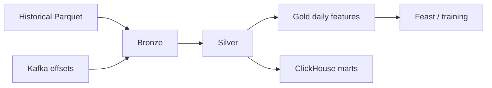

# Offline data

Historical Parquet → Spark Bronze → Silver → Gold features. ClickHouse builds analytics marts from published Silver. Argo Workflows runs the bounded stages; checks gate publication and OpenMetadata records results and lineage.

## Historical generator

[`historical-full.yaml`](../../src/data-pipeline/simulator/configs/historical-full.yaml) defines v19: 365 days from 2025-10-29, seed 2603, 3M customers, 20K merchants, 3.9M payment methods and 4.2M devices. [`historical-dev.yaml`](../../src/data-pipeline/simulator/configs/historical-dev.yaml) supplies the smaller dev dataset. Implementation: [`world.py`](../../src/data-pipeline/simulator/simulator/world.py), [`lifecycle.py`](../../src/data-pipeline/simulator/simulator/lifecycle.py), [`historical.py`](../../src/data-pipeline/simulator/simulator/historical.py).

### Data problems

| Problem | Generator configuration | Processing |
|---|---|---|
| Skew | `hot_merchant_share: 0.5`, merchant Zipf exponent 1.1; familiar/Zipf selection can also choose the hot merchant, giving about 56% observed share | AQE enabled; verify an actual skew split with the [controlled comparison](#controlled-skew-comparison) |
| Schema evolution | Schema 2 → 3 on 2026-04-30; older Parquet physically lacks `assessment_id`, `evidence_sha256` and `user_agent_family` | Bronze merges schemas; contracts check field presence by version |
| Duplicates | `duplicate_rate: 0.02`; copies retain `event_id` and business content, with a later `recorded_at` | Bronze keeps deliveries; Silver keeps the earliest identical copy and quarantines conflicting payments |
| High cardinality | Configured entity domains above | Integration-scoped keys, bounded date ranges and exact distinct counts |
| Delayed labels | Chargebacks become available 7–21 days after the attempt | Silver links against a 45-day lookback; training filters `label_available_at` by cutoff |

Cardinality ratio is `count(DISTINCT key) / count(*)` for a named table/range, with nulls reported separately. Configured domain size is not an observed distinct count. For example:

```sql
SELECT count(*) AS attempts,
       uniqExact(customer_id) / nullIf(count(*), 0) AS customer_cardinality_ratio,
       uniqExact(merchant_id) / nullIf(count(*), 0) AS merchant_cardinality_ratio
FROM lakehouse.`silver.attempts`
WHERE payment_day BETWEEN '2026-09-01' AND '2026-09-30';
```

### Publication and reruns

Submit `generate-historical` in `data`. Shards write per-day Parquet, separate `.v2`/`.v3` event files and `_day.json` markers; `config.json` pins inputs and the generator digest, and `manifest.json` publishes the inventory. Complete days are skipped, incomplete days regenerated, and changed inputs or an already published version are refused. Credentials come from Secrets; roots and shard settings come from chart values.

| Dataset / run | Events | Labels | Files / size |
|---|---:|---:|---|
| Dev v18, `generate-historical-v18-77fzr` | 823,963 | 161,007 | 181 / 112.4 MB; 11m50s |
| Recorded AWS v19, `generate-historical-v19-nvp7l` | 983,727,083 | 192,204,996 | 2,924 / 133.5 GB; 49 min |
| GCP v19, `generate-historical-v19-gcp-mstrk` | 983,727,083 | 192,204,996 | 2,924 / 133,498,693,796 bytes; succeeded |

Dev uses `s3://platform-dev/datasets/payment-gateway/historical/v18`; GCP uses `s3://talos-proxmox-prod-platform/datasets/payment-gateway/historical/v19`. GCP's manifest SHA-256 is `78ee54fe2a607ae0c128bc6765d89238f28d00270fca5ad48a8fed44fd0f8608`, matching the existing live-traffic pin. Its per-file rows/bytes, unique paths and 365 dates reconcile; this check did not reread every Parquet object or run downstream jobs. The recorded dev/AWS readbacks found no empty parts and verified physical v2/v3 schemas.

## Spark processing

<a id="pipeline"></a>

`dp1-bronze` ingests raw data; `dp-pipeline(start, end)` builds Silver, then Gold and the marts in parallel. Each layer writes an audit branch/staging table, validates, then publishes. Daily runs and backfills use the same range-bounded jobs. Plan steps skip outputs whose range, input snapshots and batch image already match; no separate progress database is needed.



### DP1: raw → Bronze

[`bronze/ingest.py`](../../src/data-pipeline/batch/batch/bronze/ingest.py) keeps every delivery and source provenance. Historical ingestion validates manifest paths/sizes, reads all files with `mergeSchema=true`, replaces only that dataset version and verifies per-file row counts. Kafka ingestion resumes at the committed rows' `max(_kafka_offset) + 1`; undecodable/invalid records go to `bronze.rejected_records`. Progress survives compaction because it is stored with the rows.


### Silver

[`silver/curate.py`](../../src/data-pipeline/batch/batch/silver/curate.py) reads Bronze days `start − 1` through `end + 1`, assigns each payment to its first event's UTC day and overwrites only the requested payment days. Labels are partitioned by availability day and link against 45 days of attempts.

| Output | Grain / rule |
|---|---|
| `silver.payment_events` | One row per `event_id`; earliest identical business-content copy |
| `silver.rejected_events` | Every event of a payment with conflicting copies |
| `silver.attempts` | One row per attempt, with context, client/server time, decision and outcome |
| `silver.labels` | Distinct observations classified linked, pending, orphan or violation; orphans/violations fail checks |

For the executable conflict fixture, two identical `evt-1` copies become one; two `evt-2` copies with amounts 100/999 quarantine all three deliveries of their payment. See [`test_silver.py`](../../src/data-pipeline/batch/tests/silver/test_silver.py). [`test_generation.py`](../../src/data-pipeline/simulator/tests/test_generation.py) checks the schema cutover and physical fields. Recorded Bronze version counts were 514,342,841 v2 and 469,384,242 v3 events; new risk-decision fields were absent in all 101,943,941 v2 decisions and present in all 93,028,261 v3 decisions. These are correctness results, not schema/dedup speedups; side-by-side Spark UI captures remain missing.

### Gold: offline features

[`gold/features.py`](../../src/data-pipeline/batch/batch/gold/features.py) and [`gold/windows.py`](../../src/data-pipeline/batch/batch/gold/windows.py) implement [`fraud-history-batch-v1`](../../contracts/features/fraud-history-batch-v1.yaml):

- Customer/payment-method counts, amounts, declines and exact distinct counts over 7/30 days at UTC-midnight anchors. A run needs one longest window of history; unchanged values produce no extra row. Incomplete windows remain null.
- `dim_customer` is SCD2 over the observed profile and devices used at least twice in 90 days. An ordered XOR sweep replaces the former interval join; retries reset the audit branch to `main` before rewriting.
- `label_attempt` keeps the earliest linked label per attempt/source, with scoring time and separate `label_available_at`.

The 5-minute/1-hour/24-hour feature tables are written by Flink and the feature writer, including historical replay. Training joins select the latest feature timestamp at or before the attempt and labels available before the cutoff.

### Marts

[`gold/marts.py`](../../src/data-pipeline/batch/batch/gold/marts.py) builds a rolling 90-day analytics window from published Silver. It stages range-limited attempts and label summaries, builds bounded hash buckets, checks staging tables, then replaces the live partitions.

### Controlled skew comparison

[`silver/benchmark.py`](../../src/data-pipeline/batch/batch/silver/benchmark.py) compares one cached, pinned range with skew handling off, AQE skew handling on and 16-bucket salting. Broadcast is disabled; row counts/checksums must match, and the AQE plan must show a real skew split. Run `dp2-benchmark start=2026-09-01 end=2026-09-30` after Silver publishes that range.

Production timings for these three variants remain unrecorded. Capture wall/task times, hot-key share and final adaptive plans together. DP1 write-distribution measurements cover writes rather than skewed joins; salting remains experimental.

## Recorded v19 backfill (AWS)

The following results predate GCP. Source regeneration there does not establish a completed GCP backfill.
<a id="prod-v19-run"></a>

Bronze v19, then `dp-backfill` from 2025-10-29 on the prod cluster (11 spot executors × 3 cores, drivers on on-demand nodes). Minutes per stage, from the Argo node times. Until June the stages ran in one line and `check-gold` audited Gold and the marts together; from July Gold and the marts run side by side, so the month total no longer includes the mart build:

| Month | Run | silver | check-silver | gold | check-gold | marts | check-marts | Month total |
|---|---|---|---|---|---|---|---|---|
| 2025-10 (3 days) | `dp-backfill-ljwl7` | 4 | 1 | 3 | 2 | 0 | | 13 |
| 2025-11 | `dp-backfill-ljwl7` | 10 | 5 | 12 | 7 | 0 | | 37 |
| 2025-12 | `dp-backfill-ljwl7` | 12 | 9 | 13 | 15 | 0 | | 51 |
| 2026-01 | `dp-backfill-ljwl7` | 13 | 11 | 19 | 21 | 0 | | 68 |
| 2026-02 | `dp-backfill-6pqtr` | 11 | 12 | 12 | 23 | 0 | | 62 |
| 2026-03 | `dp-backfill-7xxsm` | 13 | 18 | 17 | 28 | 0 | | 103 |
| 2026-04 | `dp-backfill-np6cn` | 9 | 3 | 8 | 9 | 0 | | 33 |
| 2026-05 | `dp-backfill-drbzt` | 15 | 4 | 15 | 10.5 | 5.3 | | 52 |
| 2026-06 | `dp-backfill-wjc8k` | 9 | 3.6 | 9 | 14.5 | 20.5 | | 61 |
| 2026-07 | `dp-backfill-8h7gq` | 15 | 4 | 14 | 10 | 0.5 | 1.1 | 44 |
| 2026-08 | `dp-backfill-8h7gq` | 14.5 | 3.8 | 13.7 | 11.1 | 7.7 | 1.1 | 44 |
| 2026-09 | `dp-backfill-ww2pp` | skipped | skipped | 13.8 | 10.8 | 12.7 | 1.2 | 28 |
| 2026-10 (28 days) | `dp-backfill-ww2pp` | 12.5 | 3.5 | 11.9 | 10.9 | 16.2 | 1.3 | 50 |


Published row counts (Iceberg `main`, 2025-10-29 to 2026-10-28):

| Table | Rows |
|---|---|
| `silver.payment_events` | 964,433,589 |
| `silver.attempts` | 191,148,630 |
| `silver.labels` | 192,163,964 |
| `silver.rejected_events` | 0 |
| `gold.dim_customer` | 34,004,866 |
| `gold.feat_customer_daily` | 348,030,903 |
| `gold.feat_payment_method_daily` | 362,959,360 |
| `gold.label_attempt` | 192,163,964 |
| `marts.fact_payment_attempt` | 44,209,535 (2026-08-04 to 2026-10-28, the 90-day window; 6.05 GiB, 147 bytes a row) |
| `marts.fact_merchant_day` | 1,327,898 |

Every Silver, Gold and mart rule passed in OpenMetadata: 58 tests on 15 tables. Lineage runs from the v19 dataset through Bronze and Silver to the Gold tables and marts.

## Optimization techniques

Recorded AWS v19 changes; timings across months are operational results, not controlled same-input benchmarks.

| Technique | Problem | Result |
|---|---|---|
| Range model: overwrite only the run's days | Full-history recomputes grew with history; rebuilding every customer's `dim_customer` history was OOMKilled in January | Silver 9–15 minutes a month from November to October |
| Narrow deduplication within the range | A broadcast of v19's 20M duplicated event IDs exceeded the driver's result size | One shuffle on `event_id` per month |
| Change-point feature rows | One row per entity per day would be about 1.1B rows a year per table | 348M customer and 363M card rows for the year |
| XOR sweep for familiar devices | Joining every attempt to its customer's device intervals was OOMKilled even per month | One ordered window pass per customer |
| `persist(MEMORY_AND_DISK)` instead of `localCheckpoint` | Spot reclaims lost locally checkpointed blocks and failed the stage | Lost blocks are recomputed from lineage |
| Range-scoped checks (`additional_table_filters`) | Whole-table checks grew every month; scoping through a `SELECT *` subquery ran ClickHouse out of memory | check-silver + check-gold: 18 + 28 minutes (March) → 3 + 9 (April) |
| Branch reset before the `dim_customer` rewrite | Its delete and append are two commits; a retry after a failure between them read the delete and would have dropped history | Every attempt starts from `main` |
| Gold executor 9g + 3g → 7g + 5g, `MALLOC_ARENA_MAX=2` | Gold executors were OOMKilled in native memory while tasks peaked at 331 MB | Same 12 GiB pod, more room outside the heap |
| Gold and the marts side by side | The mart build waited for Gold although it reads only Silver | July and August: 44 minutes a month, the mart build behind Gold |
| Skip a stage whose output is already on `main` | A re-run after a later failure rebuilt every layer (June's re-run redid 22 minutes of published Silver and Gold) | Plan steps compare range, input snapshots and batch image; September's re-run skipped its published Silver and took 28 minutes |
| Drivers on on-demand nodes, executors on spot | A reclaimed driver restarts the whole application | Spot loss costs only executor retries |

### Viewing Spark event logs

Event logs are under `runs/payment-gateway/spark-events/`. Run a temporary History Server from the deployed `data-platform-spark` image with the environment's `gateway-storage` credentials and S3A settings, port-forward 18080, then remove it after capturing jobs/stages/plans. Store screenshots under `docs/data/images/`.

## Output grains

Silver stores one canonical event or attempt per identity. Gold daily features use an entity and UTC anchor timestamp; `dim_customer` keeps SCD2 validity ranges. Labels retain attempt identity and availability time. Feature joins take the latest row available at the scoring timestamp.
