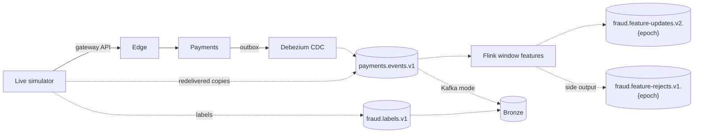
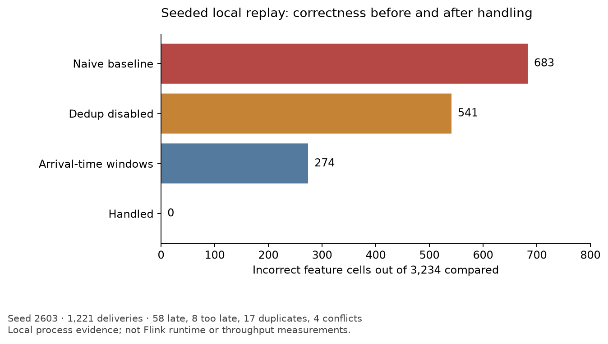
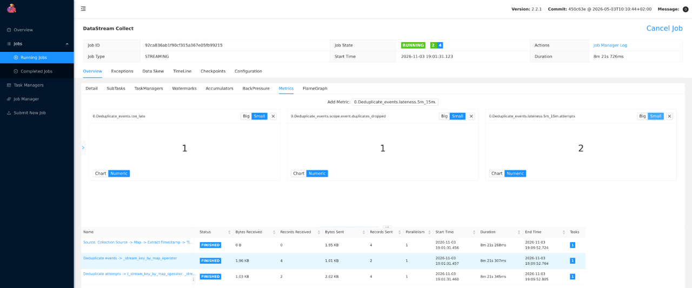
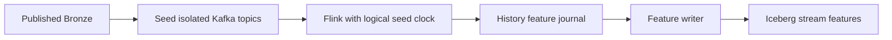

# Online data

Live gateway events and bounded historical replay use the same PyFlink feature operators. Both publish an epoch-scoped feature journal and persist stream features to Iceberg; the live feature writer also pushes updates to Feast/Redis.

## Live simulator



- Tokenizes synthetic cards, creates payments and submits attempts through Edge with run-scoped idempotency keys; retries reuse the same key and content.
- Publishes simulation-truth labels after each attempt and schedules chargebacks for successful fraud on `fraud.labels.v1`. Label availability is the actual publication time. The schedule is held in memory, so an interrupted run reports unfinished labels instead of claiming them.
- Configuration comes from `SIMULATOR_CONFIG`, rendered by the `live-traffic` chart.
- Store-and-forward lateness: `late_rate` (default 0) selects attempts held for `late_min_seconds`–`late_max_seconds` (300–600) and bounded by `max_held_attempts`. Edge accepts `simulated_client.attempted_at` only from synthetic integrations and rejects times after server time. Attempts still held at shutdown are reported as unsent.
- Redelivery: `redelivery.enabled` (default off) and `redelivery.rate` (0.015). Copies carry an `x-simulator-redelivery` header and are never copied again. Offsets commit after the copy is acknowledged, so a restart can add copies.

The simulator continues the historical entity world: it rebuilds the world from the manifest's recorded configuration and checks the manifest's `world_digest` before sending anything.

<a id="streaming-features"></a>

### Flink processing

- Flink and PyFlink 2.2.1 on the platform's Flink operator, Kubernetes HA, checkpoints and savepoints in object storage under `runs/payment-gateway/flink/`.
- Parallelism one; each manager requests one CPU, the TaskManager 2 GiB.
- Each epoch has its own feature journal topic and state; a state layout change starts a fresh epoch instead of restoring incompatible state.
- Per-record data errors go to `fraud.feature-rejects.v1.<epoch>`. This is the real-time triage path, not the durable copy: Bronze Kafka mode independently keeps every raw delivery, in `bronze.rejected_records` or the Bronze tables.

### Windows

The job reads only `attempt_started` events, keyed on the client `attempted_at`; risk decisions do not gate contributions. Per-customer and per-method attempt counts over 5 minutes, 1 hour and 24 hours, plus distinct customer devices over 24 hours, cover `[t − window, t)`. Per-window coverage stays unknown until the job has run for that window's length, and missing history is null, never zero. An attempt time after its observed availability fails the job. Long 7- and 30-day windows are computed offline by DP3, not by Flink; there is no HybridSource bootstrap.

Each keyed customer/method [`Entity`](../../src/data-pipeline/streaming/fraud_streaming/model.py) expires old entries before admitting pending ones. The admission loop is:

```python
for window in WINDOWS:
    if entry.started_at < now - window:
        continue
    self.counts[window] += 1
    heapq.heappush(self.expirations[window], (entry.started_at + window + 1, identity))
```

Pending inputs enter one microsecond after their attempt time; expiry heaps avoid rescanning history and drive timers even for quiet entities. Changed values/progress produce a new revision; prior served snapshots remain immutable.

### Late, too-late and duplicate trace

[`job.build_updates`](../../src/data-pipeline/streaming/fraud_streaming/job.py) wires source validation → event-ID dedup → attempt-identity dedup → customer/method windows → journal, with invalid/conflicting records sent to rejects.

<a id="flink-ui"></a>


*Dev run, 2026-10-29 at about 11:51 UTC: source/progress observation → event dedup → attempt dedup → customer/method aggregation → journal/reject sinks. All operators run at parallelism 1 with 0% backpressure. The capture predates operator names (`KEYED PROCESS`); the UI shows UTC−4, so 07:51 is 11:51 UTC.*

Consider a covered entity at 12:10 UTC, with no other attempts:

| Delivery | Before handling | After handling |
|---|---|---|
| Attempt time 12:00, delivered at 12:10 | An arrival-time baseline incorrectly includes it in the 5-minute count | Attempt-time handling excludes it from 5 minutes and includes it in 1 hour and 24 hours |
| Identical redelivery of that event | A no-dedup baseline counts it twice | Event dedup drops it; there is no second contribution |
| Attempt time 11:59 on the previous day, delivered at 12:10 | It is beyond the 24-hour retained horizon | `Packet.too_late` is true; the operator increments `too_late` and omits the contribution |
| Existing identity with different business content | Keeping an arbitrary copy hides a conflict | The reject sink records `conflicting_duplicate` |

In live mode [`Timeline`](../../src/data-pipeline/streaming/fraud_streaming/operators.py) uses processing-time timers while `Entity` applies attempt-time membership. A watermark screenshot alone therefore cannot prove live late-arrival correctness. Too-late records are counted and logged; they do not have a dedicated too-late side-output topic. The rejects topic serves invalid or conflicting records.

### Metrics

| Metric | Meaning |
|---|---|
| `too_late` | Attempts older than the 24-hour horizon when processed; dropped and logged |
| `scope=event` / `scope=attempt`, `duplicates_dropped` | Identical redeliveries dropped by each dedup stage |
| `lateness=lt_1m`, `1m_5m`, `5m_15m`, `15m_24h`, `too_late`, `attempts` | Processing time minus `attempted_at` for each new attempt, so configured and observed lateness can be compared |
| `reject_class=<class>`, `rejected` | Dead-lettered records per class: `undecodable`, `invalid_event`, `invalid_context`, `conflicting_duplicate` |

### Local correctness comparison

[`fraud_streaming/benchmark.py`](../../src/data-pipeline/streaming/fraud_streaming/benchmark.py) replays a seeded workload with known shares through the job's own window, deduplication and horizon logic:
- late attempts (5–15 minutes);
- too-late attempts (beyond 24 hours);
- byte-identical duplicates (1.5%);
- conflicting copies.

It compares each variant with the v2 reference at hourly anchors:
- **handled:** the job's logic.
- **no dedup:** every delivery counts.
- **arrival time:** windows keyed on arrival instead of `attempted_at`.
- **baseline:** neither dedup nor attempt-time windows.

For each variant it reports mismatched cells, over- and under-counts, and the `too_late`, `duplicates_dropped`, `rejected` and lateness counters. The replay runs outside the Flink runtime; Flink itself is checked by the dev `stream-history` run.

Run: `cd src/data-pipeline/streaming && PYTHONPATH=.. uv run --locked python -m fraud_streaming.benchmark`.

Results with the module defaults: seed 2603, 1,200 attempts and 1,221 deliveries. CI pins these exact figures in `tests/test_benchmark.py`, so a change to the window or dedup logic that alters them fails the build. Injected: 58 late, 8 too late, 17 duplicates, 4 conflicting copies.

| Variant | Mismatched cells (of 3,234) | Over-count | Under-count |
|---|---|---|---|
| handled | 0 | 0 | 0 |
| no dedup | 541 | 850 | 0 |
| arrival time | 274 | 349 | 0 |
| baseline | 683 | 1,199 | 0 |

The handled variant's counters equal the injected workload: `too_late` 8, event `duplicates_dropped` 17, `rejected` (conflicting) 4, and lateness 5–15 minutes 58.



The chart summarizes the module defaults; the command above reproduces its values. It measures local correctness, not Flink throughput. The isolated runtime check below verifies the same operators inside Flink.

<a id="evidence"></a>

### Dev validation

One bounded dev run on 2026-10-29, from PR #101's dev releases. Prod was untouched.

- **Run:** simulator run `e0810a50db3f41a4b6fb2b0f99b37c7a`, 11:17:10–12:18:31 UTC. Traffic was admitted for 3,600 s (until 12:17:10); held store-and-forward attempts kept flushing until the pod was removed.
- **Configuration:** v18 manifest `a466e98e…cb553`, 1 payment/s, concurrency 4, `late_rate` 0.05 with 300–600 s delays, redelivery at 0.015.
- **Flink:** job `a95a3fad89bf1791e9ce32b3453b8879`, epoch `live-v18`.
- **Raw source:** `payments.events.v1`, read from the offsets at the run start. Bronze Kafka mode was not deployed in dev during the run.

| Measure | Configured | Simulator report | Raw `payments.events.v1` | Flink metrics (11:51:40–12:12:49) |
|---|---|---|---|---|
| Late attempts | 5%, 300–600 s | 178 sent and 12 unsent at shutdown, of 3,600 admitted; delays 305–598 s | 178 of 3,590 unique attempt starts (4.96%) had `recorded_at − attempted_at` of 5–15 minutes; the other 3,412 were under 1 minute | lateness `5m_15m` 58, `1m_5m` 3, `lt_1m` 1,210, of 1,271 unique attempts (4.56% in `5m_15m`) |
| Duplicates | 1.5% of committed events | 265 selected of 18,133 consumed (1.46%) | 265 extra deliveries over 18,133 unique event IDs (1.46%), all carrying the redelivery header | event `duplicates_dropped` 15 of 1,286 attempt-start deliveries (1.17%); attempt-stage duplicates 0 |
| Too late | none injected | — | — | `too_late` never registered (0) |
| Rejects | none injected | — | reject topic: 0 records | `rejected` never registered (0) |

Flink counters reset on restart and count only attempt starts; raw-topic duplicate rates cover all event types. The `1m_5m` metric includes processing delay, so it need not equal network lateness. No too-late or poison records were injected in this live run; replay fixtures cover those paths locally.


*Same dev run at about 12:12 UTC: event deduplication is 0% backpressured, 95% idle and 5% busy.*

The counters above came from Flink's REST API (`/jobs/<id>/vertices/<id>/metrics`), using port 6125 allowed by the Cilium policy.

**Isolated runtime check, GCP, 2026-11-04.** Job `92ca836ab1f90cf315a367e05fb99215` ran the deployed `build_updates` operators in a temporary Flink 2.2.1 pod with a bounded collection and logical clock, without Kafka or feature-store writes. At anchor `2025-10-09T08:53:20Z`, inputs were a 10-minute-old attempt, its exact duplicate, an 8-minute-old distinct attempt and an attempt older than 24 hours by one microsecond. Customer and card 1-hour counts advanced **1 → 2**; neither duplicate nor too-late input added a contribution. Counters were **duplicates_dropped=1**, **too_late=1**, **lateness.5m_15m.attempts=2**. The job finished and the pod was removed. This validates the shared runtime operators; it does not inject poison data into the live Kafka pipeline.



### Restart


*Before the restart, about 11:51 UTC (07:51 in the UI): checkpoints 171–180 completed every 10 s in about 0.7–1.2 s, at about 6.4 MB.*

| Step | Result |
|---|---|
| TaskManager pod deleted | 11:51:38 UTC; last completed checkpoint 181 |
| Job restored | from checkpoint 181 at 11:51:40.443 UTC, 2.4 s after deletion |
| First new checkpoint | 182 completed at 11:52:43.455 UTC, about 65 s after deletion |
| Journal integrity | `fraud.feature-updates.v2.live-v18` over the run: 13,159 updates for 5,746 entities, with 0 repeated or conflicting `(key, revision)` pairs and 0 revision regressions, across this restart and the upgrade restart before it |

## Historical replay

[`stream-history`](../../infra/charts/data-pipelines/templates/stream-history.yaml) plans bounded date units, seeds isolated Kafka topics from Bronze, runs Flink to `FINISHED`, writes history features, then cleans up and publishes lineage. [`history.py`](../../src/data-pipeline/streaming/fraud_streaming/history.py) owns planning/seeding; [`job.py`](../../src/data-pipeline/streaming/fraud_streaming/job.py) runs the shared operators with a logical seed clock. Historical topics and epoch `history-v19` are isolated from live `payments.events.v1` and `live-v19`; replay never overwrites live features.

Run `stream-history` with `start`/`end` only after Bronze is published. Unit size and parallelism come from `features.historyUnitDays` and `features.historyParallelism` in the environment's values. Redis stream recovery is a separate `feast-materialize stream-recovery` run over the last 24 hours 5 minutes.

### Flink processing and publication

Replay uses the same [windows](#windows), [deduplication and rejects](#late-too-late-and-duplicate-trace) as live traffic. Instead of wall-clock processing-time timers, it advances event-time timers with the logical seed clock, so old attempts contribute at their historical availability time. Each unit runs at parallelism 1 to preserve ordering; separate units run concurrently. The history writer replaces only the unit's Iceberg rows and does not push to Redis.



### Backpressure and optimization

<a id="historical-replay-optimization"></a>

<a id="backpressure"></a>

Recorded AWS-era replay measurements; current settings come from the environment values.

History replay drains seeded Kafka as fast as downstream operators accept it. Credit-based backpressure pauses source polling; Kafka retains the queued records.

**Baseline** (7-day unit, 3 GiB TaskManager, JVM heap state): the aggregate operators are red at about 100% busy, and everything upstream is backpressured.


*Unit `20260819`, 03:26 UTC (the UI shows UTC−5): source 96% backpressured and 4% busy; aggregates 0% backpressured and 88–89% busy.*

The aggregate stage spent about 12 ms/record (75 records/s); source throughput fell from 1,150 to 350 events/s. Near 1M events, heap reached 981/1,183 MB and repeated heartbeat/checkpoint failures prevented progress.

| Change | Purpose / observed result |
|---|---|
| Omit replay coverage-flip timers; allow interruptible timers | Avoid millions of simultaneous `bootstrap + 24h` timers blocking checkpoint barriers; live coverage timers remain |
| RocksDB, incremental checkpoints, 5 GiB TaskManager | Pass the former 1M-event heap failure point |
| Unaligned checkpoints, 2-minute minimum pause, 10-minute timeout, 10 tolerated failures | Avoid restart loops; tuned heap run: 4 checkpoints/11 min instead of 25/12 min, no restores |
| 4-day units, 24 concurrent; state cache 20,000 | Spread independent units across the capped pool; cache change not isolated in measurements |
| Bounded seed buffer, per-unit report/offset check | Keep memory bounded and reuse seeded topics after restart |
| `safe-to-evict: false` | Prevent autoscaler scale-down eviction during replay; Spot interruption remains possible |

**After** (4-day unit `20260915` on RocksDB, 50 minutes in)


*Source: 97% backpressured, 3% busy.*


*Customer aggregate: 0% backpressured, 90% busy; it paces the job.*


*18 checkpoints triggered, 16 completed, none restored. The latest uploaded 255 MB of a 335 MB state in 59 s.*

| | Baseline (heap) | RocksDB, 4-day units |
|---|---|---|
| Progress | stalls near 1M events | 227–466 events/s per unit with 14 running |
| Checkpoints | 22 of 25 completed, latest 1 min 59 s | 16 of 18 completed, average 46 s, longest 157 s |
| Upload per checkpoint | full 148 MB | 85 MB average, against 221 MB of full state |
| TaskManager | 1.4–1.5 of 2 CPU, heap 83% full | 1.3 of 1.4 CPU, 3.6 of 5 GiB |

RocksDB fixed stability; aggregation remains the bottleneck at about 350 events/s. Its checkpoints are slower than tuned heap (46 s versus 29 s). More independent units can increase total throughput within the 48-vCPU pool cap.

**Not adopted:** a 20,000-record Python bundle caused 40-second stalls and ~350-second checkpoints. Window counts are already incremental (0.16–0.67 ms/attempt outside Flink versus ~12 ms inside); merging dedup stages needs separate state/recovery validation.

**Reproduce.** Port-forward `svc/fraud-streaming-history-v19-<YYYYMMDD>-rest`, open the job and pick an operator's **BackPressure** tab (`HIGH` above 90%), and use **Checkpoints** for durations and sizes. The same figures are at `/jobs/<id>/vertices/<id>/subtasks/metrics` (`busyTimeMsPerSecond`, `backPressuredTimeMsPerSecond`).
