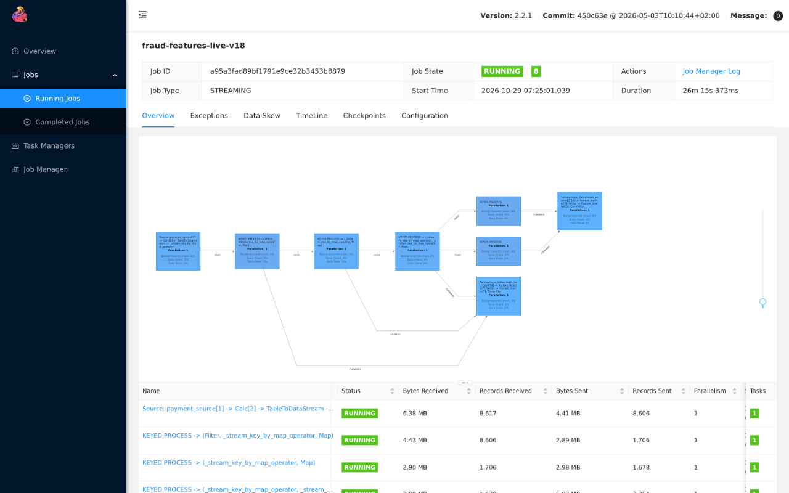
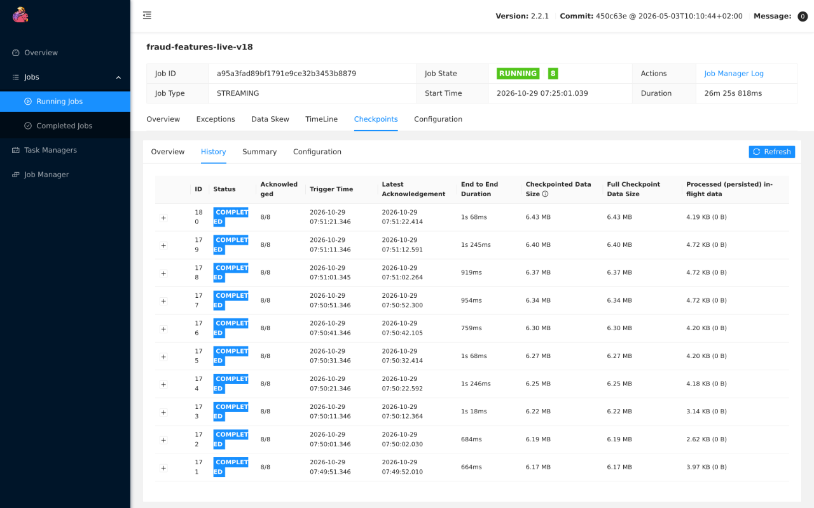
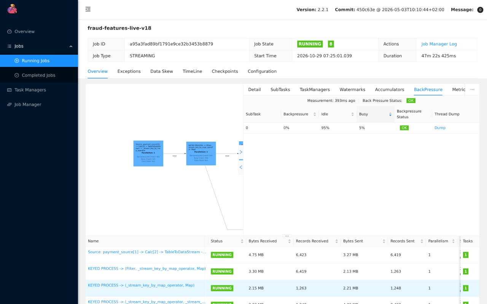

# Online data

The online path is live gateway traffic. The live simulator drives the gateway's public APIs at current time, Payments writes authoritative events that reach Kafka through outbox CDC, and a PyFlink job turns them into v2 window features on the feature journal topic `fraud.feature-updates.v2.<epoch>`, with per-record rejects on `fraud.feature-rejects.v1.<epoch>`. The streaming path ends at those two topics: Feast and Go Fraud's feature retrieval are disabled until the [feature-store change](../overview/roadmap.md#feature-store-build-order). Bronze also ingests the same topics in Kafka mode; see [offline data](offline.md).

- Simulator code: [`src/data-pipeline/simulator/simulator/live`](../../src/data-pipeline/simulator/simulator/live). Streaming code: [`src/data-pipeline/streaming`](../../src/data-pipeline/streaming); deployment: [`infra/charts/fraud-features`](../../infra/charts/fraud-features).
- Status: the live simulator is disabled in both environments; the Flink job runs in dev and is disabled in prod. Dev simulator values point at the v18 historical manifest and its SHA-256. The Flink job implements feature contract v2 under epoch `live-v18`.

## Data problems and how they are solved

| Problem | Generated by | Solved by | Evidence |
|---|---|---|---|
| Late arrivals | Store-and-forward clients: a seeded share of attempts is held for a configured delay, then submitted with the original click time as `simulated_client.attempted_at` | Flink counts each attempt in the windows its `attempted_at` falls in, producing a new revision without changing served snapshots. Attempts older than the 24-hour horizon increment the `too_late` metric and are logged, without failing the job | Dev run: 178 of 3,590 attempts (4.96%) arrived 5–15 minutes late against 5% configured; replay benchmark: 0 of 3,234 cells wrong when handled, 274 with arrival-time windows. See [Evidence](#evidence) |
| Duplicates | Redelivery: a seeded share of committed events is re-published to `payments.events.v1` as byte-identical copies on the same partition, on top of at-least-once CDC | Flink deduplicates by `event_id`, then by attempt identity, dropping identical copies and dead-lettering conflicting content; that state expires 25 hours after the attempt time, so a later copy is already too late. Bronze keeps every delivery and Silver deduplicates | Dev run: 265 extra deliveries over 18,133 unique events (1.46%) against 1.5% configured, all dropped by Flink; replay benchmark: 850 over-counted values without dedup, 0 when handled. See [Evidence](#evidence) |
| Poison records | Malformed or undecodable events, invalid attempt context, or conflicting content under one event or attempt identity | Flink writes them to `fraud.feature-rejects.v1.<epoch>` through a side output while the job keeps running. The value is the original bytes, the key is the `event_id` when decodable, and headers carry the error class, a short message and the source topic, partition, offset and timestamp. Rejects commit exactly-once with the checkpoint, and each one increments a per-class `rejected` metric. Invariant violations such as offset regression or state limits still fail the job | Dev run: none injected; the reject topic stayed empty and no `rejected` metric registered. CI routes a malformed record to the reject side output with its error-class header; no CI test reaches the reject topic end to end |
| Restarts | Pod or node loss | Checkpoint recovery restores offsets and state; journal and reject writes commit exactly-once with the checkpoint | Dev run: TaskManager deleted at 11:51:38 UTC, job restored from checkpoint 181 2.4 s later, first new checkpoint 65 s after deletion; 13,159 journal updates with no repeated or conflicting revisions. See [Evidence](#evidence) |

## Live simulator

- Tokenizes synthetic cards, creates payments and submits attempts through Edge with run-scoped idempotency keys; retries reuse the same key and content.
- Publishes simulation-truth labels after each attempt and schedules chargebacks for successful fraud on `fraud.labels.v1`. Label availability is the actual publication time. The schedule is held in memory, so an interrupted run reports unfinished labels instead of claiming them.
- Configuration comes from `SIMULATOR_CONFIG`, rendered by the `live-traffic` chart.
- Store-and-forward lateness: `late_rate` (default 0) selects attempts held for `late_min_seconds`–`late_max_seconds` (300–600) and bounded by `max_held_attempts`. Edge accepts `simulated_client.attempted_at` only from synthetic integrations and rejects times after server time. Attempts still held at shutdown are reported as unsent.
- Redelivery: `redelivery.enabled` (default off) and `redelivery.rate` (0.015). Copies carry an `x-simulator-redelivery` header and are never copied again. Offsets commit after the copy is acknowledged, so a restart can add copies.

The simulator continues the historical entity world: it rebuilds the world from the manifest's recorded configuration and checks the manifest's `world_digest` before sending anything.

## Streaming features

### Runtime

- Flink and PyFlink 2.2.1 on the platform's Flink operator, Kubernetes HA, checkpoints and savepoints in object storage under `runs/payment-gateway/flink/`.
- Parallelism one; each manager requests one CPU, the TaskManager 2 GiB.
- Each epoch has its own feature journal topic and state; a state layout change starts a fresh epoch instead of restoring incompatible state.
- Per-record data errors go to `fraud.feature-rejects.v1.<epoch>`. This is the real-time triage path, not the durable copy: Bronze Kafka mode independently keeps every raw delivery, in `bronze.rejected_records` or the Bronze tables.

### Windows

The job reads only `attempt_started` events, keyed on the client `attempted_at`; risk decisions do not gate contributions. Per-customer and per-method attempt counts over 5 minutes, 1 hour and 24 hours, plus distinct customer devices over 24 hours, cover `[t − window, t)`. Per-window coverage stays unknown until the job has run for that window's length, and missing history is null, never zero. An attempt time after its observed availability fails the job. Long 7- and 30-day windows are computed offline by DP3, not by Flink; there is no HybridSource bootstrap. See [feature store](../ml/feature-store.md).

### Window code

Each customer or payment-method `Entity` in [`model.py`](../../src/data-pipeline/streaming/fraud_streaming/model.py) keeps its attempts in keyed Flink state and advances to the current anchor `now`. Expiry first, then admission:

```python
for window in WINDOWS:
    expirations = self.expirations[window]
    while expirations and expirations[0][0] <= now:
        _, identity = heapq.heappop(expirations)
        entry = self.entries[identity]
        self.counts[window] -= 1
        ...
while self.pending and self.pending[0][0] <= now:
    _, identity = heapq.heappop(self.pending)
    entry = self.entries[identity]
    if entry.started_at < now - DAY:
        del self.entries[identity]
        continue
    for window in WINDOWS:
        if entry.started_at < now - window:
            continue
        self.counts[window] += 1
        # The inclusive lower boundary expires one microsecond after start + window.
        heapq.heappush(self.expirations[window], (entry.started_at + window + 1, identity))
```

- **Windows by attempt time.** `WINDOWS` is 5 minutes, 1 hour and 24 hours. An attempt joins a window when its `attempted_at` (`started_at`) is in `[now − window, now)`.
- **Pending first.** A new attempt waits in `pending` until one microsecond after its start, so an attempt never counts in a snapshot anchored at its own start time.
- **Late attempts.** An attempt arriving late joins every window it still falls in, and is skipped entirely if it's already older than 24 hours.
- **Expiry heaps.** Each window has a heap of expiry times, so evicting old attempts costs O(log n) per attempt instead of rescanning history. The job registers one Flink timer at the earliest pending or expiry boundary, so counts drop even when the customer is quiet.
- **Revisions.** After each advance, the job compares the coverage, values, counts and source progress with the previous snapshot. Only a change increments `revision` and moves `write_at` forward, so redelivered or idle inputs produce no new revision, and a late attempt produces a new revision without changing earlier ones.

### Metrics

| Metric | Meaning |
|---|---|
| `too_late` | Attempts older than the 24-hour horizon when processed; dropped and logged |
| `scope=event` / `scope=attempt`, `duplicates_dropped` | Identical redeliveries dropped by each dedup stage |
| `lateness=lt_1m`, `1m_5m`, `5m_15m`, `15m_24h`, `too_late`, `attempts` | Processing time minus `attempted_at` for each new attempt, so configured and observed lateness can be compared |
| `reject_class=<class>`, `rejected` | Dead-lettered records per class: `undecodable`, `invalid_event`, `invalid_context`, `conflicting_duplicate` |

### Replay benchmark

[`fraud_streaming/benchmark.py`](../../src/data-pipeline/streaming/fraud_streaming/benchmark.py) replays a seeded workload with known shares through the job's own window, deduplication and horizon logic:
- late attempts (5–15 minutes);
- too-late attempts (beyond 24 hours);
- byte-identical duplicates (1.5%);
- conflicting copies.

It compares each variant with the v2 reference at hourly anchors:
- **handled:** the job's logic.
- **no dedup:** every delivery counts.
- **arrival time:** windows keyed on arrival instead of `attempted_at`.
- **baseline:** neither dedup nor attempt-time windows.

For each variant it reports mismatched cells, over- and under-counts, and the `too_late`, `duplicates_dropped`, `rejected` and lateness counters. The replay runs outside the Flink runtime; the dev live run exercises Flink itself.

Run: `cd src/data-pipeline/streaming && PYTHONPATH=.. uv run --locked python -m fraud_streaming.benchmark`.

Results with the module defaults: seed 2603, 1,200 attempts and 1,221 deliveries. CI pins these exact figures in `tests/test_benchmark.py`, so a change to the window or dedup logic that alters them fails the build. Injected: 58 late, 8 too late, 17 duplicates, 4 conflicting copies.

| Variant | Mismatched cells (of 3,234) | Over-count | Under-count |
|---|---|---|---|
| handled | 0 | 0 | 0 |
| no dedup | 541 | 850 | 0 |
| arrival time | 274 | 349 | 0 |
| baseline | 683 | 1,199 | 0 |

The handled variant's counters equal the injected workload: `too_late` 8, event `duplicates_dropped` 17, `rejected` (conflicting) 4, and lateness 5–15 minutes 58.

## Evidence

One bounded dev run on 2026-10-29, from PR #101's dev releases. Prod was untouched.

- **Run:** simulator run `e0810a50db3f41a4b6fb2b0f99b37c7a`, 11:17:10–12:18:31 UTC. Traffic was admitted for 3,600 s (until 12:17:10); held store-and-forward attempts kept flushing until the pod was removed.
- **Configuration:** v18 manifest `a466e98e…cb553`, 1 payment/s, concurrency 4, `late_rate` 0.05 with 300–600 s delays, redelivery at 0.015.
- **Flink:** job `a95a3fad89bf1791e9ce32b3453b8879`, epoch `live-v18`.
- **Raw source:** `payments.events.v1`, read from the offsets at the run start. Bronze Kafka mode was not deployed in dev during the run.

### Configured versus observed

| Measure | Configured | Simulator report | Raw `payments.events.v1` | Flink metrics (11:51:40–12:12:49) |
|---|---|---|---|---|
| Late attempts | 5%, 300–600 s | 178 sent and 12 unsent at shutdown, of 3,600 admitted; delays 305–598 s | 178 of 3,590 unique attempt starts (4.96%) had `recorded_at − attempted_at` of 5–15 minutes; the other 3,412 were under 1 minute | lateness `5m_15m` 58, `1m_5m` 3, `lt_1m` 1,210, of 1,271 unique attempts (4.56% in `5m_15m`) |
| Duplicates | 1.5% of committed events | 265 selected of 18,133 consumed (1.46%) | 265 extra deliveries over 18,133 unique event IDs (1.46%), all carrying the redelivery header | event `duplicates_dropped` 15 of 1,286 attempt-start deliveries (1.17%); attempt-stage duplicates 0 |
| Too late | none injected | — | — | `too_late` never registered (0) |
| Rejects | none injected | — | reject topic: 0 records | `rejected` never registered (0) |

Notes:
- Flink counters are not checkpointed, so they cover only the window after the last restart.
- The 3 attempts in `1m_5m` are most likely the catch-up after the TaskManager restart, because the metric measures processing time, not arrival time.
- Flink sees only attempt starts, so its duplicate share is over attempt starts, while the raw share covers every event type.
- The disable release reached `deploy/dev` at 12:14:17, and the live-traffic Application picked it up at about 12:16:43. About a minute later, before automatic sync had pruned anything, a manual Argo sync pruned only the simulator's Deployment, ConfigMap, ServiceAccount, NetworkPolicy and ExternalSecrets, at 12:18:31. The Applications use `automated.prune: true`, so the gap was most likely reconcile delay. On-time traffic had already stopped at 12:17:10.
- The simulator's first container failed at 11:17:06 while the gateway rolled out with the same release (Edge returned 504 from 11:18:36 to 11:18:38); Kubernetes restarted it, and the run above is the restarted container.

### Restart

| Step | Result |
|---|---|
| TaskManager pod deleted | 11:51:38 UTC; last completed checkpoint 181 |
| Job restored | from checkpoint 181 at 11:51:40.443 UTC, 2.4 s after deletion |
| First new checkpoint | 182 completed at 11:52:43.455 UTC, about 65 s after deletion |
| Journal integrity | `fraud.feature-updates.v2.live-v18` over the run: 13,159 updates for 5,746 entities, with 0 repeated or conflicting `(key, revision)` pairs and 0 revision regressions, across this restart and the upgrade restart before it |

### Flink UI

The Flink UI shows browser local time, UTC−4: 07:25 and 07:51 in the captures are 11:25 and 11:51 UTC. The captures predate operator names, so every operator appears as `KEYED PROCESS`.



*Job graph at about 11:51 UTC, before the restart: source and progress observation, event deduplication, attempt deduplication, customer and method aggregation, and the journal and reject sinks. All run at parallelism 1 with 0% backpressure.*



*Checkpoint history at about 11:51 UTC: checkpoints 171–180 completed every 10 s in about 0.7–1.2 s, at about 6.4 MB.*



*Backpressure on the event deduplication operator at about 12:12 UTC: 0% backpressured, 95% idle, 5% busy.*

The `too_late`, `duplicates_dropped`, `rejected` and lateness values above were read from the Flink REST API (`/jobs/<id>/vertices/<id>/metrics`). A capture of the UI's metrics panel is still missing.

The TaskManager metrics only became visible after this run's fix pinning the metric query service to port 6125, which the CiliumNetworkPolicy allows.
