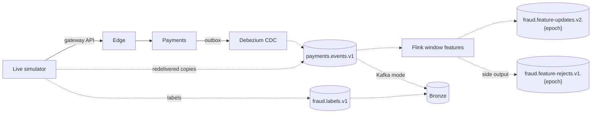

# Online data

Live gateway events and bounded historical replay use the same Java Flink feature operators. Both publish an epoch-scoped feature journal and persist stream features to Iceberg; the live feature writer also pushes updates to Feast/Redis.

## Live simulator



- Tokenizes synthetic cards, creates payments and submits attempts through Edge with run-scoped idempotency keys; retries reuse the same key and content.
- Publishes simulation-truth labels after each attempt and schedules chargebacks for successful fraud on `fraud.labels.v1`. Label availability is the actual publication time. The schedule is held in memory, so an interrupted run reports unfinished labels instead of claiming them.
- Configuration comes from `SIMULATOR_CONFIG`, rendered by the `live-traffic` chart.
- Store-and-forward lateness: `late_rate` (default 0) selects attempts held for `late_min_seconds`–`late_max_seconds` (300–600) and bounded by `max_held_attempts`. Edge accepts `simulated_client.attempted_at` only from synthetic integrations and rejects times after server time. Attempts still held at shutdown are reported as unsent.
- Redelivery: `redelivery.enabled` (default off) and `redelivery.rate` (0.015). Copies carry an `x-simulator-redelivery` header and are never copied again. Offsets commit after the copy is acknowledged, so a restart can add copies.

The simulator continues the historical entity world: it rebuilds the world from the manifest's recorded configuration and checks the manifest's `world_digest` before sending anything.

<a id="streaming-features"></a>

### Flink processing

- Flink 2.2.1 with Java 17 on the platform's Flink operator, Kubernetes HA, checkpoints and savepoints in object storage under `runs/payment-gateway/flink/`.
- Parallelism one; each manager requests one CPU, the TaskManager 2 GiB.
- Each epoch has its own feature journal topic and state; a state layout change starts a fresh epoch instead of restoring incompatible state.
- Per-record data errors go to `fraud.feature-rejects.v1.<epoch>`. This is the real-time triage path, not the durable copy: Bronze Kafka mode independently keeps every raw delivery, in `bronze.rejected_records` or the Bronze tables.

### Windows

The job reads only `attempt_started` events, keyed on the client `attempted_at`; risk decisions do not gate contributions. Per-customer and per-method attempt counts over 5 minutes, 1 hour and 24 hours, plus distinct customer devices over 24 hours, cover `[t − window, t)`. Per-window coverage stays unknown until the job has run for that window's length, and missing history is null, never zero. An attempt time after its observed availability fails the job. Long 7- and 30-day windows are computed offline by DP3, not by Flink; there is no HybridSource bootstrap.

Each keyed customer/method [`Aggregate`](../../src/data-pipeline/streaming/jvm/src/main/java/dev/fraud/stream/Aggregate.java) is a `KeyedProcessFunction`, not a built-in Flink window: sliding 5-minute, 1-hour and 24-hour windows per entity would otherwise copy every attempt into each pane. It keeps one contribution per attempt in RocksDB map state and one counter per window, and a deadline queue says when each contribution enters or leaves each window. `Wire.WINDOWS` is `{5 min, 1 h, 24 h}`.

When an attempt arrives, `processElement` stores it and queues its admission one microsecond after its attempt time, so an attempt never counts in its own window:

```java
Contribution prior = entries.get(identity);
if (prior != null && !prior.digest.equals(packet.fact.digest))
  throw new IllegalStateException("conflicting attempt start");
if (prior == null) {
  // ... size guard, then:
  entries.put(identity, contribution);
  state.size++;
  deadlines.add(contribution.startedAt + 1, identity, 0);
}
```

`activate` then admits the contribution into every window that still covers its attempt time and queues one expiry per window, `startedAt + window + 1`. A contribution already older than 24 hours is dropped instead of counted; this is the `too_late` path:

```java
if (entry.startedAt < now - Wire.DAY) {
  entries.remove(identity);
  state.size--;
  return;
}
for (int i = 0; i < Wire.WINDOWS.length; i++) {
  if (entry.startedAt < now - Wire.WINDOWS[i]) continue;
  state.counts[i]++;
  deadlines.add(entry.startedAt + Wire.WINDOWS[i] + 1, identity, i + 1);
  // ... distinct devices over 24 h
}
```

`advance` (abridged below) moves the entity clock forward and pops every due deadline. Expiries decrement the counters and are applied before admissions that share the same instant, which matches the reference model; only the 24-hour expiry deletes the contribution. After a pass, `emit` writes a new snapshot revision only if a count, the coverage flags or the source progress changed:

```java
while ((instant = deadlines.next()) != null && instant <= now) {
  // expiry at an instant precedes admission at that instant
  ...
  if (action.kind == 0) { activations.add(action); continue; }
  state.counts[action.kind - 1]--;          // a window expired for this attempt
  if (action.kind == 3) { entries.remove(action.identity); state.size--; }
  ...
  for (Action action : activations) activate(state, action.identity, entries.get(action.identity), boundary);
}
```

Because each attempt costs one map entry and three queued deadlines, the work per event does not grow with window length, and a timer is registered only for the earliest deadline (`schedule`), not one per attempt. Live mode registers processing-time timers; replay registers event-time timers on the logical seed clock, so the same code produces both. Prior served snapshots stay immutable.

### Late, too-late and duplicate trace

[`StreamJob`](../../src/data-pipeline/streaming/jvm/src/main/java/dev/fraud/stream/StreamJob.java) wires source validation → event-ID dedup → attempt-identity dedup → customer/method windows → journal, with invalid/conflicting records sent to rejects. Live and replay use this single JVM implementation with typed Flink serialization and checkpointed singleton source progress. Generic/Kryo fallback is disabled. Python remains only for historical planning/seeding and independent reference tests. The JVM state layout requires fresh epochs and checkpoint paths; legacy Python checkpoints cannot be restored.

<a id="flink-ui"></a>

The prod job graph and checkpoints are on the [feature store page](../ml/feature-store.md#streaming-writer-and-live-job).

Consider a covered entity at 12:10 UTC, with no other attempts:

| Delivery | Before handling | After handling |
|---|---|---|
| Attempt time 12:00, delivered at 12:10 | An arrival-time baseline incorrectly includes it in the 5-minute count | Attempt-time handling excludes it from 5 minutes and includes it in 1 hour and 24 hours |
| Identical redelivery of that event | A no-dedup baseline counts it twice | Event dedup drops it; there is no second contribution |
| Attempt time 11:59 on the previous day, delivered at 12:10 | It is beyond the 24-hour retained horizon | The deduplication operator increments `too_late` and omits the contribution |
| Existing identity with different business content | Keeping an arbitrary copy hides a conflict | The reject sink records `conflicting_duplicate` |

In live mode `Aggregate` uses processing-time timers and applies attempt-time membership. Too-late records are counted; they do not have a dedicated too-late side-output topic. The rejects topic serves invalid or conflicting records.

A bounded Flink 2.2.1 job (2026-11-03, a four-record collection source) exercised the same paths. Its UI metrics tab shows the counters the table predicts: one too-late attempt dropped, one identical redelivery dropped by event dedup, and two attempts classed as 5–15 minutes late.


One bounded dev run on 2026-10-29, from PR #101's dev releases. Prod was untouched.

- **Run:** simulator run `e0810a50db3f41a4b6fb2b0f99b37c7a`, 11:17:10–12:18:31 UTC. Traffic was admitted for 3,600 s (until 12:17:10); held store-and-forward attempts kept flushing until the pod was removed.
- **Configuration:** v18 manifest `a466e98e…cb553`, 1 payment/s, concurrency 4, `late_rate` 0.05 with 300–600 s delays, redelivery at 0.015.
- **Flink:** job `a95a3fad89bf1791e9ce32b3453b8879`, epoch `live-v18`.
- **Raw source:** `payments.events.v1`, read from the offsets at the run start. Bronze Kafka mode was not deployed in dev during the run.

| Measure | Configured | Simulator report | Raw `payments.events.v1` | Flink metrics (11:51:40–12:12:49) |
|---|---|---|---|---|
| Late attempts | 5%, 300–600 s | 178 sent and 12 unsent at shutdown, of 3,600 admitted; delays 305–598 s | 178 of 3,590 unique attempt starts (4.96%) had `recorded_at − attempted_at` of 5–15 minutes; the other 3,412 were under 1 minute | lateness `5m_15m` 58, `1m_5m` 3, `lt_1m` 1,210, of 1,271 unique attempts (4.56% in `5m_15m`) |
| Duplicates | 1.5% of committed events | 265 selected of 18,133 consumed (1.46%) | 265 extra deliveries over 18,133 unique event IDs (1.46%), all carrying the redelivery header | event `duplicates_dropped` 15 of 1,286 attempt-start deliveries (1.17%); attempt-stage duplicates 0 |
| Too late | none injected | — | — | `too_late` never registered (0) |
| Rejects | none injected | — | reject topic: 0 records | `rejected` never registered (0) |

Flink counters reset on restart and count only attempt starts; raw-topic duplicate rates cover all event types. The `1m_5m` metric includes processing delay, so it need not equal network lateness. No too-late or poison records were injected in this live run; the bounded run and the local replay below cover those paths.


*Same dev run at about 12:12 UTC: event deduplication is 0% backpressured, 95% idle and 5% busy.*

The counters above came from Flink's REST API (`/jobs/<id>/vertices/<id>/metrics`), using port 6125 allowed by the Cilium policy.

### Metrics

| Metric | Meaning |
|---|---|
| `too_late` | Attempts older than the 24-hour horizon when processed; dropped |
| `scope=event` / `scope=attempt`, `duplicates_dropped` | Identical redeliveries dropped by each dedup stage |
| `lateness=lt_1m`, `1m_5m`, `5m_15m`, `15m_24h`, `too_late`, `attempts` | Processing time minus `attempted_at` for each new attempt, so configured and observed lateness can be compared |
| `reject_class=<class>`, `rejected` | Dead-lettered records per class: `undecodable`, `invalid_event`, `invalid_context`, `conflicting_duplicate` |

### Local correctness comparison

The JVM tests compare 2,498 serialized snapshots from 503 deliveries against the independent [v2 reference](../../src/data-pipeline/features/reference_v2.py), including late inputs, duplicates, conflicts and coverage boundaries. They also verify processing-time timers, RocksDB checkpoint/restore, source-clock recovery, typed serializers, bounded load and transactional Kafka output. A packaged-job test runs the application JAR in the production Flink base image.

A seeded local replay (seed 2603: 1,221 deliveries with 58 late, 8 too late, 17 duplicates and 4 conflicts) compares three degraded variants and the handled job with the reference, counting incorrect feature cells out of 3,234.


This is local process evidence, not a Flink runtime or throughput measurement.

<a id="evidence"></a>

### Restart


*Before the restart, about 11:51 UTC (07:51 in the UI): checkpoints 171–180 completed every 10 s in about 0.7–1.2 s, at about 6.4 MB.*

| Step | Result |
|---|---|
| TaskManager pod deleted | 11:51:38 UTC; last completed checkpoint 181 |
| Job restored | from checkpoint 181 at 11:51:40.443 UTC, 2.4 s after deletion |
| First new checkpoint | 182 completed at 11:52:43.455 UTC, about 65 s after deletion |
| Journal integrity | `fraud.feature-updates.v2.live-v18` over the run: 13,159 updates for 5,746 entities, with 0 repeated or conflicting `(key, revision)` pairs and 0 revision regressions, across this restart and the upgrade restart before it |

History is replayed through these same operators: [Historical replay (novel)](historical-replay.md).
