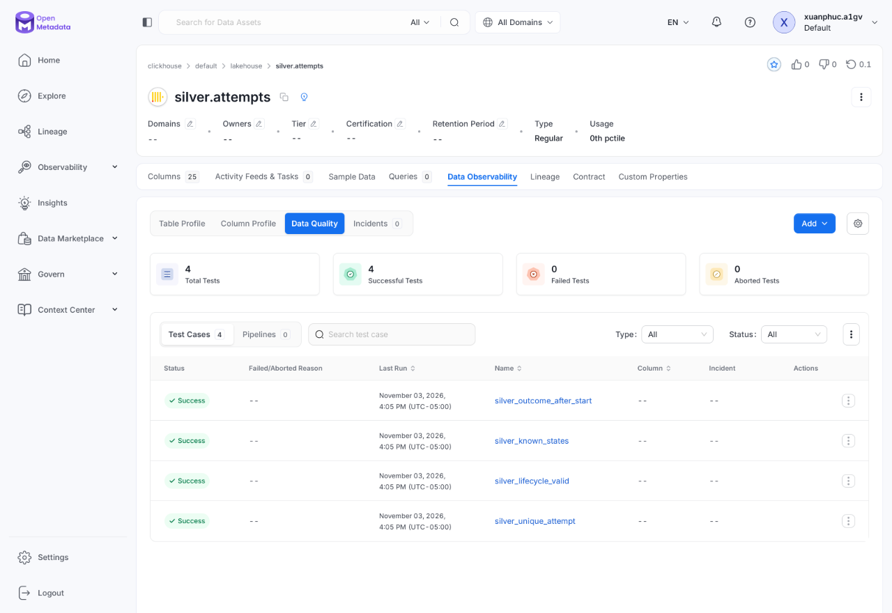
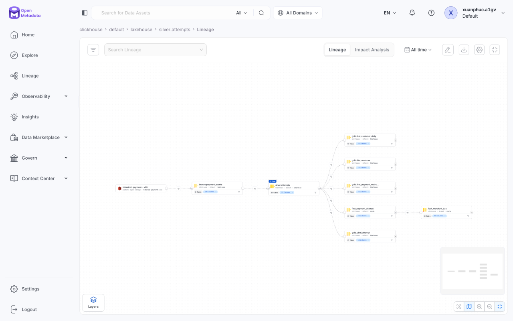

# Orchestration and governance

Argo Workflows orchestrates the finite data pipelines; OpenMetadata is the catalog for lineage, contracts and data validation. They stand in for the course's Airflow and DataHub. Connections and credentials are defined once in the charts and Doppler and reused by every pipeline.

## Workflows

All templates live in the [`data-pipelines` chart](../../infra/charts/data-pipelines) in the `data` namespace.

| Workflow | Stages | Status |
|---|---|---|
| `generate-historical` | Shards in parallel → publish | v18 and original v19 published; fresh GCP publication verified separately |
| `dp1-bronze` (historical or Kafka source) | Spark ingest to an audit branch → ClickHouse checks on the branch → publish branch to main → OpenMetadata publish | Recorded AWS v19 completed; Kafka runs inside `dp-daily` |
| `dp-pipeline` (`start`/`end` days) | Silver, then Gold and the marts side by side, each as plan → build on an audit branch or staging → checks → publish; OpenMetadata publish on exit. Plan steps skip outputs whose range, source snapshots and image already match. | Recorded AWS v19 completed |
| `dp-daily`, `dp-backfill` | Kafka into Bronze, then `dp-pipeline` for yesterday and two lookback days; `dp-pipeline` month by month in order, stopping at the first failed month | Backfill on demand; `dp-daily` enabled in prod, suspended in dev |
| `maintain-lakehouse` | Task `nightly` (enabled in prod, suspended in dev) or `zorder` over one month | Implemented |
| `feast-materialize` (`since` day, `stream-recovery`) | `feast apply` registry → materialize the daily views from each view's last end minus lookback (or `since`) through now → `verify_online` compares 200 newest keys with the offline rows; `stream-recovery` instead rebuilds the stream views from the last 24 hours 5 minutes | `feast-materialize-daily` cron, enabled in prod, suspended in dev |
| `stream-history` (`start`/`end` days) | Plan `historyUnitDays` units → per unit, in parallel up to `historyParallelism`: topics → seed from Bronze → bounded Flink until FINISHED → history writer → cleanup and OpenMetadata publish | On demand |
| `warehouse-benchmark`, `dp2-benchmark` (skewed join) | Single on-demand stage | Tools only; the evidence comes from the backfill |

Seed and materialization scratch pods and PVCs carry a scratch label. Argo deletes these pods five minutes after completion, including failed retry attempts, so their generic ephemeral PVCs can be reclaimed.

Batch lakehouse publication uses [write–audit–publish](write-audit-publish.md): candidate snapshots pass native checks before catalog publication. ClickHouse marts use staged partition replacement. Bronze holds `dp1-bronze-writer`; `dp-pipeline` holds `dp-writer`, serializing competing pipeline runs and maintenance. Checks retry execution errors, not failed data rules.

A platform admission policy rejects deleting or terminating an active workflow in `data`; stop runs with `shutdown: Stop`.

The recorded GCP backfill and its checks-before-publish capture are in [Write–audit–publish (novel)](write-audit-publish.md#release-protocol). [Historical replay](online.md#historical-replay) uses the live feature engine with logical time, isolated outputs and seed reuse.

### Spark sizing and placement

| Workload | Prod placement and sizing |
|---|---|
| Silver and Bronze (`large`) | Spot pool (`talos.dev/nodepool: spot`): 11 executors × 3 cores = 33 executor cores; each 9 GiB heap + 3 GiB overhead, 24 GiB ephemeral storage |
| Gold (`gold`) | Same executors at 7 GiB heap + 5 GiB overhead: Gold runs no Python, but its native memory outgrew 3 GiB in May 2026 |
| Drivers | On-demand `cpu` pool (three `e2-standard-4` workers); 500m request, 4 GiB + 1.5 GiB for `large`, 2 GiB + 1.5 GiB for `gold` |
| Every executor | `MALLOC_ARENA_MAX=2`, graceful decommission, failure exclusion, 10 Argo retries |
| Shuffle | 1,024 partitions, AQE coalescing with 128 MB advisory size; large v19 shuffles require more than 3–4× core count |
| Kafka mode | One 3-core executor, three shuffle partitions matching the topics |
| Argo steps / SQL checks | Steps on on-demand workers; SQL executes on shared ClickHouse |

The spot pool is capped at 12 nodes / 48 vCPU / 192 GiB. Its only machine type is `e2-standard-4`, which has about 3,270m pod CPU after reservations, so one 3-core executor fits, and 16 GiB fits the executor memory. Keep generator and Spark jobs sequential. Spark retains graceful decommission and its bounded 10-retry policy.

## Data products and contracts

Each data product lives in one folder under [`contracts/data-products/`](../../contracts/data-products): an [ODPS](https://github.com/bitol-io/open-data-product-standard) descriptor `product.odps.yaml` and one [ODCS](https://github.com/bitol-io/open-data-contract-standard) contract per output port. Contracts are the authoritative schema, field meanings and quality rules; product, contract and dataset versions are independent.

| Product | Ports | Reference |
|---|---|---|
| `historical-payments` | `payment-events`, `fraud-labels` | [payment events](../../contracts/data-products/historical-payments/payment-events.odcs.yaml), [fraud labels](../../contracts/data-products/historical-payments/fraud-labels.odcs.yaml) |
| `bronze-payments` | `payment-events`, `fraud-labels`, `rejected-records` | [payment events](../../contracts/data-products/bronze-payments/payment-events.odcs.yaml), [fraud labels](../../contracts/data-products/bronze-payments/fraud-labels.odcs.yaml), [rejected records](../../contracts/data-products/bronze-payments/rejected-records.odcs.yaml) |
| `silver-payments` | `payment-events`, `attempts`, `labels`, `rejected-events` | [payment events](../../contracts/data-products/silver-payments/payment-events.odcs.yaml), [attempts](../../contracts/data-products/silver-payments/attempts.odcs.yaml), [labels](../../contracts/data-products/silver-payments/labels.odcs.yaml), [rejected events](../../contracts/data-products/silver-payments/rejected-events.odcs.yaml) |
| `gold-features` | `dim-customer`, `feat-customer-daily`, `feat-payment-method-daily`, `label-attempt` | [customer dimension](../../contracts/data-products/gold-features/dim-customer.odcs.yaml), [customer features](../../contracts/data-products/gold-features/feat-customer-daily.odcs.yaml), [payment-method features](../../contracts/data-products/gold-features/feat-payment-method-daily.odcs.yaml), [attempt labels](../../contracts/data-products/gold-features/label-attempt.odcs.yaml) |
| `payment-marts` | `fact-payment-attempt`, `fact-merchant-day`, `build-info` | [attempt fact](../../contracts/data-products/payment-marts/fact-payment-attempt.odcs.yaml), [merchant day](../../contracts/data-products/payment-marts/fact-merchant-day.odcs.yaml), [build info](../../contracts/data-products/payment-marts/build-info.odcs.yaml) |

Each contract has a generated reference under [`products/<product>/`](products). CI lints every descriptor and contract with the pinned native tools and diffs each reference against a fresh export (`bash scripts/ci-checks.sh contracts`). Regenerate a reference with the export command in [`scripts/ci-checks.sh`](../../scripts/ci-checks.sh) after changing a contract.

Historical source contracts describe schema and meaning only. Bronze, Silver, gold and marts contracts carry executable ClickHouse SQL quality rules, each returning a violation count that must be zero, which the checks stage runs as native OpenMetadata test cases. Each rule's table comes from its contract's server database: lakehouse rules run against the audited Iceberg snapshot, and marts rules against the build's `__staging` tables while their results attach to the live tables.

### Range-scoped validation

Each rule is pinned to its table's audited snapshot and audits only the rows the run could write. The checks read the range the audited commit records (`dp2.range` for Silver, `dp3.range` for Gold) and pass it to ClickHouse as `additional_table_filters = {'lakehouse.<schema.table>': '<filter>'}`: `payment_day` for Silver events and attempts, `partition_day` for rejected events, the availability day for labels, and the anchor or validity day for Gold. The key must not be quoted with backticks, or ClickHouse silently filters nothing. Other audited tables a rule references are pinned to their own audited snapshots, and every rule runs with external sort, external group-by and `full_sorting_merge`. Saved test definitions are not reused; the processor upserts the current contract rules.

Recorded AWS backfill checks fell from 18 + 28 minutes in March to 3 + 9 in April after range scoping. A first attempt at scoping wrapped each table in a `SELECT * … WHERE` subquery, which made ClickHouse materialize it and ran out of memory on `silver_attempt_amount_context`; the setting keeps the rule's own plan.

GCP, 2026-11-03: all four `silver.attempts` rules pass—outcome after start, known states, valid lifecycle and unique attempt.

## Catalog

The `data-pipelines` application owns the shared catalog connections. A PostSync register job creates the OpenMetadata services on each deploy. Every checks run ingests the ClickHouse `lakehouse` and `marts` schemas, without staging tables, and Kafka topics are ingested by the on-demand `metadata-discovery` template. Each connector declares its ExternalSecret alongside its connection. Discovery samples no rows; only DP3's `profile` stage profiles, and only the published marts.

Pipelines publish lineage (historical source and Kafka topics → Bronze → Silver → gold tables and marts; the feature journal → `feature-writer` → `gold.feat_stream_*`; Bronze `payment_events` → `stream-history` → `gold.feat_stream_*`; `gold.feat_*_daily` → `feast-materialize`), their execution status, with the Silver snapshots a DP3 run read as its execution parameters, and native test results. The exit handler publishes lineage on success and failure: the edges are the pipeline's structure, and a backfill that stops at a later month has already published earlier ones. OpenMetadata's Flink connector reads the live job from its JobManager REST API; if it cannot resolve the Flink job's Kafka topics, the SDK publishes `payments.events.v1` → streaming job → journal and reject topics. `dp-daily`'s exit handler publishes Bronze and the pipeline together, because the pipeline runs through `templateRef` without its own exit handler. A run succeeds only when every expected test reports Success.

### RAG knowledge workflow and AI assets

The RAG pipeline's `rag-knowledge` workflow also runs in `data`, from the [`rag-pipeline` chart](../../infra/charts/rag-pipeline). It is governed the same way: the knowledge-base contract's checks run through the shared checks image, and its exit handler publishes the run status and the lineage from the corpus container to `knowledge.chunks`.

## Schema registry

Karapace serves an internal Protobuf schema registry at `http://schema-registry.payment-gateway.svc.cluster.local:8081` with `BACKWARD_TRANSITIVE` compatibility. A registration Job registers the payment and label `<topic>-value` subjects from the root contracts on each release; an incompatible change fails the Job. Topic payloads stay raw protobuf without registry framing, so the registry gates compatibility rather than serving consumers.
