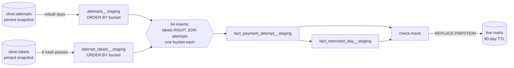

# Storage

Three storage roles: immutable source files in object storage, an Iceberg lakehouse for Bronze, Silver and gold feature tables, and ClickHouse as the SQL warehouse over the lakehouse with native marts.

## Object storage

| Environment | Bucket | Engine |
|---|---|---|
| Dev | `platform-dev` | MinIO |
| Prod | `platform-prod-142737101504-us-east-1` | AWS S3, versioned and private |

| Prefix | Contents |
|---|---|
| `datasets/payment-gateway/historical/<version>/` | Generator output; immutable once `manifest.json` exists |
| `datasets/payment-gateway/knowledge/<version>/` | RAG corpus documents published by the `rag-knowledge` workflow; immutable once `manifest.json` exists |
| `runs/payment-gateway/` | Pipeline run reports and Flink checkpoints |
| `lakehouse/` | Iceberg table data, through the Polaris catalog |
| `artifacts/` | Kubeflow artifacts, owned by the platform |

Bucket names have no meaning to application code: workloads receive `S3_ENDPOINT`, `S3_PATH_STYLE`, `AWS_REGION` and an `output` or root URL. Never tag active Flink state with `expire=true`, which enables the platform's finished-run lifecycle rule.

## Lakehouse

Tables are Iceberg, registered in the Polaris REST catalog that the `lakehouse` chart deploys. Spark writes them; ClickHouse reads them through a DataLakeCatalog database.

Prod v19 holds Bronze in full, and Silver and Gold from 2025-10-29 to 2026-10-28; see [the run](offline.md#prod-v19-run).

| Technique | Applied to | Why |
|---|---|---|
| Partitioning | Bronze by `_source` and `days(occurred_at)` (labels by `days(label_available_at)`); Silver by `payment_day` (labels by availability day); Gold by day of `event_timestamp`, `dim_customer` by month | One-day and one-month reads touch only their partitions |
| Write order | Silver events by `occurred_at` and attempts by `started_at` within each file (`WRITE LOCALLY ORDERED BY`) | File min/max statistics prune time filters inside a day, for Spark and ClickHouse alike |
| Write distribution | `write.distribution-mode=hash` and a target file size on every table, except the historical Bronze and Silver event writes, which use `distribution-mode=none` with the fanout writer | Without it, each Spark task writes one small file per partition it touches. Historical files hold one purchase day each and Silver reads Bronze files back, so those tasks already touch only a few day partitions; at v19 the hash shuffle cost about 217 GB of executor disk for no extra clustering |
| Compaction | Bronze, the files of the last 3 days of Kafka appends | Kafka runs append small files; `rewrite_data_files` with `binpack` and an `_ingested_at` filter merges only those. Silver and Gold need none: every run rewrites whole day partitions at the 256 MB target |
| Z-order | `silver.attempts` by `customer_id` and `payment_method_fingerprint`, one month at a time, on demand (`maintain-lakehouse task=zorder start end`) | Feature queries filter one customer or card over a window; clustering lets file statistics skip files. The report compares one customer's planned files and bytes for that month before and after |
| Maintenance | All tables, nightly | `expire_snapshots` (older than 7 days, last 10 kept) and dropping `audit-*` branches older than 7 days, which would otherwise pin their files; no full-table rewrites, so its cost does not grow with history |

**Evidence (prod v19, `maintain-lakehouse-zorder-8z67x`, 2026-11-01).**

- **Partitioning prunes:** one Bronze day (2025-10-29) plans 4 of 2,904 files and 282 MB of 113.7 GB.
- **Z-order does not prune at this layout:** September 2026 of `silver.attempts` was rewritten with `zorder(customer_id, payment_method_fingerprint)` in 70 seconds, and the month's busiest customer still plans all 30 files (2.50 GB before, 2.52 GB after). Each day partition is one file under the 256 MB target, so the customer appears in every file and file statistics cannot skip any; clustering only helps once a partition spans several files, or through Parquet row-group statistics, which planning does not count. Silver therefore keeps its time order and is not Z-ordered on a schedule.

Kafka offsets are derived from the Bronze rows themselves, not from snapshot metadata, so compaction and snapshot expiry never lose ingestion progress.

`maintain-lakehouse` (task `nightly`) runs from a suspended daily 03:43 UTC CronWorkflow and holds `dp-writer` and `dp1-bronze-writer`, so it never commits alongside a pipeline run. It reports before/after files and bytes per table and the branches it dropped; task `zorder` is the on-demand storage evidence.

## Warehouse

ClickHouse reads the Iceberg tables directly through the `lakehouse` DataLakeCatalog database configured by `lakehouse`; queries need no copy of the lake. It runs the contract-derived SQL checks for Bronze and Silver.

### Running SQL inside ClickHouse's limits

The prod server has about 3.4 GiB of memory, and the `marts` profile caps a query at 2 GiB. Two patterns keep the checks and the mart builds inside that:

- **Spill instead of hash.** Every contract rule runs with external aggregation (800 MB threshold), external sort (400 MB), `join_algorithm = 'full_sorting_merge'`, `max_threads = 2` and `max_block_size = 16384`. On v19, a full-history amount/context join finished this way in 18m48s at 1.77 GiB peak, writing 17.8 GiB of sort spill, after hash joins exceeded the server.
- **Read only the run's range.** Rules are scoped to the audited commit's range with `additional_table_filters` (see [range-scoped validation](orchestration-governance.md#range-scoped-validation)), so their cost follows one month instead of the whole table.
- **A small hash build side, read once.** The rebuilt days' attempts and their label summary are staged in MergeTree tables ordered by a payment-hash bucket, and the fact is inserted one bucket at a time: one bucket of labels `RIGHT JOIN` the same bucket of attempts with `join_algorithm = 'hash'`. ClickHouse builds the hash table from the right side, so memory holds one bucket of attempts, and the primary key limits each insert to its bucket of both tables. The label summary itself is built in 8 hash passes, each reading only its eight columns. The failures that led here are in [optimization techniques](offline.md#optimization-techniques).

`EXPLAIN indexes = 1` on the checks shows the sort-merge join on `(integration_id, payment_id)`, explicit column reads and `payload_case` filtering through `PREWHERE`. Approximate uniqueness is unsuitable for an exact duplicate gate, and no local filesystem cache is configured.

### Warehouse indexing

DP3 builds two native MergeTree marts in the ClickHouse `marts` database ([DDL](../../src/data-pipeline/batch/batch/gold/sql/marts)); every structure serves a named fixed query.

| Structure | Choice | Query it serves |
|---|---|---|
| `fact_payment_attempt` partition | `toDate(started_at)` | Q0 time ranges prune whole days; the day-granular TTL drops whole partitions |
| `fact_payment_attempt` primary key | `(integration_id, toDate(started_at), merchant_id, started_at)` | Q0 network-wide time ranges and Q1 one merchant's days; a plain `started_at` range prunes through the monotonic `toDate` |
| Bloom filters, `GRANULARITY 4` | `customer_id`, `payment_method_fingerprint` | Q2 one customer's 30 days, Q3 one card across customers |
| `minmax`, `set(8)` | `risk_score`, `outcome` | Q4 approved high-risk attempts and declines by outcome |
| `fact_merchant_day` | monthly partitions, `(integration_id, day, merchant_id)` | Q5 daily KPIs without scanning attempts |

Time comes first because almost every dashboard and tool query has a time range; a merchant-first key would make network-wide time queries scan every partition. The hot merchant holds about half of all attempts, so Q1 is reported for it and for a median merchant. No projections: a customer-ordered copy would double storage on the 30 GiB volume shared with Langfuse.

The ID and fingerprint columns use `CODEC(ZSTD(3))`. They hold random UUIDs and SHA-256 hex, which LZ4 barely compresses: before the codec the fact took about 240 bytes a row (6.4 GiB for May 6 – June 30, 2026), and a 180-day window would not have fitted the 30 GiB volume with a build's staging copies. On a 2M-row sample ZSTD stored a UUID string in 18.5 bytes instead of 35.5 and a fingerprint in 32.2 instead of 63.4, close to the native `UUID` and `FixedString(32)` sizes, so the columns stay strings. A build stages about 13 GiB (attempts, label summary, fact) next to the live fact, and ClickHouse keeps the parts its merges replace for `old_parts_lifetime`; at the default 480 s those leftovers filled the volume during September 2026's build, so the server keeps them 60 s.

Retention is a wall-clock `TTL` of 90 days with `ttl_only_drop_parts`, matching the rolling window each build inserts; `marts.build_info` records the window, the rebuilt days and the Silver snapshots. Builds join with external sort-merge and spill, the settings the v19 checks needed above.

**Evidence.** Each fixed query on the prod marts over the full window (2026-08-04 to 2026-10-28: 44.2M rows, 576 parts, 5,732 granules), from `EXPLAIN indexes = 1` and `system.query_log`, warm, with the query and query-condition caches off. The hot merchant is the one with the most attempts, the customer the one with the most attempts and the card the one shared by the most customers.

| Query | Pruned by | Granules read | Rows read | Time | Without skip indexes |
|---|---|---|---|---|---|
| Q0 last day by hour | partition and key on `toDate(started_at)` | 64 (7 parts) | 0.5M | 13 ms | same |
| Q1 hot merchant, 30 days | key: day, then merchant | 1,248 of the 2,020 in 30 days | 10.2M | 340 ms | same |
| Q1 median merchant, 30 days | key: day, then merchant | 199, one per day part | 1.6M | 54 ms | same |
| Q2 customer, 30 days | key: day; bloom filter `ix_customer` | 1,451 of 2,020 | 11.4M | 745 ms | 2,020 granules, 15.7M rows, 827 ms |
| Q3 card across customers | bloom filter `ix_method` | 296 of 5,732 | 2.3M | 158 ms | 5,732 granules, 44.2M rows, 1,905 ms |
| Q4 declines by outcome | `set(8)` on `outcome` | 5,732, no skipping | 44.2M | 352 ms | 278 ms |
| Q5 hot merchant's daily KPIs | `fact_merchant_day` key | 57 of 165 | 0.5M | 12 ms | same |

What it shows:

- **The time-first key carries most queries.** Q0 reads 1% of the fact, and one merchant's 30 days read only its own key range in each day: one granule a day for a median merchant. The hot merchant still reads 60% of those days, because it makes about half of all attempts.
- **The card bloom filter pays; the customer one barely does.** A card's attempts sit in a few granules, so `ix_method` skips 95% and is 12× faster. The busiest customer's attempts are spread over most days of the month, so `ix_customer` skips only 28%.
- **`set(8)` on `outcome` does not help a common value.** Declines occur in every granule, so the index skips nothing and adds about 70 ms. The `minmax` on `risk_score` is not measured, because the historical rule-based policy records no score.
- **The daily mart answers KPIs without the fact:** 12 ms against 340 ms for the same merchant and month from attempts.

The on-demand `warehouse-benchmark` can additionally compare raw Iceberg and an unsorted copy, but it makes a second 6 GiB copy of the fact on the shared 30 GiB volume, so it was not run on prod.
