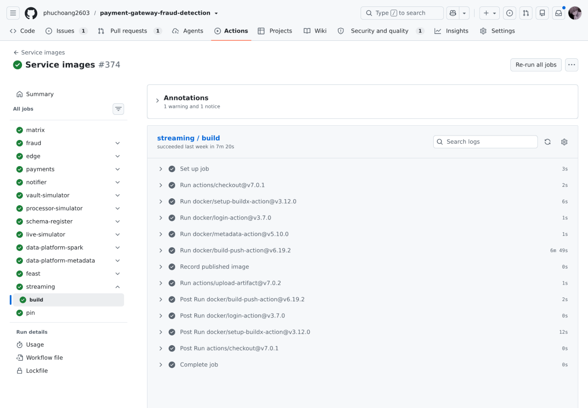
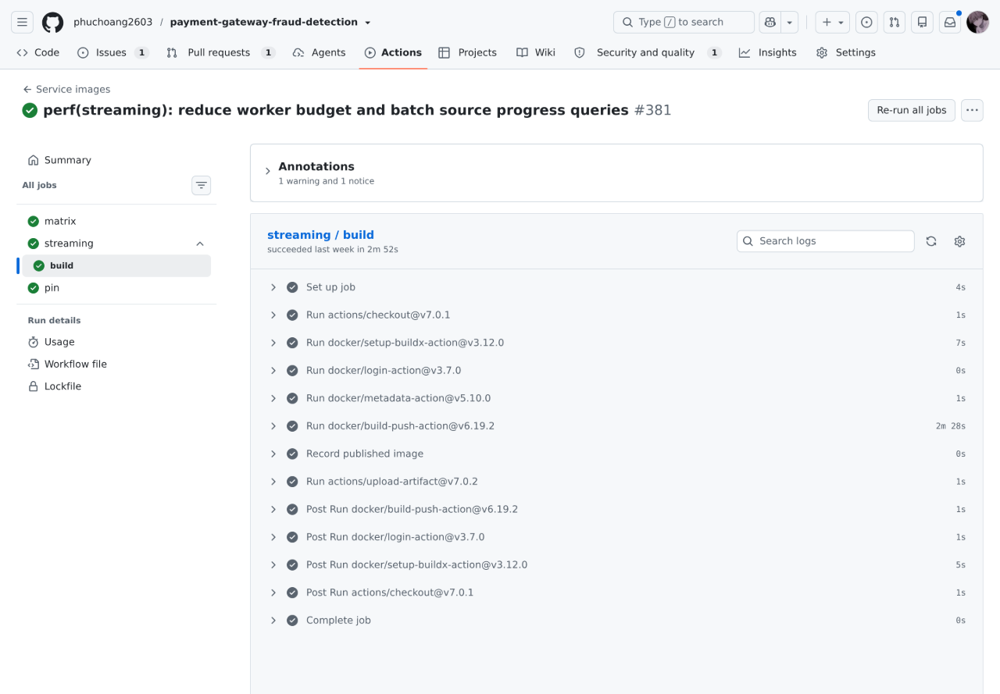
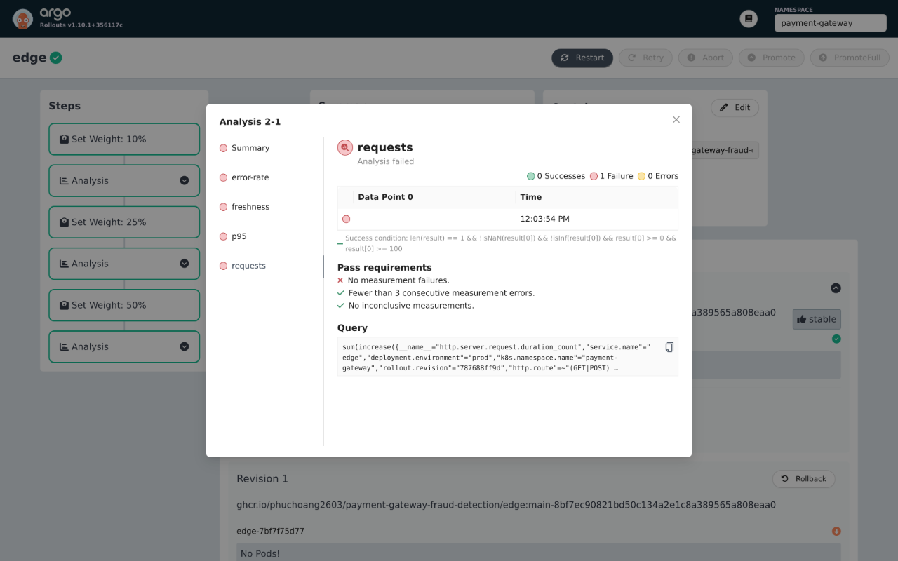
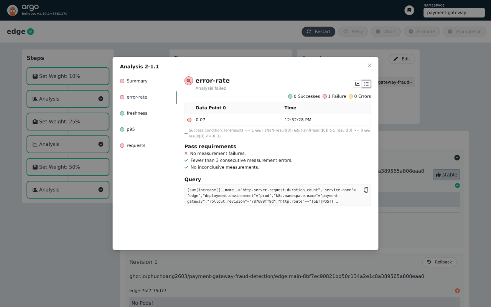
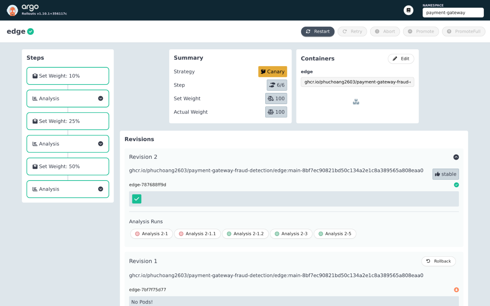

# Docker, CD and canary deployment

GitHub Actions builds images after contract/Helm checks, Go tests and Python tests; Argo CD reconciles application Helm charts. CI has no cluster credentials.

## Docker images

Application images are built from Dockerfiles in [`infra/docker`](../../infra/docker). Images run as non-root; Go uses a shared multi-stage build and a static binary on distroless. Python builds install locked dependencies before source for caching and copy runtime dependencies from build stages.

| Images | Dockerfile / runtime |
|---|---|
| Six Go services | `go-service.Dockerfile`; distroless, no shell or package manager |
| Live simulator and historical generator | `live-simulator.Dockerfile`; slim Python |
| Feast | `feast.Dockerfile`; slim Python |
| Streaming | `streaming.Dockerfile`; typed JVM Flink job and Python seed/orchestration tools, without PyFlink |
| Schema registration | `schema-register.Dockerfile`; protoc build stage, slim Python runtime |
| Debezium Connect | `connect-debezium.Dockerfile`; Strimzi with the Debezium plugin |
| Spark jobs | `data-platform-spark.Dockerfile`; checksummed connectors, slim Python and headless JRE |
| Metadata jobs | `data-platform-metadata.Dockerfile`; pinned OpenMetadata ingestion base |

Measured image optimization (`linux/amd64`); compressed size is registry layer bytes, unpacked size is disk usage:

| Image / comparison | Optimization | Before → after |
|---|---|---|
| Spark, `1e090ee` → `opt`, 2026-10-22 | Disable uv download cache, copy installed dependencies | Local 5.07 → 3.06 GB; compressed 2.02 → 1.06 GB (−48%) |
| Spark, `main-eb98307`, 2026-11-01 | Separate connector/build stages; copy only Spark runtime; remove pip/cache | 1.35 GB compressed, 1.89 GB unpacked; −33% compressed against `1e090ee`, with newer Spark and more connectors |
| Streaming, `6cec4a9` → `52219c0`, 2026-10-27 | Avoid installing a second copy of Flink libraries | Compressed 1.22 → 0.91 GB (−25%); unpacked 1.82 → 1.49 GB |

Streaming builds: `6cec4a9` before, `52219c0` after.

Sources: [baseline job](https://github.com/phuchoang2603/payment-gateway-fraud-detection/actions/runs/40566181024/job/122408013040) and [optimized job](https://github.com/phuchoang2603/payment-gateway-fraud-detection/actions/runs/40592235496/job/122499209418). GitHub reports total job durations of **7m20s → 2m52s** and build/push steps of **6m49s → 2m28s**. Python-era builds with different cache states.

GHCR platform manifests rechecked on 2026-11-05 contain **1,221,394,562 → 908,755,934 compressed layer bytes (−25.6%)** for the two streaming tags.

## Release flow

| Source | Release branch | Argo CD target |
|---|---|---|
| Trusted, non-draft pull request | `deploy/dev` | Dev |
| `main` | `deploy/prod` | Prod |

1. [`release.yml`](../../.github/workflows/release.yml) calls [`scripts/release.py`](../../scripts/release.py) to compare each image's inputs in [`service-images.json`](../../.github/service-images.json) against its deployed revision.
2. [`build-image.yml`](../../.github/workflows/build-image.yml) builds affected images into GHCR with immutable `pr-<number>-<sha>` or `main-<sha>` tags. Unchanged images retain their tags; chart-only releases reuse all images.
3. Publication waits for every other workflow on that commit/event to succeed and skips superseded revisions. It records the chart revision and image tags in [`release.yaml`](../../infra/argocd/app-of-apps/release.yaml) on the release branch.
4. The [dev](../../infra/argocd/dev/root.yaml) or [prod](../../infra/argocd/prod/root.yaml) root reconciles the release. Bootstrap requires the namespace, Doppler token, AppProject and root once.

The same flow delivers services and pipeline WorkflowTemplates; Argo Workflows runs their plan, build, validation and publish stages. Prod enables the gateway, Kafka, data pipelines with Flink/Feast, ClickHouse and lakehouse. The prod root also enables live traffic, ML training, LLM and RAG Applications. Nonsecret settings are in [chart values](../../infra/charts); Doppler credentials reach workloads through External Secrets.

## Edge progressive delivery

Only Edge uses a canary; the other five Go services remain Deployments. Rollouts controls the public route's `edge`/`edge-canary` weights and Service hash selectors; Argo CD ignores those controller-owned fields. Internal callers use stable `edge`; only public `/checkout/` traffic is split.

The platform supplies Rollouts v1.10.1 and Gateway API plugin v0.17.0. The application owns the [Rollout and analysis templates](../../infra/charts/payment-gateway/templates/rollout.yaml). Dev receives configuration only; acceptance runs directly against prod.

Subsequent candidates receive 10%, 25%, then 50% of public checkout traffic. Each step warms up for five minutes and requires two passing observations, one minute apart: at least 100 candidate checkout requests in five minutes, 5xx fraction at most 1%, p95 at most one second and latest sample age at most 120 seconds. Queries select environment, namespace and Rollout pod hash; business declines do not count as 5xx. Empty, stale, non-finite or insufficient observations abort after warm-up; three consecutive query errors abort. The rollout's progress deadline is 30 minutes. Low traffic cannot silently promote.

For an incident, run `kubectl --kubeconfig ~/.kube/talos-prod.yaml argo rollouts abort edge -n payment-gateway` when the kubectl plugin is installed, then revert the source image/chart and publish through the existing release flow. Confirm stable endpoints and HTTPRoute weights before considering recovery complete. Abort does not undo database migrations or changes to other services.

Prod acceptance on 2026-11-03 verified abort to stable/canary weights 100/0, reconciliation without weight reset, and automatic promotion after two passing observations at each stage. The rollout failure alert fired on abort and resolved on retry.

Browser captures from the retained prod AnalysisRuns below show the failed attempts and healthy retry. The Rollouts UI displays UTC−05:00; all captures are from 2026-11-03.

With no candidate traffic, Analysis 2-1 failed after warm-up. The blank measurement is an empty query result, not zero requests.

The fault attempt, Analysis 2-1.1, failed the 1% error threshold: the UI rounds the stored 0.0721649 fraction to 0.07. Its request guard also failed (97 against a minimum of 100); freshness and p95 passed.

On the healthy retry, final-stage Analysis 2-5 passed all four guards. Its two request observations were 1,703 and 1,832.

All three stages completed, promoting revision `787688ff9d` to stable at 100% traffic.

