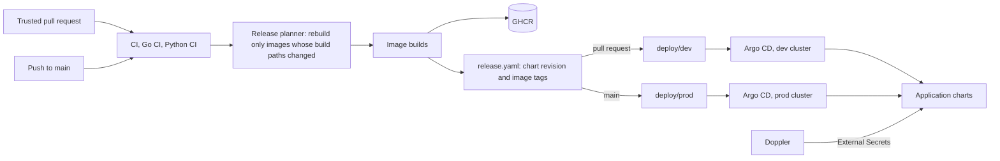

# Continuous delivery

GitOps deploys the same application charts to dev and prod. CI publishes a complete release to a deployment branch; Argo CD in each cluster reconciles it. CI never contacts Kubernetes or holds cluster credentials, and it never commits to `main`.

| Environment | Release branch | Published by | Gateway hostname |
|---|---|---|---|
| Dev | `deploy/dev` | Trusted, non-draft pull requests | `pay-gateway-dev.phuchoang.sbs` |
| Prod | `deploy/prod` | `main` | `pay-gateway.phuchoang.sbs` |

## Releases

- The roots are `infra/argocd/dev/root.yaml` and `infra/argocd/prod/root.yaml`. Each release records one chart source revision and per-service image tags in `infra/argocd/app-of-apps/release.yaml`. Bootstrap Helm parameters must not override that release revision.
- Images carry `pr-<number>-<full-sha>` or `main-<full-sha>` tags. The release planner (`scripts/release.py`) compares each image's build paths (`.github/service-images.json`) against its last deployed commit and rebuilds only changed images; unchanged images keep their tags, and an unreachable recorded commit counts as changed. Chart-only releases reuse every tag.
- Draft PRs skip the service-image release workflow; marking a PR ready for review enables dev publication.
- Publication waits for all affected image builds and for every other workflow run on the same commit and event (CI, Go CI, Python CI and any added later) to succeed, for dev and prod alike; a failed or cancelled check stops the release. It skips a superseded source revision. There are no image-pin commits or mutable `latest` tags.
- Bootstrap: create the `payment-gateway` namespace and its Doppler token, then apply the AppProject and the environment root once.

## Applications

| Chart | Namespace | Contents |
|---|---|---|
| `payment-gateway` | `payment-gateway` | The six Go services, their CNPG databases with separate owner and runtime roles, Payments idempotency Redis, secrets, routing and policies |
| `kafka` | `payment-gateway` | Kafka, Debezium Connect, Karapace and topic declarations |
| `live-traffic` | `data` | Live simulator |
| `data-pipelines` | `data` | Generator and pipeline WorkflowTemplates; Flink, Feast writer/server and Redis under `features.enabled`; OpenMetadata connections, the register job and on-demand discovery |
| `clickhouse` | `data` | ClickHouse instance, its users from Doppler, Service and the `langfuse` setup Job |
| `lakehouse` | `data` | Polaris REST catalog with its PostgreSQL store, signing keys and Iceberg storage secret; the `lakehouse` warehouse registration; ClickHouse `lakehouse` DataLakeCatalog |
| `llm-platform` | `llm`, `llm-agents` | Chat and embedding model servers, agent gateway and its policy, the sandbox egress proxy, Langfuse with its Postgres and Redis; in `llm-agents` the global model config, MCP servers, sandboxed agents and their Substrate worker pool; a catalog Job per release that publishes agentregistry entries, prompts to Langfuse and AI assets to OpenMetadata; see [LLM agents](../llm/agents.md) |
| `rag-pipeline` | `llm` | RAG knowledge workflow (corpus, chunks, embeddings through the gateway, Feast write, checks and lineage), its Feast pgvector Postgres, and the knowledge API that also serves the MCP tools, autoscaled by KEDA; see [RAG](../llm/rag.md) |

The prod release enables every application except `live-traffic`, `llm-platform` and `rag-pipeline`; `data-pipelines.features.enabled` runs Flink, the feature writer, Redis and the Feast server. Enabled applications include the gateway services with their databases, Redis and Kafka; `data-pipelines` with the generator, Bronze, Silver, analytics, maintenance and feature workflows, with the OpenMetadata connections and register job; `clickhouse`; and `lakehouse`. Application pods are stateless; Postgres and the Payments and Feast Redis instances own the persistent volumes.

## Edge progressive delivery

Only the public Edge checkout route uses a canary; the other five Go services remain Deployments. Internal callers use the stable `edge` Service. The existing Istio HTTPRoute retains its hostname, path, HTTPS header and timeouts, with `edge`/`edge-canary` weights controlled by Argo Rollouts. Argo CD ignores only this route's weights and the two Services' controller-owned hash selectors.

Before setting `rollout.enabled`, the platform owner must install compatible pinned Rollouts CRDs/controller and the `argoproj-labs/gatewayAPI` plugin, grant access to the namespace and `edge` HTTPRoute, and permit controller queries to `http://vmsingle-vmks.observability.svc.cluster.local:8428`. Grafana discovery and controller metrics collection also belong to the platform. Prod runs Rollouts v1.10.1 (chart 2.43.8) and Gateway API plugin v0.17.0, pinned and delivered by the platform. The controller query path, scoped route permissions and shared scrape/discovery are verified.

Adopt through separately published prod releases:

1. Set `rollout.enabled: true`, `rollout.migration: true`, retaining `legacyReplicas: 1`. The temporary `workloadRef` uses `scaleDown: never`; verify the new Rollout replicas and stable endpoints before reducing legacy replicas.
2. Set `legacyReplicas: 0` after stable checkout requests succeed through Rollout endpoints. Verify the stable-only route and Argo CD convergence.
3. Publish the inline Rollout (`migration: false`) and prune the old Edge Deployment only after endpoint continuity is verified. Remove the temporary migration configuration after handover. Dev remains configuration-only; acceptance runs directly against prod.

Subsequent candidates receive 10%, 25%, then 50% of public checkout traffic. Each step warms up for five minutes and requires two passing observations, one minute apart: at least 100 candidate checkout requests in five minutes, 5xx fraction at most 1%, p95 at most one second and latest sample age at most 120 seconds. Queries select environment, namespace and Rollout pod hash; business declines do not count as 5xx. Empty, stale, non-finite or insufficient observations abort after warm-up; three consecutive query errors abort. The rollout's progress deadline is 30 minutes. Low traffic cannot silently promote.

For an incident, run `kubectl --kubeconfig ~/.kube/talos-prod.yaml argo rollouts abort edge -n payment-gateway` when the kubectl plugin is installed, then revert the source image/chart and publish through the existing release flow. Confirm stable endpoints and HTTPRoute weights before considering recovery complete. Abort does not undo database migrations or changes to other services. Reverting controller adoption requires ready Deployment endpoints and stable-only routing before removing Rollout resources.

## Runtime configuration

Python services take settings from configuration files and environment variables, never command-line flags. Every service validates its configuration at startup and exits non-zero with a sanitized diagnostic on invalid values; booleans accept only `true` or `false`.

| Service | Variable | Default | Purpose |
|---|---|---|---|
| fraud | `GRPC_ADDR`, `SHUTDOWN_TIMEOUT` | `:8000`, `10s` | Internal gRPC listener and drain (max 60s) |
| fraud | `FRAUD_DATABASE_URL`, `FRAUD_MIGRATE_DATABASE_URL` | required | Runtime and migration identities |
| fraud | `FRAUD_ASSESSMENT_DEADLINE`, `FRAUD_ASSESSMENT_LEASE`, `FRAUD_ASSESSMENT_RETRY_HORIZON`, `FRAUD_ASSESSMENT_ERROR_BACKOFF` | `1s`, `2s`, `5m`, `250ms` | Fenced completion and bounded recovery |
| fraud | `FRAUD_FEAST_URL`, `FRAUD_FEATURE_SERVICE`, `FRAUD_FEATURE_TTL_DAILY`, `FRAUD_FEATURE_TTL_STREAM` | chart values under `features`; enabled in prod | Online history retrieval |
| payments | `PAYMENTS_DATABASE_URL`, `PAYMENTS_MIGRATE_DATABASE_URL` | required | Runtime and migration identities |
| payments | `PAYMENTS_REDIS_ADDR`, `PAYMENTS_REDIS_PASSWORD`, `PAYMENTS_IDEMPOTENCY_TTL` | chart values, `24h` | Redis-first idempotency with a 50 ms deadline before database fallback |
| payments | `PAYMENTS_ATTEMPT_BUDGET`, `PAYMENTS_FRAUD_TIMEOUT`, `PAYMENTS_PROCESSOR_TIMEOUT` | `5s`, `1s`, `3s` | Attempt and dependency budgets |
| payments | `PAYMENTS_ASSESSMENT_RETRY_HORIZON`, `PAYMENTS_ASSESSMENT_BACKOFF` | `5m`, `1s` | Same-attempt assessment recovery |
| edge | `EDGE_HTTP_ADDR`, `EDGE_SHUTDOWN_TIMEOUT` | `:8080`, `10s` | Public listener and drain |
| edge | `EDGE_INTEGRATIONS_JSON`, `EDGE_PAYMENTS_ADDR`, `EDGE_VAULT_ADDRESS` | required, chart values | Integration configuration and dependencies |
| notifier | `NOTIFIER_DATABASE_URL`, `NOTIFIER_INTEGRATIONS_JSON`, `NOTIFIER_KAFKA_BROKERS` | required, chart values | Delivery state, subscriptions, event feed |
| vault | `VAULT_DATABASE_URL`, `VAULT_ENCRYPTION_KEY`, `VAULT_PROCESSING_ADDR` | required, required, `:8001` | Vault store, key and processor-only listener |
| processor | `PROCESSOR_DATABASE_URL`, `VAULT_ADDRESS` | required | Processor store and vault processing listener |
| processor | `PROCESSOR_LATENCY_MIN`, `PROCESSOR_LATENCY_MAX`, `PROCESSOR_TIMEOUT_RATE` | prod `20ms`, `150ms`, `0` | Simulated latency and injected lost responses |
| all Go | `METRICS_ENABLED`, `TRACING_ENABLED`, `OTEL_EXPORTER_OTLP_*_ENDPOINT` | disabled outside Helm | Telemetry export; see [observability](observability.md) |
| generator | `SIMULATOR_CONFIG`, `GENERATOR_MODE`, `SHARD_INDEX`, `SHARD_COUNT`, `GENERATOR_WORKERS` | set by the workflow | See [offline data](../data/offline.md) |
| live simulator | `SIMULATOR_CONFIG` | `/etc/simulator/live.yaml` | See [online data](../data/online.md) |

The gateway chart sets `terminationGracePeriodSeconds: 30` to cover the 10 s drain, two bounded 3 s telemetry shutdowns and scheduling margin.

## Gateway verification

The 2026-10-23 acceptance run against prod is recorded in the [gateway verification evidence](../../openspec/changes/archive/2026-10-23-build-minimum-payment-gateway/verification.md): synthetic tokenization; approve, risk-decline, processor-decline, timeout-then-recovery and expiry paths; decline-then-approve through the hosted page with signed webhooks; Redis fallback; Connect restart and Kafka outage catch-up; byte-equal topic payloads; and the ledger lifecycle check. A short smoke run does not establish the monthly availability objective or the nominal load target.
