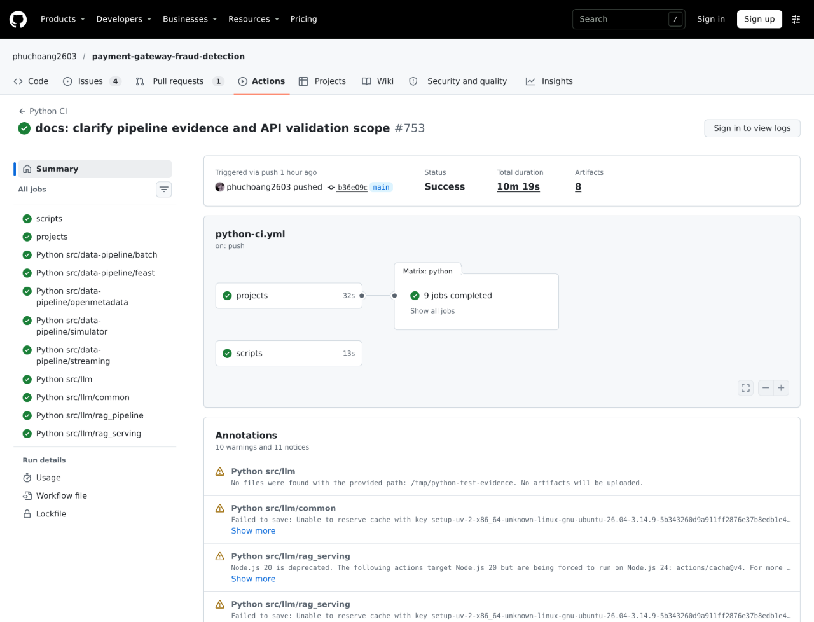
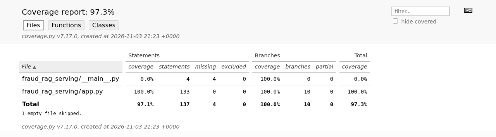
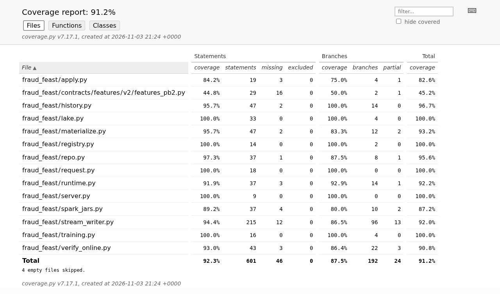
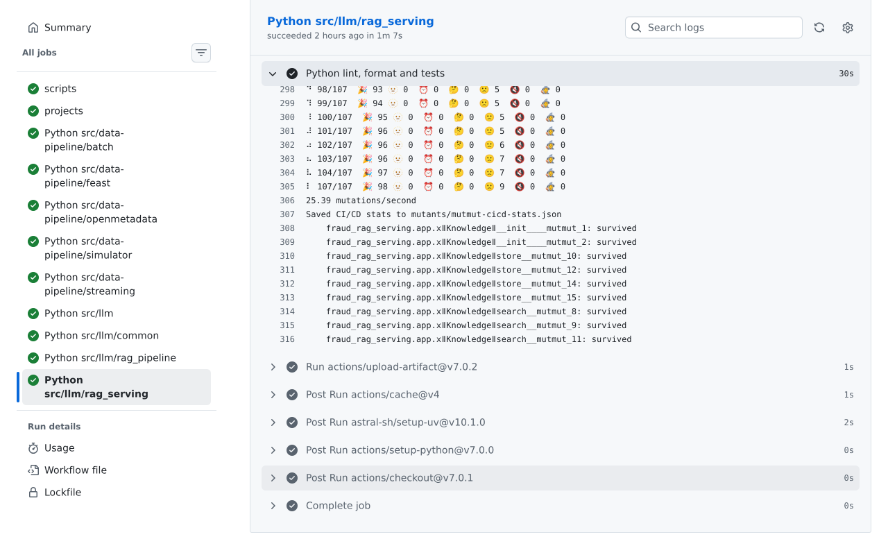
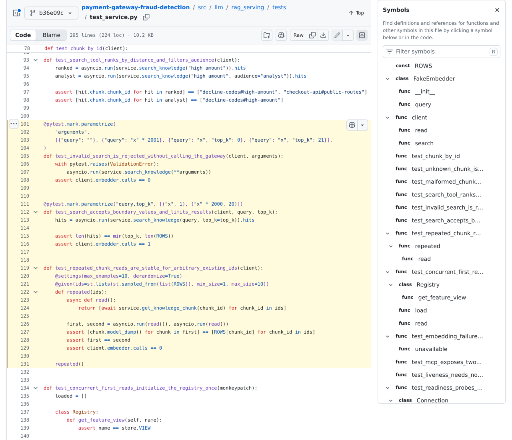

# CI, validation and verification

GitHub Actions validates pull requests and `main`; successful checks gate image publication to GHCR and Argo CD deployment. Tests and builds run in CI. Local checks run in `devenv shell` (format, lint, schema validation and Helm rendering).

## CI checks

| Workflow | Validation |
|---|---|
| [CI](../../.github/workflows/ci.yml) | Contract lint, generated-reference diff, Helm lint/render for all charts and values |
| [Go CI](../../.github/workflows/go-ci.yml) | Lint, unit tests, Postgres integration tests through testcontainers, changed-code mutation testing on PRs |
| [Python CI](../../.github/workflows/python-ci.yml) | Ruff lint/format, pytest and coverage artifacts per project; knowledge API mutation results for affected knowledge API code |

[`scripts/ci-checks.sh`](../../scripts/ci-checks.sh) holds shared checks. On PRs, [`ci-matrix.py`](../../scripts/ci-matrix.py) selects affected projects and local dependencies; `main` tests every project.

## Test techniques

| FSDS criterion | Implementation example |
|---|---|
| API tests with fixtures and mocks | [Feast server tests](../../src/data-pipeline/feast/tests/test_server.py), [fixtures](../../src/data-pipeline/feast/tests/conftest.py): FastAPI client against a store double |
| Equivalence partitioning and boundary values | [Fraud policy](../../src/payment-gateway/fraud/internal/domain/policy_test.go): amount/account-age boundaries; [request features](../../src/data-pipeline/feast/tests/test_request.py): country pair, history and scoring hour |
| Mutation testing, >80% on changed code | Go CI uses changed-code mutations on PRs. Python CI caches native mutmut results for the knowledge API; source-only changes retest changed functions, while test/dependency changes start a new baseline. |
| Generator and Spark behavior | Physical v2/v3 Parquet cutover, deterministic generation across workers/shards, delayed chargebacks and redelivery; mixed-schema Bronze-to-Silver ingestion, deduplication and equivalent skew-join outputs |
| Property-based idempotency | [Knowledge API](../../src/llm/rag_serving/tests/test_service.py): arbitrary repeated chunk reads; [Gold ranges](../../src/data-pipeline/batch/tests/gold/test_gold_ranges.py): reruns and range splits; [payment lifecycle](../../src/payment-gateway/payments/internal/domain/payment_property_test.go): arbitrary command sequences preserve state invariants |
| API throughput and latency | [Knowledge API Locust report](../llm/loadtest/knowledge-api-locust.html): 140.31 req/s, p95 310 ms, zero failures (2026-10-30); Feast retrieval load-test evidence pending |

A Python project can set a minimum total coverage with `coverage-fail-under` under `[tool.ci]` in its `pyproject.toml`; `scripts/ci-checks.sh` passes it to pytest-cov. `src/ml` sets 90 (97.9% line and branch combined when set).

## Coverage and mutation testing

Coverage from CI (`python-test-evidence-*` and `go-test-evidence-*` artifacts), 2026-11-01; API rows refreshed on 2026-11-03. Go counts only handwritten code; sqlc and protobuf output is excluded.

| Project | Line coverage | Branch coverage |
|---|---|---|
| data-pipeline/streaming | 89.0% | 84.1% |
| data-pipeline/simulator | 87.1% | 78.4% |
| data-pipeline/batch | 86.1% | 70.6% |
| data-pipeline/feast | 92.3% | 87.5% |
| data-pipeline/openmetadata | 50.2% | 39.7% |
| llm/rag_serving | 97.1% | 100.0% |
| llm/common | 68.8% | 45.0% |
| llm/rag_pipeline | 61.7% | 73.6% |

| Go module | Domain package | Whole module | Mutation (full run, 2026-10-26) |
|---|---|---|---|
| payments | 92.5% | 55.0% | 269 killed, 0 lived, 106 not covered: efficacy 100%, mutator coverage 71.7% |
| fraud | 100% | 60.3% | 11 killed, 0 lived: 100%, 100% |
| notifier | 88.3% | 50.6% | 68 killed, 0 lived, 25 not covered: 100%, 73.1% |
| edge | 87.3% | 59.6% | 42 killed, 0 lived, 51 not covered: 100%, 45.2% |
| vault-simulator | 90.0% | 48.2% | 29 killed, 0 lived, 17 not covered: 100%, 63.0% |
| processor-simulator | 100% | 37.2% | 6 killed, 0 lived, 40 not covered: 100%, 13.0% |
| shared | | 42.1% | 64 killed, 0 lived, 25 not covered: 100%, 71.9% |

The >90% line-coverage requirement applies to feature and knowledge APIs. Generator and Spark tests verify behavior; Go domain and whole-module figures describe other scopes. [Python CI run 41721055100](https://github.com/phuchoang2603/payment-gateway-fraud-detection/actions/runs/41721055100), commit `b36e09c`, passed all nine projects, including 71 Spark/batch tests, 34 simulator tests and 21 knowledge API tests.

Native coverage.py reports from the run’s artifacts show 100% for knowledge `app.py` and feature `server.py`/`request.py`. **Statements** is line coverage; the header combines statements and branches.

The knowledge API mutation baseline killed **98/107 mutants (91.6%)**: nine survived, none untested, skipped or timed out. Native mutation reports are CI artifacts; the HTTP listener bootstrap lives in `__main__.py`, outside the API mutation scope.

The same passing run executes parameterized invalid/boundary searches and Hypothesis-generated repeated reads. The source below shows the actual partitions and idempotency assertion.

