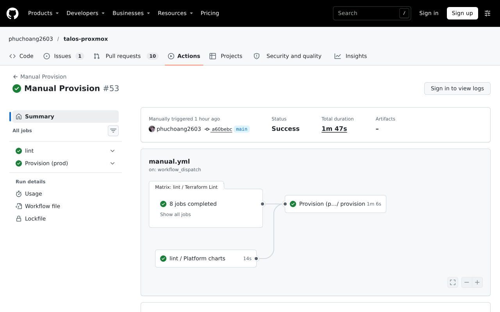

# Infrastructure and IaC

Two Talos Kubernetes clusters run the same application charts. They are provisioned and operated from the platform repository, [talos-proxmox](https://github.com/phuchoang2603/talos-proxmox), with OpenTofu (Terraform-compatible) for Proxmox, GCP and cluster bootstrap, and Argo CD for platform components. This repository holds no Terraform stack or cloud credentials.

Production moved from AWS to GCP on 2026-11-02.

| | Dev | Prod |
|---|---|---|
| Infrastructure | Proxmox VMs: one control plane and two workers | GCP project `talos-proxmox`, `us-central1-a`, single zone |
| Baseline nodes | `dev-server1` (control plane), `dev-server2`, `dev-server3` | One On-Demand `e2-standard-4` control plane and three On-Demand `e2-standard-4` workers (`cpu` pool) |
| Elastic capacity | None | Cluster Autoscaler over a GCE Spot group (`spot` pool) of `e2-standard-4` workers, 0 to 12 nodes / 48 vCPU / 192 GiB |
| GPU | One RTX 5060 Ti (16 GiB) on `dev-server1`, shared by the chat and embedding servers through one DRA claim | One fixed on-demand NVIDIA L4 on `g2-standard-4` (`talos.dev/nodepool: gpu`, tainted `burst.talos.dev/gpu-training`), shared by training, scoring and Triton through one DRA claim; the LLM platform is disabled in prod |
| Volumes | `local-path` | GCE persistent disks (`pd-balanced`) through the default `cloud-block` StorageClass |
| Object storage | MinIO `platform-dev` | GCS bucket `talos-proxmox-prod-platform` through the S3-compatible XML API |

The full-scale generator uses the Spot pool: one shard per Spot node, selected by `talos.dev/nodepool: spot` in the prod values. Both clusters have one control plane and are not highly available.

## Platform and application ownership

| Owned by the platform | Owned by this repository |
|---|---|
| Talos, Cilium, Argo CD, Argo Workflows, Spark and Flink operators, External Secrets, Istio ambient mesh, ingress and Cloudflare tunnels | Application charts and their values |
| The Altinity ClickHouse operator, OpenMetadata, Kubeflow and the `ml` workspace | Polaris catalog and its registration, ClickHouse instance and users, ClickHouse `lakehouse` DataLakeCatalog, catalog connections |
| Victoria metrics and traces stores, Grafana | Application telemetry configuration |
| Buckets, storage policies and gateway storage identities | Dataset, run and lakehouse prefixes used by workloads |

Removing an application chart never removes shared services, buckets, catalog databases or namespaces.

## Provisioning

| Platform code | Responsibility |
|---|---|
| [`terraform/foundation`](https://github.com/phuchoang2603/talos-proxmox/tree/main/terraform/foundation) | Shared identities, state and secret contracts |
| [`terraform/proxmox`](https://github.com/phuchoang2603/talos-proxmox/tree/main/terraform/proxmox) / [`terraform/gcp`](https://github.com/phuchoang2603/talos-proxmox/tree/main/terraform/gcp) | Dev VMs / prod network, instances, worker groups and storage |
| [`terraform/talos`](https://github.com/phuchoang2603/talos-proxmox/tree/main/terraform/talos) / [`terraform/cluster`](https://github.com/phuchoang2603/talos-proxmox/tree/main/terraform/cluster) | Talos bootstrap and environment configuration |
| [`apps`](https://github.com/phuchoang2603/talos-proxmox/tree/main/apps) | Shared operators and platform services through Argo CD |

Talos machine configuration and GitOps replace the rubric's Ansible-on-VM configuration. The [platform provisioning workflow](https://github.com/phuchoang2603/talos-proxmox/blob/main/docs/architecture/terraform-ci.md) describes plan/apply; the prod apply below succeeded on platform commit `a60bebc` (run `41733627525`).

