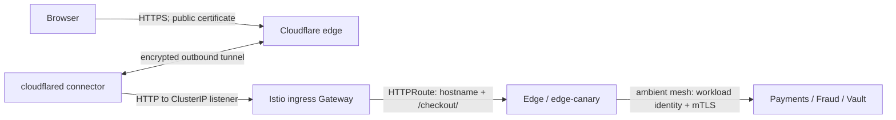
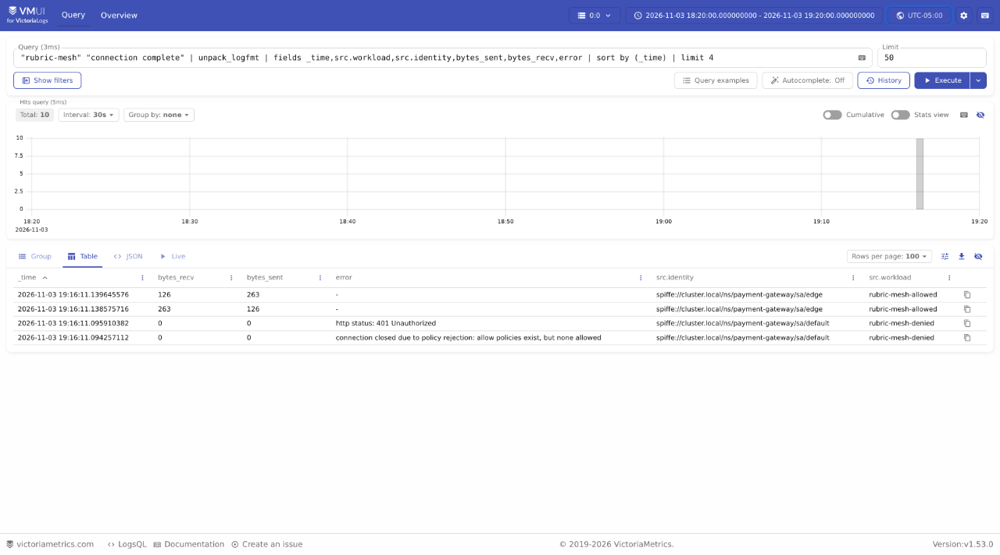

# Domains, HTTPS, gateways and the service mesh

Cloudflare supplies the public hostname and browser TLS endpoint. A platform-managed Cloudflare Tunnel brings that traffic to an internal Istio Gateway. Gateway API resources route the public checkout path; Istio ambient mTLS and identity policies protect service-to-service calls. These are separate boundaries with different owners.

## Hostname and routing ownership

| Layer | Source of truth | Responsibility |
|---|---|---|
| DNS, public certificate, tunnel credentials, `ClusterTunnel` and connector | [Platform repository](https://github.com/phuchoang2603/talos-proxmox/tree/main/apps/components/cloudflare-tunnel) | Connect to Cloudflare without exposing a public Kubernetes load balancer |
| Hostname binding and internal listener | [`ingress.yaml`](../../infra/charts/payment-gateway/templates/ingress.yaml) | App-owned `TunnelBinding` targets `http://<gateway>-istio.payment-gateway.svc.cluster.local:<port>`; `Gateway` uses class `istio`, a ClusterIP Service and an HTTP listener |
| Hostname, checkout path, headers, timeouts and backend references | [`http-route.yaml`](../../infra/charts/payment-gateway/templates/http-route.yaml) | Match the configured host and `/checkout/`; set `X-Forwarded-Proto: https`; route to stable/canary Edge |
| Public canary weights | [Rollouts strategy](../../infra/charts/payment-gateway/templates/_rollout.tpl) | Rollouts changes route weights; Argo CD ignores those controller-owned fields |
| Private service access | [`mesh.yaml`](../../infra/charts/payment-gateway/templates/mesh.yaml), [NetworkPolicy](../../infra/charts/payment-gateway/templates/network-policy.yaml) | Strict mTLS, allowed service-account identities and permitted pod connections |

Dev uses `pay-gateway-dev.phuchoang.sbs`; prod uses `pay-gateway.phuchoang.sbs`, from the [environment values](../../infra/charts/payment-gateway). A `TunnelBinding` expresses the desired route to the platform controller; application delivery does not hand-edit Cloudflare routes. The Gateway accepts HTTPRoutes only from its own namespace.

## Public endpoints beyond checkout

The following prod hostnames have live `TunnelBinding` resources as of 2026-11-05. Dev uses the corresponding `-dev` hostname shown below.

| Endpoint | Prod | Dev | Origin / access path |
|---|---|---|---|
| Checkout | `pay-gateway.phuchoang.sbs` | `pay-gateway-dev.phuchoang.sbs` | App-owned Istio Gateway API listener → `/checkout/` → Edge; checkout-session credentials |
| Grafana | `grafana.phuchoang.sbs` | `grafana-dev.phuchoang.sbs` | Tunnel → `grafana.observability:80`; Grafana's Dex/OIDC login |
| Argo CD | `argocd.phuchoang.sbs` | `argocd-dev.phuchoang.sbs` | Tunnel → `argo-cd-argocd-server.argo-cd:80`; native Argo CD SSO/RBAC |
| Argo Workflows | `workflows.phuchoang.sbs` | `workflows-dev.phuchoang.sbs` | Tunnel → `argo-workflows-server.operators:2746`; Workflows SSO/RBAC |
| OpenMetadata | `openmetadata.phuchoang.sbs` | `openmetadata-dev.phuchoang.sbs` | Tunnel → `openmetadata.data:8585`; application OIDC login |
| Dex | `auth.phuchoang.sbs` | `auth-dev.phuchoang.sbs` | Tunnel → `dex.auth:5556`; `/dex` issuer, authorization and token endpoints |
| Kubeflow | `kubeflow.phuchoang.sbs` | `kubeflow-dev.phuchoang.sbs` | Shared Istio ingress → Kubeflow UI and `/pipeline/`, `/jupyter/`, `/volumes/` routes; OAuth2 proxy/JWT policy |
| Kagent | `kagent.phuchoang.sbs` | `kagent-dev.phuchoang.sbs` | Shared Istio ingress → `kagent-ui.kagent:8080`; OAuth2 proxy |
| Agent Registry | `agentregistry.phuchoang.sbs` | `agentregistry-dev.phuchoang.sbs` | Shared Istio ingress → `agentregistry.agentregistry:12121`; OAuth2 proxy |
| Langfuse | `langfuse.phuchoang.sbs` | `langfuse-dev.phuchoang.sbs` | Shared Istio ingress → `langfuse-web.llm:3000`; OAuth2 proxy and application login |

The platform owns the bindings for [Grafana](https://github.com/phuchoang2603/talos-proxmox/tree/main/apps/components/observability), [Argo CD](https://github.com/phuchoang2603/talos-proxmox/tree/main/apps/components/argocd-post), [Workflows](https://github.com/phuchoang2603/talos-proxmox/tree/main/apps/components/argo-workflows), [OpenMetadata](https://github.com/phuchoang2603/talos-proxmox/tree/main/apps/components/openmetadata), [Dex/shared UI authentication](https://github.com/phuchoang2603/talos-proxmox/tree/main/apps/components/auth), [Kubeflow](https://github.com/phuchoang2603/talos-proxmox/tree/main/apps/components/kubeflow), [Kagent](https://github.com/phuchoang2603/talos-proxmox/tree/main/apps/components/kagent) and [Agent Registry](https://github.com/phuchoang2603/talos-proxmox/tree/main/apps/components/agentregistry). The application owns [Langfuse's VirtualService](../../infra/charts/llm-platform/templates/langfuse.yaml); its tunnel binding and shared authentication are platform-owned.

These routes use three different paths. Grafana, Argo CD, Workflows, OpenMetadata and Dex target their own Services directly. The shared UI domains target the HTTP port of `istio-ingressgateway`, then use the Istio `ml/kubeflow-gateway` and `VirtualService` resources; `/oauth2/` goes to `oauth2-proxy.auth:80`. Checkout uses the separate Kubernetes Gateway API resources described above. The shared UI routes have not all been migrated to Gateway API.

The desired tunnel origin for both Istio ingress Services is **port 80**, not their first Service port, **15021**, which is the status listener. During this inventory, `TunnelBinding.status.services` listed 15021 for the Gateway-backed bindings despite the desired target being 80.

## Internal API and data endpoints

The `llm/agentgateway` is a separate ClusterIP Gateway with class `agentgateway`; it has no public `TunnelBinding` in this inventory. Its HTTPRoutes are internal and do not inherit the checkout hostname.

| Internal entry point | Routing | Access boundary |
|---|---|---|
| `agentgateway.llm.svc.cluster.local:80/v1/embeddings` | Embedding backend; the more specific prefix takes precedence over `/v1` | Client API keys, route policies and mesh identity |
| `agentgateway.llm.svc.cluster.local:80/v1` | Chat/completions backend | Client API keys, prompt policies and rate limits |
| `agentgateway.llm.svc.cluster.local:80/v1/systemone` | Exact decision route; screening requests have a separate header match | Decision-route policy and mesh identity |
| `agentgateway.llm.svc.cluster.local:80/knowledge/v1` | Rewrite `/knowledge/v1` to `/v1` on `rag-api:8080` | Client API keys and route policy |
| `agentgateway.llm.svc.cluster.local:80/mcp/knowledge` | Knowledge MCP backend | `x-api-key` policy and mesh identity |
| `agentgateway.llm.svc.cluster.local:80/a2a/coordinator` | Coordinator A2A backend | Client-key/route policy; gateway signs the upstream JWT |
| `payment-risk-predictor.ml.svc.cluster.local:80` | Service-attached HTTPRoute through an Istio waypoint; champion/challenger weights | Internal inference and mesh policies |
| `edge.payment-gateway.svc.cluster.local:8080` | Internal merchant API, including `/v1/payments`; stable Edge Service | Integration credentials and mesh policy; this path has no public checkout route |
| `payments`, `fraud-service`, `vault-simulator`, `notifier`, `processor-simulator` in `payment-gateway`, port 8000 | Private Go/gRPC service calls | Service-account identities and NetworkPolicy; Vault fixture resolution uses a separate port 8001 |
| `payment-gateway-kafka-kafka-bootstrap.payment-gateway.svc.cluster.local:9092` | Internal Kafka clients | Kafka namespace/network configuration; no public hostname |
| `schema-registry.payment-gateway.svc.cluster.local:8081` | Internal schema HTTP API | Internal Service/NetworkPolicy; no public hostname |
| `feast-server.data.svc.cluster.local:6566` | Feast feature retrieval | Internal Service/NetworkPolicy; no public hostname |
| `clickhouse.data.svc.cluster.local:8123` / `:9000` | SQL HTTP / native protocol | Database users and NetworkPolicy; no public hostname |
| `iceberg-catalog.data.svc.cluster.local:8181` | Polaris REST catalog | Catalog credentials and NetworkPolicy; no public hostname |

The route definitions live in [LLM gateway](../../infra/charts/llm-platform/templates/gateway.yaml), [REST APIs](../../infra/charts/llm-platform/templates/apis.yaml), [MCP](../../infra/charts/llm-platform/templates/mcp.yaml), [A2A](../../infra/charts/llm-platform/templates/a2a.yaml) and [ML experiment routing](../../infra/charts/ml-training/templates/experiment.yaml). Flink REST UIs (`:8081`) and transient Spark driver UIs (`:4040`) are management endpoints reached by explicit port-forward, not public tunnel hostnames. Dev object storage uses the separately managed `minio.home.phuchoang.sbs`; prod uses `storage.googleapis.com`, as described in [Storage](../data/storage.md#object-storage). Runtime model and tool behavior remains in the [LLM notes](../llm/gateway-and-jev-policy.md); this page owns how traffic reaches those components.

## Where encryption terminates

The browser's HTTPS connection terminates at Cloudflare. The Cloudflare-to-connector tunnel is encrypted, but the configured connector-to-Gateway target is **HTTP**, not an HTTPS origin listener. This configuration does not demonstrate TLS on every hop. The `X-Forwarded-Proto` header conveys the original scheme; it neither adds encryption nor replaces authentication. Its meaning depends on keeping the ingress path and trusted proxy configuration controlled.

Ambient mesh enrollment protects supported workload-to-workload traffic independently of the public certificate. `PeerAuthentication` requires `STRICT` mTLS and workload-selected `AuthorizationPolicy` rules allow specific identities and ports. For example, Edge is admitted by the ingress Gateway's service account; Vault admits Edge on port 8000 and processor fixture resolution on 8001.

ztunnel enforces Layer 4 identity/port policy. It does not inspect HTTP paths or methods: the ingress Gateway handles the public `/checkout/` route. An ambient Layer 7 service policy needs an appropriate waypoint and `targetRefs`; adding HTTP rules to a ztunnel-selected workload policy is not a substitute. See the [Istio ambient authorization guide](https://istio.io/latest/docs/ambient/usage/l4-policy/).

Public `/v1/payments` has no matching route and returned HTTP 404 during the recorded prod acceptance. Internal merchant callers use the stable Edge Service; a ClusterIP address alone is not an authorization control. Gateway API routing and service-mesh identities do not replace the application's integration keys and checkout-session credentials.

On 2026-11-04, two temporary ambient-mesh pods called only Vault's gRPC health RPC on port 8000. The `edge` service account received `SERVING`; `default` was denied. The receiving proxy recorded “allow policies exist, but none allowed”; the sending proxy recorded HTTP 401 with zero bytes exchanged. The allowed call recorded both workload identities and response bytes.

See [Delivery](cd.md#edge-progressive-delivery) for canary results and [Security and secrets](security.md) for secret delivery and application access controls.
