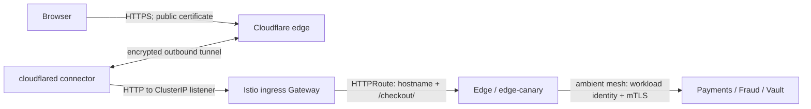

# Domains, HTTPS, gateways and the service mesh

Cloudflare supplies the public hostname and browser TLS endpoint. A platform-managed Cloudflare Tunnel brings that traffic to an internal Istio Gateway. Gateway API resources route the public checkout path; Istio ambient mTLS and identity policies protect service-to-service calls. These are separate boundaries with different owners.



## Hostname and routing ownership

| Layer | Source of truth | Responsibility |
|---|---|---|
| DNS, public certificate, tunnel credentials, `ClusterTunnel` and connector | [Platform repository](https://github.com/phuchoang2603/talos-proxmox/tree/main/apps/components/cloudflare-tunnel) | Connect to Cloudflare without exposing a public Kubernetes load balancer |
| Hostname binding and internal listener | [`ingress.yaml`](../../infra/charts/payment-gateway/templates/ingress.yaml) | App-owned `TunnelBinding` targets `http://<gateway>-istio.payment-gateway.svc.cluster.local:<port>`; `Gateway` uses class `istio`, a ClusterIP Service and an HTTP listener |
| Hostname, checkout path, headers, timeouts and backend references | [`http-route.yaml`](../../infra/charts/payment-gateway/templates/http-route.yaml) | Match the configured host and `/checkout/`; set `X-Forwarded-Proto: https`; route to stable/canary Edge |
| Public canary weights | [Rollouts strategy](../../infra/charts/payment-gateway/templates/_rollout.tpl) | Rollouts changes route weights; Argo CD ignores those controller-owned fields |
| Private service access | [`mesh.yaml`](../../infra/charts/payment-gateway/templates/mesh.yaml), [NetworkPolicy](../../infra/charts/payment-gateway/templates/network-policy.yaml) | Strict mTLS, allowed service-account identities and permitted pod connections |

Dev uses `pay-gateway-dev.phuchoang.sbs`; prod uses `pay-gateway.phuchoang.sbs`, from the [environment values](../../infra/charts/payment-gateway). A `TunnelBinding` expresses the desired route to the platform controller; application delivery does not hand-edit Cloudflare routes. The Gateway accepts HTTPRoutes only from its own namespace.

## Where encryption terminates

The browser's HTTPS connection terminates at Cloudflare. The Cloudflare-to-connector tunnel is encrypted, but the configured connector-to-Gateway target is **HTTP**, not an HTTPS origin listener. This configuration does not demonstrate TLS on every hop. The `X-Forwarded-Proto` header conveys the original scheme; it neither adds encryption nor replaces authentication. Its meaning depends on keeping the ingress path and trusted proxy configuration controlled.

Ambient mesh enrollment protects supported workload-to-workload traffic independently of the public certificate. `PeerAuthentication` requires `STRICT` mTLS and workload-selected `AuthorizationPolicy` rules allow specific identities and ports. For example, Edge is admitted by the ingress Gateway's service account; Vault admits Edge on port 8000 and processor fixture resolution on 8001.

ztunnel enforces Layer 4 identity/port policy. It does not inspect HTTP paths or methods: the ingress Gateway handles the public `/checkout/` route. An ambient Layer 7 service policy needs an appropriate waypoint and `targetRefs`; adding HTTP rules to a ztunnel-selected workload policy is not a substitute. See the [Istio ambient authorization guide](https://istio.io/latest/docs/ambient/usage/l4-policy/).

Public `/v1/payments` has no matching route and returned HTTP 404 during the recorded prod acceptance. Internal merchant callers use the stable Edge Service; a ClusterIP address alone is not an authorization control. Gateway API routing and service-mesh identities do not replace the application's integration keys and checkout-session credentials.

## Recorded verification

On 2026-11-04, two temporary ambient-mesh pods called only Vault's gRPC health RPC on port 8000. The `edge` service account received `SERVING`; `default` was denied. The receiving proxy recorded “allow policies exist, but none allowed”; the sending proxy recorded HTTP 401 with zero bytes exchanged. The allowed call recorded both workload identities and response bytes. The temporary pods and nonsecret protocol ConfigMap were removed.


This proves the tested identity/port boundary, not every route or every mesh policy. The [delivery note](cd.md#edge-progressive-delivery) owns the separate 10/25/50% canary, abort and promotion evidence. [Security and secrets](security.md) owns secret delivery and application access controls.

## Read-only checks

Select the environment's kubeconfig explicitly; for prod:

```bash
kubectl --kubeconfig ~/.kube/talos-prod.yaml -n payment-gateway get gateway,httproute,tunnelbinding
kubectl --kubeconfig ~/.kube/talos-prod.yaml -n payment-gateway get peerauthentication,authorizationpolicy,networkpolicy
curl -sS -o /dev/null -w '%{http_code}\n' https://pay-gateway.phuchoang.sbs/checkout/
```

Inspect Gateway `Accepted`/`Programmed` and route `Accepted`/`ResolvedRefs` conditions, then connector health and backend endpoints. A checkout request without session context may be rejected by the application; an HTTP status alone does not verify checkout behavior or mesh authorization. Reuse the identity-based acceptance method above to test private access without sending payment data.
