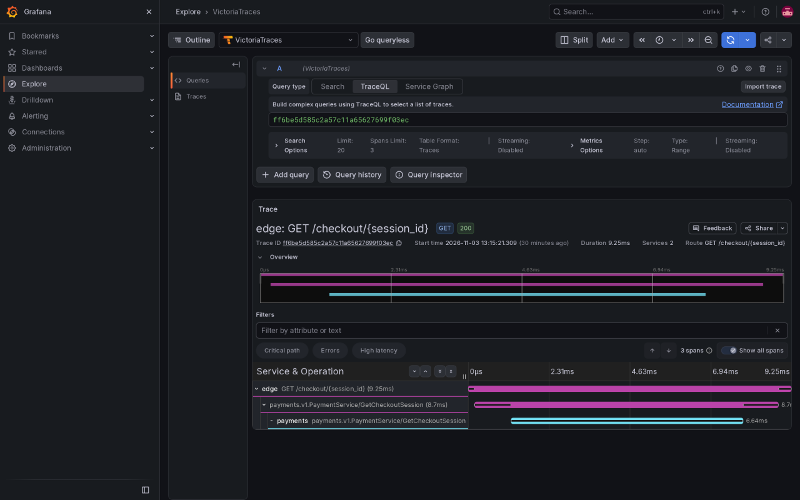
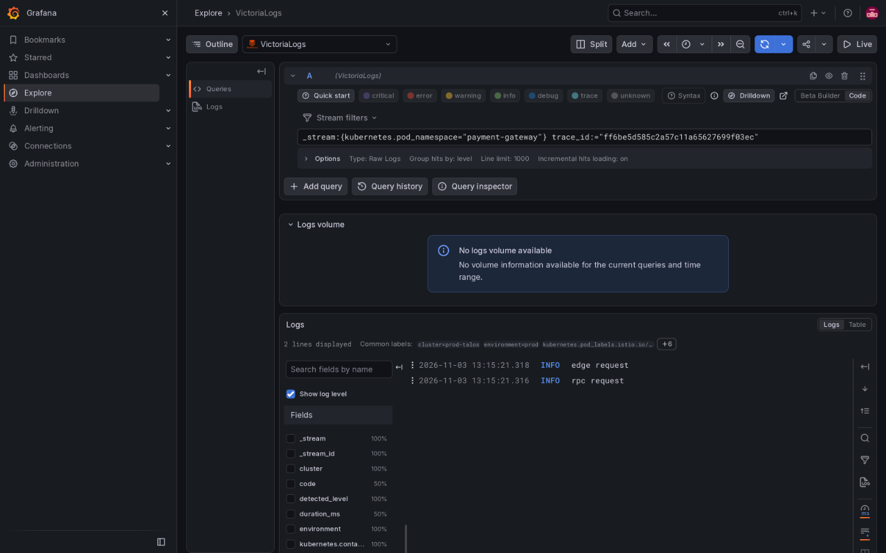
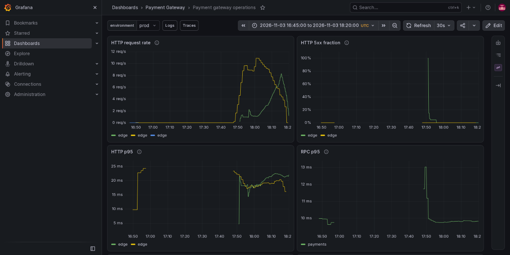
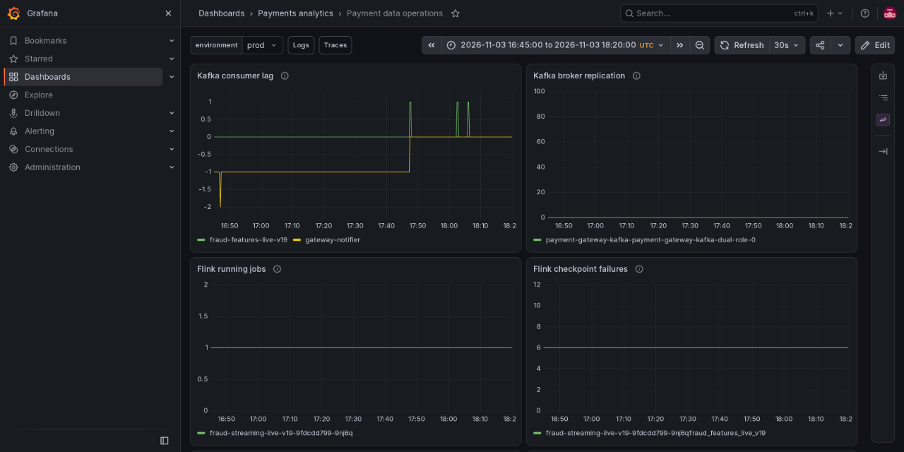
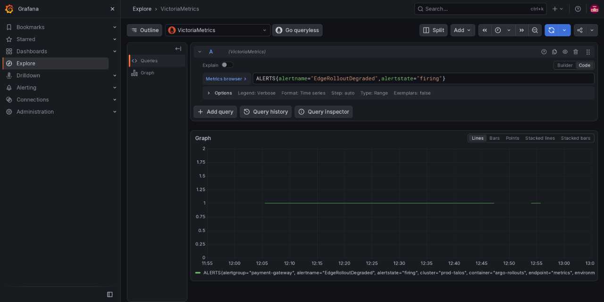
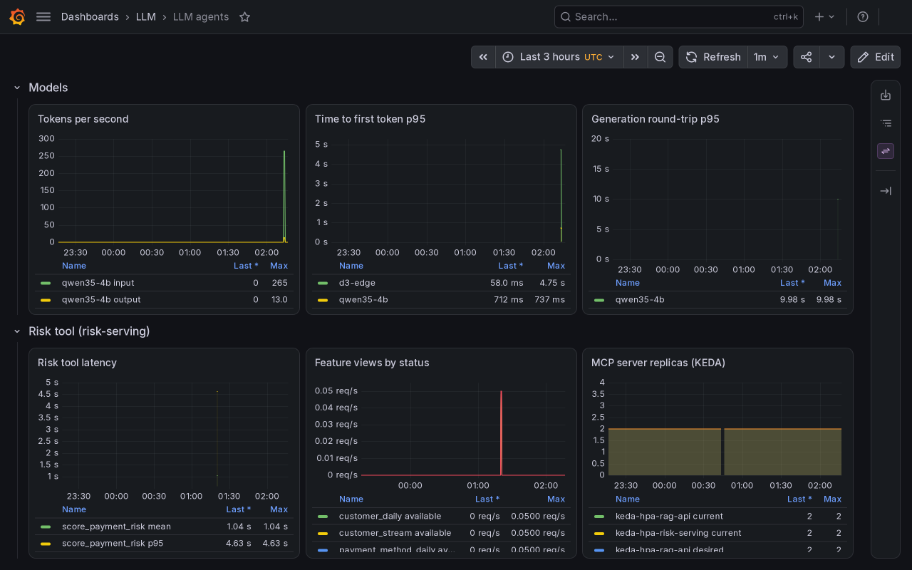

# Observability

The platform owns VictoriaMetrics, VictoriaLogs, VictoriaTraces and Grafana. Application charts own telemetry settings, dashboards and alert rules; no separate application monitoring stack is deployed.

## Collection and signals

Six Go services export metrics and traces through [`shared/observe`](../../src/payment-gateway/shared/observe) over OTLP/HTTP. JSON stdout logs carry active `trace_id`/`span_id` fields for correlation. [Chart telemetry values](../../infra/charts/payment-gateway/values.yaml) configure the shared agents, export intervals and sampling; the binaries default to disabled.

| Signal | What it measures |
|---|---|
| HTTP / gRPC | Request rate, failures and latency; business declines are successful RPCs |
| Payments / Fraud / processor | Attempt duration, pending outcomes, Redis fallback, decisions and policy duration |
| Notifier | Delivery outcomes, pending age and consumer progress |
| Kafka / Flink | Broker replication, consumer lag, running jobs and checkpoint failures through native exporters |
| Workflow / Spark / Rollout | Shared controller signals and pod state; no executor-level Spark instrumentation |

Fraud's [Feast adapter](../../src/payment-gateway/fraud/internal/adapters/feast/client.go) retrieves features; Triton calls record `fraud.model.calls`, `fraud.model.status` and `fraud.model.enforced`, with the model version and score attached to the assessment.

Trace context crosses gRPC and the Debezium event header into notifier retries. Bounded export queues/timeouts keep payment readiness and processing independent of telemetry availability. Spans exclude bodies, query strings, token-bearing paths and sensitive headers; metric labels exclude payment/customer/event IDs.

A sampled checkout GET at 18:15:21 UTC connects the Edge HTTP span, Edge gRPC client span and Payments server span in trace `ff6be5d585c2a57c11a65627699f03ec` (9.25 ms, HTTP 200). Explore displays UTC−05:00.

Filtering VictoriaLogs by that exact trace ID returns two request log entries. The separate log-volume panel has no data; the log results below it establish correlation.

## Dashboards and alerts

[Gateway dashboards](../../infra/charts/payment-gateway/dashboards) and [monitoring rules](../../infra/charts/payment-gateway/templates/monitoring.yaml) cover service operations and canary health. [Data dashboards](../../infra/charts/data-pipelines/dashboards) cover Kafka/Flink and job state. Grafana discovers their labelled ConfigMaps; VMAgent/VMAlert select application namespaces.

The gateway dashboard captures the fault spike and healthy retry over 16:45–18:20 UTC on 2026-11-03. Repeated `edge` legends represent separate series; candidate `787688ff9d` was rejected at 7.2% errors, then passed all three canary stages on retry.

Over the same window, Kafka reports zero under-replicated partitions and Flink reports one running job. The cumulative failed-checkpoint counter remains at six, with no increase in this window. Negative consumer-lag values at the start reflect uncommitted offsets.

Select the environment before comparing results. VictoriaMetrics preserves dotted OTLP names and resource labels; canary queries also select `rollout.revision`. Missing series remain **No data**, never a healthy zero.

Namespace-local rules cover sustained errors/latency, notification age, lag, failed jobs, checkpoint failures and missing signals. Shared Alertmanager currently routes to `blackhole`: alerts evaluate and are visible, but no external notifications are delivered.

Grafana Explore retains firing samples for `EdgeRolloutDegraded` during the aborted attempts (16:55–18:05 UTC; this Explore capture displays UTC−05:00). Gaps mean no firing series, not a measured zero. The rollout completed at 18:13 UTC.

## LLM metrics

vLLM, the endpoint picker, agentgateway, `rag-api` and `risk-serving` expose metrics scraped by the platform's vmagent into VictoriaMetrics. Agent traces and prompt versions go directly to [Langfuse](../llm/langfuse.md); the [custom runtime](../llm/custom-go-adk-runtime.md) implements prompt selection and trace linkage. Agentgateway exports metrics but no traces. These LLM sources export natively without an OpenTelemetry Collector.

Scrape configuration: [`infra/charts/llm-platform/templates/scrape.yaml`](../../infra/charts/llm-platform/templates/scrape.yaml) and the `VMPodScrape` in [`infra/charts/rag-pipeline/templates/api.yaml`](../../infra/charts/rag-pipeline/templates/api.yaml). The queries below run in Explore; the agent-facing ones are also on the [LLM dashboard](#llm-dashboard).

| What | Metric |
|---|---|
| Web API requests and failures | `knowledge_api_requests_total{exported_endpoint, status}` (the scrape's own `endpoint` label shadows the app's, so the path is in `exported_endpoint`) |
| MCP tool calls and failures | `knowledge_mcp_tool_calls_total{tool, outcome}`; at the gateway `agentgateway_requests_total{route="llm/mcp-knowledge"}` and `agentgateway_mcp_requests_total` |
| Requests per route, keys refused, rate-limited | `agentgateway_requests_total{route, status}` |
| Tokens per request (input, output) | `agentgateway_gen_ai_client_token_usage` |
| Round-trip time of a generation | `agentgateway_gen_ai_server_request_duration` |
| Time to first token, inter-token latency, queue, KV cache | `vllm:time_to_first_token_seconds`, `vllm:inter_token_latency_seconds`, `vllm:num_requests_waiting`, `vllm:kv_cache_usage_perc` |
| Prompts caught by PII masking | `agentgateway_guardrail_checks_total{action, phase}` |

Current dev captures are kept with the components they describe: [gateway routing](../llm/gateway-and-jev-policy.md#routes), [Jev screening and PII guard decisions](../llm/gateway-and-jev-policy.md#screening-and-pii), and [model time to first token](../llm/inference.md#checks-on-dev).

The risk server exports `risk_mcp_tool_calls_total{tool,outcome}`, `risk_tool_latency_seconds{tool}` and `risk_view_status_total{view,status}`. Tool failures are counted even when MCP transports the error with HTTP 200.

### LLM dashboard

The "LLM agents" dashboard ([`files/dashboards/llm-agents.json`](../../infra/charts/llm-platform/files/dashboards/llm-agents.json)) shows A2A calls and failures per agent route, MCP tool calls by outcome, screen route calls, guard checks and screen latency, and the model's tokens, time to first token and round-trip. Its MCP panels count the knowledge and risk servers, and a Risk tool row shows the tool's mean and p95 latency, the feature view statuses, and an Autoscaling row with the KEDA replicas of both MCP servers and the agent worker pool. The ConfigMap carries the `grafana_folder` annotation from `dashboards.folder`, so the dashboard lands in the `LLM` folder like the other components' dashboards. On dev, `score_payment_risk` read 1.04 s mean and 4.63 s p95 over the 3 hours shown, every feature view `available`, and 2 replicas for both MCP servers:

