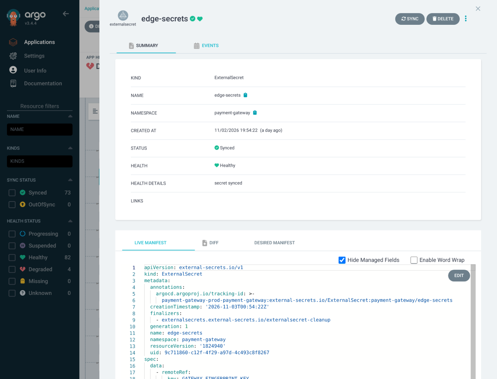

# Security and secrets

## Central secret delivery

Doppler → External Secrets → Kubernetes Secret → workload `secretKeyRef`. Credentials stay in Doppler; endpoints, bucket names and other nonsecret settings stay in [chart values](../../infra/charts).

| Configuration | Source |
|---|---|
| `gateway-doppler` store, project `payment-gateway-fraud-detection`, configs `dev` / `prd` | [SecretStore template](../../infra/charts/secret-store/templates/secret-store.yaml), [prod values](../../infra/charts/secret-store/values-prod.yaml) |
| Database, Redis, encryption, integration and object-storage key mappings | [Gateway ExternalSecrets](../../infra/charts/payment-gateway/templates/external-secrets.yaml), [database secrets](../../infra/charts/payment-gateway/templates/database-external-secrets.yaml), [service values](../../infra/charts/payment-gateway/values.yaml) |
| LLM/RAG client keys and backing-service credentials | [LLM chart](../../infra/charts/llm-platform), [RAG chart](../../infra/charts/rag-pipeline) |

Bootstrap `payment-gateway/doppler-token` (`dopplerToken`) from a read-only token for the environment. The store restricts eligible namespaces. After rotation, restart affected workloads so environment variables refresh, using a new Edge Rollout revision when its environment changes.

One storage identity per environment serves the generator, Flink, lakehouse and metadata jobs. Prod uses GCS HMAC keys for the shared bucket; `datasets/`, `runs/` and `lakehouse/` prefixes are conventions, not authorization boundaries.

On 2026-11-04, all 20 gateway ExternalSecrets reported `SecretSynced`, `Ready=True`. Argo CD shows `edge-secrets` Synced/Healthy with “secret synced”; the capture displays metadata and readiness, without credential values.

## Access boundaries

- [Istio policies](../../infra/charts/payment-gateway/templates/mesh.yaml) enforce strict mTLS and service-account authorization. Vault admits Edge on port 8000 and processor resolution on 8001.
- [Network policies](../../infra/charts/payment-gateway/templates/network-policy.yaml) restrict pod traffic; [database policies](../../infra/charts/payment-gateway/templates/database-network-policy.yaml) isolate database access.
- Each service owns a database with separate migration/runtime roles; Payments CDC has a replication identity.

The allowed/denied service-account test and its access-log proof are maintained in [Networking](networking.md#where-encryption-terminates), alongside the public TLS and ingress boundaries.

Card data is synthetic. The vault encrypts fictional fixtures and issues opaque tokens; raw card data stays out of logs, events, Fraud, Redis and the lake. This demonstrates PCI DSS-oriented isolation, not compliance.

## Gateway access controls

Hosted checkout uses session-bound credentials; internal merchant calls use integration API keys hashed with SHA-256.

| Surface | Authentication and policy |
|---|---|
| Models, MCP tools and agents | agentgateway: per-client API keys, rate/token limits and mesh-only backend access; dev checks returned 401 without a key and 20 × 429 in a 160-request burst |
| Grafana and other platform UIs | Platform-owned access configuration in [`talos-proxmox/apps`](https://github.com/phuchoang2603/talos-proxmox/tree/main/apps) |

A dedicated feature-API gateway rate-limit acceptance remains missing.
