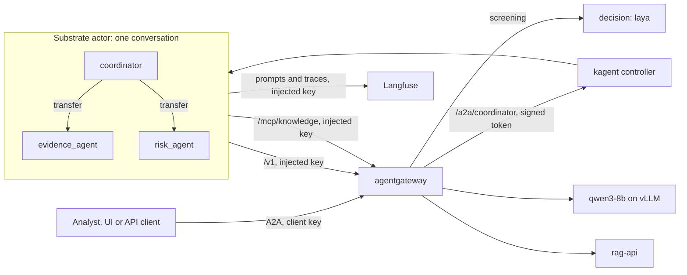
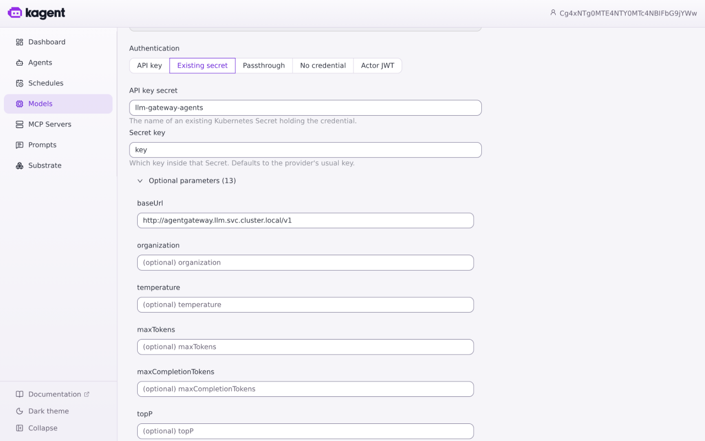
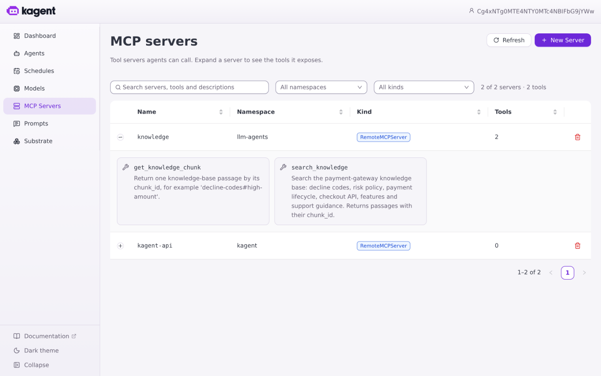
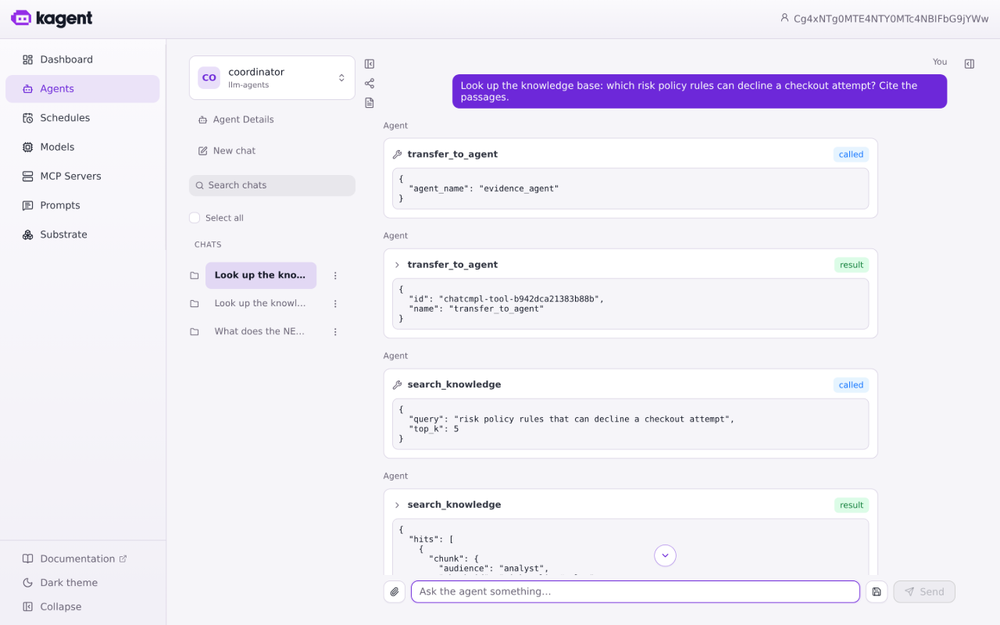
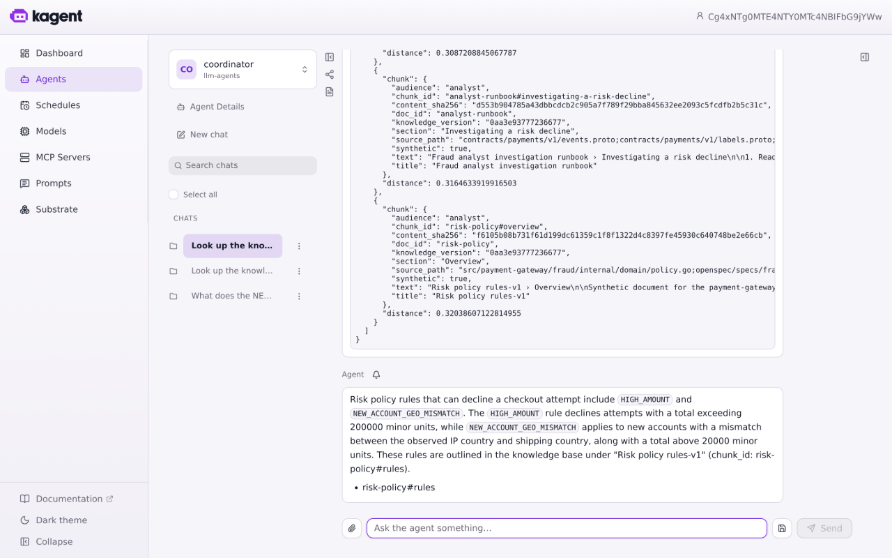
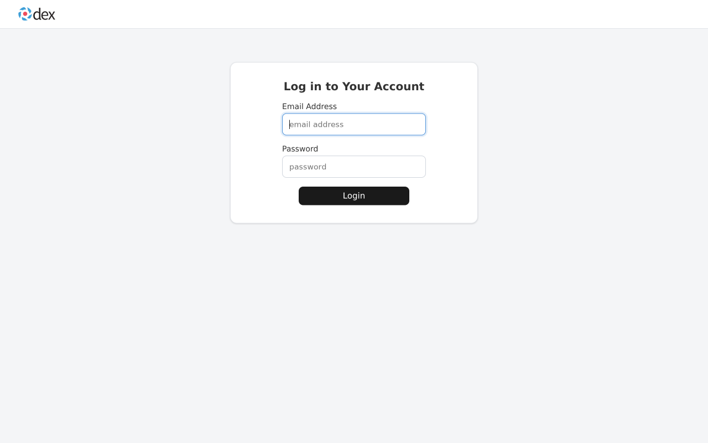
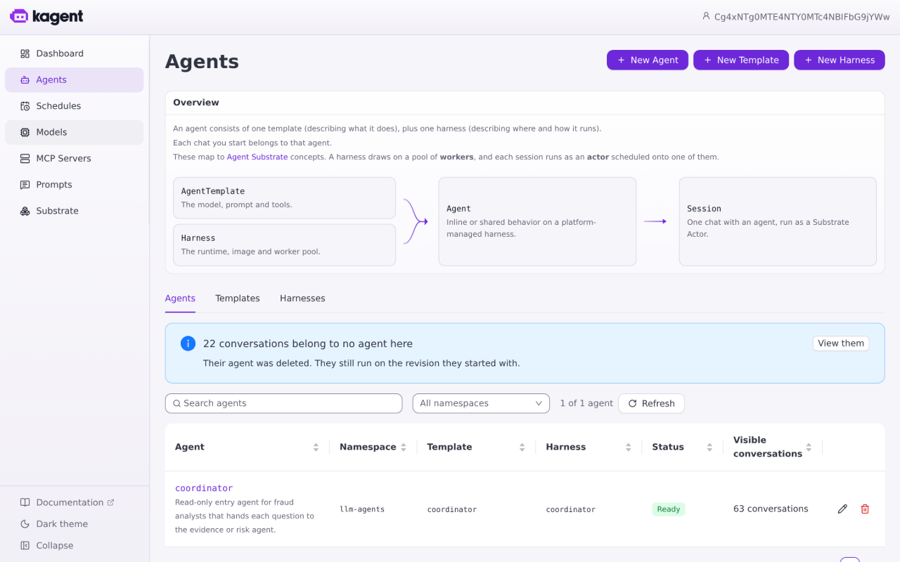
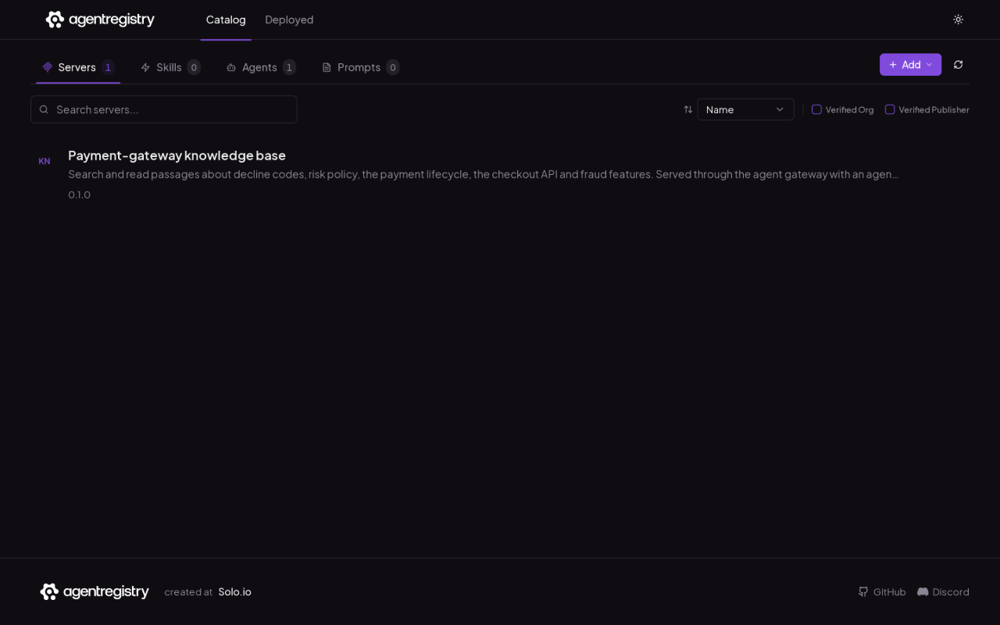
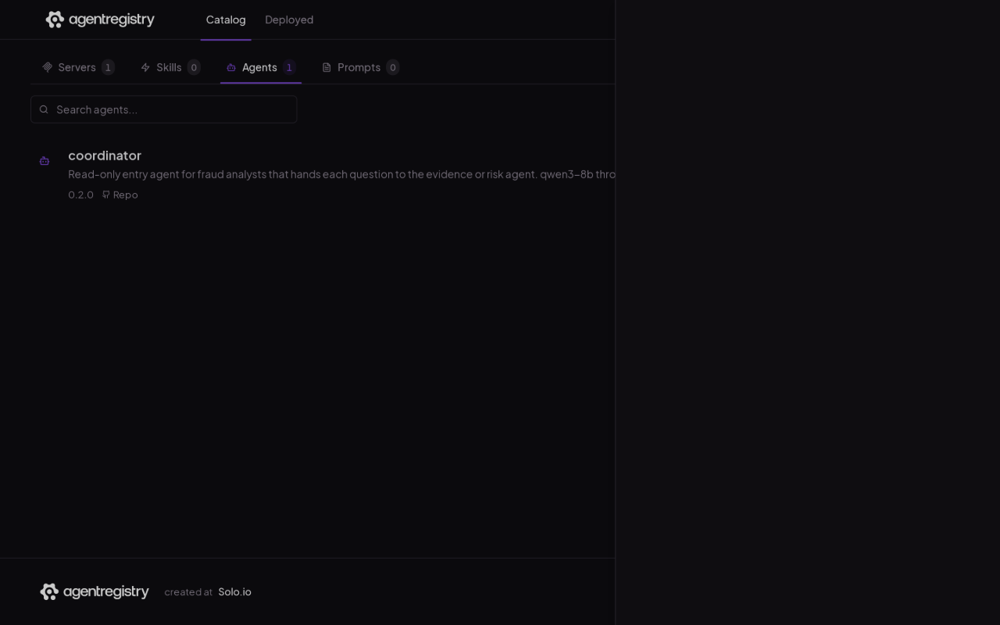

# LLM agents

Fraud analysts ask an agent about decline codes, risk decisions and payment behaviour; it answers from the knowledge base and cites the passages it used. Agents are read-only: they cannot change risk decisions, retry payments, issue refunds or promote models, and they never sit in the payment decision path.

**Status:** built and running on dev: the `coordinator` entry agent with the `evidence-agent` and `risk-agent` sub-agents, the A2A route, prompts and A/B tests in Langfuse, and request screening. The prod platform is ready; the app reaches prod with the release after the merge.

- Chart: [`infra/charts/llm-platform`](../../infra/charts/llm-platform): [`agents.yaml`](../../infra/charts/llm-platform/templates/agents.yaml) (model config, MCP servers, templates, the entry agent, worker pool and its autoscaler), [`a2a.yaml`](../../infra/charts/llm-platform/templates/a2a.yaml) (the A2A route), [`catalog.yaml`](../../infra/charts/llm-platform/templates/catalog.yaml) and [`files/catalog.py`](../../infra/charts/llm-platform/files/catalog.py) (registry, prompt seeds), prompt seeds in [`files/prompts/`](../../infra/charts/llm-platform/files/prompts).
- Runtime: kagent 1.0.0-rc1 with Agent Substrate 1.0.0-rc1, installed by the platform; the agent runtime image is [`src/llm/agent_runtime`](../../src/llm/agent_runtime).

## Who does what

| Component | Owns |
|---|---|
| kagent | Defining agents: model config, templates, tools, sub-agents, UI chat, the public A2A endpoint |
| Agent Substrate | Running them: one gVisor actor per conversation, suspended to a snapshot when idle and resumed on any worker; the egress gateway that injects credentials |
| Agent runtime (ours) | kagent's Go ADK runtime plus a Langfuse plugin: each model call's system prompt and A/B variant from Langfuse, linked to the trace |
| agentgateway | Every A2A, model and tool call: keys, limits, screening, PII masking ([gateway](gateway.md)) |
| `rag-api` | The knowledge tools; their list lives in its code ([RAG](rag.md)) |
| Langfuse | The prompts, their versions and A/B tests, and the agents' traces ([observability](observability.md#langfuse)) |
| agentregistry | The catalog of agents and MCP servers |

## Global model config

One kagent `ModelConfig`, `default-model-config`, used by every agent: provider OpenAI, model `qwen3-8b`, the agents' gateway key, and the gateway's `/v1` route as base URL. Changing the model, the gateway or the key for all agents is one edit. Its sampling settings are the ones every agent uses; kagent's Go runtime takes them only from here, so A/B variants differ by prompt text.

## Agents

| Agent | Deployed as | Tools | Role |
|---|---|---|---|
| `coordinator` 0.2.0 | kagent `Agent` behind `/a2a/coordinator` | sub-agents `evidence_agent`, `risk_agent` | Entry agent: hands each question to the specialist that owns it |
| `evidence-agent` 0.3.0 | `AgentTemplate`, compiled into the coordinator | `knowledge` MCP server | Explains declines, policy and payment behaviour from the knowledge base, citing chunk ids |
| `risk-agent` 0.1.0 | `AgentTemplate`, compiled into the coordinator | none yet | Assesses the risk of one payment, card or customer; the scoring tool is a later change |

The specialists are kagent Shared sub-agents: `subAgent` bindings compile their templates into the coordinator's runtime, and the coordinator transfers the conversation to one of them, which answers the analyst. A conversation is one actor and one trace, with no second network hop. Callers reach agents only through the gateway's A2A route ([gateway](gateway.md#routes)).

The `evidence-agent` template references the `knowledge` server without a tool list, so it gets every tool the server lists; kagent discovers them:

A chat in the kagent UI on dev (2026-10-31): the coordinator transfers to `evidence_agent`, which calls `search_knowledge` through the gateway,

and answers from the passage it found, citing its chunk id:

The kagent UI is published by the platform behind its Dex login:

## Runtime

Every agent runs one image, [`src/llm/agent_runtime`](../../src/llm/agent_runtime): kagent's own Go ADK entrypoint, pinned to the kagent v1.0.0-rc1 commit, with one ADK plugin added. Before each model call the plugin reads the calling agent's prompt, `<agent>-system-prompt`, from Langfuse (cached for 60 s, the last version kept if Langfuse is unreachable), picks the A/B variant for the conversation and puts the prompt first in the system instruction. It also links the model call's span to that prompt version and tags the trace with the agent's side of its test ([observability](observability.md#ab-tests)).

The runtime holds no credentials. The model key, the MCP key and the Langfuse key are placeholders that Substrate's egress gateway replaces on the way out, from Secrets named in each agent's `EgressPolicy` and `ModelConfig`; the gateway admits the egress gateway by its mesh identity.

## Sandbox, warm start and autoscaling

Agents run on Agent Substrate in their own namespace, `llm-agents` (Pod Security `privileged`, outside the mesh, created by the platform):

- **Isolation.** Each conversation is its own gVisor actor. Its only way out is Substrate's egress gateway, which carries every connection and injects the credentials.
- **Warm start.** Each agent revision has a golden snapshot. A new conversation is restored from it in about 1 s and its runtime is ready 2 to 7 s later (fresh process start; 4.6 s on average over six cold conversations). Substrate's router waits up to 30 s for a waking conversation, so the first message is accepted: 6 of 6 cold conversations on 2026-10-31. An idle conversation is snapshotted and suspended, taking no worker, and resumes on any worker with its context.
- **Reservation.** kagent books 250m CPU and 256Mi per actor (platform `runtimeDefaults`), plus Substrate's overhead, against a worker's 2Gi limit, so a worker holds several conversations.
- **Autoscaling.** KEDA scales the WorkerPool from 2 to 6 workers on Substrate's own metric, the number of workers that are partly or fully booked (`ate_workerpool_workers{ate_worker_state=~"partial|at_capacity"}`), 0.7 per worker. Argo CD leaves the pool's `replicas` to KEDA.

Twelve conversations sent at once to the two-worker pool (2026-10-31):

| | |
|---|---|
| Workers | 2 → KEDA asked for 3 at 56 s, Ready at 78 s |
| Conversations accepted on the first message | 12 of 12 |
| Time to the full answer | 79 to 123 s, median 112 s (the shared GPU is the limit) |

## Registry

The release catalog job publishes the entry agents and the MCP servers from the chart values to agentregistry. The coordinator's entry names its sub-agents and lists the MCP servers they use; prompts are in Langfuse and tools come from the servers.

## Prompts and A/B tests

Langfuse is the source of each agent's system prompt and A/B test. [`files/prompts/<agent>.md`](../../infra/charts/llm-platform/files/prompts) and the agent's `abTest` in the values only seed a prompt that Langfuse does not have yet; after that, prompts are edited, versioned and tested in Langfuse, and the next conversation uses the new version without a release ([observability](observability.md#langfuse)).

## Autoscaling

| Workload | Mechanism | Why |
|---|---|---|
| Agent conversations | Substrate actors: created on demand, suspended to zero when idle, resumed on any worker | Idle conversations cost nothing; any number wait in snapshots |
| Agent worker pool (`llm-agents`) | KEDA, 2 to 6 workers on Substrate's busy-worker metric | Workers follow the conversations that hold them |
| Knowledge API (`rag-api`) | KEDA, 2 to 4 replicas on its combined REST and MCP request rate | See [RAG](rag.md#load-test-and-autoscaling) |
| Model servers | One replica per model | One GPU per environment |

## Known limits

- qwen3-8b sometimes answers an evidence question without calling the knowledge tools; the answer then has no citation. A question that asks for the passages makes it search.
- In one of 16 conversations sent four at a time, the first message was refused ("retry after the session becomes available"), and one UI chat lost its stream after the tool result. A retry answered both.
