# LLM agents

Fraud analysts ask an agent about decline codes, risk decisions and payment behaviour; it answers from the knowledge base and cites the passages it used. Agents are read-only: they cannot change risk decisions, retry payments, issue refunds or promote models, and they never sit in the payment decision path.

**Status:** built and running on dev: the `coordinator` entry agent with the `evidence-agent` and `risk-agent` sub-agents, the A2A route and request screening. Prod configuration targets the GCP GPU pool; the dev captures below do not establish production readiness.

- Chart: [`infra/charts/llm-platform`](../../infra/charts/llm-platform): [`agents.yaml`](../../infra/charts/llm-platform/templates/agents.yaml) (model config, MCP servers, templates, the entry agent, worker pool and its autoscaler), [`a2a.yaml`](../../infra/charts/llm-platform/templates/a2a.yaml) (the A2A route), [`catalog.yaml`](../../infra/charts/llm-platform/templates/catalog.yaml) and [`files/catalog.py`](../../infra/charts/llm-platform/files/catalog.py) (registry, prompt seeds), prompt seeds in [`files/prompts/`](../../infra/charts/llm-platform/files/prompts).
- Runtime: kagent 1.0.0-rc1 with Agent Substrate 1.0.0-rc1, installed by the platform; the agent runtime image is [`src/llm/agent_runtime`](../../src/llm/agent_runtime).

## Who does what

| Component | Owns |
|---|---|
| kagent | Defining agents: model config, templates, tools, sub-agents, UI chat, the public A2A endpoint |
| Agent Substrate | Running them: one gVisor actor per conversation, suspended to a snapshot when idle and resumed on any worker; the egress gateway that injects credentials |
| Agent runtime (ours) | kagent's Go ADK runtime plus a Langfuse plugin: each model call's system prompt and A/B variant from Langfuse, linked to the trace |
| agentgateway | Every A2A, model and tool call: per-client keys, request/token limits, action/jailbreak screening and PII masking |
| `rag-api` | `search_knowledge` and `get_knowledge_chunk`, discovered through MCP `tools/list` |
| `risk-serving` | `get_risk_features` and `score_payment_risk`, reading Feast and calling Triton |
| [Langfuse](langfuse.md) | Prompt management and agent traces |
| agentregistry | The catalog of agents and MCP servers |

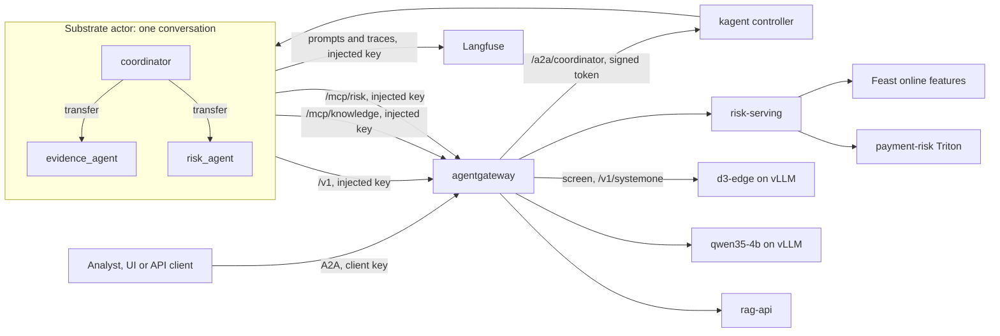

## Global model config

One kagent `ModelConfig`, `default-model-config`, used by every agent: provider OpenAI, model `qwen35-4b` with the model card's non-thinking sampling, the agents' gateway key, and the gateway's `/v1` route as base URL. Changing the model, the gateway or the key for all agents is one edit. Its sampling settings are the ones every agent uses; kagent's Go runtime takes them only from here.

The [gateway note](gateway-and-jev-policy.md#routes) shows the shared base URL and credential Secret in the kagent model configuration.

[`agents.yaml`](../../infra/charts/llm-platform/templates/agents.yaml) generates this shared base URL and binds the ModelConfig to every template. Dev calls through this gateway returned chat completions and 1024-dimensional embeddings; direct model access from an unapproved pod was reset. A new end-to-end proof still needs one trace matched to gateway route counters.

## Agents

| Agent | Deployed as | Tools | Role |
|---|---|---|---|
| `coordinator` 0.2.0 | kagent `Agent` behind `/a2a/coordinator` | sub-agents `evidence_agent`, `risk_agent` | Entry agent: hands each question to the specialist that owns it |
| `evidence-agent` 0.3.0 | `AgentTemplate`, compiled into the coordinator | `knowledge` MCP server | Explains declines, policy and payment behaviour from the knowledge base, citing chunk ids |
| `risk-agent` 0.2.0 | `AgentTemplate`, compiled into the coordinator | `risk` MCP server | Reads online features and re-scores supplied payment inputs with the served fraud model; drivers are not attributions |

The specialists are kagent Shared sub-agents: `subAgent` bindings compile their templates into the coordinator's runtime, and the coordinator transfers the conversation to one of them, which answers the analyst. A conversation is one actor and one trace, with no second network hop. Callers reach agents only through the gateway's `/a2a/coordinator` route.

### Evidence agent

The `evidence-agent` template references the `knowledge` server without a tool list, so it gets every tool the server lists; kagent discovers them:

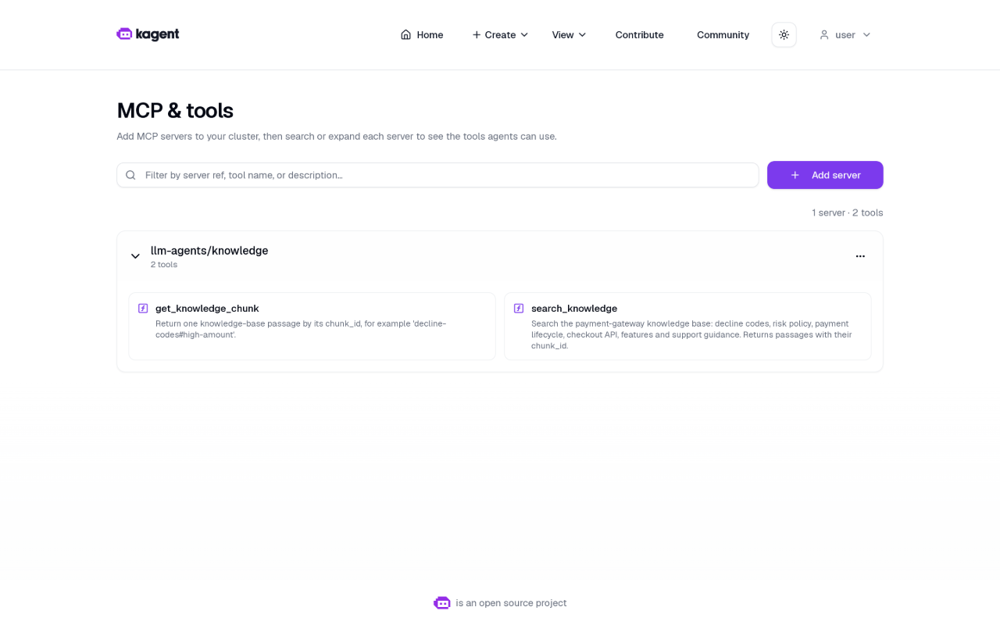

A chat in the kagent UI on dev (2026-10-31): the coordinator transfers to `evidence_agent`, which calls `search_knowledge` through the gateway,

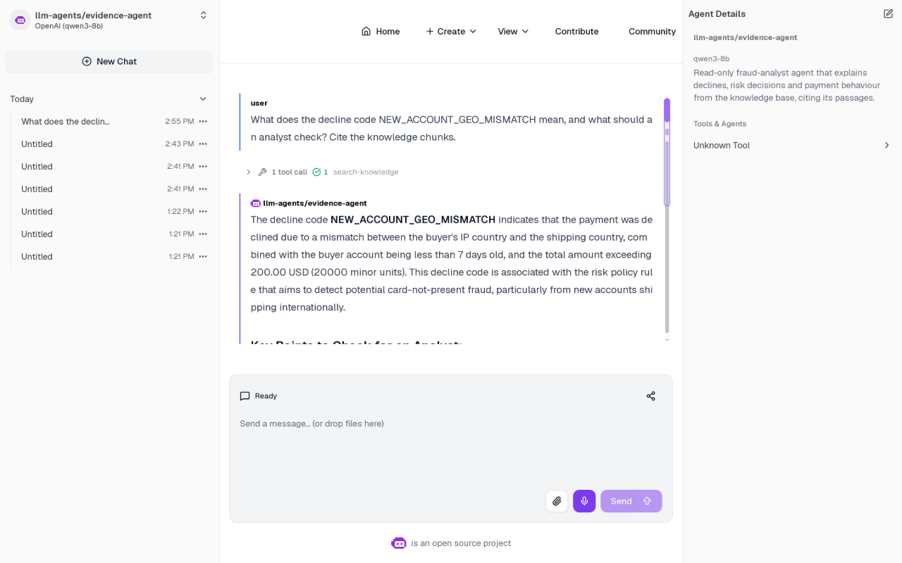

and answers from the passage it found, citing its chunk id:

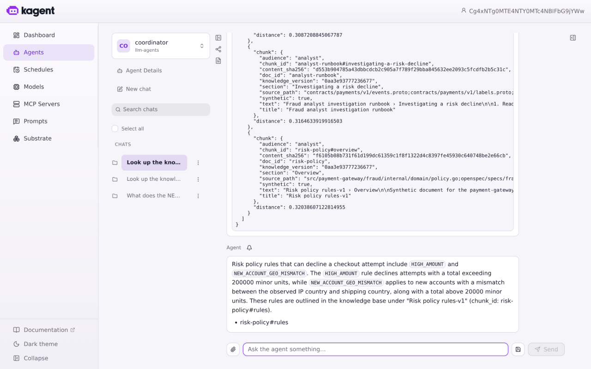

The kagent UI is published by the platform behind its Dex login:

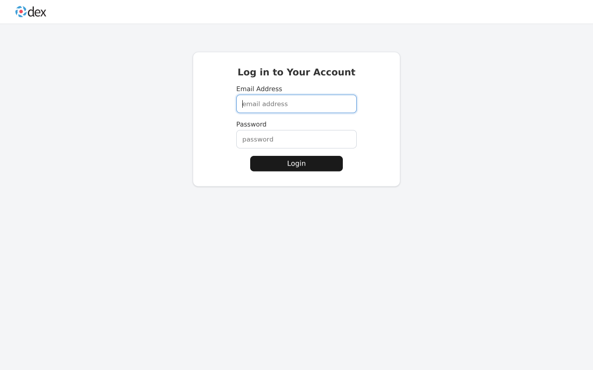

### Risk agent

`risk-agent` 0.2.0 re-scores a payment with the served fraud model through the `risk` MCP server at `/mcp/risk`. Both environments render the same tools and prompt; the evidence below is from dev. The tool takes a `request` object (`integration_id`, `customer_id`, `payment_method_fingerprint`, `amount_minor`, both account-creation timestamps, `shipping_country`, `ip_country`, `item_count`, `has_device`) and sets the scoring time itself, so the result is a what-if re-score, not a stored decision.

- `get_risk_features` returns the five `payment_risk_v1` views, each with a status (`available`, `missing`, `future`, `expired`, `error`, `timeout`) and values only when `available`.
- `score_payment_risk` returns the probability, model version, decline threshold, `at_or_above_decline_threshold`, the view statuses and the drivers. Unavailable views contribute NaN to Triton, and an upstream error returns no score.
- Drivers rank feature gain times distance from the training reference distribution. They are not per-prediction attributions, and a reference from another model version yields none.
- Results carry at most four decimals, because the gateway masks any run of 13 or more digits as a card number.

At 02:12 UTC on 2026-11-05 a dev chat sent the coordinator an analyst question with a customer and fingerprint. It transferred to `risk_agent`, which called both tools with the fingerprint unchanged:

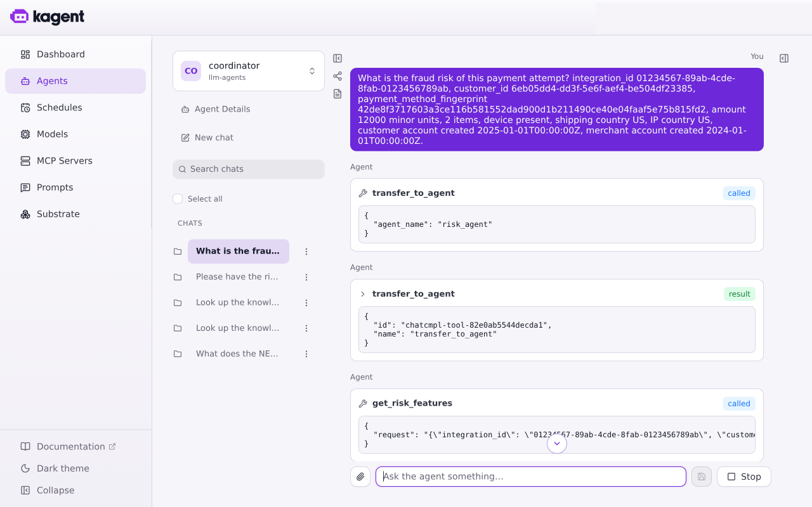

The result is model v5, a score of 0.0006 against the decline threshold 0.8597, `at_or_above_decline_threshold` false, and five drivers led by `customer_snapshot_attempt_count_1h` (34.57% of the ranking) and `amount_minor` (31.92%). The v4 reference had recorded no feature gains because the trainer did not name its features; a dev retrain after the fix registered v5 with gains for 48 of its 50 features.

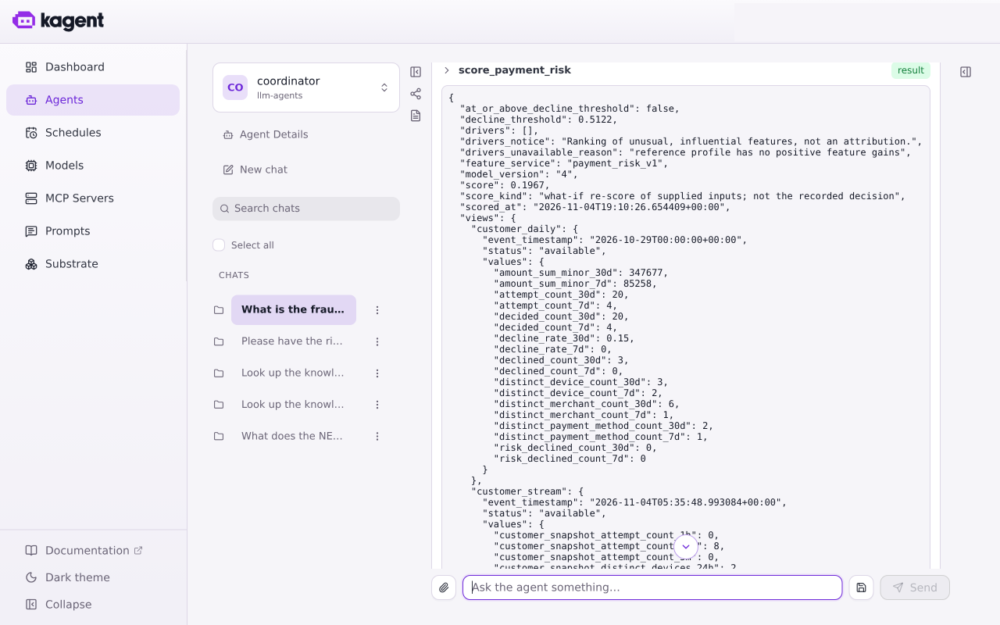

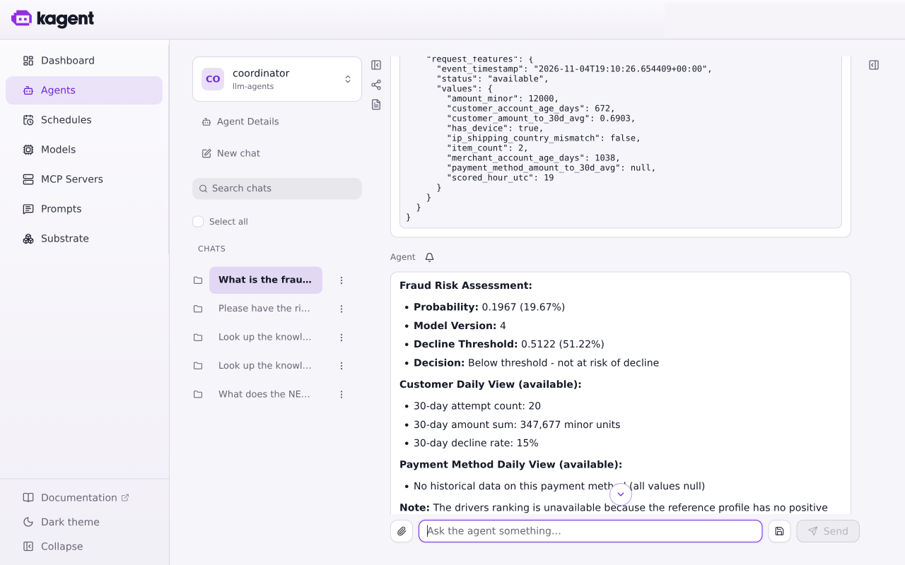

The [Langfuse trace evidence](langfuse.md#traces) records both tools between model calls; the [runtime note](custom-go-adk-runtime.md#evidence-and-limits) shows the retry’s transfer and prompt-version linkage.

Its releases and scaling are in [Scaling](scaling.md). A gateway call returned 401 without a key, listed both tools and scored a dev customer with all five views `available` (748 ms cold, 256 ms warm).

A retry on 2026-11-05 at 06:04 UTC returned score 0.0006 from model v5 against threshold 0.8597, with both stream views correctly marked `expired`. In the same conversation, a later policy question transferred to `evidence_agent`, which retrieved `decline-codes#new-account-geo-mismatch` and `risk-decision#requirements-requirement-rules-baseline-policy` and cited them:

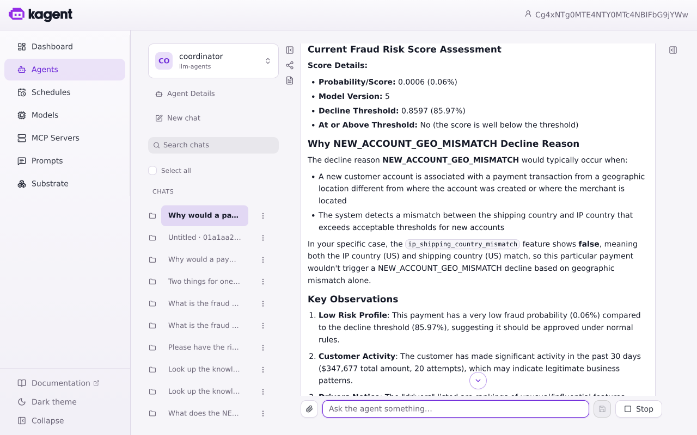

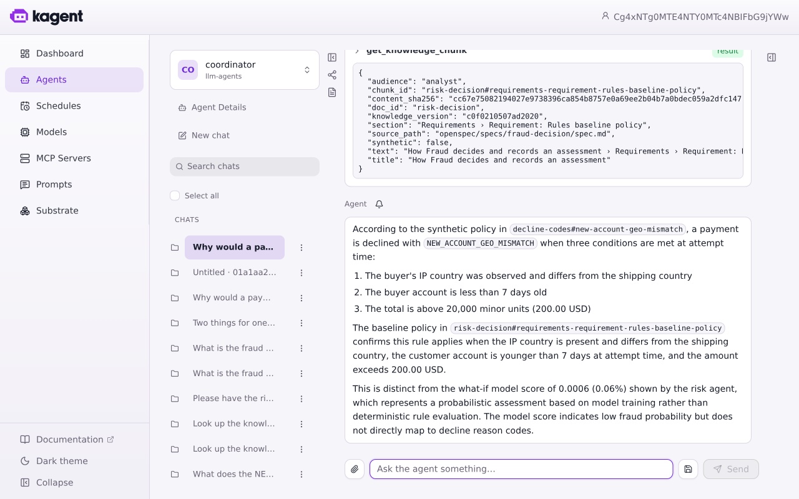

Pending: answer quality still needs evaluation; the risk answer rendered 347677 minor units as dollars, described expired stream values as uncaptured and explained the policy before retrieving evidence. The first explicit transfer follow-up was rejected by the gateway's request-screening webhook with HTTP 403; a plain policy question succeeded.

Prompt-version evidence for the retry is in [Langfuse](langfuse.md#prompts).

## Runtime

Every agent runs the project's [custom Go ADK runtime (novel)](custom-go-adk-runtime.md): kagent's pinned Go entrypoint with a Langfuse prompt plugin and prompt-version trace linkage. That note covers prompt selection, credential delivery, evidence and limits.

## Sandbox, warm start and autoscaling

Agents run on Agent Substrate in their own namespace, `llm-agents` (Pod Security `privileged`, outside the mesh, created by the platform):

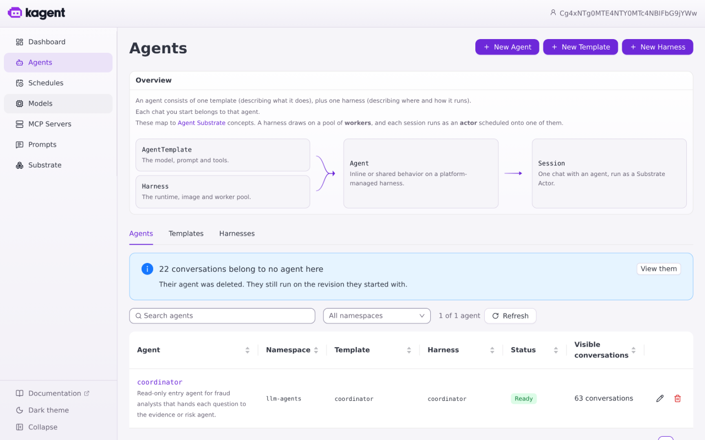

- **Isolation.** Each conversation is its own gVisor actor. Its only way out is Substrate's egress gateway, which carries every connection and injects the credentials.
- **Warm start.** Each agent revision has a golden snapshot. A new conversation is restored from it in about 1 s and its runtime is ready 2 to 7 s later (fresh process start; 4.6 s on average over six cold conversations). Substrate's router waits up to 30 s for a waking conversation, so the first message is accepted: 6 of 6 cold conversations on 2026-10-31. An idle conversation is snapshotted and suspended, taking no worker, and resumes on any worker with its context.
- **Reservation.** kagent books 250m CPU and 256Mi per actor (platform `runtimeDefaults`), plus Substrate's overhead, against a worker's 2Gi limit, so a worker holds several conversations.
- **Autoscaling.** KEDA scales the WorkerPool from 2 to 6 workers; the metric, target and a run are in [Scaling](scaling.md#agent-worker-pool).

## Registry

The release catalog job publishes the entry agents and the MCP servers from the chart values to agentregistry. The coordinator's entry names its sub-agents and lists the MCP servers they use; prompts are in Langfuse and tools come from the servers.

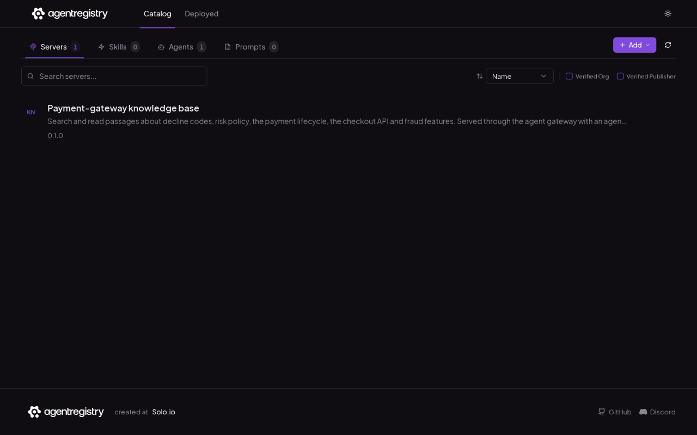

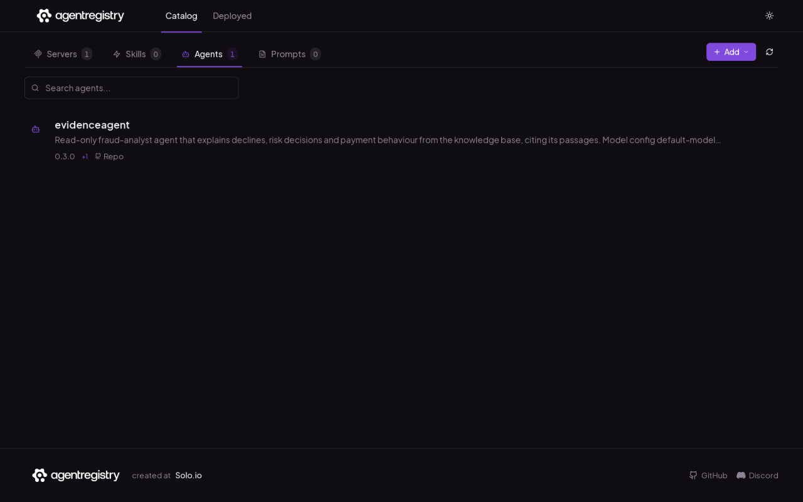

Prompt management, A/B comparisons and trace details are documented in [Langfuse](langfuse.md).

## Known limits

- The chat model sometimes answers an evidence question without calling the knowledge tools; the answer then has no citation. A question that asks for the passages makes it search.
- In one of 16 conversations sent four at a time, the first message was refused ("retry after the session becomes available"), and one UI chat lost its stream after the tool result. A retry answered both.
