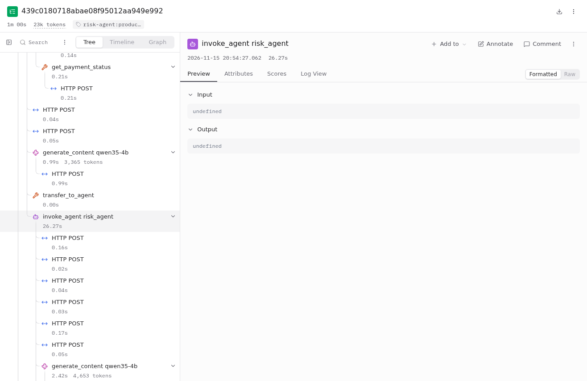
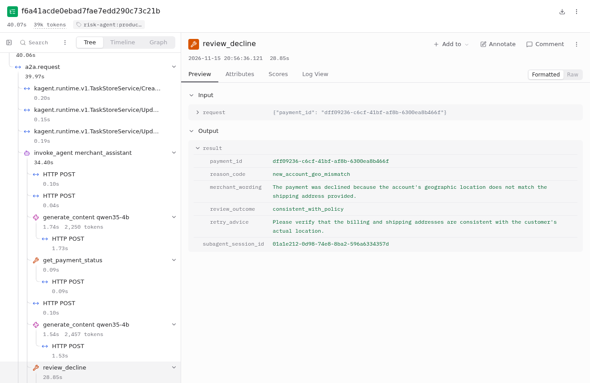
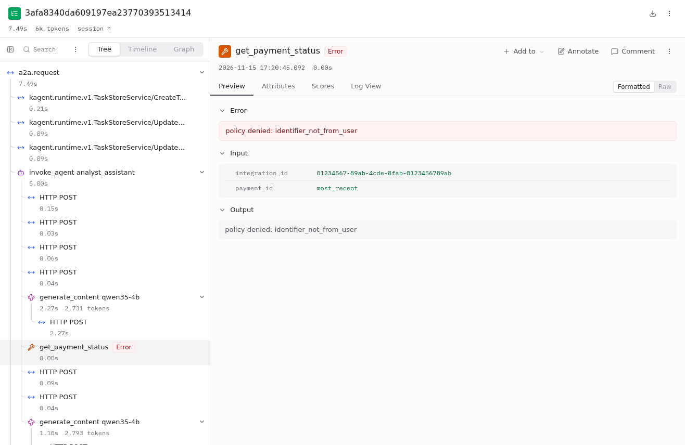
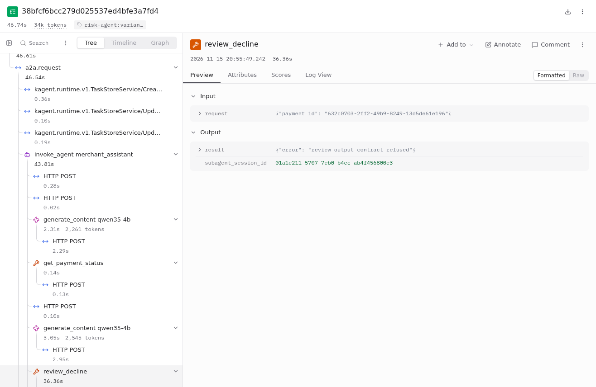
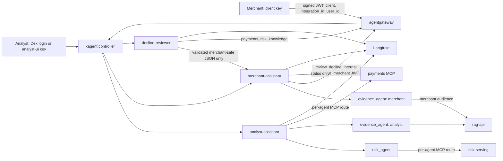

# LLM agents

Fraud analysts ask an agent about decline codes, risk decisions and payment behaviour; it answers from the knowledge base and cites the passages it used. Agents are read-only: they cannot change risk decisions, retry payments, issue refunds or promote models, and they never sit in the payment decision path.

**Status:** `analyst-assistant`, `merchant-assistant` and the internal `decline-reviewer` run on dev. The merchant review completes in 7 of 10 runs; answer quality is not established.

### Entry agents on dev

Measured on dev on 2026-11-16 with the Qwen3.5-4B chat model:

| Check | Result |
|---|---|
| Analyst question on a risk-declined payment | `get_payment_status`, `get_attempt_risk_inputs`, transfer to `risk_agent`, `get_risk_features`, `score_payment_risk`; recorded inputs and a fresh score (0.4288 against the 0.7737 decline threshold) returned |
| Merchant question on a declined payment | `get_payment_status`, then `review_decline` over the internal A2A route; the answer carries the review outcome and no score |
| 10 merchant decline questions, sequential, counted from the `review_decline` result in Langfuse | 7 of 10 reviews completed, p50 59.6 s, p95 86.2 s. With `risk_agent` and `evidence_agent` as the reviewer's sub-agents: 4 of 10, p50 53.6 s, p95 64.2 s |
| Why reviews did not complete | An earlier run completed 5 of 10: the risk tool's feature-store read was reset while the single-replica Feast server rolled (it now runs two replicas and rolls without a gap), the 4B model asked the merchant for an integration id (the runtime now removes bound arguments from the tool schemas the model sees), and the model answered outside the JSON contract, which the runtime refuses. With sub-agents, `risk_agent` answered in prose instead of transferring back, so the reviewer produced no JSON. Calling the tools itself, without thinking, the reviewer reasoned in prose before the JSON or kept looking up knowledge: 2 of 10. With thinking on its route, the three misses ended with an empty answer after the reasoning |
| Jev screen and the review request | The review request `{"payment_id": …}` scores 0.88 as a jailbreak, so `decline-reviewer`, which only `merchant-assistant` calls, has its own model route without the screen ([routes](gateway-and-jev-policy.md#request-screening)). On dev, an analyst jailbreak, an analyst request to approve and override a decision and a merchant jailbreak each got a 403 from the gateway; an ordinary analyst question passed |

The analyst's trace in Langfuse shows `get_payment_status`, the transfer to `risk_agent` and its 26 s run:

The merchant's trace shows `get_payment_status`, then `review_decline` returning only the five contract fields and the isolated session id:

### Policy denials

The runtime refuses before a tool runs or a result leaves, and records the refusal on the trace. Both refusals below came from the 4B model's own behaviour on dev:

- A model-invented identifier: it called `get_payment_status` with `payment_id` `most_recent`; the policy refused it with `identifier_not_from_user`, and the model asked the user for the id.

  

- A review request outside the input contract: asked to add `"order_ref": "A-4471"`, `merchant-assistant` sent it in the `review_decline` request; `decline-reviewer` returned the fixed `review input contract refused` before its model ran.
- An answer outside the output contract: `review_decline` returned the fixed `review output contract refused` and nothing else.

  

- Chart: [`infra/charts/llm-platform`](../../infra/charts/llm-platform): [`agents.yaml`](../../infra/charts/llm-platform/templates/agents.yaml) (model config, MCP servers, templates, the entry agent, worker pool and its autoscaler), [`a2a.yaml`](../../infra/charts/llm-platform/templates/a2a.yaml) (the A2A route), [`catalog.yaml`](../../infra/charts/llm-platform/templates/catalog.yaml) and [`files/catalog.py`](../../infra/charts/llm-platform/files/catalog.py) (registry, prompt seeds), prompt seeds in [`files/prompts/`](../../infra/charts/llm-platform/files/prompts).
- Runtime: kagent 1.0.0-rc1 with Agent Substrate 1.0.0-rc1, installed by the platform; the agent runtime image is [`src/llm/agent_runtime`](../../src/llm/agent_runtime).

## Who does what

| Component | Owns |
|---|---|
| kagent | Defining agents: model config, templates, tools, sub-agents, UI chat, the public A2A endpoint |
| Agent Substrate | Running them: one gVisor actor per conversation, suspended to a snapshot when idle and resumed on any worker; the egress gateway that injects credentials |
| Agent runtime (ours) | kagent's Go ADK runtime with Langfuse prompts and policy callbacks for caller profiles, tool access, bound arguments, provenance and call limits; a protected review-result boundary |
| agentgateway | Every A2A, model and tool call: per-client keys, request/token limits, action/jailbreak screening and PII masking |
| `rag-api` | `search_knowledge` and `get_knowledge_chunk`, discovered through MCP `tools/list` |
| `risk-serving` | `get_risk_features` and `score_payment_risk`, reading Feast and calling Triton |
| [Langfuse](langfuse.md) | Prompt management and agent traces |
| agentregistry | The catalog of agents and MCP servers |

## Global model config

One kagent `ModelConfig`, `default-model-config`, serves the agents that receive human input: provider OpenAI, model `qwen35-4b` with the model card's non-thinking sampling, the agents' gateway key, and the gateway's `/v1` route as base URL. `decline-reviewer`, which receives only validated review requests, has `decline-reviewer-model`: the same model and sampling with kagent's `tokenPassthrough`, so its model calls carry its caller's JWT to its own listener (8083), whose model route turns thinking on. The chart renders one such `ModelConfig` per agent with `humanInput: false`. Sampling settings are taken only from the `ModelConfig`; kagent's Go runtime has no other source.

[`agents.yaml`](../../infra/charts/llm-platform/templates/agents.yaml) generates the base URLs and binds each ModelConfig to its agent's templates. Dev calls through this gateway returned chat completions and 1024-dimensional embeddings; direct model access from an unapproved pod was reset. The model-version runs match the gateway's chat counts to Langfuse's model calls per window ([Langfuse](langfuse.md#model-versions)).

## Agents

| Agent | Deployed as | Tools | Role |
|---|---|---|---|
| `analyst-assistant` 0.2.0 | kagent `Agent` on listener 8082, `/a2a/analyst-assistant` | payments, knowledge; local `evidence_agent`, `risk_agent` | Analyst questions |
| `merchant-assistant` 0.1.0 | kagent `Agent` on listener 8081, `/a2a/merchant-assistant` | payment status; merchant `evidence_agent`; remote `review_decline` | Own-integration payment status and merchant-safe decline guidance |
| `decline-reviewer` 0.1.0 | kagent `Agent` on listener 8083, reachable only through the internal route | payments, risk and analyst knowledge tools, no sub-agents | Independent review of one declined payment for the merchant assistant |
| `evidence-agent` 0.4.0 | `AgentTemplate` per entry agent, compiled locally | the entry agent's knowledge route: analyst or merchant audience | Guidance with cited chunk ids; merchant lookup refuses analyst-only chunks |
| `risk-agent` 0.4.0 | `AgentTemplate`, compiled into the analyst assistant | payments, risk and knowledge MCP servers | Rebuilds recorded attempt inputs and performs a what-if re-score |

Each entry agent has its own listener, tool routes and caller profile ([routes](gateway-and-jev-policy.md#routes)). Specialists remain local Shared sub-agents in the entry agent's actor and conversation. The gateway signs a token per call with `client`, `user_id` and, for merchants, `integration_id`; kagent owns sessions by `user_id`. `review_decline` uses kagent's native remote A2A tool through the internal gateway route on port 8081, forwarding the authenticated merchant JWT into an isolated `decline-reviewer` session. The reviewer runs the review with its own tools, because a 4B specialist that ended the turn in prose left the reviewer without a result. Its result contract contains only `payment_id`, `reason_code`, `merchant_wording`, `review_outcome` and `retry_advice`; intermediate tool artifacts are withheld. The reviewer's input contract admits only `{"payment_id": <uuid>}`, so the merchant model cannot pass free text to it. The [runtime](custom-go-adk-runtime.md) enforces profiles, bound arguments and both contracts.

### Evidence agent

The evidence templates use their audience-specific knowledge route: the analyst's `evidence_agent` reads `/mcp/knowledge`, the merchant's reads `/mcp/knowledge-merchant`, which refuses analyst-only chunks.

### Risk agent

`risk-agent` re-scores a payment with the served fraud model through the `risk` MCP server at `/mcp/risk`. Both environments render the same tools and prompt. The tool takes a `request` object (`integration_id`, `customer_id`, `payment_method_fingerprint`, `amount_minor`, both account-creation timestamps, `shipping_country`, `ip_country`, `item_count`, `has_device`) and sets the scoring time itself, so the result is a what-if re-score, not a stored decision.

- `get_risk_features` returns the five `payment_risk_v1` views, each with a status (`available`, `missing`, `future`, `expired`, `error`, `timeout`) and values only when `available`.
- `score_payment_risk` returns the probability, model version, decline threshold, `at_or_above_decline_threshold`, the view statuses and the drivers. Unavailable views contribute NaN to Triton, and an upstream error returns no score.
- Drivers rank feature gain times distance from the training reference distribution. They are not per-prediction attributions, and a reference from another model version yields none.
- Results carry at most four decimals, because the gateway masks any run of 13 or more digits as a card number.

The [Langfuse trace evidence](langfuse.md#traces) records both tools between model calls. Its releases are on [MCP releases](mcp-releases.md) and its scaling on [Scaling](scaling.md). A gateway call listed both tools and scored a dev customer with all five views `available` (748 ms cold, 256 ms warm); authentication results are in the [gateway checks](gateway-and-jev-policy.md#checks-on-dev).

## Runtime

Every agent runs the project's [custom Go ADK runtime (novel)](custom-go-adk-runtime.md): kagent's pinned Go entrypoint with a Langfuse prompt plugin and prompt-version trace linkage. That note covers prompt selection, credential delivery, evidence and limits.

## Sandbox, warm start and autoscaling

Agents run on Agent Substrate in their own namespace, `llm-agents` (Pod Security `privileged`, outside the mesh, created by the platform).

- **Isolation.** Each conversation is its own gVisor actor. Its only way out is Substrate's egress gateway, which carries every connection and injects the credentials.
- **Warm start.** Each agent revision has a golden snapshot. A new conversation is restored from it in about 1 s and its runtime is ready 2 to 7 s later (fresh process start; 4.6 s on average over six cold conversations). Substrate's router waits up to 30 s for a waking conversation, so the first message is accepted: 6 of 6 cold conversations on 2026-10-31. An idle conversation is snapshotted and suspended, taking no worker, and resumes on any worker with its context.
- **Reservation.** kagent books 250m CPU and 256Mi per actor (platform `runtimeDefaults`), plus Substrate's overhead, against a worker's 2Gi limit, so a worker holds several conversations.
- **Autoscaling.** KEDA scales the WorkerPool from 2 to 6 workers; the metric, target and a run are in [Scaling](scaling.md#agent-worker-pool).

## Registry

The release catalog job publishes the MCP servers and every agent from the chart values to agentregistry. An entry agent's entry names its sub-agents and lists the MCP servers they use; the sub-agents are published too, marked as running inside their entry agent. Prompts are in Langfuse and tools come from the servers. `decline-reviewer` and `analyst-assistant` carry their own prompts; the review instructions are not in the analyst's.

## Known limits

- A new agent session restores from a Substrate snapshot with a 10-second limit. On a dev worker node under heavy load the restore exceeds it and the first message is refused; a new chat usually lands on another node.
- The chat model sometimes answers an evidence question without calling the knowledge tools; the answer then has no citation. A question that asks for the passages makes it search.
- The risk answer can render minor units as dollars and describe expired stream values as uncaptured; answer quality still needs evaluation.
- kagent's built-in file and shell tools (`bash`, `write_file`, `edit_file`) are offered to every model; the policy refuses any call to them. Removing them from the model request dropped review completion from 10 of 10 to 1 of 10 on dev, because `risk_agent` stopped transferring back, so they stay.
- In one of 16 conversations sent four at a time, the first message was refused ("retry after the session becomes available"), and one UI chat lost its stream after the tool result. A retry answered both.
