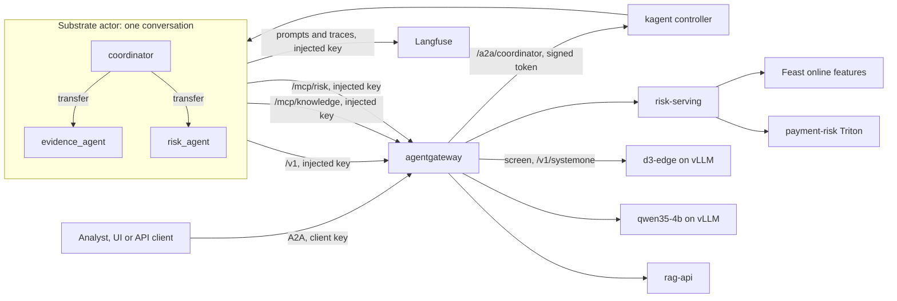
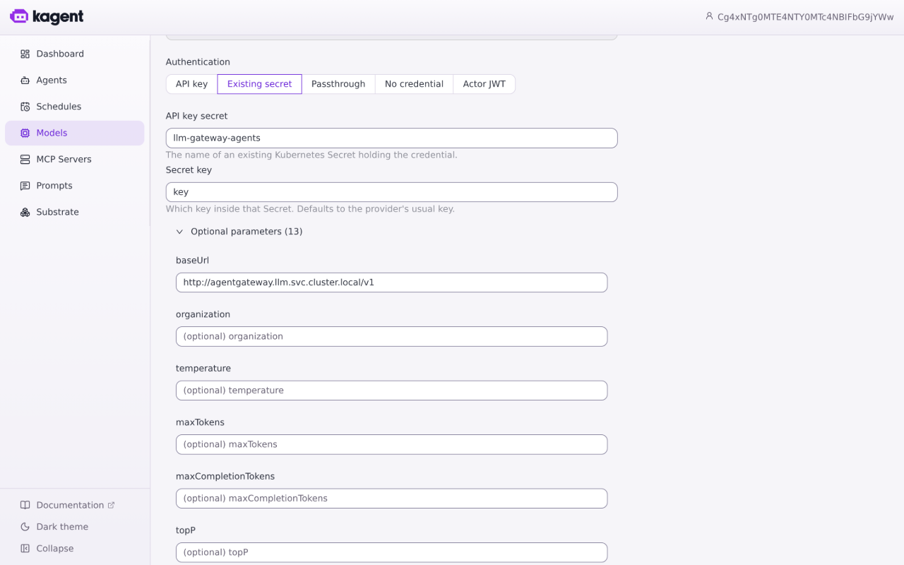
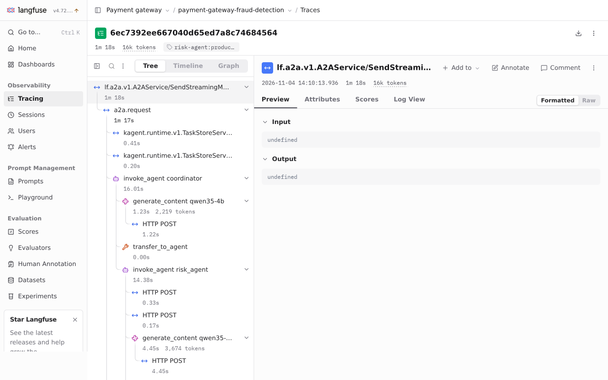
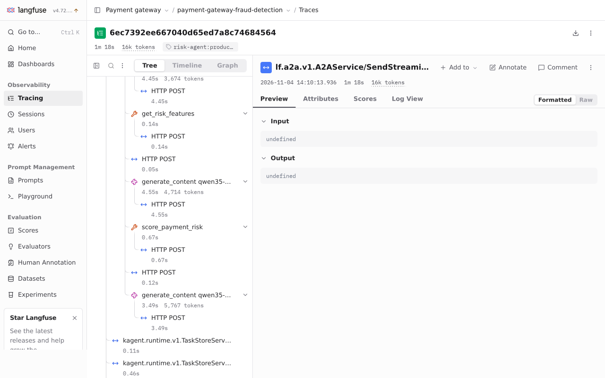

# LLM agents

Fraud analysts ask an agent about decline codes, risk decisions and payment behaviour; it answers from the knowledge base and cites the passages it used. Agents are read-only: they cannot change risk decisions, retry payments, issue refunds or promote models, and they never sit in the payment decision path.

**Status:** built and running on dev: the `coordinator` entry agent with the `evidence-agent` and `risk-agent` sub-agents, the A2A route, prompts and A/B tests in Langfuse, and request screening, shown in the historical captures below. The dev risk-scoring tool is verified in the chat below; what is not yet shown is listed at the end of Risk scoring. Production is enabled on the GCP GPU pool; the dev captures below do not establish production readiness.

- Chart: [`infra/charts/llm-platform`](../../infra/charts/llm-platform): [`agents.yaml`](../../infra/charts/llm-platform/templates/agents.yaml) (model config, MCP servers, templates, the entry agent, worker pool and its autoscaler), [`a2a.yaml`](../../infra/charts/llm-platform/templates/a2a.yaml) (the A2A route), [`catalog.yaml`](../../infra/charts/llm-platform/templates/catalog.yaml) and [`files/catalog.py`](../../infra/charts/llm-platform/files/catalog.py) (registry, prompt seeds), prompt seeds in [`files/prompts/`](../../infra/charts/llm-platform/files/prompts).
- Runtime: kagent 1.0.0-rc1 with Agent Substrate 1.0.0-rc1, installed by the platform; the agent runtime image is [`src/llm/agent_runtime`](../../src/llm/agent_runtime).

## Who does what

| Component | Owns |
|---|---|
| kagent | Defining agents: model config, templates, tools, sub-agents, UI chat, the public A2A endpoint |
| Agent Substrate | Running them: one gVisor actor per conversation, suspended to a snapshot when idle and resumed on any worker; the egress gateway that injects credentials |
| Agent runtime (ours) | kagent's Go ADK runtime plus a Langfuse plugin: each model call's system prompt and A/B variant from Langfuse, linked to the trace |
| agentgateway | Every A2A, model and tool call: per-client keys, request/token limits, action/jailbreak screening and PII masking |
| `rag-api` | `search_knowledge` and `get_knowledge_chunk`, discovered through MCP `tools/list` |
| `risk-serving` | `get_risk_features` and `score_payment_risk`, reading Feast and calling Triton |
| Langfuse | The prompts, their versions and A/B tests, and the agents' traces |
| agentregistry | The catalog of agents and MCP servers |

## Global model config

One kagent `ModelConfig`, `default-model-config`, used by every agent: provider OpenAI, model `qwen35-4b` with the model card's non-thinking sampling, the agents' gateway key, and the gateway's `/v1` route as base URL. Changing the model, the gateway or the key for all agents is one edit. Its sampling settings are the ones every agent uses; kagent's Go runtime takes them only from here, so A/B variants differ by prompt text.

[`agents.yaml`](../../infra/charts/llm-platform/templates/agents.yaml) generates this shared base URL and binds the ModelConfig to every template. Dev calls through this gateway returned chat completions and 1024-dimensional embeddings; direct model access from an unapproved pod was reset. A new end-to-end proof still needs one trace matched to gateway route counters.

## Agents

| Agent | Deployed as | Tools | Role |
|---|---|---|---|
| `coordinator` 0.2.0 | kagent `Agent` behind `/a2a/coordinator` | sub-agents `evidence_agent`, `risk_agent` | Entry agent: hands each question to the specialist that owns it |
| `evidence-agent` 0.3.0 | `AgentTemplate`, compiled into the coordinator | `knowledge` MCP server | Explains declines, policy and payment behaviour from the knowledge base, citing chunk ids |
| `risk-agent` 0.2.0 | `AgentTemplate`, compiled into the coordinator | `risk` MCP server | Reads online features and re-scores supplied payment inputs with the served fraud model; drivers are not attributions |

The specialists are kagent Shared sub-agents: `subAgent` bindings compile their templates into the coordinator's runtime, and the coordinator transfers the conversation to one of them, which answers the analyst. A conversation is one actor and one trace, with no second network hop. Callers reach agents only through the gateway's `/a2a/coordinator` route.

The `evidence-agent` template references the `knowledge` server without a tool list, so it gets every tool the server lists; kagent discovers them:

A chat in the kagent UI on dev (2026-10-31): the coordinator transfers to `evidence_agent`, which calls `search_knowledge` through the gateway,

and answers from the passage it found, citing its chunk id:

The kagent UI is published by the platform behind its Dex login:

## Runtime

Every agent runs one image, [`src/llm/agent_runtime`](../../src/llm/agent_runtime): kagent's own Go ADK entrypoint, pinned to the kagent v1.0.0-rc1 commit, with one ADK plugin added. Before each model call the plugin reads the calling agent's prompt, `<agent>-system-prompt`, from Langfuse (cached for 60 s, the last version kept if Langfuse is unreachable), picks the A/B variant for the conversation and puts the prompt first in the system instruction. It also links the model call's span to that prompt version and tags the trace with the agent's side of its test.

The runtime holds no credentials. The model key, the MCP key and the Langfuse key are placeholders that Substrate's egress gateway replaces on the way out, from Secrets named in each agent's `EgressPolicy` and `ModelConfig`; the gateway admits the egress gateway by its mesh identity.

## Sandbox, warm start and autoscaling

Agents run on Agent Substrate in their own namespace, `llm-agents` (Pod Security `privileged`, outside the mesh, created by the platform):

- **Isolation.** Each conversation is its own gVisor actor. Its only way out is Substrate's egress gateway, which carries every connection and injects the credentials.
- **Warm start.** Each agent revision has a golden snapshot. A new conversation is restored from it in about 1 s and its runtime is ready 2 to 7 s later (fresh process start; 4.6 s on average over six cold conversations). Substrate's router waits up to 30 s for a waking conversation, so the first message is accepted: 6 of 6 cold conversations on 2026-10-31. An idle conversation is snapshotted and suspended, taking no worker, and resumes on any worker with its context.
- **Reservation.** kagent books 250m CPU and 256Mi per actor (platform `runtimeDefaults`), plus Substrate's overhead, against a worker's 2Gi limit, so a worker holds several conversations.
- **Autoscaling.** KEDA scales the WorkerPool from 2 to 6 workers on Substrate's own metric, the number of workers that are partly or fully booked (`ate_workerpool_workers{ate_worker_state=~"partial|at_capacity"}`), 0.7 per worker. Argo CD leaves the pool's `replicas` to KEDA.

Twelve conversations sent at once to the two-worker pool (2026-10-31):

| | |
|---|---|
| Workers | 2 → KEDA asked for 3 at 56 s, Ready at 78 s |
| Conversations accepted on the first message | 12 of 12 |
| Time to the full answer | 79 to 123 s, median 112 s (the shared GPU is the limit) |

## Registry

The release catalog job publishes the entry agents and the MCP servers from the chart values to agentregistry. The coordinator's entry names its sub-agents and lists the MCP servers they use; prompts are in Langfuse and tools come from the servers.

## Prompts and A/B tests

Langfuse is the source of each agent's system prompt and A/B test. [`files/prompts/<agent>.md`](../../infra/charts/llm-platform/files/prompts) and the agent's `abTest` in the values only seed a prompt that Langfuse does not have yet; after that, prompts are edited, versioned and tested in Langfuse, and the next conversation uses the new version without a release.

## Autoscaling

| Workload | Mechanism | Why |
|---|---|---|
| Agent conversations | Substrate actors: created on demand, suspended to zero when idle, resumed on any worker | Idle conversations cost nothing; any number wait in snapshots |
| Agent worker pool (`llm-agents`) | KEDA, 2 to 6 workers on Substrate's busy-worker metric | Workers follow the conversations that hold them |
| Knowledge API (`rag-api`) | KEDA, 2 to 4 replicas on its combined REST and MCP request rate | Target 10 req/s per replica; a dev Locust run scaled 2 → 4 → 2 |
| Risk MCP (`risk-serving`) | KEDA, 2 to 4 replicas on tool-call rate | Initial target 5 calls/s per replica; provisional, without a risk Locust benchmark |
| Model servers | One replica per model | GPU capacity is separate from tool-server scaling |

## Risk scoring

Dev enables the `risk` server and `risk-agent` 0.2.0; production retains the toolless 0.1.0 agent and has no risk server. The `risk` server accepts a `request` object with `integration_id`, `customer_id`, `payment_method_fingerprint`, `amount_minor`, both account-creation timestamps, `shipping_country`, `ip_country`, `item_count` and `has_device`. The tool sets the scoring time. It returns five view statuses, a probability, model version and decline threshold. Missing, expired, future or invalid views contribute NaN to Triton, including ratios derived from unavailable daily views. An upstream error returns no score. The result is a what-if re-score, not a stored decision.

Drivers rank feature gain times distance from the training reference distribution; they are not per-prediction attributions. If the reference belongs to another version, the score carries no drivers and explains why. There is no step-up threshold in the served model configuration.

On dev, risk and knowledge use blue-green Rollouts. A dedicated analysis Job initializes MCP, lists tools and calls the preview before promotion; tool errors or timeouts block promotion. KEDA owns replicas and Rollouts own active/preview revision selectors. An existing Langfuse prompt and its A/B variant both need new tool-aware versions; the catalog seeds only missing prompts.

Every number in a tool result carries at most four decimals, because the gateway masks any run of 13 or more digits as a card number and a full-precision probability has more. The result also says whether the probability is at or above the decline threshold, computed before rounding.

### Proof on dev, 2026-11-04

A call to `/mcp/risk` through the gateway with the benchmark key returned 401 without a key, listed `get_risk_features` and `score_payment_risk`, and scored a dev customer at 0.1967 from model v4 against the decline threshold 0.5122, with all five views `available` (748 ms cold, 256 ms warm, three calls).

In a kagent chat the coordinator transferred to `risk_agent`, which called `get_risk_features` and `score_payment_risk` with the payment-method fingerprint unchanged and answered with that score and the reason it had no drivers:

One Langfuse trace covers the conversation: 1 min 18 s end to end with 16k tokens, tagged `risk-agent:production`. The coordinator took 16.0 s, `get_risk_features` 0.14 s and `score_payment_risk` 0.67 s; its four `qwen35-4b` calls took 1.2 to 4.6 s.

On the promoted revision's two pods, after two chats and one analysis call: `get_risk_features` 2 successes, `score_payment_risk` 3 successes, no failures, 0.22 s and 1.32 s of tool time in total, and every view `available` on every call.

| Release | Pre-promotion analysis | Outcome |
|---|---|---|
| `risk-serving` 785f66cfc5, first run | Failed: the Job's 60 s deadline, which counts the image pull | Previous revision stayed active |
| `risk-serving` 785f66cfc5, retry at 180 s | Successful in 26 s | Promoted |
| `risk-serving` 756dbb8686 | Successful | Promoted |
| `rag-api` 7fcf4cbc | Successful in 73 s, waiting for a cold pod | Promoted; one Rollout owns every ReplicaSet and no Deployment remains |
| `risk-serving` 5dcd89f99f, faulty: `MODEL_URL` points at a model server that does not exist | Failed in 27 s (19:40:22 to 19:40:49): `preview returned an MCP tool error` | Rollout aborted; the active Service kept selecting 756dbb8686, and the gateway scored 0.1967 at 19:40:05 during the rollout and at 19:41:09 after it |
| `rag-api` 69f45b78c4, faulty: `RAG_DB_HOST` points at a missing database | No analysis: the preview pod failed readiness with 503 for more than 5 min | Never promoted; the active Service kept selecting 7fcf4cbc. The Rollout stayed `Progressing` until the spec was restored, which is why both Rollouts now set `progressDeadlineAbort` |

The faulty candidates were made by pausing Argo CD's reconcile of the app with the `argocd.argoproj.io/skip-reconcile` annotation, patching one environment variable on the Rollout, and restoring it afterwards; both Rollouts returned to Healthy on their original revisions. Argo Rollouts skips the analysis on a first install, which has no previous revision to protect; that case was not run here.

Two causes were found and fixed on the way. A new preview pod becomes an endpoint of its Service in the mesh a moment after it is Ready, and the Rollout starts the analysis in the same second it scales the preview up, so the analysis client waits up to 150 s for the MCP handshake and retries only connection failures. The Job's deadline is 300 s, because it counts the image pull. The first chat also failed: the gateway's `PhoneNumber` masking replaced a 7-digit run inside the fingerprint, so phone numbers are now matched by `gateway.piiPatterns` at word boundaries.

### Not yet shown

The drivers are empty because the served v4 reference has no feature gains; the fix to the training code is on main, and drivers appear once a model trained from it is served. KEDA scale-out under load was not observed: the HPA read 0 of 5 calls/s per replica at two replicas, and the 5 calls/s target is untested. The Langfuse `risk-agent` prompt is still version 1, which has the tool wording but not the line about the threshold flag, and the answer calls the comparison a "Decision". The phone masking change is deployed on dev only, and the removal of the charts' GPU placement has not been deployed anywhere.

## Known limits

- The chat model sometimes answers an evidence question without calling the knowledge tools; the answer then has no citation. A question that asks for the passages makes it search.
- In one of 16 conversations sent four at a time, the first message was refused ("retry after the session becomes available"), and one UI chat lost its stream after the tool result. A retry answered both.
