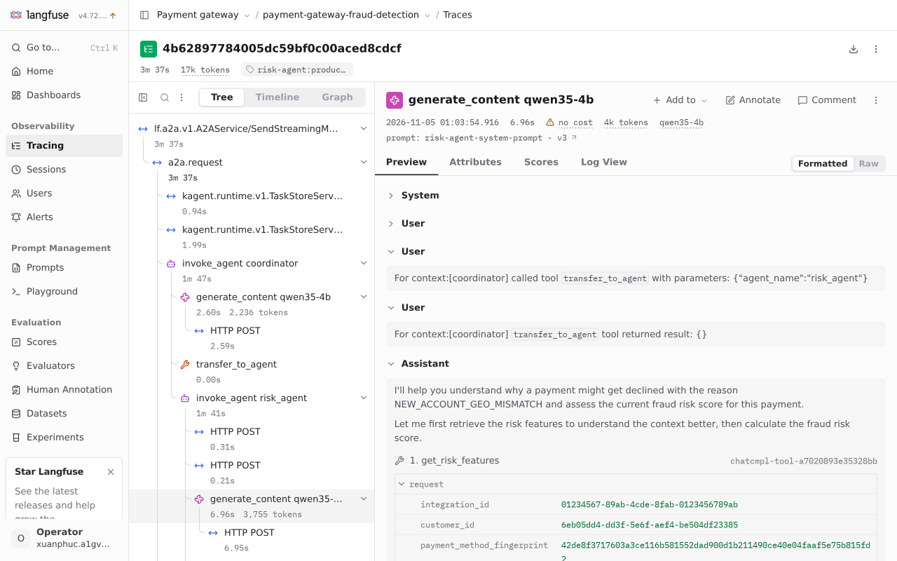

# Custom Go ADK runtime (novel)

The agents need centrally managed prompts without rebuilding their images, a consistent prompt variant throughout a conversation, and traces that identify the prompt used for each model call. The project's runtime integrates these with kagent's Go ADK and Agent Substrate.

## Design

Every agent runs one image built from [the runtime entrypoint](../../src/llm/agent_runtime/cmd/agent_runtime/main.go), pinned to kagent v1.0.0-rc1's commit in [go.mod](../../src/llm/agent_runtime/go.mod). The project-specific addition is the Langfuse plugin and span processor; agent execution, A2A serving and session handling use kagent's runtime packages.

Before each model call, the [plugin](../../src/llm/agent_runtime/internal/langfuse/plugin.go):

1. Resolves the calling agent's `<agent>-system-prompt`, so a transferred sub-agent uses its own prompt.
2. Reads the production prompt and its A/B configuration. A hash of the prompt name and conversation identity selects the variant consistently. Substrate's projected actor name supplies the identity because the ADK session ID is shared across actors.
3. Places the selected prompt before kagent's system guidance.
4. Retains the selection by invocation ID until ADK opens its `generate_content` span, then adds the prompt name, version and the agent's A/B tag. The selection is removed when the run ends.

The [prompt client](../../src/llm/agent_runtime/internal/langfuse/prompts.go) caches each name/label for 60 s. If Langfuse is unavailable, it uses the last cached version; without a cached prompt, the model call fails. Prompt edits therefore reach calls after cache expiry without an image release, while an outage can leave an actor using an older version.

The runtime holds placeholder credentials. Substrate's egress gateway replaces the model, MCP and Langfuse credentials from the Secrets referenced by each agent's `EgressPolicy` and `ModelConfig`. The Harness pins the runtime image by digest. Deployment and sandbox details remain in [Agents](agents.md#sandbox-warm-start-and-autoscaling).

## Evidence and limits

The Go runtime replaced Python imports that exceeded the golden actor's 30 s wakeup window under gVisor. The recorded dev run accepted all six cold conversations: snapshot restore took about 1 s, followed by runtime readiness in 2–7 s, averaging 4.6 s. These are system observations, not a controlled Go-versus-Python benchmark; see [the startup evidence](agents.md#sandbox-warm-start-and-autoscaling).

On 2026-11-05, trace `4b62897784005dc59bf0c00aced8cdcf` linked all three risk-agent model calls to `risk-agent-system-prompt` version 3. The [conversation evidence](agents.md#risk-agent) records the score, tool calls and answer-quality limits. Existing [plugin tests](../../src/llm/agent_runtime/internal/langfuse/plugin_test.go) and [client tests](../../src/llm/agent_runtime/internal/langfuse/prompts_test.go) cover agent-specific selection, actor identity, trace linkage, caching and missing prompts.

Prompt-version linkage establishes which instructions ran; it does not establish answer quality or an A/B winner. The LLM-version A/B remains on hold, and the third agent worker's readiness limit is recorded in [Scaling](scaling.md#agent-worker-pool).
