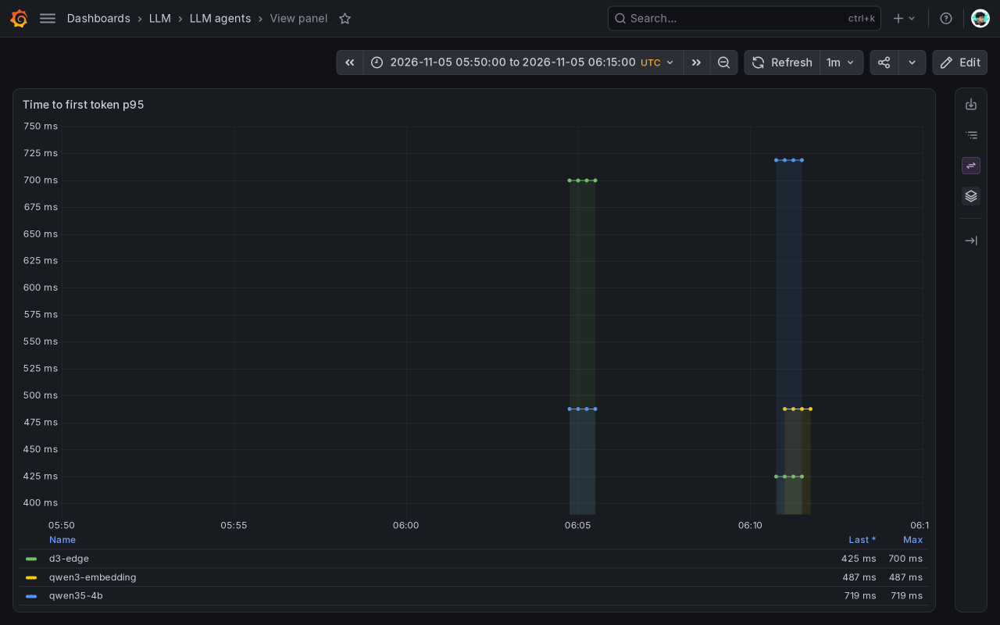

# LLM inference

Self-hosted chat, embedding and decision models for the agents, the RAG pipeline and the gateway's request screen, and how fast the chat model serves agent traffic. Every caller reaches them through agentgateway with per-client API keys, request/token limits and mesh authorization; nothing calls a model server directly.

- Chart: [`infra/charts/llm-platform`](../../infra/charts/llm-platform) (`models.yaml`, values `models`). Application `llm-platform` in namespace `llm`, on dev and prod. GPU placement follows the platform-owned DRA `llm-gpu` claim; the application is enabled on the GCP GPU pool for prod.
- Platform prerequisites (KServe 0.21 `LLMInferenceService` presets, the GPU DRA driver, the `llm-gpu` node group for the local model cache, agentgateway) come from the platform repository.

## Models

| Model | Served name | Weights (pinned revision) | Runtime | Role |
|---|---|---|---|---|
| [Qwen3.5-4B FP8 (RedHatAI, dynamic)](https://huggingface.co/RedHatAI/Qwen3.5-4B-FP8-dynamic) | `qwen35-4b` | `397b7ba47a99b3221ebfc0cfc5a279118cb733ad` | vLLM v0.32, FP8 weights and KV cache, text only, max length 32 768, 32 concurrent sequences, `qwen3_coder` tool-call parser, thinking off; sampling 0.7 / top-p 0.8 / presence 1.5 | Agents' chat model with tool calling |
| [Qwen3-Embedding-0.6B](https://huggingface.co/Qwen/Qwen3-Embedding-0.6B) | `qwen3-embedding` | `97b0c614be4d77ee51c0cef4e5f07c00f9eb65b3` | vLLM pooling runner, 1024 dimensions, max length 2 048 | Knowledge-base and query embeddings |
| [d3-edge](https://huggingface.co/vllm-sr/d3-edge) | `d3-edge` | `c454ee39b862248d70abd7f84195d2f54ffe6d43` | vLLM nightly `2b009fc6` pinned by digest (release 0.32 does not serve `/v1/systemone`), text only, max length 2 048, 16 concurrent sequences | Decision model classifying prompts as action, jailbreak or safe |

All three are KServe `LLMInferenceService`s. The chat model runs behind llm-d's endpoint picker (EPP) and an InferencePool, so a second replica would join the same pool rather than a new route.

## One GPU, three models

The three models share one claimed GPU through a single DRA `ResourceClaim` (`llm-gpu`), each vLLM process with a fixed memory fraction: 0.76 for chat, 0.12 for embeddings and 0.10 for `d3-edge` (each is the model's `gpuMemoryUtilization` value). On dev's 15.48 GiB card the chat fraction is 0.72: with the other two servers resident, with their CUDA contexts, 11.6 GiB are free when the chat server starts, less than the 11.76 GiB that 0.76 asks for, and it crash-looped on 2026-11-04 until the fraction was lowered. The chat server keeps its KV cache in FP8, which the [benchmark](#benchmark) kept for throughput and cache room. The embedding and decision servers cap their context at 2 048 tokens so their caches fit the small shares; knowledge chunks are at most about 400 tokens, and a screen is one short question.

## Weights and start-up

- Each `LLMInferenceService` names its model as `hf://<repo>:<revision>`. KServe's storage initializer puts that pinned revision in the pod's `/mnt/models` before vLLM starts, and vLLM loads it with InstantTensor (`--load-format=instanttensor`, I/O depth 32; the chat server's buffer is 1.5 GiB to stay inside its memory limit).
- Each model has a KServe `LocalModelNamespaceCache` on the platform's `llm-gpu` node group, so the files are downloaded once to the GPU node's disk and every start reads them from there.
- The rollout strategy is `maxSurge: 0, maxUnavailable: 1`: a surge pod would ask for a second share of the one GPU and never schedule.
- The start-up probe allows up to 180 failures (30 minutes) for the first weight load and CUDA graph capture; liveness only starts after it.

## Autoscaling

The model servers are not autoscaled: the three servers use fixed shares of one claimed GPU, with no capacity reserved for a second replica. Scaling out means a second GPU replica behind the same InferencePool. KEDA scales agent workers and the knowledge API independently of model replicas.

## Checks on dev

On 2026-11-01, after the move to the local model cache: all three `LLMInferenceService`s Ready from the cache on the one claimed GPU; a chat completion through the gateway answered 200 and an embedding returned 1024 dimensions.

The Grafana sample for 2026-11-05, 05:50–06:15 UTC, shows vLLM p95 time to first token during dev conversations. This monitoring sample is separate from the controlled benchmark below.



## Benchmark

How fast the chat model serves agent-shaped traffic, which server settings were tried, which one was kept, and what the gateway adds. Run on 2026-10-31, 18:11 to 23:10 UTC, against `qwen35-4b` on the dev RTX 5060 Ti (16 GiB, Blackwell), sharing the GPU with the other model servers.

- Manifests: [`infra/charts/llm-platform/benchmark/`](../../infra/charts/llm-platform/benchmark): [`job.yaml`](../../infra/charts/llm-platform/benchmark/job.yaml) (the load generator) and [`server.yaml`](../../infra/charts/llm-platform/benchmark/server.yaml) (a standalone server for one variant), applied with `kubectl`. Argo CD never renders them.
- Tool: `vllm bench serve` from the serving image `vllm/vllm-openai:v0.32.0`, so no benchmark image is built.

### Workload

Agents send long, shared system prompts and short questions, so the workload is vLLM's `prefix_repetition` dataset: 3 shared 1 500-token prefixes (one per agent), 100-token questions and 150-token answers (`--ignore-eos`). Each run is a closed-loop sweep at 1, 2, 4, 8 and 16 concurrent requests, eight requests per concurrent slot:

```sh
vllm bench serve --backend openai-chat --base-url "$TARGET" --endpoint /v1/chat/completions \
  --model qwen35-4b --tokenizer RedHatAI/Qwen3.5-4B-FP8-dynamic \
  --dataset-name prefix_repetition --prefix-repetition-num-prefixes 3 \
  --prefix-repetition-prefix-len 1500 --prefix-repetition-suffix-len 100 \
  --prefix-repetition-output-len 150 --ignore-eos --seed 20261029 \
  --num-prompts $((c * 8)) --max-concurrency "$c" --percentile-metrics ttft,tpot,itl,e2el --metric-percentiles 50,90
```

Model-server runs go straight to the vLLM server, to isolate it. The chat `LLMInferenceService` was stopped through a dev release (`models.chat.stopped`) and each variant ran as `server.yaml` with one change to its arguments, each against the best configuration so far.

### Baseline

The live chat server with a bf16 KV cache and prefix caching on, no failed requests:

| Concurrency | Output tok/s | Requests/s | TTFT p50 / p90 (ms) | TPOT p50 (ms) | End-to-end p50 (ms) |
|---|---|---|---|---|---|
| 1 | 44.3 | 0.30 | 225 / 269 | 21.4 | 3 416 |
| 2 | 82.2 | 0.55 | 112 / 221 | 22.1 | 3 399 |
| 4 | 157.5 | 1.05 | 142 / 317 | 22.8 | 3 569 |
| 8 | 302.5 | 2.02 | 208 / 334 | 24.5 | 3 861 |
| 16 | 520.3 | 3.47 | 248 / 624 | 28.4 | 4 507 |

Throughput grows almost linearly to 16 concurrent requests while the time per output token rises from 21 to 28 ms, so one replica serves every agent with room to spare. The standalone default matched it: 521.2 output tokens/s at 16.

### Optimizations

| Variant (server arguments added) | Output tok/s at 1 / 16 | TTFT p50 at 16 (ms) | TPOT p50 at 16 (ms) | KV cache (tokens) | Kept |
|---|---|---|---|---|---|
| Standalone default | 44.9 / 521.2 | 276 | 28.3 | 16 608 | reference |
| Prefix caching off (`--no-enable-prefix-caching`) | 43.9 / 230.7 | 5 834 | 36.4 | 16 608 | no |
| FP8 KV cache (`--kv-cache-dtype=fp8`) | 45.7 / 601.1 | 327 | 24.0 | 27 488 | **yes** |
| FP8 KV + `--max-num-seqs=16` | 45.6 / 594.6 | 381 | 23.9 | 34 432 | no |
| FP8 KV + `--performance-mode=interactivity` | 45.7 / 598.6 | 338 | 24.0 | 25 408 | no |
| FP8 KV + n-gram speculative decoding (4 tokens, lookup 2 to 4) | 37.5 / 421.7 | 139 | 36.1 | 26 192 | no |
| FP8 KV + AWQ 4-bit weights | 65.6 / 744.9 | 583 | 16.8 | 73 824 | not adopted |

- **Prefix caching** is what makes shared agent prompts cheap: without it every request recomputes its 1 500-token prefix, throughput at 16 falls by 56% and the first token takes 5.8 s instead of 0.3 s. It stays on (vLLM's default).
- **FP8 KV cache** is kept: 15% more output tokens/s at 16 concurrent requests, a lower time per token at every level (24.0 vs 28.3 ms at 16), and 65% more KV cache room. The chat server runs with it.
- **`--max-num-seqs` and `--performance-mode interactivity`** changed nothing measurable at these concurrencies (within 1%).
- **N-gram speculative decoding** is 30% slower here: a draft was accepted for only 1.07 tokens on average, because these answers do not quote the prompt. It would need a workload whose answers quote retrieved passages to pay off, so it is not used.
- **AWQ weights** are faster (+24% output tokens/s at 16, 16.8 ms per token, 3.1 GiB less memory, 2.7× the KV cache) but start answers later (TTFT p50 361 ms at 1 and 583 ms at 16, against 165 and 327 ms) and are 4-bit; their answer quality was not measured, so FP8 weights stay served.

### Through the gateway

The gateway adds API keys, limits, PII masking and the request screen. The `prefix_repetition` prompts are random tokens, which the Jev decision model reads as jailbreak attempts and the screen rejects (403), so the gateway run used 48 distinct analyst questions with 150-token answers, sent the same way to vLLM and through the gateway with the benchmark client's key:

| Concurrency | TTFT p50 direct / gateway (ms) | Output tok/s direct / gateway | TPOT p50 (ms) | Failed |
|---|---|---|---|---|
| 1 | 54 / 1 051 | 47.8 / 36.3 | 20.7 / 20.7 | 0 / 0 |
| 2 | 73 / 1 004 | 95.0 / 71.2 | 20.7 / 20.7 | 0 / 0 |
| 4 | 91 / 1 522 | 188.3 / 125.2 | 20.7 / 20.8 | 0 / 0 |

Generation itself is unchanged; the extra time to first token is the screen's call to the Jev decision model, cached per prompt, and screens queue at higher concurrency. Agents re-send the same user turn on every model call of a conversation, so only the first call of a turn pays it.

The per-client limits stay as set (120 requests and 60 000 tokens per minute): one client at concurrency 2 of the analyst workload sends about 28 requests and 6 000 tokens a minute, and the server's measured capacity of about 4 requests/s on agent-shaped prompts is shared by all clients.
