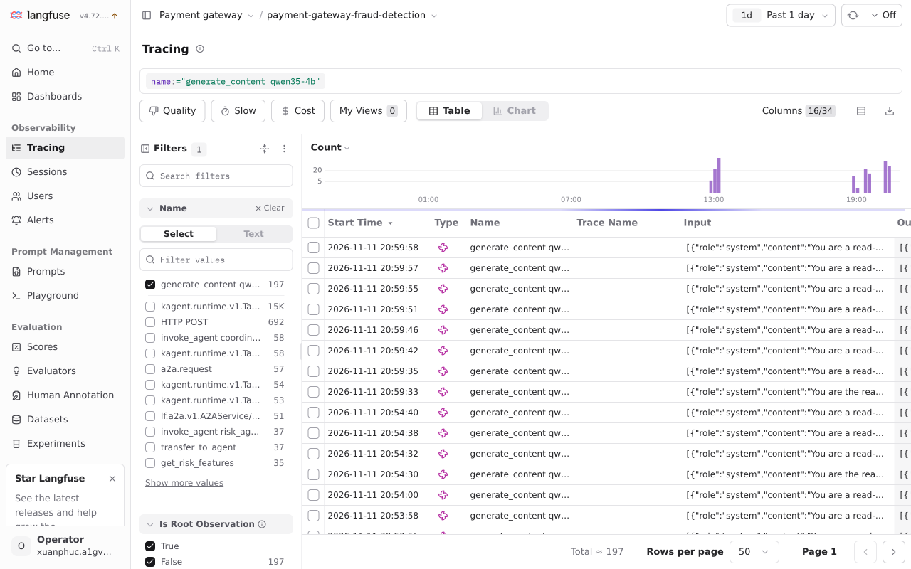

# Langfuse

Self-hosted Langfuse v4 (4.72.0, chart 2.2.0) in `llm`, on the shared ClickHouse, behind the platform's Dex proxy ([`langfuse.yaml`](../../infra/charts/llm-platform/templates/langfuse.yaml)). It holds the agents' prompts and their A/B tests, and their traces.

## Traces

kagent's Go runtime exports each conversation's spans over OTLP to Langfuse; Substrate's egress gateway adds the project's basic-auth key. A conversation is one trace: the A2A request, the coordinator's `invoke_agent` span with its model call, `transfer_to_agent`, the sub-agent's `invoke_agent` span with its tool calls and model calls, and the task-store calls. Each model call (`generate_content qwen35-4b`) carries its tokens and is linked to the prompt version it used; the [runtime capture](custom-go-adk-runtime.md#evidence-and-limits) shows a risk generation linked to production prompt v3.

Each model call's messages are recorded on its span (`OTEL_INSTRUMENTATION_GENAI_CAPTURE_MESSAGE_CONTENT=SPAN_ONLY` on the agents), so Langfuse shows each generation's input and output. They stay in the self-hosted Langfuse in the cluster.

The earlier risk scoring conversation also records both MCP tools between model calls:

## Prompts

Each agent's system prompt is the Langfuse prompt `<agent>-system-prompt`. Its `production` label is what agents use; the release catalog job only creates a prompt that does not exist yet, from [`files/prompts/<agent>.md`](../../infra/charts/llm-platform/files/prompts), so edits made in Langfuse are kept. The [runtime note](custom-go-adk-runtime.md) describes prompt caching and includes the dev prompt-version evidence.

The Langfuse prompt `risk-agent-system-prompt` was published as `production` version 3 and `variant-b` as version 4; the catalog seeds only missing prompts, so an existing prompt needs new versions in Langfuse. The 2026-11-05 06:04 UTC retry used version 3: trace `4b62897784005dc59bf0c00aced8cdcf` links all three risk model calls to that prompt version.

## A/B tests

A test is part of the prompt: the `production` version's config names the other label and the share of conversations it gets, for example `{"abTest": {"label": "variant-b", "share": 0.5}}`. The runtime hashes the prompt name and the conversation, so a conversation keeps its side for every model call, and each agent in it is split on its own. The trace is tagged with each tested agent's side (`evidence-agent:variant-b`), and every model call is linked to its version, so Langfuse compares the versions directly. Ending a test is a config edit in Langfuse; adopting the variant is moving the `production` label.

The seeds give every agent a variant that adds one instruction to its prompt. The dev metrics view captured on 2026-11-05, with its “Past 30 days” filter, shows the current risk prompt labels alongside recorded generations:

| Prompt version | Label | Median latency | Median output tokens | Model calls |
|---|---|---|---|---|
| v3 | production | 6.824 s | 271 | 5 |
| v4 | variant-b | 1 min 13 s | 337 | 2 |

A version's config may also carry model settings, `{"model": {"temperature": 0.1, "topP": 0.5, "maxTokens": 160}}`, so a variant can differ by sampling as well as by text; a setting left out keeps the `ModelConfig`'s value. kagent's OpenAI path sends only the `ModelConfig`'s settings and ignores the request's generation config, so the runtime writes the chosen version's values through the pointers the model reads, for the settings the `ModelConfig` sets (temperature, topP and maxTokens). The runtime's tests check this against kagent's own model constructor. On dev, `risk-agent-system-prompt` v5 (`variant-b`) carries `{"model": {"temperature": 0.1, "topP": 0.5, "maxTokens": 384}}` against v3 (`production`) on the `ModelConfig`'s 0.7, 0.8 and 1024. Twelve conversations of the same question with varying amounts reached the model; the gateway saw 17 calls with the variant's settings, equal to the 17 v5 generations in Langfuse, and the rest with the baseline:

| Version | Label | Model calls | Traces | Mean latency | Mean output tokens | Max output tokens |
|---|---|---|---|---|---|---|
| v3 | production | 22 | 5 | 12.5 s | 223 | 622 |
| v5 | variant-b | 17 | 5 | 6.7 s | 220 | 371 |

These are model-call samples from dev conversations, with different inputs and no answer-quality scores. They demonstrate version comparison in Langfuse, not a winning variant.

### Model versions

The chat model has an A/B candidate: Qwen3-4B-Instruct-2507 in FP8 (`qwen3-4b`) against the served Qwen3.5-4B in FP8 (`qwen35-4b`), the same size and precision, so the difference is the model generation. The candidate is the `models.candidate` block in the [`llm-platform` values](../../infra/charts/llm-platform/values.yaml) and a gateway backend weighted by `weight`. The two do not fit the dev GPU together: with the chat server cut to 0.36 of the card, vLLM's startup profiling left no memory for its cache and the pod crash-looped. On dev they take turns on the full `llm-gpu` claim with the same settings (0.72 of the card, 32k context, 32 sequences, FP8 KV cache); one is stopped while the other serves.

The same twelve conversations (six rounds of two, the question from the prompt test with varying amounts) ran against each, with the prompt tests' 50/50 split unchanged. Langfuse's model name is the one the agent requests, `qwen35-4b` in both runs, so the rows below are the two time windows; the gateway logs the served model as `qwen3-4b` in the first.

| Model | Conversations completed | Model calls | Traces | Mean latency | Median latency | Mean output tokens | `transfer_to_agent` | `search_knowledge` |
|---|---|---|---|---|---|---|---|---|
| qwen3-4b | 12 of 12 | 37 | 13 | 8.2 s | 3.9 s | 193 | 8 | 0 |
| qwen35-4b | 10 of 12 | 61 | 12 | 8.4 s | 4.7 s | 168 | 12 | 12 |

The Langfuse observations view, filtered to the model calls, shows the two runs as the two bursts of the evening (Qwen3-4B first, Qwen3.5-4B second) under one model name, as noted above.

Latency and output length are close. The difference is behaviour: the question asks for the risk features and what the knowledge base says, and Qwen3.5-4B handed over to the risk agent in every conversation and searched the knowledge base in all of them, while Qwen3-4B never searched it and transferred in eight. Two Qwen3.5-4B conversations returned an empty response instead of a task, so completion is not a win for it. The sample is small and unscored.

