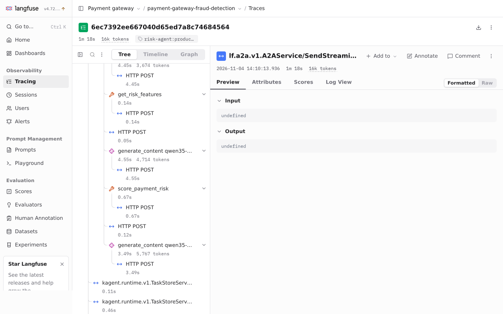
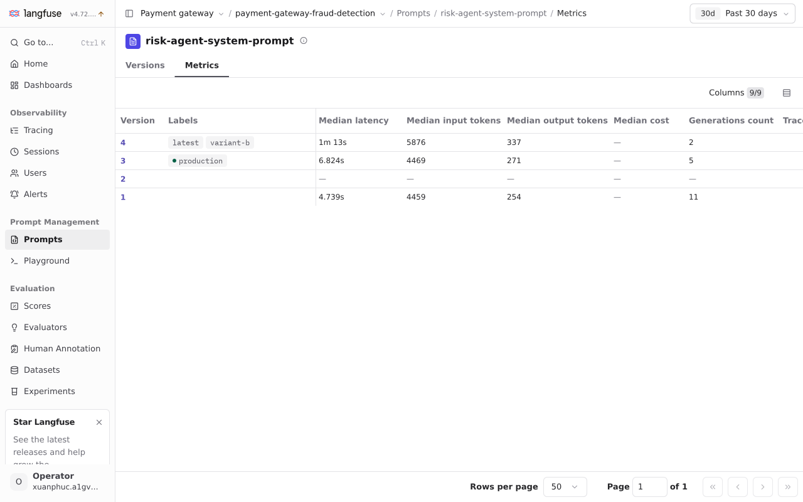

# Langfuse

Self-hosted Langfuse v4 (4.72.0, chart 2.2.0) in `llm`, on the shared ClickHouse, behind the platform's Dex proxy ([`langfuse.yaml`](../../infra/charts/llm-platform/templates/langfuse.yaml)). It holds the agents' prompts and their A/B tests, and their traces.

## Traces

kagent's Go runtime exports each conversation's spans over OTLP to Langfuse; Substrate's egress gateway adds the project's basic-auth key. A conversation is one trace: the A2A request, the coordinator's `invoke_agent` span with its model call, `transfer_to_agent`, the sub-agent's `invoke_agent` span with its tool calls and model calls, and the task-store calls. Each model call (`generate_content qwen35-4b`) carries its tokens and is linked to the prompt version it used; the [runtime capture](custom-go-adk-runtime.md#evidence-and-limits) shows a risk generation linked to production prompt v3.

Each model call's messages are recorded on its span (`OTEL_INSTRUMENTATION_GENAI_CAPTURE_MESSAGE_CONTENT=SPAN_ONLY` on the agents), so Langfuse shows each generation's input and output. They stay in the self-hosted Langfuse in the cluster.

The earlier risk scoring conversation also records both MCP tools between model calls:

## Prompts

Each agent's system prompt is the Langfuse prompt `<agent>-system-prompt`. Its `production` label is what agents use; the release catalog job only creates a prompt that does not exist yet, from [`files/prompts/<agent>.md`](../../infra/charts/llm-platform/files/prompts), so edits made in Langfuse are kept. The [runtime note](custom-go-adk-runtime.md) describes prompt caching and includes the dev prompt-version evidence.

The Langfuse prompt `risk-agent-system-prompt` was published as `production` version 3 and `variant-b` as version 4; the catalog seeds only missing prompts, so an existing prompt needs new versions in Langfuse. The 2026-11-05 06:04 UTC retry used version 3: trace `4b62897784005dc59bf0c00aced8cdcf` links all three risk model calls to that prompt version.

## A/B tests

A test is part of the prompt: the `production` version's config names the other label and the share of conversations it gets, for example `{"abTest": {"label": "variant-b", "share": 0.5}}`. The runtime hashes the prompt name and the conversation, so a conversation keeps its side for every model call, and each agent in it is split on its own. The trace is tagged with each tested agent's side (`evidence-agent:variant-b`), and every model call is linked to its version, so Langfuse compares the versions directly. Ending a test is a config edit in Langfuse; adopting the variant is moving the `production` label.

The seeds give every agent a variant that adds one instruction to its prompt. The dev metrics view captured on 2026-11-05, with its “Past 30 days” filter, shows the current risk prompt labels alongside recorded generations:

| Prompt version | Label | Median latency | Median output tokens | Model calls |
|---|---|---|---|---|
| v3 | production | 6.824 s | 271 | 5 |
| v4 | variant-b | 1 min 13 s | 337 | 2 |

These are model-call samples from dev conversations, with different inputs and no controlled workload or answer-quality scores. They demonstrate version comparison in Langfuse, not a winning variant. The LLM-version A/B remains on hold.
