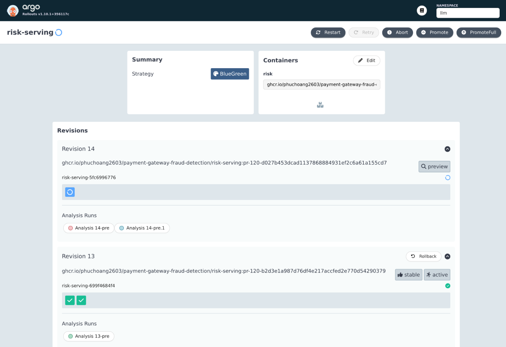
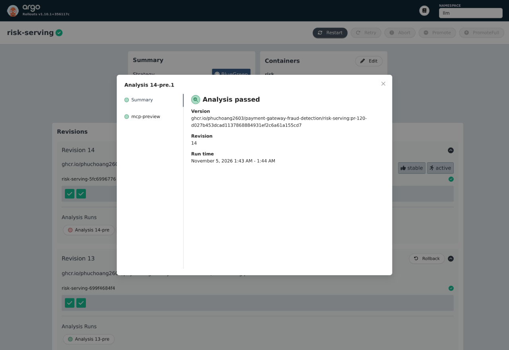

# MCP server releases

The knowledge server (`rag-api`, [RAG](rag.md)) and the risk server (`risk-serving`, [Agents](agents.md#risk-agent)) are the agents' MCP tools behind the agent gateway. They share one release strategy in both environments: an Argo Rollouts blue-green release, with KEDA targeting the Rollout's scale subresource ([autoscaling](scaling.md)).

## How a release works

The charts are [`api.yaml`](../../infra/charts/rag-pipeline/templates/api.yaml) for `rag-api` and [`risk.yaml`](../../infra/charts/llm-platform/templates/risk.yaml) for `risk-serving`. The active Service keeps its name and a `-preview` Service selects the candidate. A bounded pre-promotion Job with its own identity initializes MCP, lists the tools and makes one call (`rag-api`: a configured knowledge chunk; `risk-serving`: a synthetic scoring call that allows normal missing-history statuses, without requiring a seeded customer). A tool error, missing result or timeout blocks promotion and keeps the active revision serving. The preview starts at one replica and grows to KEDA's desired count before the Service switches; Argo CD leaves replica counts and revision hash selectors to their controllers. `progressDeadlineAbort` aborts a candidate that never becomes ready.

| Release | Pre-promotion analysis | Outcome |
|---|---|---|
| `rag-api` 7fcf4cbc | Successful in 73 s, waiting for a cold pod | Promoted; one Rollout owns every ReplicaSet and no Deployment remains |
| `risk-serving` 756dbb8686 | Successful | Promoted |
| `rag-api` 69f45b78c4, faulty: `RAG_DB_HOST` points at a missing database | None: the preview pod failed readiness with 503 for more than 5 min | Never promoted; the active Service kept selecting 7fcf4cbc. The Rollout stayed `Progressing` until the spec was restored, which is why `progressDeadlineAbort` is set |
| `risk-serving` 5dcd89f99f, faulty: `MODEL_URL` points at a model server that does not exist | Failed in 27 s: `preview returned an MCP tool error` | Rollout aborted; the active Service kept selecting 756dbb8686, and the gateway scored 0.1967 during the rollout and after it |

Each faulty candidate was made by pausing Argo CD's reconcile of the app with the `argocd.argoproj.io/skip-reconcile` annotation, patching one environment variable on the Rollout, and restoring it afterwards; both Rollouts returned to Healthy on their original revisions. Argo Rollouts skips the analysis on a first install, which has no previous revision to protect; that case was not run.

On 2026-11-05 at 06:43 UTC, risk revision 14 (`5fc6996776`) retried its failed analysis while revision 13 (`699f4684f4`) retained two Ready active pods:

The retry `risk-serving-5fc6996776-14-pre.1` passed, and revision 14 became active with two Ready pods at 06:44 UTC:

## Cleanup verification

Cleanup verification on 2026-11-05: risk revision 15 (`664d9f6f46`) passed `risk-serving-664d9f6f46-15-pre` in 45 s; knowledge revision 14 (`65c7648dd6`) passed `rag-api-65c7648dd6-14-pre.2` in 64 s after earlier connection timeouts. Both finished Healthy with two Ready pods. Dev Feast was Ready with container-local probes and no probe-IP NetworkPolicy after replacing its restarting pod; the loopback health request returned 200 in 104 ms. Production Feast rendered identically to the pre-cleanup version.

Both environment configurations now use the same scoring gate and native Feast HTTP probes. The gate uses synthetic identifiers and accepts normal missing history, while requiring request features and a valid model response. On 2026-11-05, the dev release from `85307f1` passed `rag-api-6b9d78dc-18-pre` in 53 s and `risk-serving-86c9c7557-19-pre` in 51 s; both Rollouts became Healthy with two available replicas. Feast pod `feast-server-679dfb785f-ccv4f` was Ready with native HTTP startup, readiness and liveness probes and zero restarts, without a platform change or source-IP exception. All 36 CI checks passed.

## Limits

- The captures and runs above establish dev behavior only; production deployment and adoption of this gate remain unverified.
- Alternate-backend failover is not implemented: a failed candidate keeps the active revision serving, it does not route to another backend.
