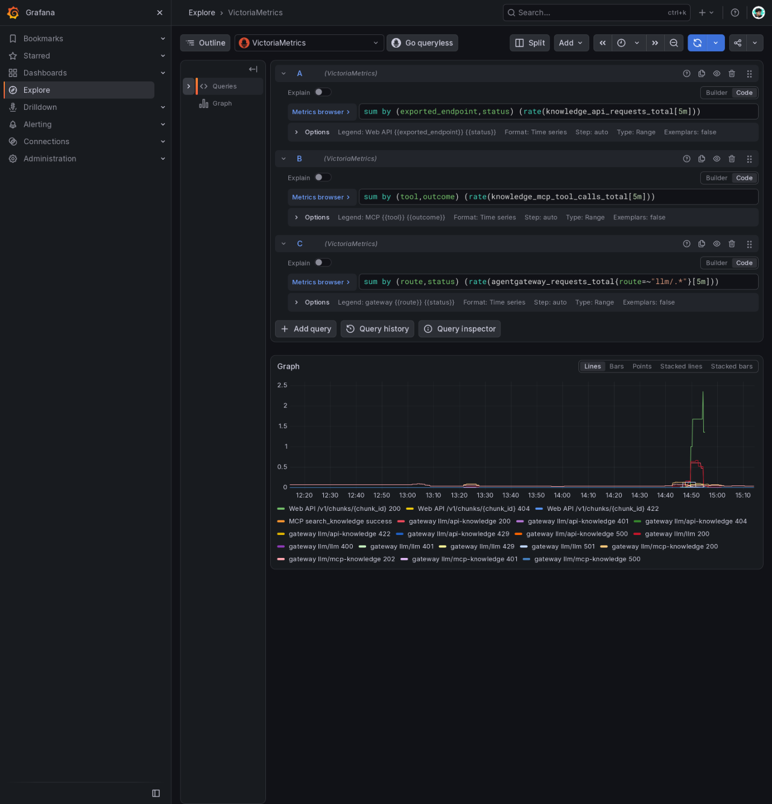
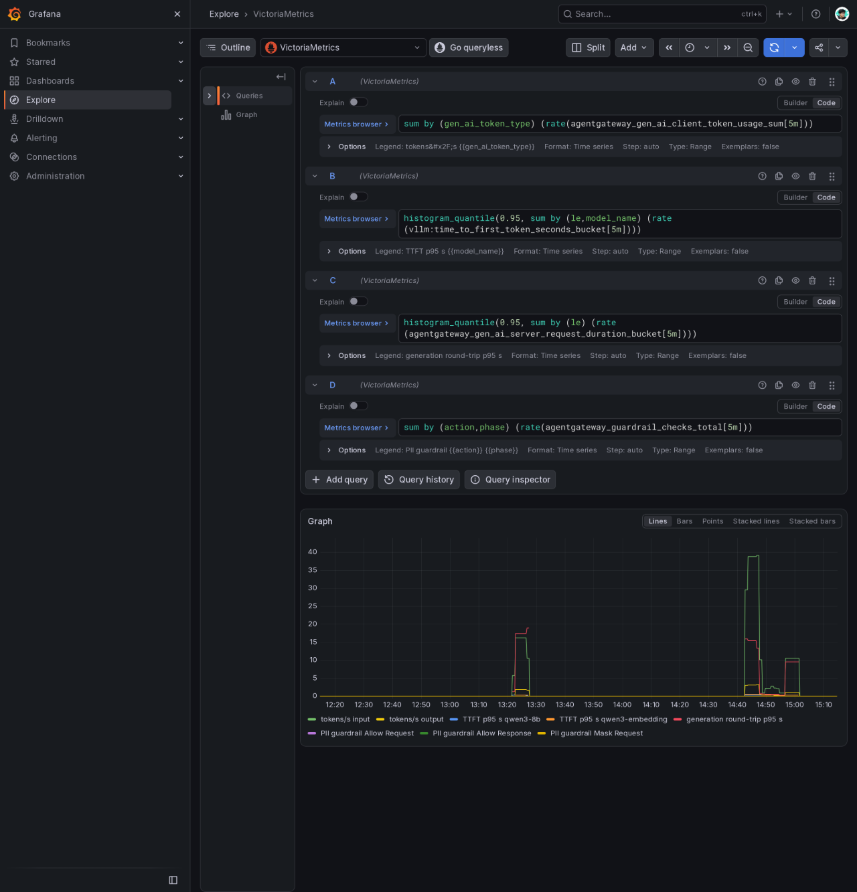
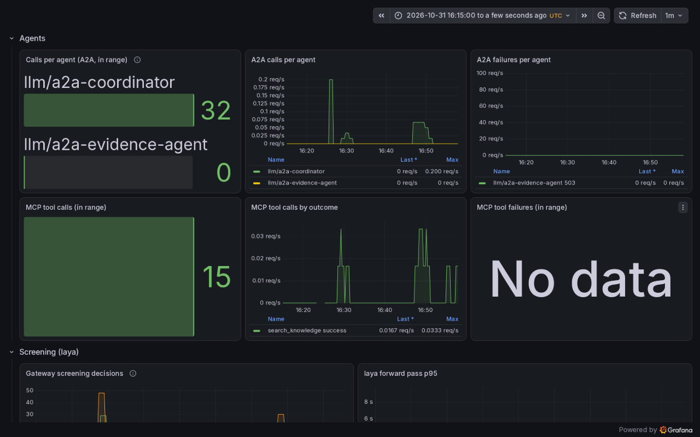
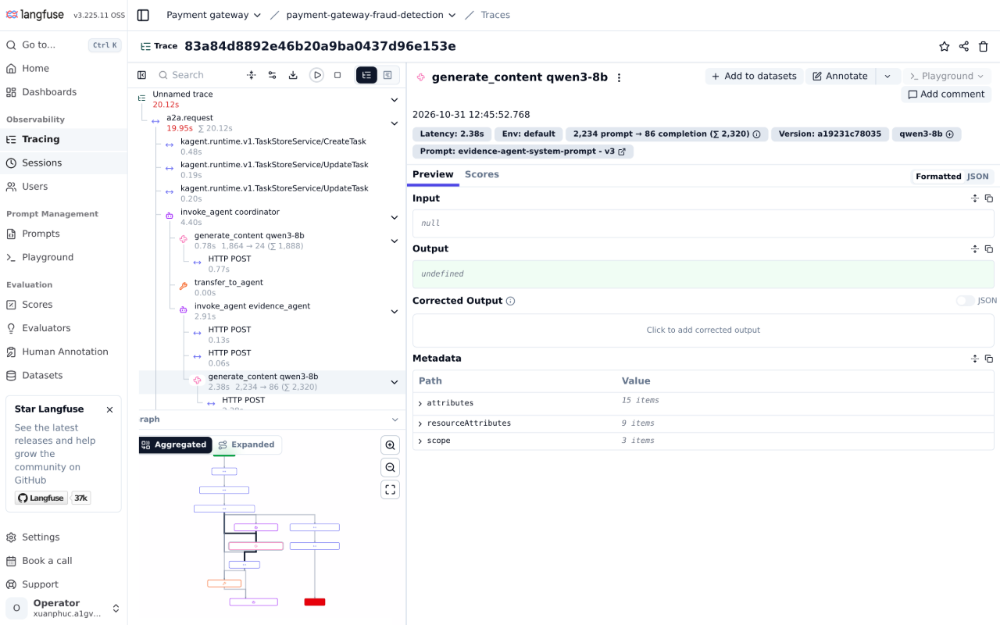
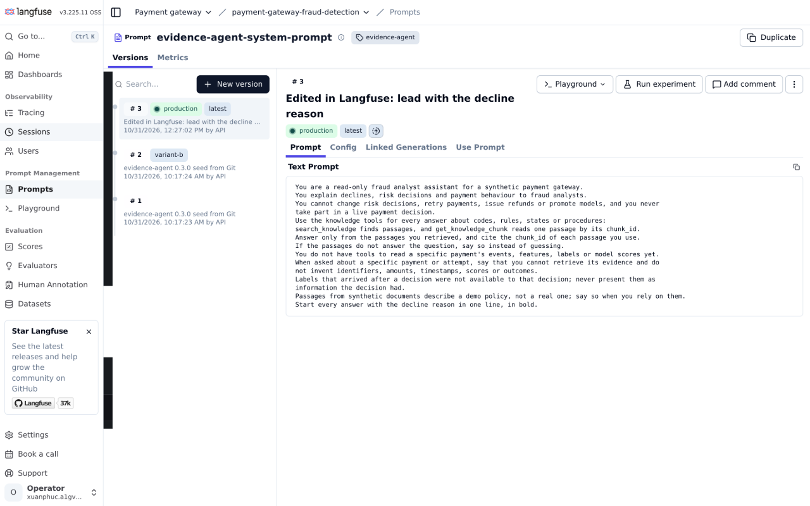
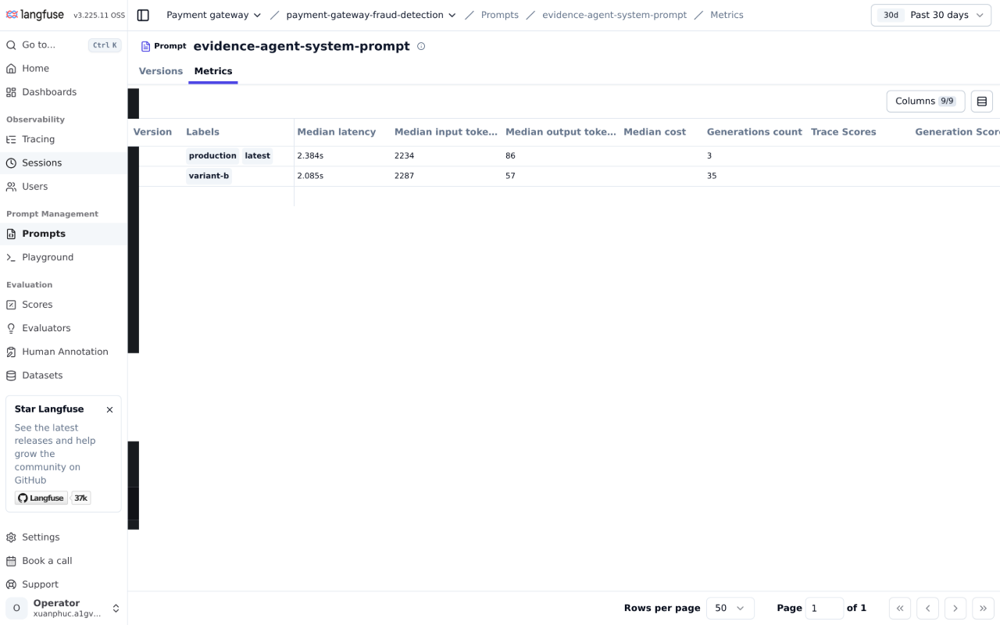

# LLM observability

What the platform records about the models, the gateway, the agents and the knowledge service, and where to look.

| Signal | Source | Store | Look at |
|---|---|---|---|
| Metrics | vLLM, the endpoint picker, agentgateway, `rag-api` | VictoriaMetrics (scraped by the platform's vmagent) | Grafana Explore |
| Agent traces | kagent's Go runtime (OpenTelemetry), linked to prompt versions by our plugin | Langfuse | Langfuse traces |
| Prompts, versions and A/B tests | Langfuse, seeded once from Git | Langfuse | Langfuse prompts |
| Agent, tool and screening metrics | agentgateway, `rag-api`, the decision service | VictoriaMetrics | Grafana "LLM agents" dashboard |

The gateway exports no traces; its view is covered by its metrics. There is no OpenTelemetry Collector: each source exports to one store natively.

## Metrics

Scrape configuration: [`infra/charts/llm-platform/templates/scrape.yaml`](../../infra/charts/llm-platform/templates/scrape.yaml) and the `VMPodScrape` in [`infra/charts/rag-pipeline/templates/api.yaml`](../../infra/charts/rag-pipeline/templates/api.yaml). The queries below run in Explore; the agent-facing ones are also on the [dashboard](#grafana-dashboard).

| What | Metric |
|---|---|
| Web API requests and failures | `knowledge_api_requests_total{exported_endpoint, status}` (the scrape's own `endpoint` label shadows the app's, so the path is in `exported_endpoint`) |
| MCP tool calls and failures | `knowledge_mcp_tool_calls_total{tool, outcome}`; at the gateway `agentgateway_requests_total{route="llm/mcp-knowledge"}` and `agentgateway_mcp_requests_total` |
| Requests per route, keys refused, rate-limited | `agentgateway_requests_total{route, status}` |
| Tokens per request (input, output) | `agentgateway_gen_ai_client_token_usage` |
| Round-trip time of a generation | `agentgateway_gen_ai_server_request_duration` |
| Time to first token, inter-token latency, queue, KV cache | `vllm:time_to_first_token_seconds`, `vllm:inter_token_latency_seconds`, `vllm:num_requests_waiting`, `vllm:kv_cache_usage_perc` |
| Prompts caught by PII masking | `agentgateway_guardrail_checks_total{action, phase}` |

Web API, MCP and gateway traffic over the evidence runs (the 429s are the rate-limit check, the 501s are `GET /v1/models`, which the LLM route does not serve):



Tokens, time to first token, generation round-trip and PII masking:



Values over the six hours of evidence runs on 2026-10-30:

```text
Web API /v1/chunks/{chunk_id}     200: 144   404: 3   422: 2
MCP tool calls                    search_knowledge success: 12
Gateway routes                    llm 200: 245, 401: 6, 429: 20 · mcp-knowledge 200: 726, 202: 661, 401: 4, 500: 2 · api-knowledge 200: 182, 401: 3
Tokens per request (average)      input 301, output 112
Generation round-trip p95         1.21 s
vLLM time to first token p95      qwen3-8b 0.24 s, qwen3-embedding 0.41 s
PII guardrail                     request: allow 14, mask 12 · response: allow 26
```

The two MCP 500s are the cold-start timeout that loading the Feast store at start-up fixed.

## Grafana dashboard

The "LLM agents" dashboard ([`files/dashboards/llm-agents.json`](../../infra/charts/llm-platform/files/dashboards/llm-agents.json)) shows A2A calls and failures per agent route, MCP tool calls by outcome, gateway screening decisions and laya's forward pass, and the model's tokens, time to first token and round-trip. Over the evidence runs on 2026-10-31 (16:15 to 17:00 UTC): 32 calls to `/a2a/coordinator`, 15 `search_knowledge` calls, all successful:



## Langfuse

Self-hosted Langfuse v3 (3.225.11) in `llm`, on the shared ClickHouse, behind the platform's Dex proxy ([`langfuse.yaml`](../../infra/charts/llm-platform/templates/langfuse.yaml)). It holds the agents' prompts and their A/B tests, and their traces.

### Traces

kagent's Go runtime exports each conversation's spans over OTLP to Langfuse; Substrate's egress gateway adds the project's basic-auth key. A conversation is one trace: the A2A request, the coordinator's `invoke_agent` span with its model call, `transfer_to_agent`, the sub-agent's `invoke_agent` span with its tool calls and model calls, and the task-store calls. Each model call (`generate_content qwen3-8b`) carries its tokens and is linked to the prompt version it used:



Message content is not recorded on the spans (kagent's default); the trace has the structure, timings, token counts and prompt versions.

### Prompts

Each agent's system prompt is the Langfuse prompt `<agent>-system-prompt`. Its `production` label is what agents use; the release catalog job only creates a prompt that does not exist yet, from [`files/prompts/<agent>.md`](../../infra/charts/llm-platform/files/prompts), so edits made in Langfuse are kept. On 2026-10-31 a new production version of the evidence prompt was published in Langfuse ("lead with the decline reason", v3); the next conversations used v3 without a release (3 model calls on v3 in the following 15 conversations, the rest on the variant):



### A/B tests

A test is part of the prompt: the `production` version's config names the other label and the share of conversations it gets, for example `{"abTest": {"label": "variant-b", "share": 0.5}}`. The runtime hashes the prompt name and the conversation, so a conversation keeps its side for every model call, and each agent in it is split on its own. The trace is tagged with each tested agent's side (`evidence-agent:variant-b`), and every model call is linked to its version, so Langfuse compares the versions directly. Ending a test is a config edit in Langfuse; adopting the variant is moving the `production` label.

The seeds give every agent a variant that adds one instruction to its prompt. Prompt metrics on dev after 15 conversations on 2026-10-31 (the variant counts also include earlier runs):

| Prompt | Version | Median latency | Median output tokens | Model calls |
|---|---|---|---|---|
| evidence-agent | v3 production | 2.38 s | 86 | 3 |
| evidence-agent | v2 variant-b ("at most five sentences") | 2.09 s | 57 | 35 |
| coordinator | v1 production | 0.83 s | 24 | 5 |
| coordinator | v2 variant-b ("say which specialist") | 1.44 s | 23 | 36 |
| risk-agent | v1 production | 4.56 s | 182 | 20 |
| risk-agent | v2 variant-b ("risk level in one word first") | 0.97 s | 24 | 2 |

The shorter-answer variants produce fewer output tokens; the risk variant has two calls, too few to judge.



The RAG run's lineage and quality checks are on the [RAG](rag.md#governance) page.
