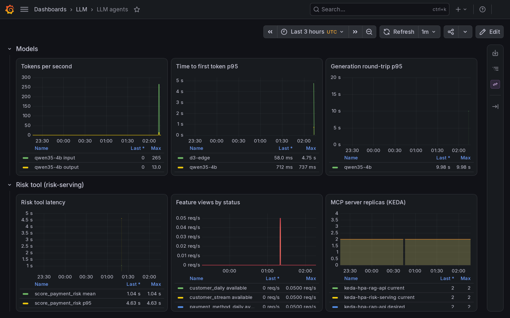

# LLM observability

What the platform records about the models, the gateway, the agents and the knowledge service, and where to look.

| Signal | Source | Store | Look at |
|---|---|---|---|
| Metrics | vLLM, the endpoint picker, agentgateway, `rag-api` | VictoriaMetrics (scraped by the platform's vmagent) | Grafana Explore |
| Agent traces | kagent's Go runtime (OpenTelemetry), linked to prompt versions by our plugin | Langfuse | Langfuse traces |
| Prompts, versions and A/B tests | Langfuse, seeded once from Git | Langfuse | Langfuse prompts |
| Agent, tool and screening metrics | agentgateway, `rag-api`, `risk-serving` | VictoriaMetrics | Grafana "LLM agents" dashboard |

The gateway exports no traces; its view is covered by its metrics. There is no OpenTelemetry Collector: each source exports to one store natively.

## Metrics

Scrape configuration: [`infra/charts/llm-platform/templates/scrape.yaml`](../../infra/charts/llm-platform/templates/scrape.yaml) and the `VMPodScrape` in [`infra/charts/rag-pipeline/templates/api.yaml`](../../infra/charts/rag-pipeline/templates/api.yaml). The queries below run in Explore; the agent-facing ones are also on the [dashboard](#grafana-dashboard).

| What | Metric |
|---|---|
| Web API requests and failures | `knowledge_api_requests_total{exported_endpoint, status}` (the scrape's own `endpoint` label shadows the app's, so the path is in `exported_endpoint`) |
| MCP tool calls and failures | `knowledge_mcp_tool_calls_total{tool, outcome}`; at the gateway `agentgateway_requests_total{route="llm/mcp-knowledge"}` and `agentgateway_mcp_requests_total` |
| Requests per route, keys refused, rate-limited | `agentgateway_requests_total{route, status}` |
| Tokens per request (input, output) | `agentgateway_gen_ai_client_token_usage` |
| Round-trip time of a generation | `agentgateway_gen_ai_server_request_duration` |
| Time to first token, inter-token latency, queue, KV cache | `vllm:time_to_first_token_seconds`, `vllm:inter_token_latency_seconds`, `vllm:num_requests_waiting`, `vllm:kv_cache_usage_perc` |
| Prompts caught by PII masking | `agentgateway_guardrail_checks_total{action, phase}` |

Current dev captures are kept with the components they describe: [gateway routing](gateway.md#routes), [Jev screening and PII guard decisions](novel-1-jev-policy.md#checks-on-dev), and [model time to first token](inference.md#checks-on-dev).

The risk server exports `risk_mcp_tool_calls_total{tool,outcome}`, `risk_tool_latency_seconds{tool}` and `risk_view_status_total{view,status}`. Tool failures are counted even when MCP transports the error with HTTP 200.

## Grafana dashboard

The "LLM agents" dashboard ([`files/dashboards/llm-agents.json`](../../infra/charts/llm-platform/files/dashboards/llm-agents.json)) shows A2A calls and failures per agent route, MCP tool calls by outcome, screen route calls, guard checks and screen latency, and the model's tokens, time to first token and round-trip. Its MCP panels count the knowledge and risk servers, and a Risk tool row shows the tool's mean and p95 latency, the feature view statuses, and an Autoscaling row with the KEDA replicas of both MCP servers and the agent worker pool. The ConfigMap carries the `grafana_folder` annotation from `dashboards.folder`, so the dashboard lands in the `LLM` folder like the other components' dashboards. On dev, `score_payment_risk` read 1.04 s mean and 4.63 s p95 over the 3 hours shown, every feature view `available`, and 2 replicas for both MCP servers:

## Langfuse

[Langfuse](langfuse.md) owns prompt versions, prompt A/B comparisons and agent traces. The [custom runtime](novel-2-go-adk-runtime.md) implements selection and trace linkage.

RAG governance uses OpenMetadata: the workflow publishes corpus → `knowledge.chunks` lineage, run status and contract-derived quality results.
