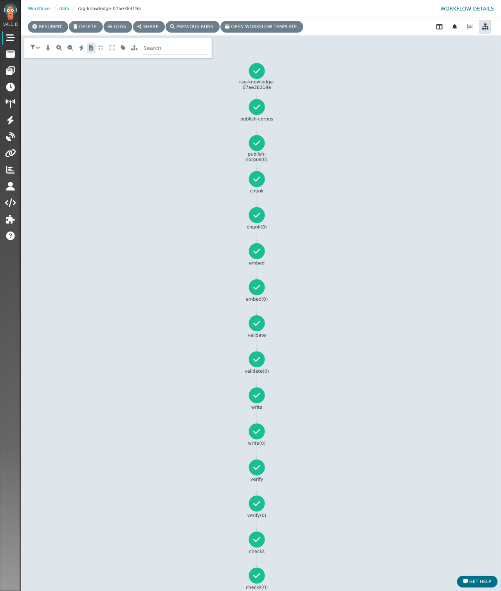
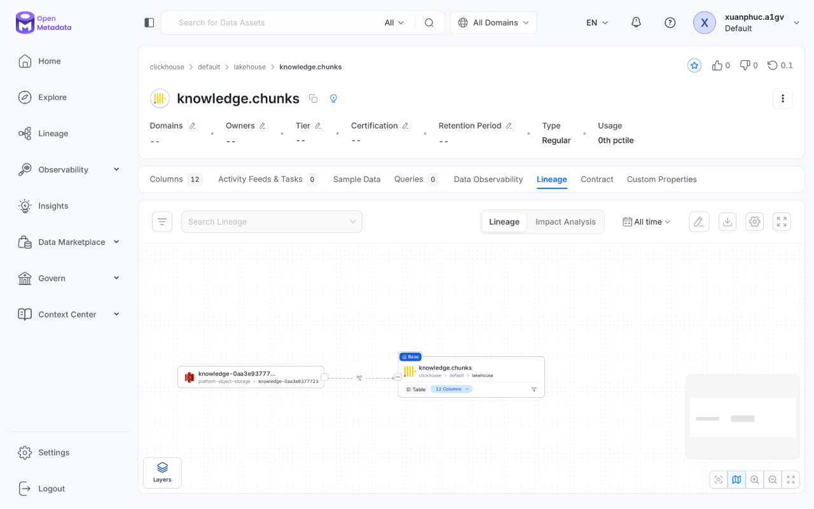
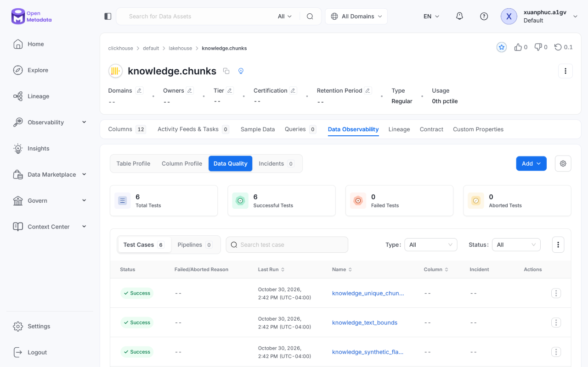
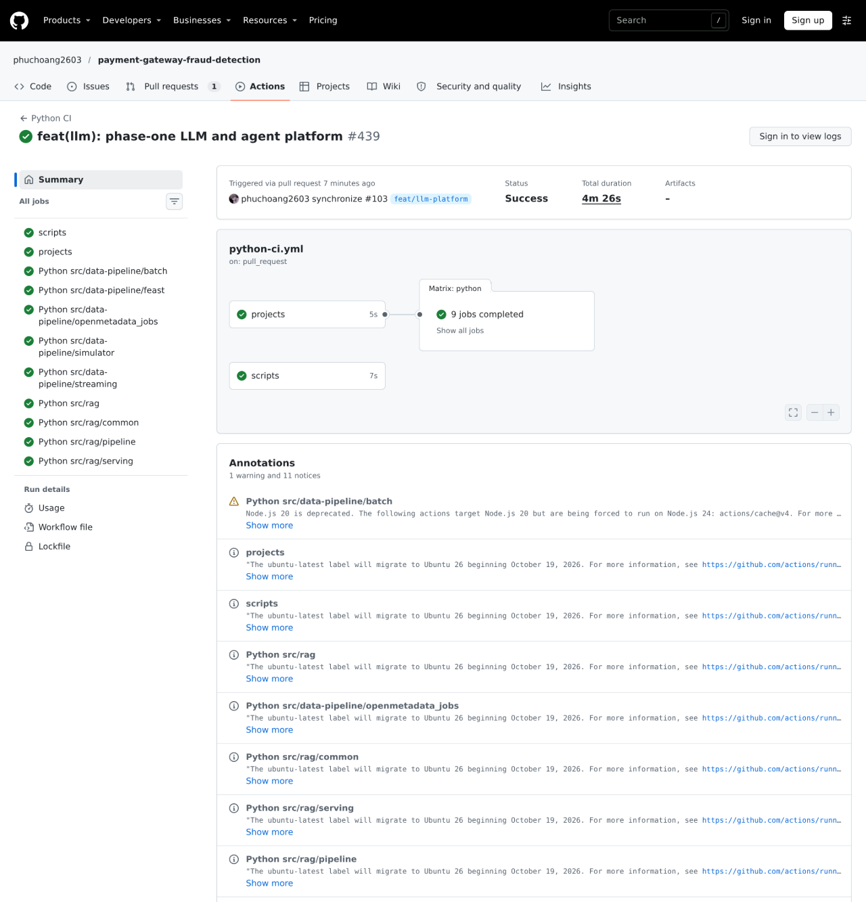
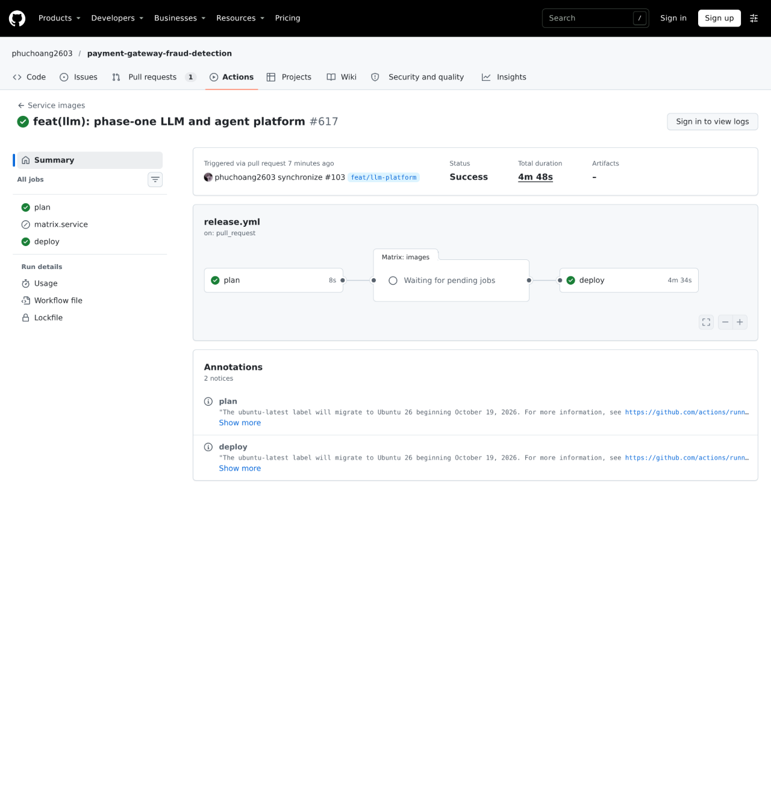

# RAG: knowledge pipeline, Web API and MCP tool

The agents answer from a small knowledge base about the payment gateway: decline codes, risk policy, the payment lifecycle, the checkout API, fraud features and support guidance. A pipeline turns documents into embedded chunks in a feature store, and one service serves them as a Web API (by id) and as MCP tools (search and read). It never reads payment data.

- Code: [`src/llm`](../../src/llm), a uv workspace: [`common`](../../src/llm/common) (Feast store, gateway embedding client), [`rag_pipeline`](../../src/llm/rag_pipeline) (corpus, chunking, validation, steps, OpenMetadata), [`rag_serving`](../../src/llm/rag_serving) (FastAPI + MCP) and [`decision`](../../src/llm/decision) (laya routing and screening).
- Deployment: [`infra/charts/rag-pipeline`](../../infra/charts/rag-pipeline), application `rag-pipeline` (workflow in `data`, store and API in `llm`). Images `rag-pipeline` and `rag-serving`.
- Contract: [`contracts/data-products/knowledge-base`](../../contracts/data-products/knowledge-base).

## Pipeline

```text
publish → chunk → embed → validate → write → verify → checks → (on exit) catalog
```

| Step | What it does |
|---|---|
| publish | Renders the corpus from the repository (specs, contracts, docs) plus six hand-written documents labelled synthetic, computes the knowledge version (a hash of the documents, chunker settings and embedding model revision) and stores it under an immutable prefix. If that version is already stored, every following step is skipped. |
| chunk | Splits by section heading, at most 280 words with 40 words of overlap; each chunk gets a stable `chunk_id` (`<doc>#<section-slug>`). |
| embed | Embeds every chunk through the gateway's `/v1/embeddings` with the pipeline's own client key. |
| validate | The quality gate, before anything is written: document coverage, embedding shape, no card number or e-mail in the text, synthetic documents flagged, and recall@3 on a golden question set. |
| write | Appends the version to the Iceberg table `knowledge.chunks` (the offline history, partitioned by version) and writes it through Feast to the pgvector online store, then types the vector column and builds an HNSW index (Feast does not). |
| verify | The online store equals the offline version (same hashes, no extra ids), and the search plan uses the HNSW index. |
| checks | The shared OpenMetadata checks job runs the ODCS contract's six rules on `knowledge.chunks` and records the results in the catalog. |
| catalog | Records the run status, the corpus container and the lineage container → `rag-knowledge` → `knowledge.chunks` in OpenMetadata. |

Each new `rag-pipeline` image starts one run, rendered as a `Workflow` named after the image tag (an ordinary resource, not a sync hook, so a failed run never blocks a sync). A run on an unchanged corpus exits early.

### Stores

| Store | What | Why |
|---|---|---|
| Iceberg `knowledge.chunks` (Polaris catalog, MinIO) | Every version's chunks and embeddings | History and the contract checks, next to the other data products |
| Feast feature view `knowledge_chunks` on CNPG Postgres + pgvector (`rag-pgvector`) | The current version, HNSW-indexed | Low-latency lookups by id and vector search for the API and the tool |

### A complete run on dev

Run `rag-knowledge-07ae38319a`, 2026-10-30 19:12–19:25 UTC, every step succeeded in 13 minutes:




```text
publish-corpus  {"knowledge_version": "0aa3e93777236677", "documents": 17, "skip": false}
chunk           {"chunks": 161}
embed           {"embedded": 161}
validate        coverage ok, embedding shape ok, no card or e-mail, synthetic flagged, golden recall@3 = 0.9
write           {"written": 161}
verify          online matches offline, no extra ids (161), search uses the HNSW index
checks          all 6 checks succeeded
catalog         {"status": "Successful", "lineage_edges": 1}
```

## Governance

The run's lineage and checks are in OpenMetadata, the same as the Bronze and Silver pipelines:



The contract's six SQL rules (row count, unique chunk id, text bounds, embedding shape, no card or e-mail, synthetic flagged) as data-quality results on `knowledge.chunks`:



## Web API and MCP tool (`rag-api`)

One FastAPI process serves both, so there is one deployment, one reader identity and no extra hop.

| Interface | Endpoint | Purpose |
|---|---|---|
| REST (`/v1`, routed as `/knowledge/v1` at the gateway) | `GET /v1/chunks/{chunk_id}` | The data-pull Web API: retrieval by id, with pydantic models and path validation; later also customer features by id |
| MCP (`/mcp`, routed as `/mcp/knowledge`) | `search_knowledge(query, top_k, audience)`, `get_knowledge_chunk(chunk_id)` | The agents' tools. Search embeds the question through the gateway and runs the HNSW query; it exists only as a tool because its callers are agents |
| Health | `/healthz` (liveness), `/readyz` (database reachable) | Kubernetes probes; readiness does not wait for a knowledge version, so the first deploy is not blocked by the pipeline |
| Metrics | `/metrics` | REST requests by path and status, MCP tool calls by tool and outcome |

- Handlers are async; Feast and Postgres calls run in worker threads. The Feast store loads in the background at start-up, so the first tool call after a rollout does not pay for it.
- The MCP server runs stateless with JSON responses, so any replica answers any request.
- Tools are discovered, not listed: kagent and the catalog job read them from `tools/list`, so a new tool is only a code change.

### Deployment, rollout and fallback

A Deployment, not a Knative Service: its callers are admitted by mesh identity, which Knative's cluster-local gateway cannot carry. Rollouts use `maxUnavailable: 0`, `maxSurge: 1`, readiness gating and a progress deadline, so a revision that never becomes ready stalls while the previous pods keep serving. A PodDisruptionBudget keeps one ready. KEDA scales it (below).

### Checks through the gateway

```text
GET /knowledge/v1/chunks/decline-codes%23new-account-geo-mismatch  →  200 {"chunk_id": "decline-codes#new-account-geo-mismatch", "title": "Decline and reason-code glossary", ...}
GET /knowledge/v1/chunks/decline-codes%23missing                   →  404 {"detail":"unknown chunk_id"}
GET /knowledge/v1/chunks/not-a-chunk-id                            →  422 string_pattern_mismatch on path.chunk_id
no key                                                             →  401
160 requests at once with one client's key                         →  140 × 200, 20 × 429
```

The MCP checks (tools/list, `search_knowledge`, 401 without a key, refused when bypassing the gateway) are on the [gateway](gateway.md#checks-on-dev) page.

### Load test and autoscaling

[`src/llm/rag_serving/loadtest/locustfile.py`](../../src/llm/rag_serving/loadtest/locustfile.py) requests chunks by id (19 of 20 requests real ids, 1 an unknown id that must return 404). It runs in the cluster as an on-demand Job, [`infra/charts/rag-pipeline/loadtest/job.yaml`](../../infra/charts/rag-pipeline/loadtest/job.yaml), against `rag-api` directly as the `llm-benchmark` identity, so it measures the API rather than the gateway's per-client rate limit. Run on 2026-10-30 with 60 users for 5 minutes; the full report is [`loadtest/knowledge-api-locust.html`](loadtest/knowledge-api-locust.html).

```text
Name                     # reqs   # fails |  Avg  Min   Max  Med |  req/s
GET /v1/chunks/{chunk_id}  39822   0 (0%) |  116   11  2520   84 | 133.21
GET /v1/chunks/{unknown}    2123   0 (0%) |  113   12  1751   81 |   7.10
Aggregated                 41945   0 (0%) |  116   11  2520   84 | 140.31

Percentiles (ms)   50%  75%  90%  95%  99%  99.9%  100%
Aggregated          84  140  230  310  560   1300  2500
```

KEDA scales `rag-api` from 2 to 4 replicas on its combined REST and MCP request rate (`knowledge_api_requests_total` plus `knowledge_mcp_tool_calls_total` in VictoriaMetrics, target 10 req/s per replica); the chart leaves `replicas` to KEDA. During the run:

```text
19:26:53  metric 0/10       ready replicas 2
19:29:25  metric 41/10      ready replicas 2   # HPA: "New size: 4; reason: external metric s0-prometheus above target"
19:30:11  metric 41/10      ready replicas 3
19:30:55  metric 41/10      ready replicas 4
19:34:21  metric 0/10       ready replicas 4   # load finished
19:39:11  metric 0/10       ready replicas 2   # HPA: "New size: 2; reason: All metrics below target" after the 5-minute stabilisation window
```

### Tests

[`src/llm/rag_serving/tests/test_service.py`](../../src/llm/rag_serving/tests/test_service.py) uses pytest fixtures and mocks for the store and the embedding client (a fake embedder counts gateway calls, the store functions are monkeypatched), and covers the REST paths (200, 404, 422), the MCP tools, validation before any gateway call, readiness, lazy loading, metrics and the app lifespan. The serving member enforces `--cov-fail-under=90`; in CI (Python CI run 41112821278, job `src/llm/rag_serving`, commit 724831f): 14 passed, 98.52% coverage.

```text
Name                            Stmts   Miss  Cover   Missing
fraud_rag_serving/__init__.py       0      0   100%
fraud_rag_serving/app.py          135      2    99%   177-178
TOTAL                             135      2    99%
Required test coverage of 90% reached. Total coverage: 98.52%
14 passed in 7.53s
```

## CI/CD

- CI runs lint, format and tests for each workspace member and builds the `rag-pipeline` and `rag-serving` images when their sources change (including the corpus sources the image copies in).
- The release publishes `deploy/dev`; Argo CD syncs the chart, and the new pipeline image starts its run.




