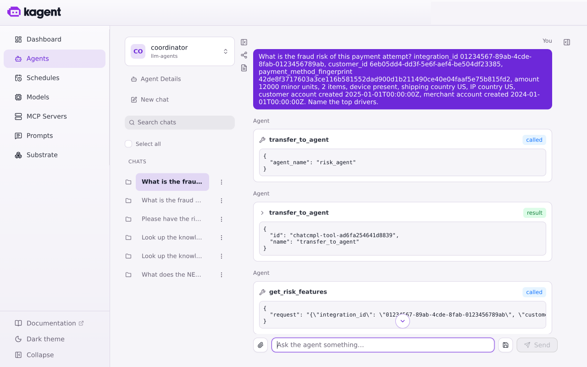
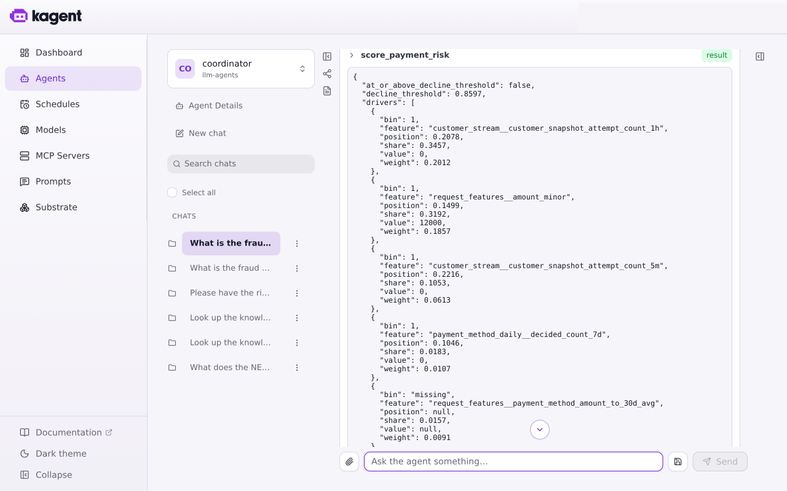
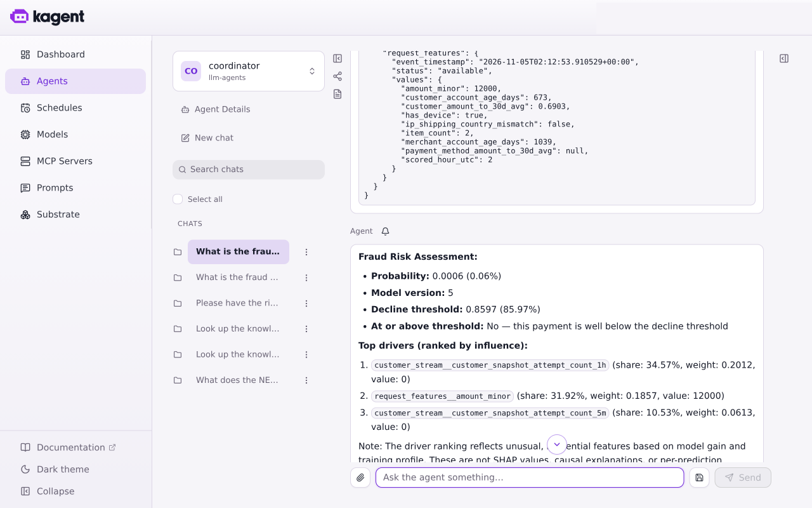
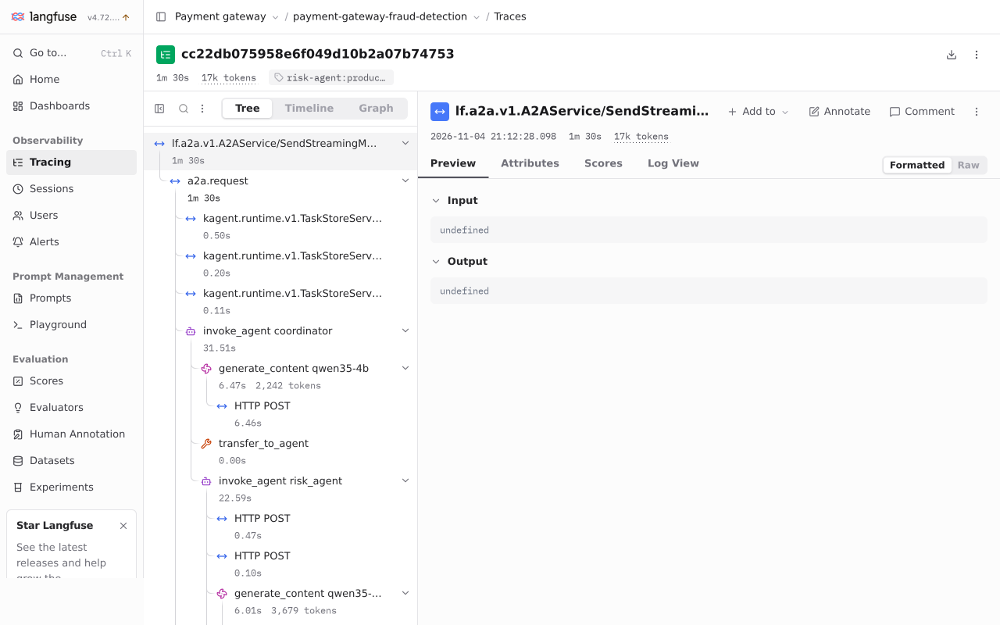
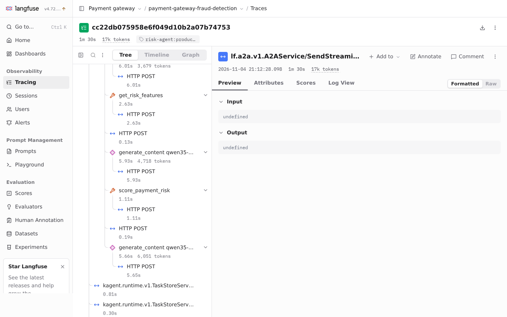
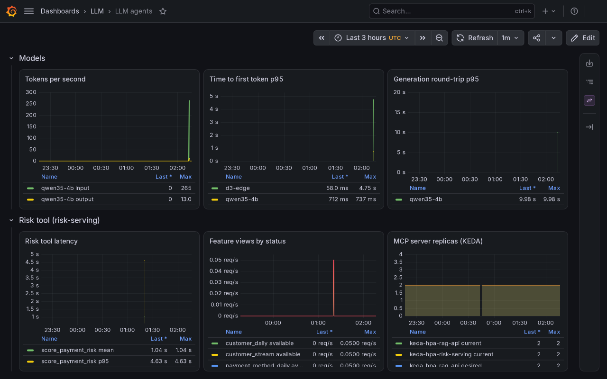

# Risk agent: scoring tool

`risk-agent` re-scores a payment with the served fraud model and explains what is unusual about it. It reaches the model through the `risk` MCP server (`risk-serving`), which the agent gateway exposes at `/mcp/risk`. Dev enables the server and `risk-agent` 0.2.0; production keeps the toolless 0.1.0 agent and has no risk server. The agent runtime, registry and prompts are in [Agents](agents.md); the knowledge tools are in [RAG](rag.md).

## Tool

The `risk` server accepts a `request` object with `integration_id`, `customer_id`, `payment_method_fingerprint`, `amount_minor`, both account-creation timestamps, `shipping_country`, `ip_country`, `item_count` and `has_device`. The tool sets the scoring time, so the result is a what-if re-score, not a stored decision.

| Tool | Returns |
|---|---|
| `get_risk_features` | The five `payment_risk_v1` views, each with its status (`available`, `missing`, `future`, `expired`, `error`, `timeout`) and values only when `available` |
| `score_payment_risk` | Probability, model version, decline threshold, `at_or_above_decline_threshold`, every view's status and the drivers |

Missing, expired, future or invalid views contribute NaN to Triton, including ratios derived from unavailable daily views. An upstream error returns no score. There is no step-up threshold in the served model configuration.

Drivers rank feature gain times distance from the training reference distribution; they are not per-prediction attributions. If the reference belongs to another version, the score carries no drivers and says why.

Every number in a result carries at most four decimals, because the gateway masks any run of 13 or more digits as a card number and a full-precision probability has more. `at_or_above_decline_threshold` is computed before rounding. The gateway's phone masking uses word-boundary patterns from `gateway.piiPatterns`, because the built-in `PhoneNumber` rule replaced a 7-digit run inside a payment-method fingerprint.

## Releases

On dev, `risk-serving` is a blue-green Rollout and KEDA targets its scale subresource. A dedicated analysis Job initializes MCP, lists the tools and calls the preview before promotion; a tool error or timeout blocks promotion and keeps the active revision serving. The knowledge server's release is in [RAG](rag.md#dev-releases).

| Release | Pre-promotion analysis | Outcome |
|---|---|---|
| `risk-serving` 785f66cfc5, first run | Failed: the Job's 60 s deadline, which counts the image pull | Previous revision stayed active |
| `risk-serving` 785f66cfc5, retry at 180 s | Successful in 26 s | Promoted |
| `risk-serving` 756dbb8686 | Successful | Promoted |
| `risk-serving` 5dcd89f99f, faulty: `MODEL_URL` points at a model server that does not exist | Failed in 27 s (19:40:22 to 19:40:49): `preview returned an MCP tool error` | Rollout aborted; the active Service kept selecting 756dbb8686, and the gateway scored 0.1967 at 19:40:05 during the rollout and at 19:41:09 after it |

The faulty candidate was made by pausing Argo CD's reconcile of the app with the `argocd.argoproj.io/skip-reconcile` annotation, patching one environment variable on the Rollout, and restoring it afterwards; the Rollout returned to Healthy on its original revision. Argo Rollouts skips the analysis on a first install, which has no previous revision to protect; that case was not run.

A new preview pod becomes an endpoint of its Service in the mesh a moment after it is Ready, and the Rollout starts the analysis in the same second it scales the preview up. The analysis client therefore waits up to 150 s for the MCP handshake and retries only connection failures, and the Job's deadline is 300 s.

## Proof on dev

A call to `/mcp/risk` through the gateway with the benchmark key returned 401 without a key, listed `get_risk_features` and `score_payment_risk`, and scored a dev customer at 0.1967 from model v4 against the decline threshold 0.5122, with all five views `available` (748 ms cold, 256 ms warm, three calls).

### Drivers after a retrain

The v4 reference profile recorded no feature gains, because the trainer did not name its features. After the fix on main, a dev retrain on the 4 GB card (`dev-retrain-gains-v5-b`, v4's snapshot and windows, 14 min 11 s, GPU fit 4 min 54 s on the GTX 1650) registered v5 and rolled it out. 48 of its 50 features carry a gain, led by `customer_snapshot_attempt_count_1h` (34.4% of the total), `amount_minor` (26.5%) and `customer_snapshot_attempt_count_5m` (11.0%). A retrain that passes only the snapshot and `force` skips training on dev when the stream tables no longer cover the 84-day window, so this run passed v4's four windows and cutoff explicitly.

### Chat

At 02:12 UTC on 2026-11-05 a kagent chat on v5 sent the coordinator an analyst question with a dev customer and fingerprint. The coordinator transferred to `risk_agent`, which called `get_risk_features` and `score_payment_risk` with the fingerprint unchanged:

The result is model v5, a score of 0.0006 against the decline threshold 0.8597, `at_or_above_decline_threshold` false, and five drivers: `customer_snapshot_attempt_count_1h` (34.57% of the ranking), `amount_minor` (31.92%), `customer_snapshot_attempt_count_5m` (10.53%), `decided_count_7d` of the payment method (1.83%) and `payment_method_amount_to_30d_avg` (1.57%, value missing):

The answer states the probability, model version, threshold, that the payment is below it, and the top drivers with the caveat that they are not SHAP values or per-prediction explanations:

One Langfuse trace covers the conversation, tagged `risk-agent:production`, with the coordinator, the risk agent and both tool spans between the model calls:

### Dashboard

The agents dashboard sits in the `LLM` Grafana folder, with the tool panels covering both MCP servers and a Risk tool row. It read 1.04 s mean and 4.63 s p95 for `score_payment_risk` over the 3 hours shown, every feature view `available`, and 2 replicas for both MCP servers:

### Autoscaling

The 5 calls/s target per replica is above what the dev chat and a single client generate. To see the scaling, the ScaledObject's target was lowered to 0.5 calls/s per replica for one run and set back to 5 afterwards, and a client sent 240 tool calls through the gateway at an average of 0.97 calls/s (233 succeeded, 7 failed, none rate-limited; the failures were not investigated):

| Time (UTC) | Metric / target | Replicas (desired) |
|---|---|---|
| 02:17:40 | 0 / 0.5 | 2 (2) |
| 02:19:15 | 0.725 / 0.5 | 2 (3) |
| 02:19:46 | 0.573 / 0.5 | 3 (4) |
| 02:20:01 | 0.430 / 0.5 | 4 (4) |

The scale-out took 2 → 3 → 4 in 46 s from the first reading over target. The ready count stayed at 3 of 4 until the sampler stopped at 02:24, and scale-down was not observed in that window. The 5 calls/s target itself is still untested, and no risk Locust test exists.

## Prompt

The Langfuse prompt `risk-agent-system-prompt` was published as `production` version 3, with the tool wording and the line asking whether the score is at or above the threshold, and the `variant-b` A/B version as version 4. The catalog seeds only missing prompts, so an existing prompt needs new versions in Langfuse rather than a release.

## Not verified

- A fresh conversation on prompt version 3 was not run. The kagent controller was in `CreateContainerError` after leader election was lost (176 restarts) and the A2A route answered 503, so the chat screenshots above are from the conversation before the publish.
- A first install of either Rollout, where the analysis is skipped.
- The 5 calls/s scaling target, scale-down, and why the fourth replica did not become ready.
- The removal of the charts' GPU placement has not been deployed to production, and the phone masking change is deployed on dev only.
